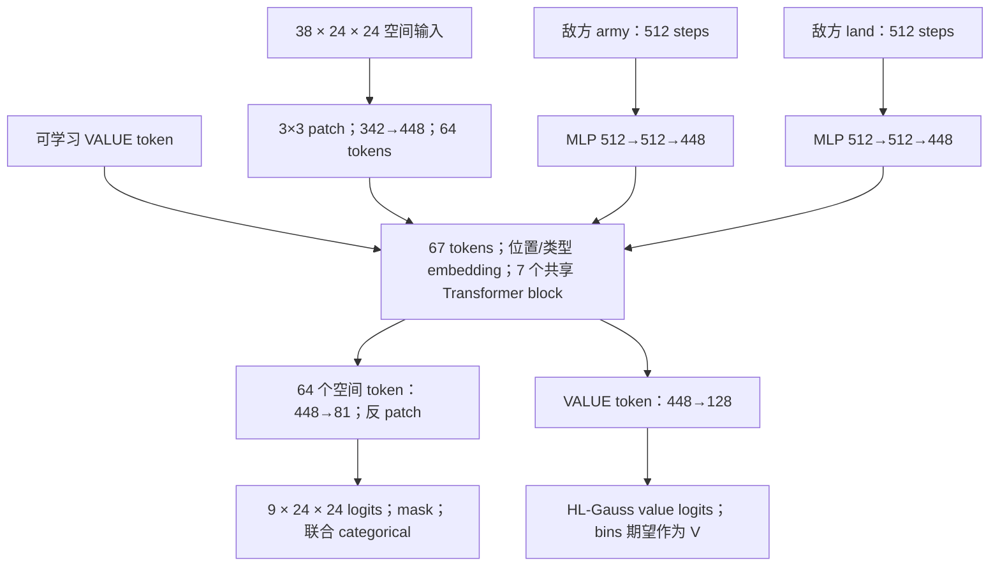

# AverageJoe 论文与当前 Generals RL 方案比较

调研日期：2026-10-16。本文只做论文、源码和现有实验记录的分析，没有修改训练方案或启动训练。

归档说明（2026-10-21）：下文的本地源码、配置哈希和实现描述对应调研时快照。整理后的正式训练入口是 v32-opt，旧 MoE 默认构造已退役；现行使用方法见 [RL 说明](../rl/README.md)，实验沿革见 [Auto research 记录](auto_research.md)。

## 1. 阅读范围与结论

用户给出的 [OpenReview PDF](https://openreview.net/pdf?id=Rb79jWnVDX) 对应 **Superhuman AI for Generals.io**。OpenReview 本次返回访问校验/HTTP 403，因此实际完整阅读的是作者同项工作的 [arXiv 2606.23348v1：Superhuman AI for Generals.io Using Self-Play Reinforcement Learning](https://arxiv.org/html/2606.23348v1)（含附录和 PDF 图表），并审计作者公开源码。**没有取得指定 OpenReview PDF 的正文，不能保证两个投稿版本逐字一致。** 以下将论文报告、公开实现和本地方案分开说明。

| 材料 | 固定版本与用途 |
|---|---|
| 论文 | Matej Straka、Viliam Lisý、Martin Schmid；arXiv `2606.23348v1`，2026-06-22；[PDF](https://arxiv.org/pdf/2606.23348v1) |
| 训练代码 | [strakam/AverageJoe](https://github.com/strakam/AverageJoe/tree/5041e635dcf6c87b8b844cb2e244ad3e0abe40d7)，`5041e635dcf6c87b8b844cb2e244ad3e0abe40d7` |
| 配套环境 | [strakam/generals-bots](https://github.com/strakam/generals-bots/tree/954927f508aa47899019d66317cc313af3e9cc19)，`954927f508aa47899019d66317cc313af3e9cc19`；这是调研时环境版本，不代表论文实验锁定版本 |
| 本地比较对象 | **v32-opt/current KL=.01**，以 [v32-opt.json](../rl/configs/v32-opt.json) 和 2026-10-16 工作区实现为准；历史 v32 仅作补充 |
| 本地版本边界 | HEAD `ada5b887257e8db70ba42c37a9e6e24a7627455d`；有未提交改动，HEAD 不能独自标识整个工作区 |

论文副本、作者源码克隆和本地关键文件哈希保存在忽略目录 `outputs/paper_reviews/Rb79jWnVDX/`；其中 `source_manifest.json` 记录具体来源。调研快照的配置 SHA256 为 `eb377db7eda6e06de22fb8b071337578146496f11b803cf6858926b9a8ea84f7`。它后来补入了评测后端等字段，与 v32-opt 验收时冻结配置并非字节相同。

我的判断：**值得借鉴的是一套围绕部分可观测、终局目标和计算效率组织的设计，而不只是把小 CNN 换成 15M Transformer。** 最优先的是选择性历史、公开统计的长期记忆、EMA 双评；随后独立验证稀疏奖励与出生距离课程、双座样本复用。大网络可以继续后置。

| 维度 | AverageJoe | 本地 v32-opt |
|---|---|---|
| 主要任务 | 17–23 边长、带迷雾的 1v1；pad 到 24×24 | 9×9、带迷雾的 1v1 |
| 空间输入 | 24 个基础/记忆通道 + 14 个兵力差分历史通道 | H4×12 地图通道 + K11 持久记忆；actor 额外己王相对 XY |
| 长期统计 | 敌方总兵力、总领地各 512 步，编码成两个 token | 网络只用最新一帧公开统计，没有这类长窗口 |
| 动作 | 单个联合 categorical，9×24² 个槽；包含 576 个重复 PASS | 单一 WAIT + 8×9² 个 MOVE；WAIT gate 与条件 MOVE 分布 |
| 奖励 | 纯终局 ±1，γ=1 | 终局 ±1 + 资源 PBRS + 前期 tick 惩罚，γ=.995 |
| Actor / critic | 共享 15.35M Transformer，同一局部信息集；分类价值头 | 独立小 CNN，总计 26,074 参数；critic 有全局 state、actor 历史及记忆 |
| 自对弈 | current-vs-current；双座都训练；EMA 用于评估/部署 | current-vs-current；当前只训练 learner 座；原 v32 用历史池 |
| 更新 | 每 GPU 512 局×512 tick，双座；筛选后 1 epoch | 16,384 局×32 tick，单座；4 epoch |

这些数字分别由作者 [特征实现](https://github.com/strakam/AverageJoe/blob/5041e635dcf6c87b8b844cb2e244ad3e0abe40d7/networks/common.py#L20-L185)、[网络](https://github.com/strakam/AverageJoe/blob/5041e635dcf6c87b8b844cb2e244ad3e0abe40d7/networks/transformer.py#L158-L280)、[匹配论文结构的发布配置](https://github.com/strakam/AverageJoe/blob/5041e635dcf6c87b8b844cb2e244ad3e0abe40d7/configs/custom/L_7d_gae90.yaml)及下文所列本地源码核对。调研时通用 CLI 的旧 MoE-CTS 默认构造不代表本表的 v32-opt 配置。

## 2. 特征工程：显式事实、短期变化、长期统计分开

### 2.1 作者实际输入

其观测没有循环网络隐状态，而是在玩家侧维护确定性的历史摘要。空间输入为 **38×24×24**，另外输入两条长度 512 的公开统计序列。38 通道不是“38 通道再完整堆叠 7 帧”。[来源：common.py](https://github.com/strakam/AverageJoe/blob/5041e635dcf6c87b8b844cb2e244ad3e0abe40d7/networks/common.py#L77-L185)。

| 通道 | 输入内容 | 时间语义 |
|---|---|---|
| 0–3 | 当前可见总兵力、己方兵力、可见敌方兵力、可见中立兵力 | 当前值；不可见兵力置 0 |
| 4 | 曾经看见的区域 | 累计己方格 3×3 邻域 |
| 5 | 观察到的敌方格之 3×3 邻域的累计区域 | 从局部观测推导；不是真实敌方完整视野 |
| 6–8 | 曾经揭示的王位、城市、山地 | 固定地图地标记忆；王位通道合并己敌 |
| 9–13 | 中立、己方、敌方、普通迷雾、迷雾结构 | 当前观测分类 |
| 14–15 | 绝对 tick、50 tick 生产周期相位 | 当前时间 |
| 16–19 | 己方土地/兵力、敌方土地/兵力 | 当前公开计分板 |
| 20–21 | 各格最近见过的正数敌兵量、距该次观察的 age | 历史记录，不是当前兵力估计的真值 |
| 22–23 | 全图归一化 x/y 坐标 | 绝对空间位置 |
| 24–30 | 最近 7 步逐格己方兵力差分 | 最新在前，可为负 |
| 31–37 | 最近 7 步逐格可见敌兵差分 | 最新在前，可受显隐变化影响 |

兵力、土地和绝对时间主要除以 50；age 为 `log1p(age)/5`；坐标除以 `pad_to−1`。这不是 log-army，也不是 running normalization，部分输入可远大于 1。[归一化实现](https://github.com/strakam/AverageJoe/blob/5041e635dcf6c87b8b844cb2e244ad3e0abe40d7/networks/common.py#L303-L319)。

另有敌方公开总兵力、总土地的 512 步队列，每步更新。两个独立 MLP 分别做 **512→512→448，SiLU**，得到两个 summary token，再和空间 token 一起进入 Transformer。类构造器虽然默认 hidden=1024，但该网络明确传入 512，实际也不是 GELU。这些统计来自公开 scoreboard，不属于 privileged state 泄露。[队列更新](https://github.com/strakam/AverageJoe/blob/5041e635dcf6c87b8b844cb2e244ad3e0abe40d7/networks/common.py#L144-L149)、[TemporalEncoder 与实际构造](https://github.com/strakam/AverageJoe/blob/5041e635dcf6c87b8b844cb2e244ad3e0abe40d7/networks/transformer.py#L90-L123)、[隐藏宽度](https://github.com/strakam/AverageJoe/blob/5041e635dcf6c87b8b844cb2e244ad3e0abe40d7/networks/transformer.py#L158-L221)。

这有明确的任务意义：几百 tick 内的敌方扩张速度、生产变化、战损和囤兵过程，无法仅靠最近几帧局部图像重建。长统计窗口比同长度的图像历史便宜，也不要求保存 512 张棋盘。但在本地16384环境下，FP32的两条512步序列仍占每座64MiB；若朴素地为32步rollout逐样本复制，额外约2GiB/座。实现时应比较摘要、降采样或历史共享存储，不能把它当作无内存成本的特征。

### 2.2 必须准确理解的记忆语义

1. **ch5 是敌方占领格邻域的累计。** 论文附录将它简写为曾见敌人的位置；代码额外做了 3×3 max-pool。它可以近似提示“敌人可能看过哪里”，但不能当作已知敌方视野。[实现](https://github.com/strakam/AverageJoe/blob/5041e635dcf6c87b8b844cb2e244ad3e0abe40d7/networks/common.py#L111-L142)。
2. **ch20/21 只在看见正数敌兵时刷新。** 如果后来重新看见空格/己方格，旧敌兵数不会清掉；从未见过敌兵的格 age 也会增长。迁移时应增加 valid 标志，或区分“距最近可见”和“距最近见敌”两种 age，避免把过期记录当成现状。
3. **敌兵差分混合了战斗、移动、增长和出入迷雾。** 例如敌军消失使输入归零，不等于敌兵死亡。差分必须和 visibility、记忆通道一起解释。
4. **迷雾结构有版本差异。** 论文附录把 general 也列入该通道；调研的环境版本实际使用 `mountains | castles`，不包含 general。不能通过这个通道直接推定未知敌王。[当前环境观测](https://github.com/strakam/generals-bots/blob/954927f508aa47899019d66317cc313af3e9cc19/generals/core/game.py#L663-L695)。

论文关于不依赖人工先验的表述，不能理解成“没有特征工程”：显式地图记忆、差分历史、公开统计、坐标和周期编码都属于人工设计的表征。其重要特点是没有依靠人类演示或手写战略来规定具体行为。

### 2.3 我们已有的设计与缺口

本地单帧为 `12×81+13=985` 维；H4 后 3940 维，K11 为 891 维，actor 声明输入合计 4831。实际 CNN 使用 H4 地图 48 通道 + K11 + 己王相对 XY2 = **61 通道**，公开标量只读取最新 13 维；优化版执行补齐至 64 通道。actor 没有利用旧帧的公开标量。[observations.py](../rl/src/generals_rl/mdp/observations.py)、[information_ppo.py](../rl/src/generals_rl/information_ppo.py)、[optimized_ppo.py](../rl/src/generals_rl/optimized_ppo.py)。

12 个地图通道为：`visible/plain/mountain/city/general/self/enemy/empty/neutral/log_army/enemy_attack_risk/combat_margin`。兵力采用 `log1p(army)/10`。后两项根据可见四邻域、公开下一步增长估算最大单路敌军威胁和单路攻防余量，不是对联合动作的精确预测。[combat.py](../rl/src/generals_rl/mdp/combat.py)。

K11 已包含：`explored, mountain, last_seen_city, general_landmark, enemy_general_landmark, not_enemy_general, last_seen_empty, last_seen_neutral, last_seen_owner_0, last_seen_owner_1, last_seen_age`。其中归属和城市是最近观察记录，不能全部叫作永久事实；王位地标及已排除敌王位置的语义更持久。记忆按玩家独立维护，并在 reset 清空。[knowledge.py](../rl/src/generals_rl/mdp/knowledge.py)。

| 能力 | 我们现在 | 借鉴价值 |
|---|---|---|
| 敌王位置、非敌王位置、地形记忆 | 已有，部分区分甚至更细 | 保留，不必重写成作者通道 |
| 最近归属及观察 age | 已有 | 增加敌军数值记忆时复用现有记忆模块 |
| 最近正数敌兵量及专用 age | 尚无对应显式通道 | 高；有利于追踪刚进雾的威胁 |
| 短期兵力变化 | H4 原始地图可间接推导 | 显式 delta 可降低学习负担，并以较低成本延长历史 |
| 敌方可能已探索区域 | 无专门累计通道 | 可试，但必须保留“推断”的语义 |
| 512 步 scoreboard 历史 | 无 | 高；直接补充当前网络欠缺的长期信息 |
| 战术风险、己王相对坐标 | 已有专门设计 | 论文没有同样手工战术通道，不能假定删掉更好 |

**建议先比较 H4、H4+delta、精简当前通道+H8 delta，而不是把全部 12 通道机械地堆叠至 H8。** 在现有 CNN 上，长期统计可以先用差分、斜率、若干尺度窗口均值/增量或小 MLP，再决定是否需要完整 512 步编码。论文提供的是方向，不是证明 7 步、512 步在 9×9 上最优。

## 3. 动作空间：联合空间策略可借鉴，重复 PASS 不建议照搬

### 3.1 作者的动作编码

网络输出 `9×P×P`，`P=24`，共 **5184 个离散槽**。前 4 平面为四方向留一兵移动，接着 4 平面为四方向半兵移动，第 9 平面为 PASS；flatten 后做一个全局 categorical。环境接收 `[is_pass,row,col,direction,is_half]`。所谓 full 是 `army−1`，half 是 `army//2`。[编码/解码](https://github.com/strakam/AverageJoe/blob/5041e635dcf6c87b8b844cb2e244ad3e0abe40d7/networks/common.py#L239-L275)。

移动 mask 要求源格己方、兵力>1，目标在图内且不是当前可见山地；两种移兵量共用方向 mask。它没有禁止所有不划算攻击或来回走动。[环境 mask](https://github.com/strakam/generals-bots/blob/954927f508aa47899019d66317cc313af3e9cc19/generals/core/action.py#L42-L65)。

**PASS 平面的 576 个位置全部合法，连 padding 也合法；它们在环境中语义完全相同。** 所以不能将论文的动作头写成 `8HW+1`。[PASS mask](https://github.com/strakam/AverageJoe/blob/5041e635dcf6c87b8b844cb2e244ad3e0abe40d7/networks/common.py#L281-L300)。

设 K 是合法的“源格、方向”组合数，各合法 logit 相同，数学上有：

\[
P(\mathrm{PASS})=\frac{P^2}{P^2+2K}.
\]

在这些合法logit相同的条件下，PASS会拥有较大概率质量；实际网络初始化分布没有测量。总熵还包括了在语义相同PASS之间分配概率的熵。它是否有利需要实验，不能直接归因为故障。比较探索程度时，应先聚合PASS，再比较**环境语义上的动作熵**。

### 3.2 我们的动作和分布

我们是 **649 类**：`WAIT=0`，其余为 `1+source×8+direction×2+mode`。mask 排除非己方、越界、山地和预测移兵量为零的动作，后者考虑公开可预测的下一 tick 增长。WAIT 始终合法。[actions.py](../rl/src/generals_rl/mdp/actions.py)。

当前不是对 649 个 logits 直接做普通 softmax，而是：

\[
P(\mathrm{WAIT})=\sigma(w),\qquad
P(m_i)=(1-\sigma(w))\operatorname{softmax}(z_{\rm valid})_i.
\]

没有合法 MOVE 时强制 WAIT。因此，**我们的 WAIT 初始先验不能套用普通单 WAIT softmax 的 `1/(1+2K)` 公式**；门控 logit 为 0 时有合法移动就对应 50% WAIT。这也不是把 source/direction/mode 拆成三个独立动作。[分布实现](../rl/src/generals_rl/spatial_ppo.py)。

建议保留现有环境动作协议与 mask。未来不论换 CNN、ViT 或 MCTS，网络都可以输出统一的逐格八移动 logits 和一个 WAIT。若真要保持作者分布且合并重复 PASS，需用 `logsumexp` 聚合全部 PASS logits，而不是随便取其中一个；但那依然不是我们当前的门控分布。

## 4. Reward 与 critic 目标

### 4.1 作者：稀疏胜负与距离课程配套

实际训练入口直接绑定 `win_lose_reward`：胜者 +1、败者 −1，其余 0；无 tick、土地、兵力、探索或城市奖励。γ=1、GAE λ=.9。部分旧 YAML 还残留 shaping 或 population 字段，但不能据此认为当前训练使用它们。[reward 实现](https://github.com/strakam/AverageJoe/blob/5041e635dcf6c87b8b844cb2e244ad3e0abe40d7/train/rewards.py#L10-L12)、[实际绑定](https://github.com/strakam/AverageJoe/blob/5041e635dcf6c87b8b844cb2e244ad3e0abe40d7/train/ppo.py#L217-L232)。

为了让随机策略早期能产生终局信号，先在近距离出生条件下训练，再提高 BFS 出生距离。论文正文描述从最大距离约 4 开始；所审计发布配置实际为 **[2,6]→[4,8]→[6,13]→[11,17]→[17,28]**。后续阶段阈值 .6，由对 random 的评估胜率触发；切换时重新设置地图池并重置训练对局/观测记忆。`pool_size=200000` 指地图池，不是对手模型池。[配置](https://github.com/strakam/AverageJoe/blob/5041e635dcf6c87b8b844cb2e244ad3e0abe40d7/configs/custom/L_7d_gae90.yaml#L1-L40)、[课程推进](https://github.com/strakam/AverageJoe/blob/5041e635dcf6c87b8b844cb2e244ad3e0abe40d7/train/ppo.py#L395-L442)。

论文 §VII-A 的三次运行对照中，sparse 更稳，shaped 后期下降。它支持“在足够终局吞吐和合适课程下，应认真测试纯胜负奖励”，但**不是我们 PBRS 有问题或 v36 崩溃原因已被证明的证据**。[论文消融](https://arxiv.org/html/2606.23348v1#S7.SS1)。

### 4.2 我们：PBRS 仍一直存在，只有 tick 项衰减

v32-opt 使用：

\[
\Phi(s)=0.05T_{\rm self}+0.2C_{\rm self}+0.001A_{\rm self},
\]
\[
r_t=r^{\rm terminal}_t+0.995\Phi(s_{t+1})-\Phi(s_t)
-0.001\max(0,1-u/1000),
\]

其中u为从0起的TensorBoard update索引，胜负仍是±1；真正终局下一势函数置0，timeout保留势函数并bootstrap。**资源PBRS不衰减，gamma固定.995；不是1000 update后只剩胜负奖励。** [rewards.py](../rl/src/generals_rl/mdp/rewards.py)、[curriculum.py](../rl/src/generals_rl/curriculum.py)、[task.py](../rl/src/generals_rl/task.py)。

需要区分理论目标与实际优化：当 discount、一致的终局处理等条件满足时，PBRS 的折扣和会望远镜消去，改变的是初始状态常数，而不是简单地把“囤资源”设成最终目标。因此不能直接照搬论文对 shaping 的因果解释。但在有限 rollout、近似 value、PPO clipping、时间截断及非平稳对手下，shaping 仍可能改变优化难度和误差，值得用对照验证。

γ=.995 时，等待 200/500 tick 的单次奖励折扣约 .367/.082；γ=1 不因时长折扣终局胜负。这是实际目标差异：前者更看重尽快兑现收益，后者更接近只问最终输赢。改变 γ 时必须同步设置 PBRS 的 `potential_gamma`，避免奖励与价值目标不一致。

建议在小网络上做“当前奖励”与“纯胜负+近出生课程”两组，再单独比较 γ=.995/.999/1。不要一次同时更换历史、模型、奖励和所有超参；也不应把 reward decay 当作论文已经验证的方案——作者主要使用的是**初始即稀疏奖励 + 地图课程**。

### 4.3 分类价值头与 timeout 的迁移边界

作者 critic 使用 128 个 `[-1,1]` bin，GAE return 经 σ=.04 的 Gaussian 平滑成软标签，以交叉熵训练；预测值为 bins 的概率加权平均。这是 HL-Gauss，不是 MSE，也不是仅分类“赢/输”的二分类头。[HL-Gauss 实现](https://github.com/strakam/AverageJoe/blob/5041e635dcf6c87b8b844cb2e244ad3e0abe40d7/train/ppo.py#L73-L99)。

纯终局 ±1、γ=1 的真实期望回报在该范围内；有平局时也不能简单等同校准胜率。**我们的 shaped value 还包含大约 `−Φ(s)` 的偏移，不能直接照搬 `[-1,1]` bins。** 若测试 HL-Gauss，应使用匹配目标的范围/变换，或在严格验证价值偏移换算后拟合无 shaping 的 base value。当前 `value_potential_offset=false`，并没有这项换算。

作者的 timeout 处理也不应原样移植：rollout 尾部使用 final state bootstrap，但中途 autoreset 的截断点 next value 会来自重置状态；其 workaround 是将截断点 loss mask 掉，并阻断该点的 GAE carry。该点仍先参与归一化/筛选。我们已有 reset 前 terminal observation bootstrap，应保留这一逻辑，再独立比较 truncation objective。[作者 rollout](https://github.com/strakam/AverageJoe/blob/5041e635dcf6c87b8b844cb2e244ad3e0abe40d7/train/rollout_selfplay.py#L105-L118)、[GAE](https://github.com/strakam/AverageJoe/blob/5041e635dcf6c87b8b844cb2e244ad3e0abe40d7/train/ppo.py#L21-L41)、[训练 mask](https://github.com/strakam/AverageJoe/blob/5041e635dcf6c87b8b844cb2e244ad3e0abe40d7/train/ppo.py#L495-L501)、[本地 bootstrap](../rl/src/generals_rl/student_ppo.py)。

## 5. Actor 与 critic 网络

### 5.1 AverageJoe：共享 Transformer 与两种输出头

下图按所审计源码绘制，而非复制论文配图：

每块是 Pre-LN attention + residual、Pre-LN FFN + residual；8 heads，每 head 56 维；FFN **448→1344→448，SiLU**，最后还有 LayerNorm。位置 embedding 固定覆盖 67 tokens；两个 temporal token 有类型 embedding。主干 bf16，attention softmax、动作/value 输出使用 fp32；无 RNN、BPTT 或 dropout。[主干与输出头](https://github.com/strakam/AverageJoe/blob/5041e635dcf6c87b8b844cb2e244ad3e0abe40d7/networks/transformer.py#L23-L85)、[构造及 forward](https://github.com/strakam/AverageJoe/blob/5041e635dcf6c87b8b844cb2e244ad3e0abe40d7/networks/transformer.py#L158-L280)。

按源码形状计算，参数数组元素共 **15,351,761**，含 128 个固定 bin centers；扣除后可训练参数约 **15,351,633**。这是 actor/critic **共享的总量**，不是两套各 15M。每个 patch 输出 81 logits，才能恢复到每格 9 logits；不能把附录的简写误读成每 patch 仅 9 logits。

critic 使用和 actor 相同的局部输入及其历史摘要，没有 full-state privileged 输入。VALUE token 是共享网络中的聚合入口，并没有另一个独立 critic Transformer。

### 5.2 我们：独立小 CNN，critic 已经包含 actor 信息

当前 actor 12,281 参数，critic 13,793 参数，共 **26,074**。两者各为两层 3×3、16 通道 CNN/ELU，加全局池化与公开统计 context，参数不共享。[spatial_ppo.py](../rl/src/generals_rl/spatial_ppo.py)、[information_ppo.py](../rl/src/generals_rl/information_ppo.py)、[optimized_ppo.py](../rl/src/generals_rl/optimized_ppo.py)。

| 项目 | Actor | Critic |
|---|---|---|
| 地图输入 | H4 地图48 + K11 + 己王相对XY2 =61 | 当前 privileged12 + H4局部48 + K11 =71 |
| 优化版执行通道 | 补至64 | 补至72 |
| CNN | 61→16→16，3×3 | 71→16→16，3×3 |
| context | GAP16 + 当前局部public13 → FC16/ELU | GAP16 + privileged public13 + 局部public13 → FC16/ELU |
| 输出 | context广播到地图后输出每格8移动；另有WAIT头 | pooled/context拼接，FC16/ELU→标量V |
| 特权信息 | 无 | 有当前全局state；同时有actor的H4/K11 |

两层 CNN 的直接空间感受野为 5×5；全局池化 context 提供全图聚合，但它不能等同于 Transformer 的任意位置间内容相关交互。这是容量与结构上的限制，不能仅用“参数小”解释所有失误。

此前“critic需要知道actor是否看过敌王”的问题，我们目前已在输入设计上通过critic同时读取H4/K11处理；但这只说明信息可获得，尚不能证明网络确实有效利用。无需再从只看state的critic开始修复。作者采取了另一个一致方案：actor/critic完全共享同一局部信息集。

两种方案各有取舍：privileged critic 可降低状态不确定性，却必须保留玩家历史以区分知识状态；共享主干省计算、让价值目标参与学习 actor 表征，但可能产生梯度干扰。论文并未单独证明“去掉 privileged critic”或“共享比独立更好”。可以先试共享局部编码器 + 仅 critic 额外接 privileged 分支，把容量与信息集变更分开。

### 5.3 对我们之前大网络过慢的启示

本仓库已经有 [map_ppo.py](../rl/src/generals_rl/map_ppo.py) 和 [scaled_ppo.py](../rl/src/generals_rl/scaled_ppo.py) 中可选的 ResNetV2/ViT、动态 geometry 和 1M/10M/100M 预算；**并非尚无大网络实现**。但 v32-opt 的验收效果只对应上述小 CNN。现有 ViT 路线主要是一格一个 token，独立 actor/critic；这和作者的共享、patch=3 不是等价配置。

24×24 时，patch1 加3个非空间 token 是579 tokens，patch3 是67 tokens，单层 attention score 元素数之比约 **74.7 倍**。这是矩阵规模推算，**不是端到端提速实测**；线性层、FFN 和实现开销也占时间。9×9 时只对应84对12 tokens，不能直接沿用24×24的比例来预测速度。

作者用 patch 后的小序列承载较大参数容量，并在 patch 内重新输出逐格 logits；因此 patch=3 不必牺牲动作分辨率。未来恢复网络探索时，应优先比较共享 backbone、patch2/3、逐格还原头与现有 patch1 的**相同参数量、相同墙钟预算**，不先增加深度。

地图尺寸方面，作者训练17–23边长，通过 pad24兼容；固定位置 embedding 限制了默认最大布局。它不是开箱支持任意更大地图的证据。我们的动态几何/位置插值有其价值，未来还需显式 valid-cell mask、padding和尺寸泛化测试；本地批内混合地图尺寸也不是已完成能力。

## 6. 与本地训练相关的额外设计

### 6.1 自对弈、数据量与 PPO 更新强度

作者双方用 current 网络，采样时每个 rollout 内参数固定；一局跨 rollout 时会换新网络。它没有等待整局结束再更新，也没有历史对手模型池；EMA 不是训练对手。[rollout_selfplay.py](https://github.com/strakam/AverageJoe/blob/5041e635dcf6c87b8b844cb2e244ad3e0abe40d7/train/rollout_selfplay.py#L19-L71)。

| 指标 | 作者发布配置，每GPU | 本地 v32-opt |
|---|---:|---:|
| 对局环境 N | 512 | 16384 |
| rollout tick T | 512 | 32 |
| 训练座位 | 两座 | learner一座；座位轮换 |
| 原始 player transitions/update | 524288 | 524288 |
| 棋盘 tick/update | 262144 | 524288 |
| 样本筛选 | 保留 top25% | 全部 |
| 每次使用样本数 | 131072，截断mask后有效量略少 | 524288 |
| minibatch | 1024 | 8192 |
| epoch | 1 | 4 |
| Adam updates/iteration | 128 | 256 |
| γ / λ | 1 / .9 | .995 / .95 |
| PPO clip / value系数 / grad clip | .2 / .5 / .267 | .2 / 1 / 1 |

作者4GPU同步时，每个 Adam step 的全局 minibatch 为4096，仍是128次更新。不能把GPU数量乘进更新次数，也不能把 player transition 与 board tick 混为一个吞吐指标。[多卡更新、筛选与训练循环](https://github.com/strakam/AverageJoe/blob/5041e635dcf6c87b8b844cb2e244ad3e0abe40d7/train/ppo.py#L188-L213)、[top-k](https://github.com/strakam/AverageJoe/blob/5041e635dcf6c87b8b844cb2e244ad3e0abe40d7/train/ppo.py#L275-L314)。

本地 v32-opt 已是 current self-play；容量2的快照池用于导出/评测，不参与历史对手抽样。历史 v32 才是容量8的历史池模式。当前四个 baseline 是评测对手，不混入该配置的训练。[opponents.py](../rl/src/generals_rl/opponents.py)、[self_play_training.py](../rl/src/generals_rl/self_play_training.py)。

**可以先尝试双座复用，而不是再把环境数翻倍。** 但须重算 minibatch/epoch、rollout存储、两座相关性和权重；双座并非两倍独立样本。长 rollout 也会改变奖励传播、模型更新频率和显存占用，不能只照抄512。

### 6.2 EMA：优先测试的低成本稳定性措施

作者每个训练iteration更新一次`ema=.999×ema+.001×current`，以EMA作为部署候选，梯度只更新current。普通vs-random评估仍用current；reference eval默认同时评current和EMA。论文三次运行平均在六天时EMA仍领先约30 Elo；这是该实验范围内的证据。[论文 §VII-B](https://arxiv.org/html/2606.23348v1#S7.SS2)、[更新及保存](https://github.com/strakam/AverageJoe/blob/5041e635dcf6c87b8b844cb2e244ad3e0abe40d7/train/ppo.py#L627-L647)。

本地可同时记录 current 与 EMA 对固定对手的采样胜率，并保留 best/current/EMA 少量权重。τ应按本地更新频率或累计样本校准；.999的半衰期约693次EMA更新，不能直接比较不同rollout长度下的同名τ。EMA也不是平均策略，更不保证解决策略循环，但很适合检验“末端下降是否主要是参数抖动”。

作者常规及参考评估默认 greedy；我们已约定**所有默认 eval 使用采样**，不应跟着改回greedy。比较 current/EMA 要用同一批地图、双座和采样协议。[作者评估实现](https://github.com/strakam/AverageJoe/blob/5041e635dcf6c87b8b844cb2e244ad3e0abe40d7/train/evaluations.py#L130-L195)。

### 6.3 top-|A| 与学习率：值得试验，不能直接移植

论文措辞为 top advantage，但代码是**跨设备统计标准化 advantage，再在每设备内按绝对值选 top25%**。所以会保留正向好动作，也保留很差、应降低概率的动作；actor和critic都使用筛选后的样本。只保留正 advantage 不是这篇实现。

它减少反向计算，但引入选择偏差，也依赖 critic 的优势排序质量。论文明确25%在单GPU上跨seed方差最高，4GPU更稳。[论文 §VII-C](https://arxiv.org/html/2606.23348v1#S7.SS3)。我们可分开测试1/.5/.25保留比例，额外比较“actor筛选、critic全量”，记录被保留样本的正负比例、终局/截断比例和value误差，不能只看最高一个seed。

作者保留标准PPO clipping，但没有额外 old-policy KL 正则。`target_kl=.02` 只在一个epoch全部minibatch之后检查，发布配置仅1epoch，因此没有机会阻止该epoch内的大更新。PPO clipping本身也不是参数或KL变化的硬上限。我们已有 categorical 自适应学习率与更新幅度监控，应保留。[PPO损失](https://github.com/strakam/AverageJoe/blob/5041e635dcf6c87b8b844cb2e244ad3e0abe40d7/train/ppo.py#L138-L165)、[epoch循环](https://github.com/strakam/AverageJoe/blob/5041e635dcf6c87b8b844cb2e244ad3e0abe40d7/train/ppo.py#L499-L539)。

另有一个**静态源码推导出的LR时钟不一致**：optimizer的 `steps_per_iter` 按筛选前batch算为512，但top25%后实际128次Adam/iteration；于是其power-law以近似 `1+实际iteration/4` 的速度推进，日志却按实际iteration计算LR。开始衰减后，日志值与真正optimizer LR可不同；这不是我们执行作者训练后测出的结果。[main.py](https://github.com/strakam/AverageJoe/blob/5041e635dcf6c87b8b844cb2e244ad3e0abe40d7/main.py#L78-L110)、[日志LR](https://github.com/strakam/AverageJoe/blob/5041e635dcf6c87b8b844cb2e244ad3e0abe40d7/train/ppo.py#L518-L527)。若迁移筛样本，scheduler必须使用真实optimizer步数，并直接记录各param group实际LR。

## 7. 实验结果可以说明什么

论文报告从随机初始化训练约4天、4×H200，登顶其人类1v1榜；前1000场815胜。该81.5%对应真实榜单对手，不是本地四个内置AI。[论文 §VI](https://arxiv.org/html/2606.23348v1#S6)。论文的 `zero v3` 是此前学习型bot，也不是我们最近拉取的 `gpt-6-kestrel-v3/v4` rule-based policy。

本地已验收的v32-opt best u1099，在8000局CPU采样扩展评测中：

| 对手 | v32-opt best | 历史v32 best，同CPU协议 |
|---|---:|---:|
| aggressive | 93.05% | 88.65% |
| expansion | 97.45% | 97.15% |
| defensive | 99.40% | 99.40% |
| random | 99.70% | 98.95% |
| 总体 | 97.40% | 96.0375% |

v32-opt该trial共1206次更新，632,291,328个fresh learner transitions；采样+更新约129,115 transitions/s，完整墙钟约126,918/s，4981.9秒。best直接对历史v32 best为571胜229负，71.375%。来源是 [Auto research 记录](auto_research.md) 中 v32-opt 的最终验收记录，而不是本次新评测。扩展测试部分复用selector地图，另做6400局不重叠地图诊断；不能将它当成全新holdout或多训练seed统计。

**两边胜率不能直接用于强弱排名。** 地图、规则、对手、采样/greedy、时长上限和算力都不同。作者当前环境还采用依赖防守/进攻目标、兵力、回合和追击关系的动作结算顺序；本地环境采用固定玩家次序，王位互换等边界规则也需对齐后才能严肃做跨环境比赛。[作者结算顺序](https://github.com/strakam/generals-bots/blob/954927f508aa47899019d66317cc313af3e9cc19/generals/core/game.py#L413-L463)、[本地引擎](../env/src/generals/core/engine.py)。这也不能反推论文训练时使用了调研环境HEAD的全部后续修复。

同样，不应拿任一仓库的纯env随机step吞吐，直接比较完整RL训练效率。至少要统一board tick/player transition、地图/人数、合法动作比例、obs/记忆开销、GPU同步方式，以及评测和存盘是否计时。

## 8. 建议借鉴顺序与验证方案

### 8.1 优先顺序

| 优先级 | 具体改动 | 原因与验证边界 |
|---|---|---|
| P0 | current/EMA同时采样评估；实际LR、KL、clip fraction、WAIT、终局率齐全 | 训练计算增量小；先区分波动、退化与价值失真 |
| P1 | 增加敌兵last-seen value/valid/age、选择性army delta；接公开统计长历史 | 直接补信息缺口；保留小网络，不重开昂贵架构搜索 |
| P1 | 纯胜负+近出生课程，与当前PBRS对照 | 同时确保终局信号可获得；阶段评价仍包含目标9×9随机地图 |
| P2 | current self-play双座样本复用；减少重复反传的epoch/保留比例对照 | 提高每次env step利用率；测固定墙钟下强度，而非只报每秒样本 |
| P2 | HL-Gauss独立对照，匹配reward的value范围 | 检验critic稳定性，不让裁剪范围悄悄改变价值目标 |
| P3 | 恢复网络探索时，共享主干+patch3+逐格还原；先小规模profile | 回应此前ViT训练慢的问题；再扩参数，避免多项变更混杂 |

不建议直接复制：重复PASS、用reset-state值处理timeout的workaround、筛选前batch作为LR时钟，以及默认greedy评测。历史池是否必要也不由这篇论文一锤定音：v32-opt已经current self-play，后续可保留历史对手作交叉评测，必要时再做对手分布对照。

### 8.2 一套可归因的实验矩阵

以下是建议，不表示已启动或已验证：

1. **B0：冻结v32-opt。** 保留一份完整run配置和代码版本，固定训练预算、评测地图与sampling协议。
2. **B1：B0+EMA。** 改动最少，比较同checkpoint current/EMA与best保留策略；不把EMA放进训练对手。
3. **F1/F2：分别加选择性记忆、公开统计历史。** 先独立做，再组合；比较同样参数增量与同墙钟预算下的效果。
4. **R1：稀疏胜负+出生距离课程。** 用当前网络，监控每百万board tick的真实终局数；单独扫gamma，训练到最终地图分布后再比较。不要直接照搬17–28距离到9×9。
5. **D1：双座训练；D2：更新数据筛选/epoch调整。** 先确认双座reset/记忆/old logprob正确，再独立测筛选，至少比较多个训练seed。
6. **V1/N1：价值头、共享patch网络。** 在前面稳定方案上分别验证；大网络路线可继续搁置，直到小方案与吞吐证据足够。

每组至少记录：四baseline和强rule policy的采样胜率/置信区间、双座差异、对历史best的交叉胜率、current/EMA差距、timeout/终局比例、WAIT概率与语义动作熵、真实LR/KL/clip fraction、advantage/value误差，以及board tick/s、player transition/s、更新耗时、完整墙钟和峰值显存。checkpoint保持固定少量best/current/EMA，不随训练时长无限增长。

### 8.3 对后续MCTS与模块边界的影响

作者也采用“环境→玩家历史特征→policy/value”的边界，我们可以沿用现有模块化设计继续扩展：

- **玩家记忆独立于网络。** 输入仅为该玩家合法可见观测，显式`reset/update`，给actor、信息一致的value与搜索共用；不从privileged state填补未知事实。
- **动作协议独立于主干。** 保持WAIT+逐格8移动、decode与mask可单独调用；CNN/ViT/MCTS prior都输出这一协议，padding由适配层处理。
- **训练reward独立于搜索终局目标。** 搜索若只优化胜负，须明确value是否包含PBRS偏移；不能直接把任意shaped critic数值当作终局胜率。
- **部署value区分局部与特权输入。** 当前privileged critic可继续辅助训练，但不能在真实迷雾搜索中调用未知真值。可单独训练基于合法信息的search value或belief条件value。
- **搜索本身还要处理迷雾和同时行动。** 不能只套完美信息棋类的AlphaGo流程；需要明确belief采样、对手动作模型及联合动作转移。论文的VALUE attention图也不是经过校准、可直接采样的敌王belief分布。

因此，眼下最值得落实的不是整体迁移作者框架，而是把显式记忆、时间统计和策略/价值接口做扎实，在rsl_rl基座上逐项对照。这样既保留已经验证的训练与评测代码，也能让后续搜索复用同一套玩家信息和动作定义。

## 9. 论文与源码差异速查

| 容易误读的点 | 本次核对结论 |
|---|---|
| “7步history” | 只堆叠7步己/敌兵力差分；另有持久地图记忆及512步全局统计 |
| “没有hand-engineered priors” | 有大量人工表征设计；不要理解为没有特征工程 |
| “曾见敌方格” | 当前代码累计其3×3邻域，不只占领格 |
| “last-seen enemy army” | 仅正数敌兵刷新，重见空格不清旧值 |
| “迷雾结构包含general” | 论文如此列举；当前环境源码只含mountain/castle |
| “每patch 9 logits” | 源码每3×3 patch输出81，恢复每格9 |
| “PASS是一类” | 编码里每格一个PASS，pad24时有576个同语义槽 |
| “top advantage 25%” | 实际按标准化advantage绝对值筛选；actor/critic都筛 |
| “target KL限制每次更新” | 只在epoch结束检查；单epoch配置不能中途早停 |
| “LR日志即实际LR” | 筛选后更新次数与scheduler分母不一致，衰减时会偏离 |
| “稀疏奖励靠整局后更新” | 实际固定rollout后更新，一局可跨多次更新 |
| “pool=历史模型池” | 该配置是地图池；EMA也不是训练对手 |
| “ViT天然任意尺寸” | 发布网络pad24、固定位置embedding；没有无界尺寸支持 |

上表是对本文固定版本的审计结果，不意味着作者所有历史实验、其他分支或OpenReview另一版本都具有同样细节。
