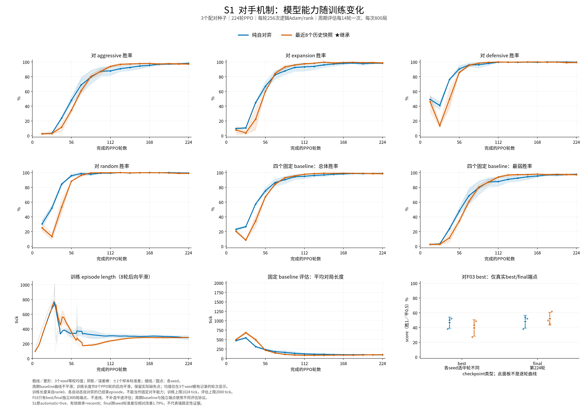
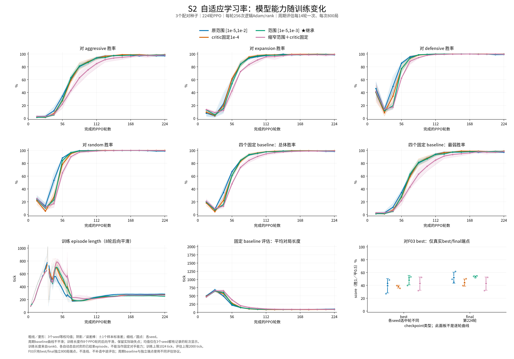
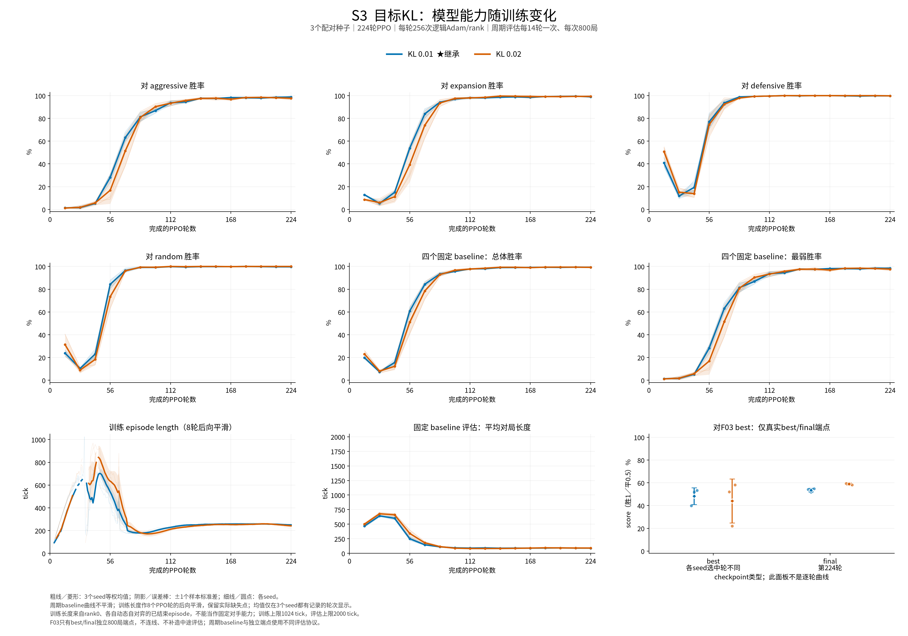
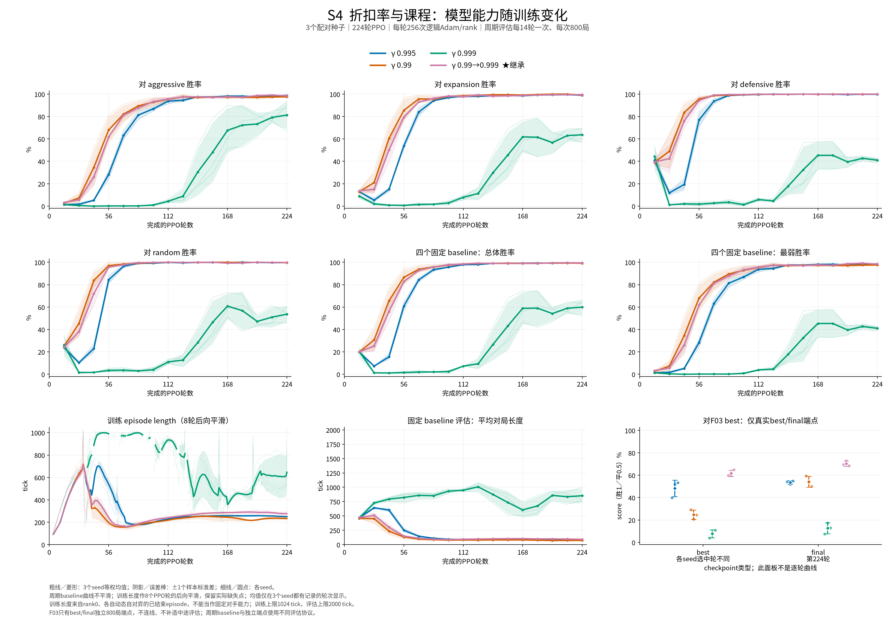
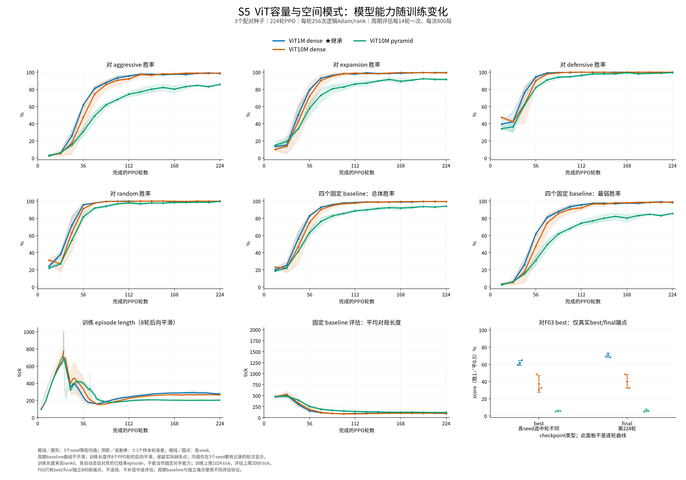
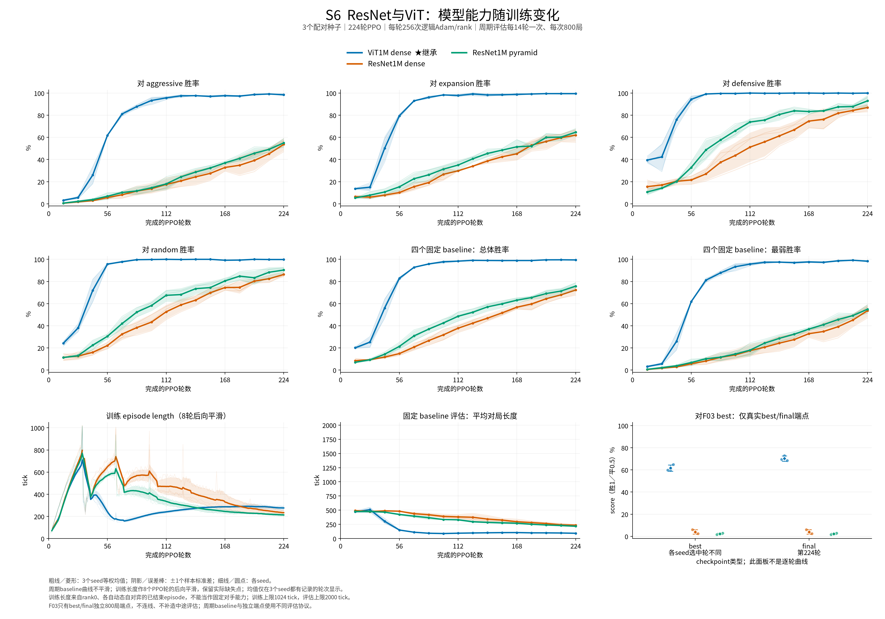
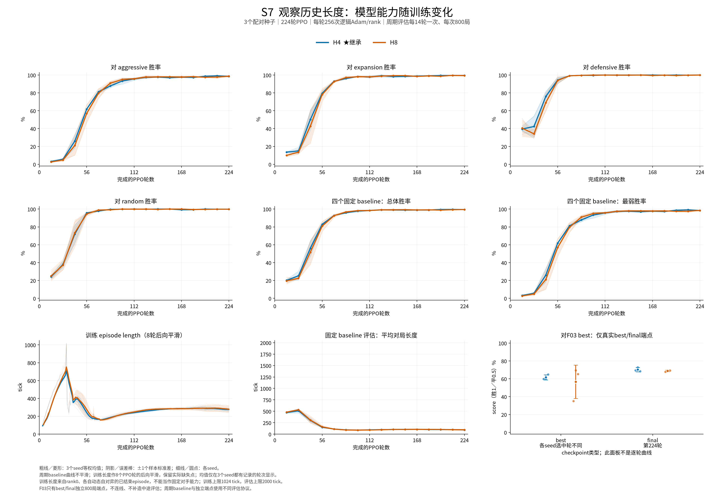

# F03 七阶段消融结果

整理日期：2026-10-21。实验于2026-10-20全部完成；本文汇总最终结果，不保留运行中流水状态。结果来自已有训练、端点评估和实际阶段裁决，本次整理没有重新训练或补跑对局。

## 最终配方与主要结论

本轮最终继承 **ViT1M dense、H4/K11、最近8个冻结历史对手、共享自适应LR范围[1e-5,1e-3]、desired KL=.01、gamma .99→.999课程**。它是本轮顺序消融在既定质量门槛下选出的配方，不是所有参数组合的全局最优，也不等于把原有LightCNN v32-opt的结果改写为ViT结果。

| 设置 | 最终继承值 |
| --- | --- |
| 环境／输入 | 9×9、1v1；本人局部H4＋单份K11持久知识；critic读取当前特权状态及同一份H4/K11 |
| 网络 | Scaled ViT1M dense，critic projection0；actor／critic独立参数；1M指两者合计预算 |
| 自对弈 | 每局均匀抽取冻结历史对手，整局不换；最近8次发布为候选；每PPO轮发布，`retain_seed=false` |
| 学习率 | 初始1e-4；actor和critic使用同一自适应LR，范围[1e-5,1e-3]；不固定critic LR |
| KL／折扣 | desired KL=.01；PPO、GAE和PBRS gamma同步从.99线性升到.999 |
| 课程边界 | `gamma_end_iteration=112`，即第113个PPO轮首次达到.999；tick惩罚在iteration125，即第126轮首次归零 |
| 采样／更新 | 8卡；全局N131072、T32、逻辑B65536、E4；每rank N16384、逻辑B8192 |
| 预算／执行 | 224轮、939,524,096 fresh learner transitions；网络BF16／编译，FP32主参数；物理microbatch不改变逻辑预算 |

最终配方精确复用S4的三项`gamma_course`训练，S5–S7没有重复训练它们：

| 训练seed | Best选中PPO轮 | Best对原F03得分 | Final对原F03得分 | Final基础AI最弱／总体胜率 |
| --- | ---: | ---: | ---: | ---: |
| 20261013 | 210 | 59.8750% | 69.5000% | 98.50%／99.375% |
| 20261014 | 196 | 60.1250% | 72.8750% | 99.00%／99.750% |
| 20261015 | 210 | 64.8750% | 68.3750% | 99.00%／99.625% |
| 三seed均值±样本标准差 | — | **61.6250%±2.8174pp** | **70.2500%±2.3419pp** | **98.8333%／99.5833%** |

最大收益来自S4 gamma课程，final对原F03平均得分较同阶段固定.995参考提高16.6875pp。S2缩小LR上限主要减少跨seed波动。10M、ResNet、H8均未按原门槛晋级；S3的KL=.02和S7的H8有正面final结果，不能把“未晋级”写成所有指标都更差。

## 实验预算与评估口径

七阶段共有 **14种不同主条件×3个配对seed＝42项主训练**，另有6项16轮压力诊断；均已完成。各主条件从随机权重、新Adam、新历史池开始，不从上一阶段权重续训。后续阶段继承的是已选配置；配置完全相同的incumbent按原指纹复用，不额外算作新run。

| 工作量 | 主训练（每项） | 压力诊断（每项） |
| --- | ---: | ---: |
| 数量 | 42 | 6：live／recent8各3seed |
| PPO轮数 | 224 | 16 |
| 全局N／T／逻辑B／E | 131072／32／65536／4 | 131072／64／32768／4 |
| 每轮同步逻辑Adam步／rank | 256 | 1,024 |
| 总同步逻辑Adam步／rank | 57,344 | 16,384 |
| Fresh learner transitions | 939,524,096 | 134,217,728 |
| 能力评估 | 周期评估＋best/final独立端点 | 关闭，不用于最终能力排名 |

一次PPO轮包含采样、GAE和完整E4更新；Adam步是一次逻辑minibatch更新，不乘8卡。Fresh仅计learner新交互，不把重复epoch或对手动作再算一次。主训练预算与原F03实际结束的224轮相同；原F03 best在第168轮，不能用它作为训练预算分母。每项精确训练至224轮，关闭时间／平台／EV早停；显存限制只允许调整物理microbatch。

| 阶段 | 新条件数×3seed | 复用参考 | 实际继承 |
| --- | ---: | --- | --- |
| S1 对手机制 | 2×3＝6 | 无 | recent8，经独立S1有效裁决 |
| S2 学习率 | 3×3＝9 | S1 recent8 | 共享LR范围[1e-5,1e-3] |
| S3 KL目标 | 1×3＝3 | S2所选配置 | KL=.01 |
| S4 gamma | 3×3＝9 | S2／S3所选配置 | .99→.999课程 |
| S5 ViT容量／空间模式 | 2×3＝6 | S4课程ViT1M | ViT1M dense |
| S6 ResNet／ViT | 2×3＝6 | 同一S4 ViT1M | ViT1M dense |
| S7 历史长度 | 1×3＝3 | 同一S4 H4 | H4 |

训练seed固定为20261013／20261014／20261015。除该阶段因素及运行标识外保持配置一致；这种顺序设计没有覆盖全部因素交互，例如本轮没有测试“gamma课程＋KL=.02”组合。

**三类评估必须区分：**

- 周期基础AI评估在第14、28、…、224轮进行，每点800局，四个C++基础AI各200局；共42×16＝672个真实周期点。
- Best按周期基础AI的`(最弱AI胜率, aggressive胜率, 总体胜率)`字典序选择；并列保留更早模型。Final固定为第224轮。Best不使用F03结果挑选，因此不保证比final更强。
- 每run的best与final各做800局四基础AI评估、800局对不可变的原F03 best对战，共168个端点任务、134,400条端点game记录。其中84个是F03 best/final端点。对局按地图换座、masked categorical采样；F03得分为`(胜+.5×平)/局数`，不是只算胜局的胜率，也不是Elo。

对原F03的阶段表比较的是各方案分别对同一参考模型的得分，并非候选与incumbent直接互战。参考checkpoint SHA256为`a6524b234b22316da580878ec34ffd9278105fcf42774496db54d4f317f1330a`。800局不是800个训练seed；同模型、同随机协议产生相同best/final结果也不是独立重复。不同地图seed不等于已证明与训练地图逐张去重。

周期基础AI与独立端点使用各自固定赛程／执行协议，不能把图中第224轮的周期胜率当成端点表的final胜率。

### 图表怎样阅读

下面七图均为已有真实记录，每图九子图：四基础AI胜率、总体／最弱胜率、训练episode length、固定基础AI评估平均长度，以及F03端点。前八图横轴为完成的PPO轮数；第九图按best／final两类checkpoint展示，横轴不是轮次。各seed的best实际轮次见阶段表，final均为第224轮。

粗线为三seed等权均值、细线为单seed，阴影是**±1个样本标准差（ddof=1），不是置信区间**。周期评估不平滑；训练长度使用8轮后向平滑，缺失标签保留断线，不补0。训练长度来自各自演进的自对弈，不能当作固定对手能力评估；其上限1,024tick，基础AI评估上限2,000tick。

**没有完整的中途F03对战评估。** 图中F03只显示真实best/final端点，不把两点连成学习曲线。基础AI接近饱和时也不能据曲线推算F03实力。

[下载七页矢量PDF](assets/f03_ablation/all_seven_ablations.pdf)。逐点[CSV](../outputs/analysis/f03_ablation_curves_20261021/curves_long.csv)、[覆盖清单](../outputs/analysis/f03_ablation_curves_20261021/plot_manifest.json)及[绘图脚本](../outputs/analysis/f03_ablation_curves_20261021/plot_ablation_curves.py)保存在原分析产物中。

### 阶段选择门槛

S2–S7要求五项能力下限和critic／策略塌缩计数不增加同时满足，再有预定改善理由才晋级。下表是候选减incumbent的三配对seed均值差，单位pp；它是冻结的实践门槛，**不是显著性检验**。

| 端点 | 最弱基础AI胜率下限 | 总体基础AI胜率下限 | F03得分下限 |
| --- | ---: | ---: | ---: |
| Final | −2 | −2 | −3 |
| Best | −3 | — | −3 |

改善理由包括final F03提高至少3pp、满足条件的跨seed标准差改善等；标准差分支还要求incumbent标准差至少2pp、下降至少20%，两组各自最差final之差不低于−3pp。这里的“最差之差”是`min(候选)−min(参考)`，不是同seed差值的最小值。S1的专门final优先裁决独立保留，未扩展到后六阶段。

## S1：当前模型与最近8个历史快照

| 对手机制 | Best F03均值±标准差 | Final F03均值±标准差 | Final最差seed | Best轮：13／14／15 |
| --- | ---: | ---: | ---: | --- |
| Live current | 46.5833%±7.6161pp | 47.9583%±8.7895pp | 37.8750% | 224／210／224 |
| Recent8，实际继承 | 39.5000%±11.1692pp | 52.0417%±8.6325pp | 44.8750% | 168／210／196 |

Recent8的基础AI曲线初期有更明显回落，后期两组都较高，但与原F03对战仍有明显差异。Recent8的final均值增加4.0833pp、最差seed提高7pp；跨seed标准差只下降1.7856%，未达到20%的稳定性改善门槛。它的best平均反而下降7.0833pp，不能被final优势掩盖。

**原自动decision仍为live；后续实际继承recent8。** 原规则仅因best F03的−3pp门槛拒绝历史池。S1独立的有效裁决按final优先条件接受其+4.0833pp能力增益，并将best负面结果保留为报告项；原decision、阈值和训练源码均未改写。此次选择依据是final能力，不能写成“明显更稳定”或“修复了F20”。[原自动记录](../outputs/analysis/f03_sequential_ablation_20261016/stages/S1/decision.json)、[实际有效裁决](../outputs/analysis/f03_sequential_ablation_20261016/control_v2/adjudications/S1.user-priority-v1.json)。

Recent8表示候选池，不是所有活跃句柄只有8个。初始模型第8轮后退出候选，已分配的对局仍可持有它至结束；T32、episode上限1,024时，保守清零界为第40轮末，第41轮起保证动作不含bootstrap。曲线前期因此包含较长预热，不能只按“池已填满”判断实际对手组成。

## S2：自适应LR范围与固定critic LR

参考为S1实际继承的recent8，gamma=.995、KL=.01不变。共享调度是actor／critic使用同一LR，不表示共享网络参数。原范围[1e-5,1e-2]改为[1e-5,1e-3]，实际只降低上限。

| LR方案 | Best F03均值±标准差 | Final F03均值±标准差 | Best轮：13／14／15 |
| --- | ---: | ---: | --- |
| 原共享范围 | 39.5000%±11.1692pp | 52.0417%±8.6325pp | 168／210／196 |
| Critic固定1e-4 | 38.0625%±2.2870pp | 44.3958%±5.5171pp | 224／210／182 |
| 共享范围[1e-5,1e-3]，继承 | 48.3333%±7.3701pp | 53.5625%±1.5947pp | 182／224／210 |
| 缩窄actor范围＋critic固定 | 42.8333%±10.3232pp | 42.8333%±10.3232pp | 224／224／224 |

缩界方案final平均只提高1.5208pp，主要收益是标准差下降81.5272%，且五项能力门槛通过。两组各自最差final提高6.875pp，但seed15自身下降6.875pp，不能宣称每seed都更好。基础AI曲线已接近天花板，仍需独立F03端点区分这些方案。

固定critic的final下降7.6458pp，组合下降9.2083pp，均超过−3pp下限，未晋级。固定LR是真正恒定1e-4，actor降得更低时critic也不跟随；不是`min(actor_lr,1e-4)`。组合三seed的best都等于final，同模型端点不增加独立证据。[S2实际决定](../outputs/analysis/f03_sequential_ablation_20261016/stages/S2/decision.json)。

## S3：desired KL=.01与.02

| Desired KL | Best F03均值±标准差 | Final F03均值±标准差 | Best轮：13／14／15 |
| --- | ---: | ---: | --- |
| .01，继承 | 48.3333%±7.3701pp | 53.5625%±1.5947pp | 182／224／210 |
| .02 | 44.0833%±19.3586pp | 59.0625%±.8125pp | 196／154／224 |

KL=.02的三个final都更好，均值提高5.5pp，标准差下降49.049%；但best均值下降4.25pp，超过−3pp门槛，因此实际保留.01。不能用较好的final豁免已经冻结的best门槛，也不能把该选择解释成“.01的final更强”。

seed14最能说明选模代理偏差：基础AI首次字典序最优选中第154轮，对F03仅22%；final为59.5625%。权重与实际选中快照一致，没有模型错绑证据。图中的基础AI曲线与F03端点测的是不同对象，无法由前者恢复缺失的中途F03曲线。[S3实际决定](../outputs/analysis/f03_sequential_ablation_20261016/stages/S3/decision.json)。

## S4：固定gamma与gamma课程

| Gamma方案 | Best F03均值±标准差 | Final F03均值±标准差 | Best轮：13／14／15 |
| --- | ---: | ---: | --- |
| 固定.995参考 | 48.3333%±7.3701pp | 53.5625%±1.5947pp | 182／224／210 |
| 固定.99 | 24.7917%±4.1951pp | 54.1667%±4.8159pp | 168／140／126 |
| 固定.999 | 7.7500%±3.5598pp | 12.6667%±4.9806pp | 168／182／210 |
| .99→.999课程，继承 | 61.6250%±2.8174pp | 70.2500%±2.3419pp | 210／196／210 |

课程在best、final均有明显收益，是唯一符合晋级规则的候选；final提高16.6875pp，三个seed分别提高15.3125／21.1250／13.6250pp。其final标准差2.3419pp高于参考1.5947pp，因此这是能力提升，不能附带宣称稳定性也提高。PPO、GAE、PBRS gamma逐轮同步，第113轮首次达到.999，之后保持至224轮。

固定.99的final接近参考，但best门槛失败。固定.999的基础AI曲线长时间偏低、训练对局更长，基础AI和F03端点均明显更差；部分对局达到tick上限形成和局，seed14的final F03平局率为29.375%。与此同时其late32 EV仍约.986–.994，说明高EV不能代表策略强。固定高gamma差、课程好，并不能仅凭这些曲线确定单一critic机制。[S4实际决定](../outputs/analysis/f03_sequential_ablation_20261016/stages/S4/decision.json)。

## S5：ViT容量与dense／pyramid

| 模型 | Best F03均值±标准差 | Final F03均值±标准差 | Best轮：13／14／15 |
| --- | ---: | ---: | --- |
| 1M dense参考，继承 | 61.6250%±2.8174pp | 70.2500%±2.3419pp | 210／196／210 |
| 10M dense | 37.2500%±9.8075pp | 40.1250%±7.9225pp | 224／182／224 |
| 10M pyramid | 5.7917%±.6884pp | 6.1667%±1.3010pp | 224／154／224 |

参考精确复用S4课程1M。相同fresh和Adam预算下，10M dense的final低30.1250pp，pyramid低64.0833pp，两者均未晋级。Dense的基础AI胜率仍很高，尤其不能用这个代理指标替代F03对战；pyramid同时表现出更大的能力缺口。

10M pyramid的训练wall吞吐约为10M dense的1.712倍，但能力更差。相同更新预算而非相同wall预算，是本轮比较的约束；结果不证明10M普遍无效，也不证明延长训练一定追上1M。[S5实际决定](../outputs/analysis/f03_sequential_ablation_20261016/stages/S5/decision.json)。

## S6：匹配1M预算的ResNet与ViT

| 模型 | Best F03均值±标准差 | Final F03均值±标准差 | Best轮：13／14／15 |
| --- | ---: | ---: | --- |
| ViT1M dense参考，继承 | 61.6250%±2.8174pp | 70.2500%±2.3419pp | 210／196／210 |
| ResNet1M dense | 4.0000%±1.9244pp | 4.0000%±1.9244pp | 224／224／224 |
| ResNet1M pyramid | 2.2500%±.6250pp | 2.2500%±.6250pp | 224／224／224 |

两种ResNet均失败全部五项能力门槛，实际继续ViT。六项ResNet的best都选在第224轮、与final权重相同，因此差距不能仅归因于基础AI过早选模；它们已使用recent8和gamma课程，也不能只归因为纯current自对弈。

ResNet的基础AI曲线仍在演进，现有固定预算只证明当前网络／输入／优化配方落后。Late32 EV约.95–.97、五项critic flags为空，却与很低F03能力并存。图中没有逐层或算子profile，不能将差距确定归因于卷积、归一化或某个kernel。[S6实际决定](../outputs/analysis/f03_sequential_ablation_20261016/stages/S6/decision.json)。

## S7：H4与H8

H8只改变task／policy的history长度4→8及运行标识，其他配置继承S4。两边仍为81个空间token，增长的是输入通道和对应输入层参数；recent8的“8”是对手候选数，与H8不是一回事。

| 历史长度 | Best F03均值±标准差 | Final F03均值±标准差 | Best轮：13／14／15 |
| --- | ---: | ---: | --- |
| H4，继承 | 61.6250%±2.8174pp | 70.2500%±2.3419pp | 210／196／210 |
| H8 | 56.6667%±18.7693pp | 68.8542%±.9107pp | 140／224／210 |

两组基础AI曲线和对局长度整体接近，但F03的best端点差异明显。H8的final平均下降1.3958pp，在−3pp范围内；标准差下降61.1111%，两组各自最小final之差为−.5625pp，满足预定稳定性分支。Final基础AI最弱／总体均值与H4相同，为98.8333%／99.5833%。但best F03下降4.9583pp，质量门槛失败，所以保留H4；不能把这一决定写成“H8没有稳定性收益”。

H8 seed13的best在第140轮，对F03仅35.125%，final升至67.8125%；另两seed的best为69.5000%和65.3750%。已有模型取证支持选点绑定正确，低分不能直接当作critic塌缩。该例再次提示：选择代理与目标能力不一致，会显著影响best端点。H8平均训练wall比H4慢约1.45%，这不是其未晋级的主要门槛。[S7实际决定](../outputs/analysis/f03_sequential_ablation_20261016/stages/S7/decision.json)。

## 吞吐、critic诊断与结论边界

以下取原`summary.performance.wall_seconds`，包括训练记录中的初始化、周期评估收尾及同步，不含训练后四项独立端点评估。三seed吞吐按fresh总量除以wall总量计算，**不是env.step/s，也不是纯采样速度**。

| 条件 | 平均训练wall／seed | 合并fresh transitions/s |
| --- | ---: | ---: |
| S4 ViT1M dense课程 | 1.823小时 | 143,172 |
| S5 ViT10M dense | 6.189小时 | 42,171 |
| S5 ViT10M pyramid | 3.615小时 | 72,192 |
| S6 ResNet1M dense | 5.712小时 | 45,686 |
| S6 ResNet1M pyramid | 3.400小时 | 76,769 |

1M参考的Collection／Update占两者合计27.96%／72.04%，10M dense为16.77%／83.23%；更大模型的主要记录成本在update，不能直接归为环境模拟瓶颈。各模型实际局长、浮点与编译路径不同，以上也不是只替换单一算子的因果加速比。

六项压力诊断均完整结束，预算见前表。其结果没有能力排名：评估关闭，而不是某个胜率“尚未完成”。Live和recent8均未复现既定神经恒值／head负饱和区间；历史池真实胜局负raw／PPO advantage比例在三个seed反而都更高。T64时保守bootstrap清零界为第24轮末，本诊断仅16轮，因此不能据此证明成熟池长期更稳定，或历史池治愈了原F20。

全部48项完整诊断摘要的既定五项critic flags均无true的暂态／持续区间；`prior_same_weights`项首轮无定义。它们只说明这些阈值定义的症状未复现。高EV、空flags、小批量`U=V+Φ` probe和稀疏梯度都不能认证critic全面健康：EV／真实终局优势来自更新前rollout，probe来自更新后rank0有限状态，测量时点和总体不同；稀疏梯度或整轮均值也不能推算所有Adam步骤的clip比例。现有证据没有定位F20根因。

## 如何使用这些结果

当前可以把最终配方作为新的固定训练起点；复用的是明确配置和通用PPO／历史池／课程能力，无须把已完成的七阶段排队、裁决和压力编排继续放进日常训练入口。完整重做本轮实验时仍应使用冻结源码、配置和原选择规则，不能把当前默认配置当作历史输入。

接下来最直接的质量改进方向是校准选模指标：S1、S3、S7已展示基础AI代理选点与F03能力不一致。若要改为按更强对手或其他指标选best，应作为新实验预先冻结规则，不能回头挑原F03成绩最高的中途模型；目前本来就没有完整中途F03评估。顺序消融、每条件仅3个训练seed、地图复用和有限训练预算，均限制了全局因果／泛化结论。

取证还存在历史覆盖边界：五项早期模型已补验tensor有限性、schema、digest、选点和端点绑定，但三个早期run原8rank身份没有全部留存，补验不能重建。ResNet BF16 eager／compiled actor曾有约10.2%的raw-logit RMS差异；原失败保留，后续推理gate采用策略分布及合法动作ratio分支，critic／训练梯度门槛未改。通过小shape验证不等于长期训练效果或所有数值路径完全相同。

## 全部42项主run的三seed端点索引

下表每格按seed **20261013／20261014／20261015** 排列；均为百分比得分，精确由已有800局W/L/D计算，未用四舍五入后的rate反推。Run名为`<条件>_s<seed>`，均完整224轮；best选中轮见各阶段表，final均为224轮。相同incumbent在多个阶段出现时指向这些同一run，不增加样本。

| 条件前缀 | Best F03：13／14／15 | Final F03：13／14／15 |
| --- | --- | --- |
| S1_live | 37.8750／49.8750／52.0000 | 37.8750／54.0000／52.0000 |
| S1_recent8 | 27.0000／43.0000／48.5000 | 49.6250／44.8750／61.6250 |
| S2_critic_fixed | 39.6250／39.1250／35.4375 | 39.6250／43.1250／50.4375 |
| S2_lr_bounded | 39.8750／51.7500／53.3750 | 54.1875／51.7500／54.7500 |
| S2_fixed_and_bounded | 31.8750／44.2500／52.3750 | 31.8750／44.2500／52.3750 |
| S3_kl_0.02 | 52.1250／22.0000／58.1250 | 59.5000／59.5625／58.1250 |
| S4_gamma_0.99 | 29.1250／20.7500／24.5000 | 59.3750／53.2500／49.8750 |
| S4_gamma_0.999 | 3.8750／8.5000／10.8750 | 7.5000／17.4375／13.0625 |
| S4_gamma_course | 59.8750／60.1250／64.8750 | 69.5000／72.8750／68.3750 |
| S5_vit10m_dense | 48.5000／30.5000／32.7500 | 48.5000／39.1250／32.7500 |
| S5_vit10m_pyramid | 5.1250／6.5000／5.7500 | 5.1250／7.6250／5.7500 |
| S6_resnet1m_dense | 6.1250／3.5000／2.3750 | 6.1250／3.5000／2.3750 |
| S6_resnet1m_pyramid | 1.6250／2.2500／2.8750 | 1.6250／2.2500／2.8750 |
| S7_history8 | 35.1250／69.5000／65.3750 | 67.8125／69.5000／69.2500 |

原始结果在`outputs/analysis/f03_sequential_ablation_20261016/`：`results/<run>.json`绑定训练及四项端点；`stages/S1..S7/decision.json`保存原自动决定，S1另有上述`control_v2/adjudications`裁决；`validation/`保存预算、模型绑定及数值核查。压力run前缀为`S1stress_live`和`S1stress_recent8`，各同样3seed。[早期模型补验](../outputs/analysis/f03_sequential_ablation_20261016/validation/five_early_run_CPU_model_evidence_supplement_actual01.json)与[预算补充说明](../outputs/analysis/f03_sequential_ablation_20261016/validation/f03_budget_and_actual_early_model_evidence_addendum_actual01.md)记录其覆盖范围。原模型、配置、收据、报告和逐局记录保留，不以本文替换它们。
