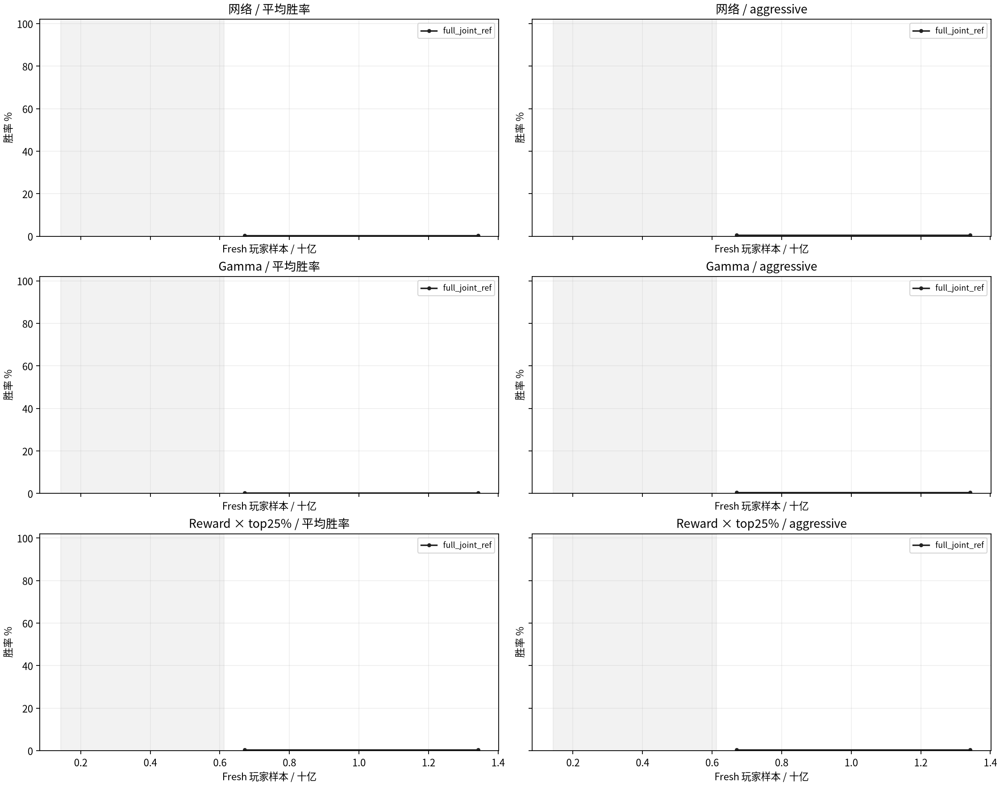

# 全尺寸 T512/E4/M64 双座纯自对弈消融

采集时间：2026-11-07T16:18:03+00:00。阶段：`superseded`。

10组、各224轮PPO、训练seed2026102901；官方18–23格长方形填充到23×23，H4/K11、patch1、2000tick上限、live current双座学习。gamma及reward×top25%全部固定1237301独立网络。

## 显存预检与统一预算

先测试4096真实对局/卡（8192玩家轨迹），必要时降低物理microbatch，再考虑2048真实对局/卡。三种网络均须通过完整T512/E4/M64八卡更新、23×23最坏token数量、同步timeout和与learner共存的eval；要求allocated峰值保留至少16GiB余量。

显存决策：`{"status": "selected", "games_per_rank": 4096, "training_lanes_per_rank": 8192, "physical_minibatch": 1024, "results": [{"trial": "memory_n4096_b1024_v11_full_early_shared_attempt1", "peak_allocated_gib": 109.70800304412842, "peak_reserved_gib": 129.8359375, "headroom_gib": 30.693364143371582, "concurrent_eval_passed": true}, {"trial": "memory_n4096_b1024_v12_full_post_attention_attempt1", "peak_allocated_gib": 105.30398082733154, "peak_reserved_gib": 129.359375, "headroom_gib": 35.09738636016846, "concurrent_eval_passed": true}, {"trial": "memory_n4096_b1024_v10_full_joint_ref_attempt1", "peak_allocated_gib": 100.61376523971558, "peak_reserved_gib": 121.75390625, "headroom_gib": 39.787601947784424, "concurrent_eval_passed": true}], "failed_candidates": [{"trial": "memory_n4096_b2048_v11_full_early_shared_attempt1", "reason": "less than 16 GiB allocated headroom", "peak_gib": 132.2629518508911}]}`。

4096对局时每轮33,554,432条fresh玩家样本、224轮共7,516,192,768条；2048对局时均减半。全组采用同一最终环境数和物理批。全样本和top25%组均E4/M64，即每轮256次Adam；筛选组逻辑batch和样本访问次数降至1/4。

## 实验矩阵与实时结果

| 版本 | 网络 | gamma | reward | 保留比例 | PPO | 最近eval平均 / aggressive | 实际玩家样本/s |
|---|---|---|---|---:|---:|---:|---:|
| v10_full_joint_ref | joint_independent | default | constant | 100% | 60/224 | 0.38% / 0.50% | 36,918 |
| v11_full_early_shared | early_shared | default | constant | 100% | 0/224 | — | — |
| v12_full_post_attention | post_attention | default | constant | 100% | 0/224 | — | — |
| v13_full_gamma1_fixed | joint_independent | fixed1 | constant | 100% | 0/224 | — | — |
| v14_full_gamma1_ramp | joint_independent | ramp1 | constant | 100% | 0/224 | — | — |
| v15_full_pbrs_decay | joint_independent | default | decay | 100% | 0/224 | — | — |
| v16_full_sparse | joint_independent | default | sparse | 100% | 0/224 | — | — |
| v17_full_top25 | joint_independent | default | constant | 25% | 0/224 | — | — |
| v18_full_pbrs_decay_top25 | joint_independent | default | decay | 25% | 0/224 | — | — |
| v19_full_sparse_top25 | joint_independent | default | sparse | 25% | 0/224 | — | — |

## 口径与溯源

- joint_independent重建1237301的完整状态＋历史＋记忆早融合Critic；只从紧凑privileged11恢复两个常量通道，9×9参数和actor/value输出与冻结原代码逐位相同，见baseline_parity.json。两个共享候选保留此前128维四层；独立baseline为96维四层，不声称是等参数量的共享机制消融。
- 网络对照为joint_independent、early_shared、post_attention（专属2层）。其余7组全部使用旧独立网络。gamma默认.99→.999；固定1从第一轮开始；.99→1在零基iteration112达到1。
- 地图课程沿用此前full-map的fresh玩家样本阈值142,606,336→612,368,384；双座转换为一半board ticks。大NT会使课程在更少PPO轮内完成。tick在零基iteration125降至0；PBRS decay同样线性衰减原territory/cities/army系数，win/loss不衰减。Sparse从开始就仅有±1胜负。rollout间改变PBRS系数是奖励课程，不声明全程stationary-PBRS不变性。
- 按AverageJoe源码，在跨卡标准化后每卡保留|A|最大的25%，正负样本都保留、actor和critic都筛。为遵守本轮M64，筛选后仍64个minibatch/epoch；作者固定batch并减少Adam次数，本轮不复制这一项。记录fresh/retained样本、实际sample visits和Adam步数。
- 固定评估每20轮＋U112/U224，完整官方随机尺寸、四baseline各100图换座，800主对局＋WAIT，采样BF16、1024tick，与之前口径衔接。收尾分别评最佳和最终模型的独立1600局，同时报告1024/2000tick结果，不能混用。
- 普通checkpoint保留2份，近期eval候选3份并保护最佳；无历史训练池。TensorBoard位于本实验runs/<版本>/，本地镜像同目录。本轮未修改默认配置或vendor；冻结源码包含工作区原有修改，完整补丁和哈希清单保留在实验目录。
- 只在8卡无其他CUDA作业、每卡空闲至少130GiB时启动新作业；不停止其他用户的进程。实际速度若受外部作业影响需单独解释。

[论文](https://arxiv.org/html/2606.23348v1)；[作者筛选源码](https://github.com/strakam/AverageJoe/blob/5041e635dcf6c87b8b844cb2e244ad3e0abe40d7/train/ppo.py)。

## 胜率曲线

<!-- superseded_by_fast_20261107 -->
本轮按用户要求在U60保留checkpoint后停止。旧4096/E4仅作归档；新的2048对局/卡、T512/E1/M256十组均从头训练，进度见[快速消融](fullmap_t512_fast_ablation_20261107.md)。
