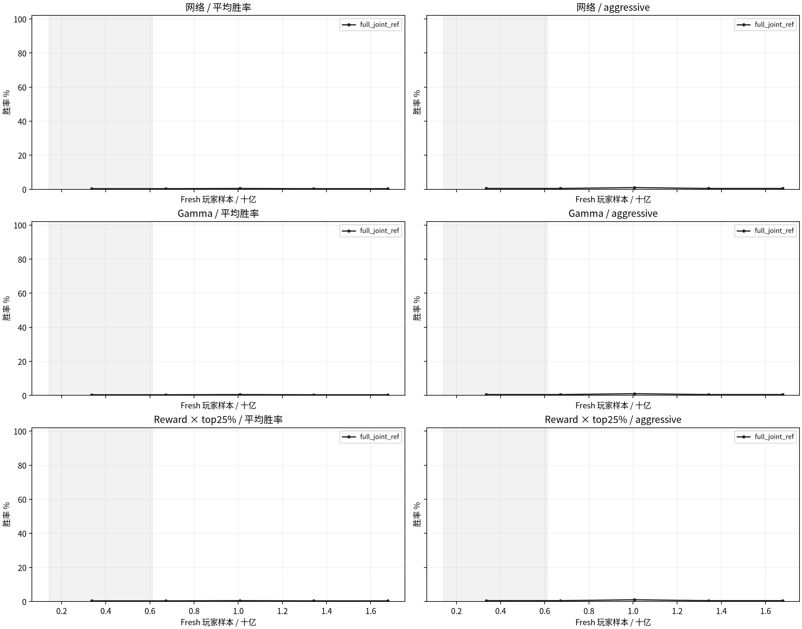

# 全尺寸 T512/E1/M256 双座纯自对弈消融

采集时间：2026-11-07T20:48:12+00:00。阶段：`superseded`。

10组、各224轮PPO、训练seed2026102901；官方18–23格长方形填充到23×23，H4/K11、patch1、2000tick上限、live current双座学习。gamma及reward×top25%全部固定1237301独立网络。

## 显存预检与统一预算

用户于2026-11-07改为每卡2048真实对局（4096玩家轨迹）、1 epoch；物理batch保持1024。保留双座、T512/M256、224轮以及十组对照。三种网络已通过更大的4096/E4显存及eval共存测试，本轮不重复长容量搜索；新配置的显存由正式训练重新记录。各组均从头训练，旧run单独归档。

容量验证依据：`{"method": "reuse larger configuration validation; smaller rollout, logical batches and epoch count; physical cap unchanged", "reference": "outputs/experiments/fullmap_t512_ablation_20261106_actual01/memory_decision.json", "formal_measured_memory": "reported by each new run; reference peaks must not be labeled new measured peaks"}`。

每轮全卡16,777,216条fresh玩家样本，224轮共3,758,096,384条；所有组均2048真实对局/卡、物理batch1024、E1/M256。全样本组每轮16,777,216次PPO样本访问和256次Adam，top25%组每轮4,194,304次样本访问、仍256次Adam。fresh样本预算是旧4096/E4的1/2，PPO访问预算是1/8。

## 实验矩阵与实时结果

| 版本 | 网络 | gamma | reward | 保留比例 | PPO | 最近eval平均 / aggressive | 实际玩家样本/s |
|---|---|---|---|---:|---:|---:|---:|
| v10_full_joint_ref | joint_independent | default | constant | 100% | 101/224 | 0.38% / 0.50% | 116,189 |
| v11_full_early_shared | early_shared | default | constant | 100% | 0/224 | — | — |
| v12_full_post_attention | post_attention | default | constant | 100% | 0/224 | — | — |
| v13_full_gamma1_fixed | joint_independent | fixed1 | constant | 100% | 0/224 | — | — |
| v14_full_gamma1_ramp | joint_independent | ramp1 | constant | 100% | 0/224 | — | — |
| v15_full_pbrs_decay | joint_independent | default | decay | 100% | 0/224 | — | — |
| v16_full_sparse | joint_independent | default | sparse | 100% | 0/224 | — | — |
| v17_full_top25 | joint_independent | default | constant | 25% | 0/224 | — | — |
| v18_full_pbrs_decay_top25 | joint_independent | default | decay | 25% | 0/224 | — | — |
| v19_full_sparse_top25 | joint_independent | default | sparse | 25% | 0/224 | — | — |

## 口径与溯源

- joint_independent重建1237301的完整状态＋历史＋记忆早融合Critic；只从紧凑privileged11恢复两个常量通道，9×9参数和actor/value输出与冻结原代码逐位相同，见baseline_parity.json。两个共享候选保留此前128维四层；独立baseline为96维四层，不声称是等参数量的共享机制消融。
- 网络对照为joint_independent、early_shared、post_attention（专属2层）。其余7组全部使用旧独立网络。gamma默认.99→.999；固定1从第一轮开始；.99→1在零基iteration112达到1。
- 地图课程沿用此前full-map的fresh玩家样本阈值142,606,336→612,368,384；双座转换为一半board ticks。本轮地图课程约U9开始、U37完成；gamma/tick/potential仍按PPO轮数推进。tick在零基iteration125降至0；PBRS decay同样线性衰减原territory/cities/army系数，win/loss不衰减。Sparse从开始就仅有±1胜负。rollout间改变PBRS系数是奖励课程，不声明全程stationary-PBRS不变性。
- 按AverageJoe源码，在跨卡标准化后每卡保留|A|最大的25%，正负样本都保留、actor和critic都筛。为遵守本轮M256，筛选后仍256个minibatch/epoch；作者固定batch并减少Adam次数，本轮不复制这一项。记录fresh/retained样本、实际sample visits和Adam步数。
- 固定评估每20轮＋U112/U224，完整官方随机尺寸、四baseline各100图换座，800主对局＋WAIT，采样BF16、1024tick，与之前口径衔接。收尾分别评最佳和最终模型的独立1600局，同时报告1024/2000tick结果，不能混用。
- 普通checkpoint保留2份，近期eval候选3份并保护最佳；无历史训练池。TensorBoard位于本实验runs/<版本>/，本地镜像同目录。本轮未修改默认配置或vendor；冻结源码包含工作区原有修改，完整补丁和哈希清单保留在实验目录。
- 旧4096/E4 run的checkpoint、曲线和源码保留于[旧实验报告](fullmap_t512_ablation_20261106.md)，不拼入本轮曲线。
- 只在8卡无其他CUDA作业、每卡空闲至少130GiB时启动新作业；不停止其他用户的进程。实际速度若受外部作业影响需单独解释。

[论文](https://arxiv.org/html/2606.23348v1)；[作者筛选源码](https://github.com/strakam/AverageJoe/blob/5041e635dcf6c87b8b844cb2e244ad3e0abe40d7/train/ppo.py)。

## 实测耗时估算

参考组预热后：采样36.0s，PPO更新108.5s。剩余训练本体约72.9小时；含eval与收尾粗估60–97小时。不含等卡时间；未开跑的结构/筛选组尚为预测。

| 版本 | 单组224轮训练本体估时 | 依据 |
|---|---:|---|
| v10_full_joint_ref | 9.0h | measured |
| v11_full_early_shared | 11.2h | reference-scaled prediction |
| v12_full_post_attention | 9.0h | reference-scaled prediction |
| v13_full_gamma1_fixed | 9.0h | reference-scaled prediction |
| v14_full_gamma1_ramp | 9.0h | reference-scaled prediction |
| v15_full_pbrs_decay | 9.0h | reference-scaled prediction |
| v16_full_sparse | 9.0h | reference-scaled prediction |
| v17_full_top25 | 3.9h | reference-scaled prediction |
| v18_full_pbrs_decay_top25 | 3.9h | reference-scaled prediction |
| v19_full_sparse_top25 | 3.9h | reference-scaled prediction |

## 胜率曲线

<!-- superseded_by_map9_20261107 -->
用户要求全部重来为9×9＋课程＋T512/E1/M256＋双座纯自对弈。全尺寸队列已停止，U100 checkpoint、源码和曲线保留；新进度见[9×9消融](map9_t512_ablation_20261107.md)。
