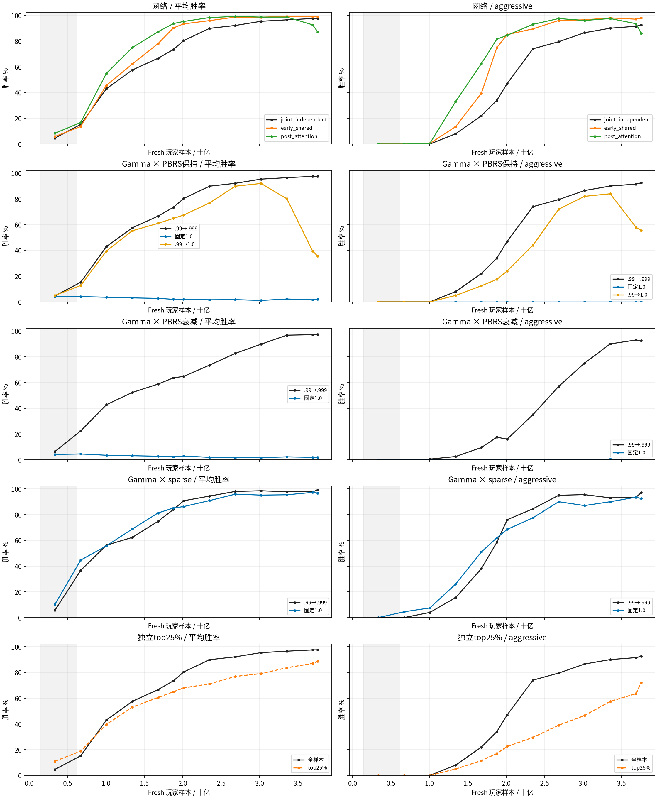

# 9×9 T512/E1/M256 双座纯自对弈消融

采集时间：2026-11-08T18:03:33+00:00。阶段：`completed`。

10组（7组gamma×reward、2组额外网络对照、1组独立top25%）、各224轮PPO、训练seed2026102901；固定9×9、官方随机布局，H4/K11、patch1、2000tick上限、live current双座学习。gamma及reward×top25%全部固定1237301独立网络。

## 显存预检与统一预算

用户于2026-11-07改为每卡2048真实对局（4096玩家轨迹）、1 epoch；所有组改为9×9＋课程，物理batch8192、推理chunk2048，保持逻辑M256。保留双座、T512、224轮、seed及十组对照。实际显存和吞吐由新训练记录；各组从头训练，全尺寸run另行归档。

容量验证依据：`{"method": "9x9 larger physical batch; current storage is encoded/H4-de-duplicated. Historical9x9 T32/physical8192 and GPU fusion tests establish capacity; monitor actual new peaks. All three networks stay far below H200 capacity by storage+activation scaling.", "reference": "outputs/experiments/shared_selfplay_ppo_ablation_20261105_actual01", "formal_measured_memory": "new runs record actual allocation/reservation peaks; no claim inherited peaks are new measurements"}`。

每轮全卡16,777,216条fresh玩家样本，224轮共3,758,096,384条；所有组均2048真实对局/卡、物理batch8192、E1/M256。全样本组每轮16,777,216次PPO样本访问和256次Adam，top25%组每轮4,194,304次样本访问、仍256次Adam。fresh样本预算是旧9×9 T32的4倍，PPO访问预算与旧T32/E4相同；与刚停止的全尺寸E1实验样本预算相同。

## 实验矩阵与实时结果

| 版本 | 网络 | gamma | reward | 保留比例 | PPO | 最近eval平均 / aggressive | 实际玩家样本/s |
|---|---|---|---|---:|---:|---:|---:|
| v10_9x9_joint_ref | joint_independent | default | constant | 100% | 224/224 | 97.50% / 92.50% | 513,456 |
| v11_9x9_early_shared | early_shared | default | constant | 100% | 224/224 | 98.88% / 98.00% | 452,509 |
| v12_9x9_post_attention | post_attention | default | constant | 100% | 224/224 | 87.12% / 86.00% | 507,903 |
| v13_9x9_gamma1_fixed | joint_independent | fixed1 | constant | 100% | 224/224 | 2.00% / 0.00% | 528,657 |
| v14_9x9_gamma1_ramp | joint_independent | ramp1 | constant | 100% | 224/224 | 35.50% / 55.50% | 514,404 |
| v15_9x9_pbrs_decay | joint_independent | default | decay | 100% | 224/224 | 97.25% / 92.50% | 511,262 |
| v16_9x9_sparse | joint_independent | default | sparse | 100% | 224/224 | 99.12% / 97.00% | 505,800 |
| v20_9x9_gamma1_pbrs_decay | joint_independent | fixed1 | decay | 100% | 224/224 | 1.75% / 0.00% | 525,627 |
| v21_9x9_gamma1_sparse | joint_independent | fixed1 | sparse | 100% | 224/224 | 96.75% / 92.50% | 510,601 |
| v17_9x9_top25 | joint_independent | default | constant | 25% | 224/224 | 88.62% / 72.00% | 812,353 |

## Gamma × reward 矩阵

| gamma | PBRS保持 | PBRS衰减 | 从头sparse |
|---|---|---|---|
| default | v10_9x9_joint_ref | v15_9x9_pbrs_decay | v16_9x9_sparse |
| fixed1 | v13_9x9_gamma1_fixed | v20_9x9_gamma1_pbrs_decay | v21_9x9_gamma1_sparse |
| ramp1 | v14_9x9_gamma1_ramp | 不做（按用户删减） | 不做（按用户删减） |

网络额外对照：early_shared、post_attention；独立top25%只与默认gamma＋PBRS保持基准比较。当前及既有配置保留，未运行的reward×top25%两组已移出队列。

## 口径与溯源

- joint_independent重建1237301的完整状态＋历史＋记忆早融合Critic；只从紧凑privileged11恢复两个常量通道，9×9参数和actor/value输出与冻结原代码逐位相同，见baseline_parity.json。两个共享候选保留此前128维四层；gamma×reward七组及top25%均固定旧独立网络；独立baseline为96维四层，不声称是等参数量的共享机制消融。
- 网络对照为joint_independent、early_shared、post_attention（专属2层）。gamma默认.99→.999和固定1各测试PBRS保持/衰减/sparse三种reward；.99→1只测试PBRS保持，在零基iteration112达到1。top25%仅在默认gamma＋PBRS保持上单独对照，不与reward做组合。
- 地图课程沿用此前9×9的fresh玩家样本阈值142,606,336→612,368,384；双座转换为一半board ticks。本轮地图课程约U9开始、U37完成；gamma/tick/potential仍按PPO轮数推进。tick在零基iteration125降至0；PBRS decay同样线性衰减原territory/cities/army系数，win/loss不衰减。Sparse从开始就仅有±1胜负。rollout间改变PBRS系数是奖励课程，不声明全程stationary-PBRS不变性。
- 按AverageJoe源码，在跨卡标准化后每卡保留|A|最大的25%，正负样本都保留、actor和critic都筛。为遵守本轮M256，筛选后仍256个minibatch/epoch；作者固定batch并减少Adam次数，本轮不复制这一项。记录fresh/retained样本、实际sample visits和Adam步数。
- 固定评估每20轮＋U112/U224，固定9×9官方随机布局、四baseline各100图换座，800主对局＋WAIT，采样BF16、1024tick，与之前口径衔接。收尾分别评最佳和最终模型的独立1600局，同时报告1024/2000tick结果，不能混用。
- 普通checkpoint保留2份，近期eval候选3份并保护最佳；无历史训练池。TensorBoard位于本实验runs/<版本>/，本地镜像同目录。本轮未修改默认配置或vendor；冻结源码包含工作区原有修改，完整补丁和哈希清单保留在实验目录。
- 全尺寸E1 run停止前的模型、曲线和源码另行保留于[全尺寸归档](fullmap_t512_fast_ablation_20261107.md)，不拼入本轮曲线。
- 只在8卡无其他CUDA作业、每卡空闲至少130GiB时启动新作业；不停止其他用户的进程。实际速度若受外部作业影响需单独解释。

[论文](https://arxiv.org/html/2606.23348v1)；[作者筛选源码](https://github.com/strakam/AverageJoe/blob/5041e635dcf6c87b8b844cb2e244ad3e0abe40d7/train/ppo.py)。

## 实测耗时估算

参考组预热后：采样12.6s，PPO更新20.0s。剩余训练本体约0.0小时；含eval与收尾粗估2–6小时。不含等卡时间；未开跑的结构/筛选组尚为预测。

| 版本 | 单组224轮训练本体估时 | 依据 |
|---|---:|---|
| v10_9x9_joint_ref | 2.0h | measured |
| v11_9x9_early_shared | 2.3h | measured |
| v12_9x9_post_attention | 2.1h | measured |
| v13_9x9_gamma1_fixed | 2.0h | measured |
| v14_9x9_gamma1_ramp | 2.0h | measured |
| v15_9x9_pbrs_decay | 2.0h | measured |
| v16_9x9_sparse | 2.1h | measured |
| v20_9x9_gamma1_pbrs_decay | 2.0h | measured |
| v21_9x9_gamma1_sparse | 2.0h | measured |
| v17_9x9_top25 | 1.3h | measured |

## 胜率曲线

## 独立复评（每项1600主对局）

| 模型 / checkpoint / tick上限 | U | 平均 | aggressive |
|---|---:|---:|---:|
| v10_9x9_joint_ref_best_t1024 | 224 | 98.250% | 94.50% |
| v10_9x9_joint_ref_best_t2000 | 224 | 98.250% | 94.50% |
| v10_9x9_joint_ref_final_t1024 | 224 | 98.250% | 94.50% |
| v10_9x9_joint_ref_final_t2000 | 224 | 98.250% | 94.50% |
| v11_9x9_early_shared_best_t1024 | 200 | 99.000% | 97.00% |
| v11_9x9_early_shared_best_t2000 | 200 | 99.000% | 97.00% |
| v11_9x9_early_shared_final_t1024 | 224 | 98.063% | 94.00% |
| v11_9x9_early_shared_final_t2000 | 224 | 98.063% | 94.00% |
| v12_9x9_post_attention_best_t1024 | 160 | 98.938% | 96.00% |
| v12_9x9_post_attention_best_t2000 | 160 | 98.938% | 96.00% |
| v12_9x9_post_attention_final_t1024 | 224 | 85.437% | 85.75% |
| v12_9x9_post_attention_final_t2000 | 224 | 85.500% | 85.75% |
| v13_9x9_gamma1_fixed_best_t1024 | 40 | 4.625% | 0.00% |
| v13_9x9_gamma1_fixed_best_t2000 | 40 | 4.688% | 0.00% |
| v13_9x9_gamma1_fixed_final_t1024 | 224 | 1.750% | 0.00% |
| v13_9x9_gamma1_fixed_final_t2000 | 224 | 1.750% | 0.00% |
| v14_9x9_gamma1_ramp_best_t1024 | 180 | 93.688% | 82.50% |
| v14_9x9_gamma1_ramp_best_t2000 | 180 | 94.125% | 82.50% |
| v14_9x9_gamma1_ramp_final_t1024 | 224 | 37.312% | 57.00% |
| v14_9x9_gamma1_ramp_final_t2000 | 224 | 37.500% | 57.25% |
| v15_9x9_pbrs_decay_best_t1024 | 224 | 98.562% | 95.00% |
| v15_9x9_pbrs_decay_best_t2000 | 224 | 98.562% | 95.00% |
| v15_9x9_pbrs_decay_final_t1024 | 224 | 98.562% | 95.00% |
| v15_9x9_pbrs_decay_final_t2000 | 224 | 98.562% | 95.00% |
| v16_9x9_sparse_best_t1024 | 224 | 98.250% | 93.50% |
| v16_9x9_sparse_best_t2000 | 224 | 98.250% | 93.50% |
| v16_9x9_sparse_final_t1024 | 224 | 98.250% | 93.50% |
| v16_9x9_sparse_final_t2000 | 224 | 98.250% | 93.50% |
| v20_9x9_gamma1_pbrs_decay_best_t1024 | 40 | 4.438% | 0.00% |
| v20_9x9_gamma1_pbrs_decay_best_t2000 | 40 | 4.625% | 0.00% |
| v20_9x9_gamma1_pbrs_decay_final_t1024 | 224 | 2.438% | 0.00% |
| v20_9x9_gamma1_pbrs_decay_final_t2000 | 224 | 2.562% | 0.00% |
| v21_9x9_gamma1_sparse_best_t1024 | 220 | 96.625% | 90.25% |
| v21_9x9_gamma1_sparse_best_t2000 | 220 | 97.125% | 90.25% |
| v21_9x9_gamma1_sparse_final_t1024 | 224 | 96.000% | 89.00% |
| v21_9x9_gamma1_sparse_final_t2000 | 224 | 96.375% | 89.00% |
| v17_9x9_top25_best_t1024 | 224 | 88.875% | 67.75% |
| v17_9x9_top25_best_t2000 | 224 | 88.938% | 67.75% |
