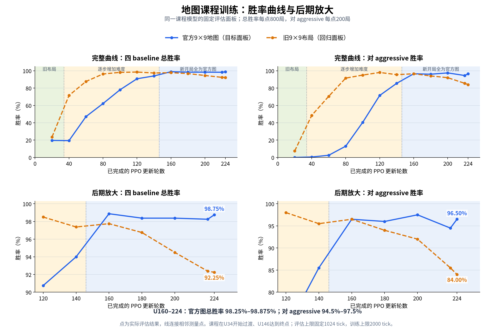
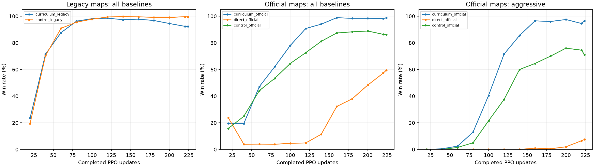

# 9×9地图课程：8×H200验证

日期：2026-11-03。目标是在执行规则不变的条件下，逐步把旧布局的出生距离、山脉比例、城市数量迁移到新版官方布局，检验目标地图上的学习效果与遗忘情况。

**已完成并验收：两组均从零完成224轮、各939,524,096条transition；48个固定面板共38,400局全部完成，无策略错误或决策超时。最终权重有限，395份冻结源码哈希一致。**

相同官方9×9面板上的最终U224结果如下，每行800局：

| 训练方式 | 总胜率 | aggressive胜率 |
|---|---:|---:|
| 旧布局→官方布局课程 | **98.75%** | **96.50%** |
| 同配置直接训练官方布局 | 59.375% | 7.50% |
| 全程旧布局，完成后迁移评估 | 86.25% | 71.00% |

课程组在U160达到98.875%，U160–224维持98%以上，完成官方地图阶段后没有重现大幅退化。直接训练组在U40–120总胜率仅约4%–5%，后期重新上升；即使物理批对齐8192，224轮内仍明显落后。该组seed与预算下，课程改善了目标任务的学习效率，单独增大物理批没有解决困难地图上的学习停滞。

课程存在一定遗忘：最终旧图胜率92.25%、aggressive84%，低于一直训练旧图的99.5%／98%。本次三个地图变量联合调度，不能区分单个变量的贡献；也尚未验证其他训练seed或更大地图的训练效果。

后期放大显示：官方图U140→160仍明显提升，U160→224总胜率在98.25%–98.875%波动，aggressive胜率在94.5%–97.5%波动，没有持续上升的趋势；旧图成绩则在后期下降。这是当前固定baseline面板上的平台期，不能推断对更强对手的能力也已停止提升。绘图脚本为 `outputs/analysis/map_curriculum9_20261103/plot_curriculum_curve.py`，同目录资产另存SVG。

**强对手补测：** 最新Razor v8的100张独立官方9×9地图、交换座位200局／模型，U160为153胜47负（76.5%），U224为181胜19负（90.5%），均无平局、策略错误或决策超时。后64轮对强对手仍有明显净提升；baseline面板饱和会掩盖这部分进步。配对地图bootstrap的提升区间为+8至+20个百分点，详见[完整对战报告](map_curriculum9_vs_razor_20261103.md)。

收集器最末验收曾因JSON将整数键转为字符串，导致更新编号集合比较失败；已修复为整数比较，并重新检查全部原始比赛记录、checkpoint与源码。该问题只影响收集器末验收，没有改变训练或比赛结果。

## 实验与固定条件

| 实验 | 训练地图 | 用途 |
|---|---|---|
| Curriculum | 旧布局→5个难度层级→官方布局 | 本轮主要实验，从零训练224轮 |
| Official direct | 从第一轮就使用官方布局 | 同预算、同物理批的直接训练对照 |
| 已完成的旧布局cap2000 | 全程旧布局 | 复用224轮checkpoint，补测官方面板，判断课程是否改善迁移 |

前两组除地图课程和run名称外，模型、优化器、奖励、随机种子及采样预算保持一致。每组均为8×H200、每卡16,384环境、T32、4 epochs、64个逻辑minibatch，逻辑／物理批均8192。总计224次PPO、939,524,096条新transition，训练episode上限2000。使用ViT1M、H4/K11、14地图通道、BF16及既有valid-token实现。沿用recent8历史自对弈、每轮发布、uniform、retain_seed=false；gamma及tick惩罚课程不变。

使用训练seed2026102901、历史池seed2126102901。正式实验从零开始，不加载旧模型，关闭早停和时间预算。当前另一任务占用约80–86GB显存／卡，剩余容量适合单组训练，因此课程组优先，直接官方对照在课程训练退出且每卡至少有50GiB空闲后自动启动。共享情况下的wall时间不用于判断独占设备吞吐提升。

直接对照的首次地图初始化尚未进入PPO时已停止，0次更新、没有checkpoint；初始化记录保存在H200实验目录的 `interrupted_attempts/direct_init_01/`。排队恢复从零开始，不改物理批或训练参数，不中断其他项目。

## 课程定义

课程按累计全局learner transitions计算。在本轮固定并行规模下，每次更新为4,194,304条transition：

| 已完成PPO更新 | 下个rollout中新开局使用的地图 |
|---:|---|
| 0–34 | 旧布局层级0 |
| 34–146 | 难度进度从0增加至1，只混合相邻两个层级 |
| ≥146 | 只从官方层级4采样 |

边界为142,606,336和612,368,384条transition，约对应总预算的15.2%和65.2%。已有对局继续完成，新的采样分布只作用于重置的lane。日志同时记录计划进度和实际在局的层级比例，不能把计划进度直接当成全部环境都已换图。

每个层级每个rank各65,536张图，共327,680张／rank；最终官方图池仍有65,536张，避免缩小终点地图多样性。预生成额外耗时单独计入初始化，不在GPU环境步中寻路或生成地图。课程停用时仍使用原来的单图池采样路径。

起点逐张复现已成功对照的旧布局，城市驻军仍为新版40–50，AFK仍为71。每个seed采样一张官方目标图，再对两端的出生曼哈顿距离、山脉数量、城市数量做插值，生成三个中间层级。中间层级采用随机城市位置及旧式地形连通修整，并检查可绕开城市到达对方出生点；最终层级直接使用未修改的官方生成器，包含出生与城市公平性约束。

这不是只混合两端图池，也不是复刻所有官方中间滑块。中间图的城市配对分布与最终官方图仍有区别，其影响由最终官方训练阶段检验。

## 地图预检

H200对实际训练rank0的1,024个地图种子抽样，5个层级各使用相同seed：

| 层级 | 插值进度 | 平均出生曼哈顿距离 | 山脉比例 | 平均城市数 |
|---:|---:|---:|---:|---:|
| 0 | 0 | 6.985 | 9.809% | 4.000 |
| 1 | 0.25 | 9.179 | 11.732% | 5.940 |
| 2 | 0.50 | 11.365 | 13.556% | 7.296 |
| 3 | 0.75 | 13.282 | 15.338% | 9.121 |
| 4 | 1 | 15.227 | 17.473% | 10.424 |

旧布局中6/1,024张图需要先攻城才能相遇；这是旧分布已有的特点，保留以对齐成功对照。其余层级抽样均存在绕开城市的通路。统计也记录出生距离分位数、可通行最短路径及该不可达计数，解释路径均值时排除不可达样本。

更大地图通过对该尺寸的官方样本校准终点，不把9×9近乎对角的出生比例放大到大图；城市起点按每玩家2城定义，不按面积同比放大。13×17、23×23均已验证每个seed的终点与官方输出完全一致。本轮只训练9×9，尚不声称大地图训练效果已验证。

CPU/GPU已验证40张地图×128 tick＝5,120 transitions的完整状态与执行结果一致。本地21项测试通过，覆盖旧图golden、逐层难度、官方终点、大地图、部分重置、真实PPO及恢复；额外20次重置验证暖身阶段与旧图池的随机采样序列一致。H200上的8卡3轮短训练与两套Arena面板的16局接入检查均已通过。另有128个lane的GPU混合层级部分重置检查通过，未重置lane保持不变，重置后的下一步与CPU一致。

## 固定评估与判断标准

U20、40、…、220以及最终U224，各评估两套不随课程变化的面板：旧布局回归面板、官方布局目标面板。每套均为四baseline×100张图×交换座位＝800局，seed271828，CPU后端，固定1024 tick，与已完成的旧布局对照一致。模型仍按自身训练的2000步尺度构造时钟特征。

用Arena原有schedule、MatchRunner、baseline C++实现及结果聚合，不复制比赛规则，不在本实验拟合Elo。旧布局面板使用已归档旧布局runtime；官方面板使用本次官方runtime。两者保留相同执行规则与策略推理，只有地图生成器不同。

已有旧布局训练的12个checkpoint补测官方面板。直接官方训练对照也使用同一个官方面板。候选模型按官方面板选取，并报告最终U224和后期曲线，防止只挑最高点掩盖退化。观察总胜率、aggressive胜率、平局、AFK、截断和实际课程分布；吞吐仅作同配置运行健康指标。

只有一对训练seed，结果用于首轮可行性判断。课程优于同配置直接训练，才支持其有实际学习收益；只优于一直训练旧图的模型，说明改善了迁移，不能单独证明优于直接训练。

## 文件与自动收集

主实验H200目录：`/DATA/disk2/yuhangwang/code/generals-rl/outputs/experiments/map_curriculum9_20261103/`。

冻结源码基于已完成旧布局cap2000的393份文件，恢复官方mapgen并加入RL课程，共395份源码。运行期间按SHA固定，不覆盖H200项目主工作区。所有checkpoint与评估结果保留；本次未提交git，也未改变默认课程开关或生产地图规则。

本地证据目录为 `outputs/analysis/map_curriculum9_20261103/`。自动收集每30分钟执行一次，结束时核验224轮、transition总数、各面板局数、错误记录、模型有限性与源码哈希，并更新本页。训练尚未完成时不推测最终胜率。

<!-- AUTOMATIC RESULTS -->
## 运行结果

最近收集状态：课程 `completed`；直接官方对照 `completed`。

- curriculum：已完成224/224轮，课程进度100.0%，在局官方地图比例100.0%。
- direct：已完成224/224轮。

| PPO更新 | 课程：旧图 | 旧图训练：旧图 | 课程：官方图 | 直接官方训练：官方图 | 旧图训练：官方图 |
|---:|---:|---:|---:|---:|---:|
| 20 | 23.50% | 19.38% | 19.62% | 23.75% | 15.75% |
| 40 | 71.50% | 70.38% | 19.38% | 3.88% | 24.88% |
| 60 | 87.62% | 90.88% | 47.12% | 4.00% | 44.12% |
| 80 | 96.25% | 95.50% | 62.12% | 3.88% | 53.37% |
| 100 | 98.12% | 97.75% | 78.00% | 4.62% | 64.50% |
| 120 | 98.50% | 99.38% | 90.75% | 4.88% | 72.62% |
| 140 | 97.38% | 99.75% | 94.00% | 11.38% | 81.12% |
| 160 | 97.75% | 99.50% | 98.88% | 32.25% | 87.38% |
| 180 | 96.75% | 99.12% | 98.38% | 38.00% | 88.25% |
| 200 | 94.50% | 99.00% | 98.38% | 48.25% | 88.88% |
| 220 | 92.38% | 99.62% | 98.25% | 57.25% | 86.38% |
| 224 | 92.25% | 99.50% | 98.75% | 59.38% | 86.25% |

官方地图上对aggressive的胜率：

| PPO更新 | 课程 | 直接官方训练 | 一直训练旧图 |
|---:|---:|---:|---:|
| 20 | 0.00% | 0.00% | 0.00% |
| 40 | 0.50% | 0.00% | 0.00% |
| 60 | 2.50% | 0.00% | 1.50% |
| 80 | 13.00% | 0.00% | 5.00% |
| 100 | 40.50% | 0.00% | 21.50% |
| 120 | 71.50% | 0.00% | 37.50% |
| 140 | 85.50% | 0.00% | 60.00% |
| 160 | 96.50% | 1.00% | 64.50% |
| 180 | 96.00% | 0.50% | 70.00% |
| 200 | 97.50% | 2.00% | 76.00% |
| 220 | 94.50% | 6.50% | 74.50% |
| 224 | 96.50% | 7.50% | 71.00% |

curriculum：224次更新，939,524,096条transition；阶段吞吐98,380/s，wall 2.85小时。

direct：224次更新，939,524,096条transition；阶段吞吐114,771/s，wall 2.55小时。

最终自动验收通过：两组224轮、各939,524,096条采样、48个完整固定面板、模型有限性及冻结源码哈希。

curriculum_official：最终官方图胜率98.75%，aggressive 96.50%；最高面板U160，总胜率98.88%。

direct_official：最终官方图胜率59.38%，aggressive 7.50%；最高面板U224，总胜率59.38%。

control_official：最终官方图胜率86.25%，aggressive 71.00%；最高面板U200，总胜率88.88%。
