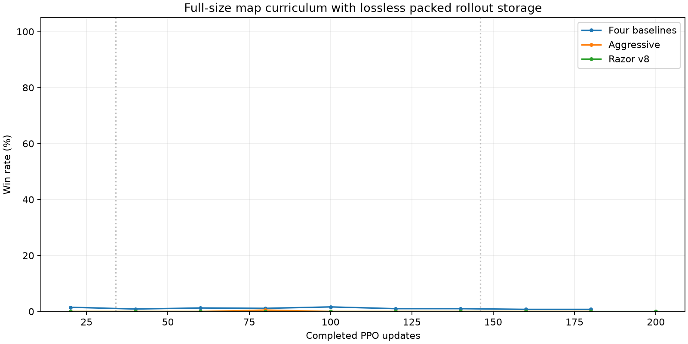

# 全尺寸地图课程：历史去重＋位打包、8×H200、224轮

> **2026-11-08状态核验：本轮已中断，未完成224轮。** 最后完成U208（872,415,232条transition），最新持久化checkpoint为`model_200.pt`。训练于2026-11-04 04:49 UTC（洛杉矶11月3日20:49）收到SIGTERM退出，现无训练或评估进程，8卡空闲；旧`status.json`中的running标记已失效。最后完整baseline评估为U180：6胜596负198平/800，胜率0.75%、胜＋半平得分率13.125%；Razor v8评估至U200仍为0胜100负。U200 baseline未完成，无U224模型或最终验收。核验快照：`outputs/analysis/map_curriculum_full_packed_20261103/status_check_20261108.json`。下方自动收集段若仍显示running，应视为历史状态。

**中断原因已确认（2026-11-08补查）：** 另一rollout 32–512 benchmark会话（`01a1a49e-e09d-7aa3-a41f-df87ab3f2da1`）于2026-11-04 04:47:19 UTC收到用户指令“h200上的实验可以停止了”，随后04:49通过SSH向本实验进程组发送SIGTERM，主动停止控制器、八卡训练和关联评估。执行返回无残留目标进程，且未删除实验文件；记录位于`outputs/benchmarks/rollout_32_512_20261103_actual01/remote_h200_stopped.json`。控制器也被终止，未处理SIGTERM并更新状态，因此`status.json`遗留running。停止行为有明确用户授权，并非训练自动早停或GPU故障。

日期：2026-11-03。按用户要求将最新无损存储方案作为默认，从头重新训练完整224轮。
旧实验的U14 checkpoint保留，本轮不加载它，也不加载性能测试产生的模型。

## 配置

| 项目 | 本轮设置 |
|---|---|
| 地图 | 官方1v1长宽各18–23格的原CDF；允许长方形，存储画布23×23 |
| 模型 | ViT1M、H4、K11、BF16、独立critic、有效token attention、模型编译 |
| 并行 | 8×H200，每卡16,384环境，全局131,072 |
| Rollout／PPO | T32、4 epochs、64逻辑minibatch；每卡逻辑8192，全局65,536 |
| 存储／激活 | 历史去重＋二值位打包；每卡物理批4096，两次梯度累积；推理chunk2048 |
| 预算 | 从零224轮，939,524,096条fresh learner transitions |
| episode上限 | 训练及固定评估均2000 tick |
| 自对弈 | recent8历史池、每轮发布、uniform、逐局固定对手、retain_seed=false |
| 奖励／学习率 | 沿用上一全尺寸实验；gamma .99→.999、tick惩罚课程、adaptive LR；早停关闭 |
| 地图课程 | 5层；暖身至全局142,606,336条，612,368,384条到全官方图，对应U34、U146 |
| 地图池 | 每层每rank65,536张，共327,680张／rank |
| 种子 | 训练2026102901，历史池2126102901，评估20261103 |

地图课程沿用[原全尺寸实验](map_curriculum_full_20261103.md)：起点保持9×9易图的近距离出生，
再逐渐调整出生距离、山脉比例和城市数量，终点使用原官方生成器；尺寸分布从第一轮就已是完整18–23格。
规则、地图生成、奖励、网络与评估面板均不改变。

相对原全尺寸配置仅改变三项训练字段：`runner.storage_history={"policy":4}`、
`runner.storage_codec="generals_rl.rollout_codec.GeneralsObservationCodec"`、
`runner.algorithm.physical_minibatch_size=4096`。run_id另取新值以区分模型来源。
本地包默认及本轮冻结源码的默认均已启用这三项；地图课程、有效token attention等仍由本轮实验配置显式开启。

## 启动验证

最新默认的CPU回归40项、57个subtest通过，包括真实训练与恢复、压缩往返、PPO更新和benchmark/profile。
存储实现沿用[位打包实验](packed_storage_20261103.md)已通过的CUDA/BF16精确对照，最大更新差异0。
对原实验已验证的地图、env、Arena、baseline和策略特征代码逐文件核验SHA，227个运行时文件保持一致，
复用其5,120条CPU/GPU逐tick一致性结果。

先单独执行全N/T、全23×23有效区域的4096前后向显存探测，真实保留完整地图池容量差额、
额外8 GiB评估预算、KL probe和8192逻辑输入；探测退出后，再启动八卡4轮短训练和Arena接入检查。
通过后进入本轮224轮训练。此容量探测不等同于实测GPU评估与反向传播在峰值瞬间重叠。

该探测已通过：allocated峰值102.52 GiB、reserved峰值104.12 GiB，
其中已包含约2.151 GiB完整bank差额及8 GiB评估预算；探测进程退出后才启动八卡任务。

八卡4轮短训练已完成262,144条样本，地图课程到达官方终点，模型有限；
Arena完成16局GPU baseline及4局CPU Razor检查，无策略错误或弃权处罚。
正式224轮torchrun已启动，PID 801043，核验8个rank均在运行，实际配置已启用去重、位打包和4096物理批；
初始化方式为from_scratch。启动证据保存在 `startup_acceptance.json`。

H200原工作区存在独立改动，本轮保留该工作区，在独立目录运行同步的398文件冻结源码和新默认，
记录完整SHA清单；不覆盖原实验、模型或其他工作区文件。

## 评估与记录

每20轮及最终U224保存完整checkpoint，并启动两套异步Arena面板：

| 面板 | 每次预算 | 执行方式 |
|---|---|---|
| 四个baseline | 每对手100张图、交换座位，共800局 | GPU0环境＋批推理，batch128 |
| 冻结Razor v8 | 50张图、交换座位，共100局 | Arena CPU隔离比赛，8个worker |

评估使用固定官方18–23格分布、2000 tick、种子20261103，不跟随课程难度变化。
GPU面板等待GPU0有至少8 GiB空闲才启动；CPU面板独立运行，不设置训练同步等待。
原Razor源码包和SHA沿用上一实验；超时／弃权处罚单列，策略执行失败不当成正常0胜率。
每30分钟自动收集一次进度、胜率及原始结果，并更新本报告；逐轮检查由程序完成，不消耗对话token。

## 时间预估与路径

位打包＋4096的短测为35,129 transitions/s，约119.4秒／轮；
939,524,096条样本对应纯训练约7.43小时。
加上完整地图池初始化、编译、异步评估干扰及收尾，启动时预计总计8–10小时。
正式训练早期数据将用于修正估计，短测不保证全程吞吐恒定。

H200：`/DATA/disk2/yuhangwang/code/generals-rl/outputs/experiments/map_curriculum_full_packed_20261103/`。
模型：`runs/vit1m_full_packed_s2026102901_u224/`。
本地：`outputs/analysis/map_curriculum_full_packed_20261103/`，包含配置、计划、日志、原始结果与验收记录。

<!-- AUTOMATIC RESULTS -->
## 运行结果

最近收集状态：`running`。

已完成208/224轮；计划课程进度100.0%，rank0在局官方地图比例100.0%。

最近8轮阶段吞吐约23,167 transitions/s，每轮181.0秒；按此速度剩余纯训练约0.80小时，不含评估收尾和未来速度变化。

| PPO更新 | 四baseline胜率 | aggressive胜率 | Razor v8胜率 | Razor含处罚局数 |
|---:|---:|---:|---:|---:|
| 20 | 1.50% | 0.00% | 0.00% | 0 |
| 40 | 0.88% | 0.00% | 0.00% | 0 |
| 60 | 1.25% | 0.00% | 0.00% | 0 |
| 80 | 1.12% | 0.50% | 0.00% | 0 |
| 100 | 1.62% | 0.00% | 0.00% | 0 |
| 120 | 1.00% | 0.00% | 0.00% | 0 |
| 140 | 1.00% | 0.00% | 0.00% | 0 |
| 160 | 0.75% | 0.00% | 0.00% | 0 |
| 180 | 0.75% | 0.00% | 0.00% | 0 |
| 200 | — | — | 0.00% | 0 |

