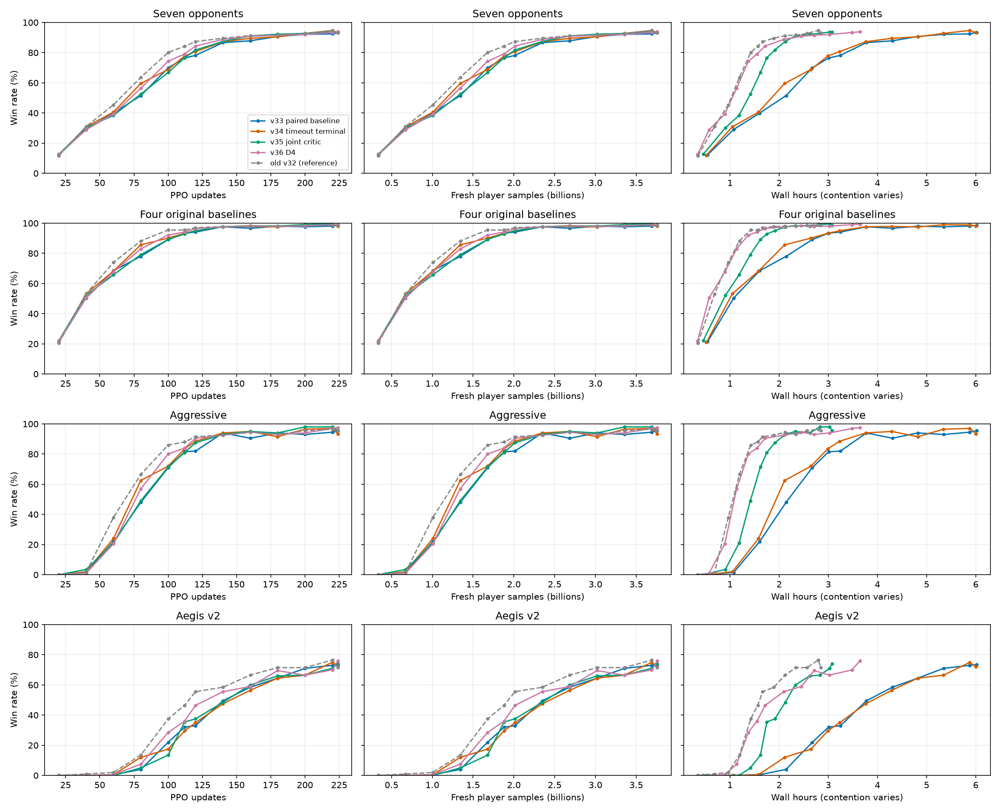

# v33–v36 顺序消融结果

UTC 2026-11-12T23:12:17+00:00；状态 `completed`。

全部为单训练种子、从头训练。224轮为3.758B玩家样本。开发集每对手200局；七对手统计1400局，Arena另运行200局WAIT参考，不计入七对手指标。

| Run | U | 父配置 | 超时终止/联合critic/D4 | 最新七对手 | 末段均值（点数） | 最近20轮玩家样本/s | 峰值 allocated/reserved GiB |
|---|---:|---|---|---:|---:|---:|---:|
| v33_paired_baseline | 224/224 | v32 | False/False/False | 93.29% | 92.14% (4/4) | 175,162 | 9.35/9.67 |
| v34_timeout_terminal | 224/224 | v33_paired_baseline | True/False/False | 93.29% | 92.82% (4/4) | 171,027 | 9.31/9.69 |
| v35_joint_critic | 224/224 | v34_timeout_terminal | True/True/False | 93.79% | 93.11% (4/4) | 476,217 | 9.29/9.64 |
| v36_d4 | 224/224 | v34_timeout_terminal | True/False/True | 93.86% | 92.71% (4/4) | 329,102 | 9.31/9.69 |

灰线为历史v32参考，未采用配对minibatch。相同硬件不代表相同可用资源；完整GPU占用见logs/*.gpu.csv和status.json中的foreign_cuda_pids。末段均值只有四个点齐全后才用于选择。

**v36恢复说明**：U220评估曾出现一次Razor-v8决策超过10ms的弃权，未计入有效胜率；同一模型、种子和规则的完整1600局复测通过。最后4轮从U220恢复模型、优化器/LR及课程计数，环境局面、随机数和地图流位置重新初始化，不能视为逐位无缝续训。失败评估与恢复前后原始记录均保留；墙钟曲线包含中断和恢复时间。后续纯决策超时最多重试两次完整评估，不改变10ms限制，不重试其他策略错误。

- v34_timeout_terminal 对 v33_paired_baseline：末段 92.14% → 92.82%；AUC 68.40% → 69.96%；选择 **v34_timeout_terminal**。
- v35_joint_critic 对 v34_timeout_terminal：末段 92.82% → 93.11%；AUC 69.96% → 69.16%；选择 **v34_timeout_terminal**。
- v36_d4 对 v34_timeout_terminal：末段 92.82% → 92.71%；AUC 69.96% → 70.36%；选择 **v34_timeout_terminal**。

## 独立种子验证

seed94722775，每对手400局；共2800局计入指标，另400局WAIT。best由开发集选定，final固定U224。

| 模型 | U | 七对手 | 四基线 | aggressive | Aegis | 七对手平局率 |
|---|---:|---:|---:|---:|---:|---:|
| v33_paired_baseline/best | 224 | 92.11% | 97.81% | 93.00% | 71.00% | 0.07% |
| v33_paired_baseline/final | 224 | 92.11% | 97.81% | 93.00% | 71.00% | 0.07% |
| v34_timeout_terminal/best | 220 | 93.50% | 98.38% | 95.25% | 73.25% | 0.11% |
| v34_timeout_terminal/final | 224 | 93.07% | 97.81% | 92.50% | 73.00% | 0.04% |
| v35_joint_critic/best | 224 | 93.36% | 98.62% | 94.75% | 73.50% | 0.04% |
| v35_joint_critic/final | 224 | 93.36% | 98.62% | 94.75% | 73.50% | 0.04% |
| v36_d4/best | 224 | 93.50% | 98.44% | 94.50% | 75.75% | 0.07% |
| v36_d4/final | 224 | 93.50% | 98.44% | 94.50% | 75.75% | 0.07% |

## Best模型互战

每对模型200张新地图×双座。表内为行模型胜率；平局不算胜利。

| 行模型／列对手 | v33 U224 | v34 U220 | v35 U224 | v36 U224 | 旧v32 U220 |
|---|---:|---:|---:|---:|---:|
| v33 U224 | — | 50.25% | 47.75% | 50.50% | 48.75% |
| v34 U220 | 49.75% | — | 48.00% | 49.25% | 50.50% |
| v35 U224 | 52.25% | 52.00% | — | 49.50% | 54.50% |
| v36 U224 | 49.50% | 50.75% | 50.50% | — | 50.75% |
| 旧v32 U220 | 51.25% | 49.50% | 45.50% | 49.25% | — |

共4000局模型互战，另2000局WAIT参考，零策略错误／超时弃权。Arena在含WAIT固定参考的整组比赛上共同拟合Elo：

| 模型 | Elo | 拟合95%区间 |
|---|---:|---:|
| v35 U224 | 1858.5 | 1633.1–2083.9 |
| v36 U224 | 1847.4 | 1620.3–2074.5 |
| v34 U220 | 1840.8 | 1612.6–2069.0 |
| v33 U224 | 1840.0 | 1611.7–2068.3 |
| 旧v32 U220 | 1837.3 | 1608.6–2066.0 |

这些Elo只用于本组相对比较，不能直接跨评估池比较。绝对分数区间较宽，各模型互战也接近均势；单训练种子不足以确认稳定优胜。预定规则继续选择v34；独立测试与互战不用于回头修改开发集选型规则。

完整胜平负、Elo与原始报告位于`outputs/experiments/episode_critic_d4_native_maps_20261111_actual01/head_to_head_results.json`。v36中断与恢复的来源、预算审计和限制见[恢复记录](rl_ablation_recovery_20261112.md)。
