# RL 训练迭代日志

当前任务：按 2026-10-07 用户补充，从 v19 继续逐项开展事实记忆 × critic 信息输入消融、可变地图的成熟 ResNet/ViT 1M/10M/100M 比较、gamma/rollout/lambda、tick penalty 0..1000 衰减，最后 H4/H8。每轮随机初始化、新 Adam、新历史池，正式预算 1..3h；全部评测默认采样，逐版记录配置、胜率曲线、效率与最佳模型失败分析。完整范围见 [实验计划](rl_experiment_plan.md)；不因局部实验完成或 baseline 达标提前结束整个阶段任务。工作分支 `codex_dev`，main 不修改。

**当前状态：v19–v22四个信息条件均已正式训练并退出，单seed结果尚不能证明信息改动的最终因果收益。容量阶段采用actor H4+K11、critic S+H4+K11；两种1M完整GPU门禁及v23/v24从零正式训练均已完成。两轮各20更新、10485760新转移，best对aggressive均2%；ViT计算吞吐快约29%，但整体强度未胜出。开发复测、八局录像、失败分析、完整曲线与地图簇配对结果已记录下文。两家实际profiler均已退出并各完成256次Adam更新；trace与GPU ABBA完成，最小mask补丁数值逐位一致且短窗口耗时降低约1.7/2.5%；10M ResNet/ViT两个完整门禁均actual exit0，共同BF16/p256正式设置已依据实测成本选择，v25原86930已从自身commit冻结源从零启动，v26冻结待GPU；实际seed0的328张量与同seed fresh模型逐位一致。短性能诊断不计正式训练或容量门禁。其余10M/100M完整门禁和四轮正式训练、gamma/rollout/lambda、tick penalty 0..1000课程及足够末阶段训练、最后H8仍待完成。** 旧v9–v18阈值与停止规则属于此前阶段，历史greedy标签原样保留；v1–v8有续训或warm start，v6–v8混过少量aggressive对手，不能作为本轮从零纯历史自对弈的公平对照。

## v9 起：从零训练的纯自对弈比较约定

- 每个方案随机初始化 policy，使用新的 Adam 与历史池；禁止旧 checkpoint、warm start、resume、蒸馏初始化，以及 baseline AI 训练对手。历史初始随机模型作为快照 0 保留，随后均匀抽取冻结 student，整局固定对手。
- v9 保留 v8 的 Light CNN、局部观测、动作与 PPO 参数；取消额外 critic 潜能偏移（`value_potential_offset=false`，也不输出未使用的 `critic_potential`）。原偏移使 TD advantage 精确抵消潜能差分，随机初始化会直接面对稀疏输赢；取消后保留标准 `gamma*Phi(next)-Phi(current)` 奖励及终局归零，让初期获得扩张信号。建立新的从零参考；后续改动根据曲线与失败录像决定，不作大量参数搜索。
- 开发对比固定训练种子 20261013、历史池种子 120261013。选模 seed271828、每 AI 200 地图×双座次；诊断 seed1001042 已用于旧实验，只作为重复开发集。旧阶段的新种子 314159265、161803398 也不能再次称为未见测试。
- 正式候选固定权重和确定性局部 student 后，预注册未使用的随机种子，以每 AI 至少 1000 地图×双座次复核。draw 计入总局数；100% 指该有限赛程无败无平，不代表所有可能地图的数学保证。
- 从 v9 重置连续无提升计数。按重复诊断集四 AI 的 `win_rate/目标胜率` 最小值衡量进展：最小值提高超过 0.01，或最小值距参考不超过 0.01 且四项均值提高超过 0.01，重置计数；始终记录完整四项胜率，点估计改善不作统计显著性声明。
- 每轮至少 1 小时、最多 3 小时；连续 12 个选模点没有超过 2pp 的改善可结束该轮。若达到目标，则先完成独立复核再结束总任务。历史池 8、完整 checkpoint 3、评估快照最近 3+best；每个版本最多保留 4 个人工诊断模型。

v9 配置见 `rl/configs/v9.json`：16,384 环境、32 tick rollout（524,288 samples/update）、4 epoch×64 minibatch（8192 samples/minibatch）、gamma0.995、episode1024、C16 两层3×3 actor/独立 critic、fixed LR1e-4。取消 critic 潜能偏移；移除 baseline 训练桥接及其专用 C++ 加速，保留原版评估 AI。训练开始后和结束时补充验证、结果、曲线与录像分析。

## v1–v8 的历史评估与停止约定

- 使用原环境控制器和原生整 tick 规则，双方在增长前从局部观测决策。每张地图交换两座位；部署只用 student 局部输入和确定性 argmax。
- 胜率 = wins / (wins + losses + draws)，超时为 draw，不能用 decisive win rate 或四 AI 总体胜率替代各 AI 胜率。
- 训练选模seed=271828，按四AI最低胜率、aggressive、overall依次选择。v1–v5每AI50地图/100局，v6–v7为100地图/200局，v8为200地图/400局；各版本配置和结果如下。
- 候选达到目标后，另用训练及选模未使用的随机种子、每 AI 至少 500 地图复核，报告每 AI/座位胜率和 95% 区间。仅固定小选模集达标不宣称完成。
- 每轮通常 1–3 小时；根据胜率平台停止。达到目标，或连续 10 个训练版本未带来有效提升后停止，并记录原因。
- 历史池固定 8 个模型；完整 checkpoint 最多 3 个；已完成评估最多保留最近 3 个权重及一个 best，报告与曲线点全部保留。录像每 AI 最多一败一胜。

## 历史参考：long_run_v1（不计本轮 v1）

16,384 环境 × 每环境 1,000,000 tick，32 tick rollout、4 epoch、64 minibatch，两阶段 MoE CTS；episode 1024、gamma 0.995。共训练约 26.35 小时，采样加更新约 172,976 transitions/s。

固定旧选模集最佳 snapshot340（update 16999）：aggressive 57%、expansion 62%、defensive 79%、random 80%。该模型在独立 seed=1001042 的 400 局只有 34%、50%、76%、73%。

最终完整 checkpoint 在同一独立 seed=1001042：aggressive 42%、expansion 55%、defensive 76%、random 77%；最近 20 个旧选模点 aggressive 仅约 +0.34pp / 100k tick，已接近平台。失败录像中存在大量合法但零兵移动与立即折返。

## v1：当前 MoE CTS 的续训参考

已完成；代码 commit `040bdc2`。保持原 reward/obs/action/网络/两阶段更新；增加可控时限、平台停止、最佳模型保留和资源/队列指标。默认 CTS 数值更新路径未改；54 个核心测试、1 个录像测试、22 个 vendor 回归通过。

- 配置：`rl/configs/v1.json`；从 `outputs/moe_cts/long_run_v1/train/checkpoint.pt` 恢复模型、两套 Adam 和历史池。训练源码冻结在 `outputs/moe_cts/iterations/v1/source/`，不受后续工作区修改影响。
- 9×9、1v1，16,384 GPU 环境，32 tick rollout、4 epoch、64 minibatch，episode 1024、gamma 0.995；新训练地图 seed=20261005。
- 上限 3600 秒；至少 1800 秒后连续 8 个评估点无超过 2pp 的有效提升停止；每 100 更新评估一次。实际因 `evaluation_plateau` 停止：874 更新、每环境新增 27,968 tick、458,227,712 transitions、约 330 万 completed episodes。
- 时间 2655.3 秒（44.3 分钟），采样加更新 **172,960 transitions/s**，全流程 172,569/s；显存峰值 allocated 16.03 GiB、reserved 16.53 GiB。9 次评估全部完成，无失败和积压。
- 最佳 snapshot627/update31299，续训仅 1600 tick/环境；权重 `outputs/moe_cts/iterations/v1/train/evaluations/best.pt`。后续 aggressive 曲线 60→56→54→58→52→49→51→51→47%，继续续训无益；末段 student 回报约 0.6–0.7，teacher 约 1.1–1.2，能力差距仍明显。

| 评估 | aggressive | expansion | defensive | random |
| --- | ---: | ---: | ---: | ---: |
| 续训前，新选模 seed=271828，100 局/AI | 46% | 62% | 83% | 71% |
| 最佳训练快照，同选模集 | **60%** | **70%** | **84%** | **80%** |
| 最佳快照独立 seed=1001042，200 局/AI | **56%** | **66.5%** | **80.5%** | **83.5%** |

独立集前 50 张地图与旧 checkpoint 的审计集完全配对：aggressive 42→50%、expansion 55→60%、defensive 76→77%、random 77→83%；整套扩大到 100 地图后的数据列在表中。v1 相对旧基线有提升，但未达到目标；连续无提升版本计数为 0。小选模集及重复挑选快照有方差，最终达标仍需全新随机种子的大赛程复核。

每 AI 一败一胜录像及独立 Core 逐 tick 重放结果在 `outputs/moe_cts/iterations/v1/diagnostic/best_at_31299/analysis/`；选取各类中位时长案例，不代表无偏行为统计。

- aggressive 失败例 185 tick：24 次零兵动作；末十 tick 持续把将军增长的兵送走，敌军绕上侧贴近时仍在操作下侧小兵，缺乏集结和防守。离线精确复现 8 局全部 1560 次动作；敌将最后 46 tick 持续可见，最终错误不能归因于遗忘。teacher/student 最后都以 >90% 概率用 2 兵攻击 9 兵敌将；存在有效防御，但对应概率仅约 1e-10。详见 `outputs/rl_iteration_audit/v1_teacher_student_failure_probe/diagnosis.json`。
- expansion/defensive/random 失败例零兵动作占比分别约 25%、56%、62%。动作 mask 是直接可改的效率问题；不能靠过滤零兵动作解决全部 aggressive 失败。
- 同一最佳权重只开启 productive mask 的推理对照：60% / 76% / 89% / 88%（原选模集）；aggressive 未提升。下一轮验证该 mask 的训练效果、固定 LR 和 TF32 吞吐；后续独立试验 student PPO、可见兵力比较特征和 terminal/dense reward 配比。

TensorBoard：`outputs/moe_cts/iterations/v1/train/`；完整训练摘要 `train/summary.json`，独立评估 `diagnostic/best_at_31299/fresh_evaluation.json`。

## v2：productive mask、固定学习率与 TF32

已完成，代码 commit `5b20967`；配置 `rl/configs/v2.json`。从 v1 最佳 student/teacher/actor/critic 权重 warm start，重新初始化两套 optimizer 和历史池。训练地图 seed=20261006；同一选模种子继续对照。

- 动作：可选 `productive_actions=true`，按下一 tick 的公开增长规则过滤零兵 MOVE，WAIT 始终可用。少数 seat-order 敌方先攻击的变化仍可能使实际移动零兵；完整评估统计实际动作。
- 算法：MoE CTS 两阶段、teacher/student=0.75/0.25、网络及 reward/obs 保持上一版本；main LR 固定 1e-4，student LR 3e-4。
- 16,384 环境、32 tick rollout、4 epoch、64 minibatch、episode 1024、gamma 0.995。训练上限 7200 秒，至少 3600 秒后可因 8 个评估点平台停止。
- `matmul_precision=high`；同配置、同初始权重和 seed 的 10 更新 GPU 短测：highest 198,116/s，high 209,534/s（采样加更新），约 +5.8%；allocated 峰值约 16.0 GiB，所有参数/损失有限。短测只证明吞吐和可运行，不能推断训练胜率。
- 模型权重 warm start 支持、productive mask/privacy/Core-GPU 对照、动作指标及精度恢复均有回归；核心 60 项、录像 1 项、vendor 22 项已通过，追加历史池 MDP 签名检查后，7 项训练控制/初始化测试再次通过。
- 历史池 8、完整 checkpoint 3、评估权重 3+best；训练源码仍冻结。TensorBoard：`outputs/moe_cts/iterations/v2/train/`。

实际因 `evaluation_plateau` 停止：2221 更新、每环境 71,072 tick、1,164,443,648 transitions、774.7 万 completed episodes。耗时 **6000.85 秒（100.0 分钟）**；采样加更新 **194,465 transitions/s**，全流程 194,047/s；显存峰值 allocated **16.05 GiB**、reserved **16.79 GiB**。22 次周期评估全部完成，无失败或积压。相对 v1 的整体吞吐约 +12.4%，包含多项配置变化，不能全部归因于 TF32。

最佳 snapshot36/update1799（每环境 57,600 tick），权重 `outputs/moe_cts/iterations/v2/train/evaluations/best.pt`，SHA256 `ba8a3d4e79bd68f08704da9e328b9151827dfdae1ee546813fd20010278832c6`。

| 评估 | aggressive | expansion | defensive | random |
| --- | ---: | ---: | ---: | ---: |
| v2 最佳，同选模 seed=271828，100 局/AI | **70%** | **80%** | **96%** | **92%** |
| v2 最佳，诊断 seed=1001042，200 局/AI | **55%** | **76.5%** | **95%** | **92.5%** |
| 相对 v1 同诊断集 | −1pp | +10pp | +14.5pp | +9pp |

该诊断种子已在此前版本使用，不能作为最终达标的全新测试集。v2 显著改善其他三个 AI，但主要瓶颈 aggressive 没有提升；按最弱对手/ aggressive 的主目标计连续无提升版本为 **1**。尚未达标；选模集 expansion=80% 也不满足“超过80%”。

- aggressive 选模曲线在 58–70% 间波动，最佳点后四次评估降为 63/65/63/61%。末 100 更新 student 回报均值 **0.589**，teacher **1.172**；teacher 回报持续提高，student 无相应上升。latent loss 均值 0.00175 不能证明 student 已掌握教师策略；下一轮用原版 PPO 直接训练局部 student。
- productive mask 基本消除了零兵动作：最佳快照的 400 局评估为 0；训练末段仍约 0.12%，来自双方动作在同一 tick 的交互。最佳评估立即折返约 10.5%，仍有集结和防守问题。entropy 从约 0.21 降至 0.16，后半段较平稳；value loss 约 0.077。
- 最佳模型每 AI 一败一胜录像及 Core 全程逐 tick 对照：`outputs/moe_cts/iterations/v2/diagnostic/best_at_1799/analysis/`。另对中期 update599 的失败逐 tick 审计：aggressive 局持续抽空将军，defensive 局有长达 37 tick 的折返并忽视邻接大军回防；Core 反事实验证了提前回防/消耗敌军可避免当时的直接死亡。这些属于中期案例，不能冒充最终最佳模型的统计。
- 原 dense reward 下，中期 defensive 430 tick 败局的初始折扣回报仍为 +0.255，说明扩张收益可能掩盖最终失败；这是后续独立 reward 实验的依据，本轮及 v3 保持 reward 不变。

最终 update1799 最佳模型的 8 局录像也已独立分析，**1907 tick 全部 Core 逐帧重放一致**：

- aggressive 败局 223 tick，decision220 将主城16兵中的15兵移走；可见入侵军在三步路径上。220改 WAIT/HALF 或221回援均能撑过原死亡 tick；222再防守的125种合法动作全部无解，错误在于提前防守和集结时序。
- defensive 败局582 tick，89/129次攻击本次兵力不足以占领可见目标，其中42次指向同一城市，出现9兵攻121兵。末段连续43次WAIT，军力391对52；该局仅9次立即反向动作，不能沿用中期模型的震荡结论。580单步改动已无解，577起四步集中才有存活分支。
- 以上反事实保留后续双方录像动作，真实 baseline 重新决策可能不同；只证明当时存在更早的生存分支，不证明能取胜。胜局的WAIT比例反而更高，因此不统一惩罚WAIT或所有弱攻击。详见 `outputs/rl_iteration_audit/v2_final_failure_analysis/analysis.md`。

完整摘要 `outputs/moe_cts/iterations/v2/train/summary.json`；另一组种子评估 `diagnostic/best_at_1799/fresh_evaluation.json`。

## v3：student-only PPO 与回合换图

已完成，配置 `rl/configs/v3.json`。从 v2 选模最佳权重 warm start，重新初始化单 Adam 和历史池；生产源码冻结于 `dd0b30038cc9faecd187f8ad1ede5937074e1bab`，不受工作区后续 v4 改动影响。

- 原版 `rsl_rl.algorithms.PPO.update` 保持未修改；全局部 student lane、单 Adam、privileged critic，取消 teacher latent 蒸馏。学生 actor encoder 获得 PPO 任务梯度；critic 中学生 latent 仍 detach，仅去掉该分支不会用于反传的 encoder 计算图。
- 配置 16,384 环境 × 32 tick、4 epoch、64 minibatch、fixed LR=1e-4、gamma=0.995、episode=1024、TF32 high；productive mask、原 obs/reward 保持。通过独占 GPU 短测后选择 16k×32，保留较长 GAE rollout。
- 地图池 65,536；每个回合结束独立随机抽新地图，正在进行的其他对局不受影响；地图生成、采样不消耗 learner RNG。训练 seed=20261007；历史池 8、快照每 50 更新、每 100 更新同选模集评估、训练至少 1 小时/最多 2 小时，资源保留上限不变。
- 不缓存 PPO fixed schedule 未使用的旧动作分布，16k×32 理论额外省 1.268 GiB。默认 CTS 保持原缓存和两阶段行为。单优化器 runner/storage 是最小 vendor 适配；PPO 算法文件未改。
- CPU 核心 70 项（CUDA 1 项在 CPU 回归中跳过）、录像 1 项、vendor 22 项通过；原版 PPO 与适配器在四种 normalizer 开关下 loss/参数/梯度/完整 Adam/RNG 精确一致。去除 value 编码器图的 CPU 短测未显示显著提速。
- 真实 CUDA 小规模 smoke：256 lane、2 更新、回合换图、历史模型发布及 2 次四 AI 子进程周期评估全部完成，无 NaN/失败/积压。另做 4 lane 原生 CUDA 的换图/部分重置逐 tick Core 对照，其他 lane 不受影响。小规模 smoke 不作为胜率或长期速度结论。

额外运行优化：历史对手每组一次 `where`，复用行索引，保留逐组动作验证。CPU Golden 的 8 条轨迹、200 边界、1264 次策略调用及 8 项非法动作合同精确一致，核心 69 通过/1 CUDA 跳过。生产源码冻结于 `outputs/moe_cts/iterations/v3/source/`，代码 commit `dd0b300`；前置 PPO/map 功能 commit `ccb88e5`、安全停止功能 `63e4c0f`。可通过创建 run 目录中的 `STOP` 文件在完整更新后正常保存并结束。

独占 GPU 短测使用相同 warm-start 权重、8 个相同权重的历史对手组、524,288 样本/更新、4 epoch×64 minibatch；每组 20 更新，以最后 10 更新累计采样/更新时间比较，未开启评估：

| 算法/布局 | 采样+更新 transitions/s | 采样秒/更新 | 学习秒/更新 | allocated 峰值 |
| --- | ---: | ---: | ---: | ---: |
| CTS 16,384×32 | 200,025 | 0.860 | 1.761 | 16.10 GiB |
| student PPO 16,384×32 | 170,665 | 0.812 | 2.260 | 14.48 GiB |
| student PPO 32,768×16 | 177,063 | 0.696 | 2.265 | 16.91 GiB |

全局部 student 获得 PPO encoder 梯度的计算量高于 CTS 当前 student 子集蒸馏更新；PPO 速度并没有优势。32k×16 仅快 3.7%，占用更多显存并缩短 rollout，本轮采用 **16,384×32**。短测全部 loss/参数有限，不能代表长期胜率。记录在 `outputs/moe_cts/iterations/v3/bench/comparison.json`。

本轮实际以 **`requested_stop` 正常停止**：在约90分钟时，诊断集后半段已无明确提升，主动创建 `STOP`，在完整更新后保存最终 checkpoint、排空评估并退出。原配置最少1小时/最多2小时、8个评估点平台规则仍保留，但本次**不是自动触发8点平台**；决策证据见 `outputs/moe_cts/iterations/v3/train/stop_rationale.json`。1M tick/环境是调用上限，本次没有跑满。

实际 **1757 更新、每环境56,224 tick、921,174,016 transitions、421.0万 completed episodes**；耗时 **5432.35秒（90.54分钟）**。采样加更新 **170,106 transitions/s**，全流程 **169,572/s**；显存峰值 allocated **14.49 GiB**、reserved **14.80 GiB**。17次周期评估全部完成：failed/cancelled/running/queued均为0。37次模型发布，历史池8、完整checkpoint3、评估权重3+best的保留上限不变。

最佳 snapshot26/update1299（每环境41,600 tick），权重 `outputs/moe_cts/iterations/v3/train/evaluations/best.pt`；SHA256 `b1c58186291f77fd1da5cad9518cfb6ec67fc906e69b217ec3c457cda72e50be`。最佳始终按预定选模集选择，没有根据复用诊断集重新挑选799模型。

| 评估 | aggressive | expansion | defensive | random |
| --- | ---: | ---: | ---: | ---: |
| v3 最佳1299，同选模 seed=271828，100局/AI | **79%** | **84%** | **93%** | **97%** |
| v3 最佳1299，诊断 seed=1001042，200局/AI | **65%** | **81.5%** | **96.5%** | **95.5%** |
| v2 最佳1799，同诊断集 | 55% | 76.5% | 95% | 92.5% |
| v3 相对v2同诊断集 | +10pp | +5pp | +1.5pp | +3pp |

尚未达标。诊断 seed已在前面版本复用，不能作为最终未见seed测试。v3/99→499→799→1299 的 aggressive 诊断胜率为 **63.5→65.5→67→65%**：相对v2有提升，但后半段无明确提高。1299相对799在同地图、座次和controller seed配对后，25局转胜、29局丢胜，净−4/200局；selector最高79%不能直接认定跨seed已接近或达到目标。按本轮最弱对手主目标，v3较v2提升，连续无提升版本计数重置为0。

- aggressive选模曲线由68%起，1299达到79%，后面1499/1599/1699为75/78/78%；expansion约78–88%，defensive/random主要在90%以上波动。只凭选模曲线看起来仍可能提高，复用诊断集却没有同步上升，因此把余下预算转向局部战斗特征实验。
- value loss从约0.083降到末100更新均值 **0.0699**，surrogate均值 **−0.00422**；entropy从约0.26升到 **0.626**，未出现熵持续降低的塌缩迹象。student回报末100均值 **0.709**，后半段约0.7–0.8，没有明显上升；self-play episode胜率约 **52.1%**，不能替代对baseline的评估。
- 全历史池运行后的吞吐稳定在约 **169k/s**，末100更新采样 **0.838秒**、学习 **2.265秒**；较CTS的student子集蒸馏方案计算更重。训练末100更新实际零兵动作约 **0.212%**、立即反向约 **6.38%**，动作mask不可能消除同tick对手先手造成的全部执行变化。最佳1299的400局选模评估零兵动作仍为0。

最佳1299每个AI一败一胜录像：`outputs/moe_cts/iterations/v3/diagnostic/best_at_1299/analysis/`。独立CPU审计 **1828 tick全部Core逐帧重放一致**，具体分析见 `outputs/rl_iteration_audit/v3_1299_failure_analysis/analysis.md`：

- aggressive败局259 tick，45次主城出兵共151兵，仅8次回援共22兵；118 tick主城≤2兵。decision258主城18只有1兵，可见敌19有8兵贴邻，而友军27有37兵；策略选远处14→5弱攻击。Core穷举143个合法动作，仅27→18 ALL/HALF可撑过原死亡tick259，分别剩30/12兵；257提前回援也可救。251只WAIT/HALF仍失败，因为后续ALL再次抽空。该局只有9次折返、15/87次弱攻击，主因是直接可见威胁下未调度邻接援军，支持下一轮combat特征。
- defensive败局539 tick，132/167次攻击不足以占领可见目标，417 tick主城≤2兵；早期领土/兵力已落后，末段军力16对123。382用48兵攻击可见敌将101兵；484再次20攻92。382/484/534/538的单步穷举和382起两步回援都未避免原死亡；额外持续留城分支也被增长后的更强敌军击穿，说明单纯保主城不能替代经济和减少无效消耗。
- 同地图game402为回归个例：v2/1799、v3/499、v3/799分别赢59/55/47 tick，1299却输539 tick；这里只核对旧报告结果，没有重放旧模型此局行为，不能指定某个动作的因果。aggressive/expansion败局从未看过敌King；random败局最后失去敌King视野217 tick，memory只对曾见过的信息有意义。
- 原reward下，aggressive/random两局失败的初始折扣回报仍为 **+0.274/+0.450**，为后续独立reward实验提供依据。八局是中位时长定性样例，不能推断全体失败频率；弱攻可能是有益消耗。反事实固定未来双方动作，仅证明是否活过原死亡tick，不证明后续获胜。

TensorBoard：`outputs/moe_cts/iterations/v3/train/`；完整预算/资源/退出结果 `train/summary.json`，最终曲线与末100指标 `train/analysis/summary.json`，最佳模型复用诊断评估 `diagnostic/best_at_1299/fresh_evaluation.json`。

收尾后独占GPU测试历史模型 `vmap` 推理：8192行/8组、30次TF32 high，串行均值2.304ms，vmap 3.184ms，反而慢38.2%；合成数据有2个near-tie贪心动作变化，最大概率差7.24e-7。未接入生产；这只测随机输入的冻结模型推理，不是完整训练速度。记录：`outputs/rl_iteration_audit/selfplay_vmap_prototype/gpu_decision.json`。

## v4：局部战斗特征

配置 `rl/configs/v4.json`；从 v3 选模最佳1299做权重迁移，重新初始化 Adam 和历史池。生产源码冻结于 `9d4100b6d99edcd6d5d66a18d0b180a6a53868d7`（combat实现提交 `bb64e0d`），随后源码修改不影响本轮。16,384环境×32 tick、4 epoch×64 minibatch、gamma=0.995、episode=1024、fixed LR=1e-4、TF32 high，训练至少1小时/最多2小时。迁移权重：`outputs/moe_cts/iterations/v4/migration_from_v3_1299/checkpoint.pt`；TensorBoard：`outputs/moe_cts/iterations/v4/train/`。此前 v2 迁移和256-lane smoke仅是可运行验证，不是本轮结果。

- `combat_features=true`：用可见敌军下一 tick 最大四邻留一攻击风险和有符号战斗余量，替换 P2 冗余身份平面。单帧仍 985、历史 4 帧；local 先屏蔽隐藏兵力，privileged critic 使用完整状态。其余 action/reward/PPO 配置保持 v3，seed=20261008。
- 风险/余量表示一次动作的潜力，不预测双方联合动作或绝对座位顺序。适用 9×9、1v1；大兵力浮点精度范围和可见性边界由实现及测试注明。
- 迁移旧身份输入列到原 self/enemy 列，将两张新特征的输入权重置零；teacher、student expert/gating、actor/critic 的所有相关历史帧都处理。输出仅权重，必须新 Adam、新历史池。录制的 1560 次旧动作在离线对照中保持，概率误差约 1e-5；不宣称任意输入下 bit-exact。
- 默认关闭，旧 MDP 不变；训练/历史对手/评估通过统一 encoder 工厂选择。历史池签名记录特征语义，防止同维度但不同含义的模型误恢复。
- root CPU 回归 **105 通过、1 CUDA 跳过、1578 subtests 通过**，包括原版 PPO/vendor 和录像工具。真实 CUDA smoke **256 lane×2 更新**、换图/模型发布及两次四 AI 子进程评估正常，无 NaN/失败/积压；短回合 clock 不同，不作胜率或速度结论。
- 空闲 GPU 的 encoder 微基准：16,384 lane，三次编码（learner-local/critic-full/opponent-local）由 **1.63ms→2.40ms**，临时峰值约 259MiB。它只测 encoder，不能据此宣称整轮训练 FPS；完整训练时另记录。

证据：`outputs/rl_iteration_audit/combat_observation_prototype/`，smoke：`outputs/moe_cts/iterations/v4/smoke_gpu/`。

本轮已完成，以 `requested_stop` 正常结束：复用诊断集后半段 aggressive 无持续上升，因此在完成最低1小时预算后转入独立reward实验。停止证据 `train/stop_rationale.json`；不是自动8点评估平台停止，也没有跑满调用上限1M tick/环境。

实际 **1501更新、每环境48,032 tick、786,956,288 transitions、334.4万 completed episodes**；耗时 **4845.61秒（80.76分钟）**。采样加更新 **164,624 transitions/s**，全流程 **162,406/s**；GPU allocated/reserved峰值 **14.49/14.80 GiB**。15次周期评估全部完成，无失败、积压或取消；发布32次、历史池8、完整checkpoint3和评估3+best的保留上限不变。比v3整轮采样加更新吞吐低约3.2%，两轮轨迹不同，不能把全部差异归于combat encoder。

最终按预定选模集选择 snapshot26/update1299，每环境41,600 tick；冻结权重 `outputs/moe_cts/iterations/v4/diagnostic/best_at_1299/snapshot.pt`，SHA256 `70c0d1e8bef7fb762701168ab1bb5bffa3e59cf7d038101758bfb0d5e9fa4c23`。

| 评估 | aggressive | expansion | defensive | random |
| --- | ---: | ---: | ---: | ---: |
| v4最佳1299，选模seed271828，100局/AI | **82%** | **87%** | **97%** | **93%** |
| v4最佳1299，诊断seed1001042，200局/AI | **65.5%** | **81%** | **96%** | **97.5%** |
| v3最佳1299，同诊断集 | 65% | 81.5% | 96.5% | 95.5% |

选模集首次全部超过80%，但未泛化，**未达标**。诊断seed已用于反复迭代，不是最终未见测试集。99/399/799/999/1099/1299的aggressive诊断胜率为 **65.5/70.5/72/72.5/71/65.5%**，中期改善未保持；没有按该诊断集重新挑选999来报告本轮最佳。最终模型aggressive相对v3仅+0.5pp，不视为有效提升，连续无提升版本计数为 **1**。

- aggressive选模从75%起，后段达到78/80/82%，末点评估1499为81%；expansion多数约80–90%，其他两个AI稳定较高。小选模集反复挑选与复测不一致，因此不能把82%当作目标完成证据。
- 末100更新value loss **0.0678**、surrogate **−0.00422**、entropy **0.634**；student回报 **0.708**，self-play胜率 **51.6%**，均未显示持续改善。吞吐约163k/s，采样/更新 **0.946/2.266秒**；实际零兵动作 **0.307%**、立即折返 **6.25%**。
- 中期299的输入消融：同一模型仅将两张combat平面置零，diag aggressive **64.5→67.5%**，expansion **81.5→85%**。这只是固定模型的输入干预，不是成对训练的因果对照，也不是最终1299表现。新特征确实被使用，但暂不能证明收益。
- 中期399的原生Core分析2036 tick完全匹配：aggressive在可见贴邻敌军下未调邻军回援，expansion提前数tick忽视可见主城威胁；两局旧reward折扣回报仍为+0.128/+0.264。单tick主城安全mask的额外800局推理对照中aggressive **70.5→70.5%**、零胜负翻转，未采用；需要更早规划和经济，不能靠最后一tick规则保证胜利。以上399案例不代替最终1299样例分析。

最终1299每AI一败一胜录像和Core审计另存 `diagnostic/best_at_1299/analysis/` 与 `outputs/rl_iteration_audit/v4_1299_failure_analysis/`。TensorBoard `outputs/moe_cts/iterations/v4/train/`；完整预算/资源 `train/summary.json`、曲线指标 `train/analysis/summary.json`，复测 `diagnostic/best_at_1299/fresh_evaluation.json`。

最终1299的8局已独立Core逐tick重放，**2519 tick全部状态精确一致**；不是前面的399样例。aggressive相对v3同赛程25局转胜、24局丢胜，净+1/200，两座次67/64%都不足目标，不能归为仅后手问题。详细分析 `outputs/rl_iteration_audit/v4_1299_failure_analysis/README.md`：

- aggressive败局227 tick，211/214将城兵送走，217邻格42有23兵、主城43仅2兵，仍外攻；随后大军绕远并折返。217回援ALL/HALF可撑过原死亡tick，城剩16/5兵；225/226单步已全部无解。最终P0先斩首、P1动作跳过，所以最后一tick的防守规则无助于本例。
- expansion败局166 tick，159已见入侵仍ALL抽空主城，161邻格38有18兵、主城37仅1兵、上方敌28有10兵，仍从主城外攻。161/162回援能撑过原死亡，但固定后续动作再次抽兵；164/165改单步已无解。原先小股攻中立城与经济落后也存在，不能把所有弱攻或WAIT一概判为错。
- 当前aggressive/expansion两败局折扣回报为−0.00039/−0.271，不能套用399两败局正回报的结论；更长的defensive926tick和random849tick败局仍为 **+0.587/+1.004**，支持独立检验reward。反事实固定未来双方选择，仅证明原死亡tick生存，不证明最终取胜；八局不是失败频率统计。

## v5：proper potential reward

配置 `rl/configs/v5.json`，先保持 v4 网络、动作、combat 特征和终局±1/tick−0.001，仅把三项 raw stats difference 改为 `gamma*Phi(next)-Phi(before)`，其中 `Phi=.05*territory+.2*cities+.001*army`、gamma=0.995。真实终止或 learner 死亡的下一状态潜能归零；超时保留实际末状态潜能，并用末状态 critic bootstrap。训练必须显式给出匹配 gamma，否则在创建输出/环境之前拒绝。

默认 `potential_gamma=None` 保留旧 reward 逐元素一致；vendor/PPO 更新和网络参数结构未改。理论对应 **terminal+tick** 基础目标的潜能塑形，不是对旧 raw difference 目标等价；旧 critic 也并非正确的潜能平移，warm-start 初期 TD/advantage 会改变。不根据理论保证胜率提升。终局±5保留为独立候选。

v5 配套开启 `task.critic_potential=true`、`policy.value_potential_offset=true`：MDP独立计算当前状态 `[N,1]` Phi，value返回 `V_head-Phi`。actor/history/原critic输入和参数维度保持不变；默认两项均关闭。任意head下，TD/GAE和clipped value residual与terminal+tick任务一致，因此这是调整优化目标，不提供额外探索奖励。old head仍需适应base目标；不宣称浮点优化轨迹bit-exact。historical pool现有签名记录新增key与policy bool，必须fresh pool；不改vendor。实现/证明/真实PPO合同：`outputs/rl_iteration_audit/potential_value_offset_prototype/README.md`。

v3/1299 的8局录像再次全 Core 回放，1828 tick精确匹配。四个失败例 aggressive/expansion/defensive/random 的旧起点折扣回报为 **+0.274/−0.004/+0.005/+0.450**，proper±1为 **−0.471/−0.514/−0.305/−0.332**；这是固定轨迹奖励审计，不是重新训练后的胜率。弱攻击多数没有直接得到正奖励，不能据此统一惩罚弱攻。详细公式/逐项账单/超时边界：`outputs/rl_iteration_audit/v3_reward_analysis/README.md`。

CPU 核心79项通过、1 CUDA跳过，vendor 22项通过；新增测试覆盖旧默认精确一致、自然终止/多人死亡/真实超时、telescope/TD/GAE、gamma副作用前拒绝。另用已迁移 v3 权重运行8 lane×2更新的student PPO+self-play+换图 CPU smoke，两次四 AI 子进程评估完成，loss/参数有限。episode仅8tick、评估仅12tick，不能作训练质量或吞吐结论。配置和结果：`outputs/moe_cts/iterations/v5/smoke_cpu/`。GPU长训练、实际warm-start来源和最终配置需等 v4 结果后决定。

接入value offset后root CPU核心 **82通过、1 CUDA跳过**；包含真实terminal+timeout rollout、完整原版PPO loss/模型/梯度/Adam/RNG与base任务对照，以及缺失potential key提前拒绝。再用最终候选配置做8 lane×2更新的CPU smoke和两次四AI子进程评估，无NaN/失败/积压：`outputs/moe_cts/iterations/v5/smoke_offset_cpu/`。短回合不作质量结论，真实GPU smoke待训练设备空闲后执行。

v4结束后，最终配置的真实GPU smoke已通过：256 lane×2更新、回合换图、fresh Adam/history、两次四AI子进程评估全部完成，损失有限，无失败/积压。warm-start来源为v4最终选模1299；记录 `outputs/moe_cts/iterations/v5/smoke_gpu/`。短回合8tick/评估12tick，不作质量或长期吞吐结论。

正式训练于2026-10-05 02:10 UTC启动；代码冻结于 `3ce8735a1f06dc2f41dcb1bc88605784939931b3`，reward实现 `f3aef68`、value平移 `3ce8735`。从v4/1299仅恢复权重，Adam和历史池重新初始化，网络/动作/combat保持；16,384×32、4 epoch×64 minibatch、gamma=.995、fixed LR=1e-4、episode1024、TF32 high，seed=20261009、换图池65536，训练至少1小时/最多2小时。历史池8/每50更新发布，每100更新四AI eval，完整checkpoint3/评估3+best，调用上限1M tick/环境。TensorBoard `outputs/moe_cts/iterations/v5/train/`，源码/初始化溯源 `outputs/moe_cts/iterations/v5/source_version.json`。

启动前独占GPU对比了空间CNN候选（尚未加入生产）：相同MDP、8192×32、E4/B64、pool2，各20更新，两个网络冷启动且seed相同、产生的轨迹不同，评估关闭。Dense整体/末10更新 **154,012/153,542 transitions/s**，CNN **45,363/45,354/s**；末10更新学习1.276→4.843秒，采样0.431→0.937秒。CNN参数少并未带来吞吐优势，本轮保持Dense网络。记录 `outputs/rl_iteration_audit/spatial_integration_candidate/gpu_bench_20_001/`；这不是胜率对比，也不代表16384环境/8对手的完整训练速度。

**早期99诊断，非最终结果**：选模79/86/96/95%，复用seed1001042为 **75/84.5/96/93%**（200局/AI）。相对v4最终的同赛程，aggressive38局转胜/19局丢胜，净+19/200；expansion19/12，defensive8/8，random2/11。仍未达标，也不以此宣称reward的单独因果收益。复测曲线写入TensorBoard `DiagnosticReuse/*`，明确与选模曲线和最终未见测试区分。

99的每AI一败一胜录像已Core逐tick验证，**1813 tick完全一致**；报告 `outputs/rl_iteration_audit/v5_99_failure_analysis/README.md`。aggressive败局213提前ALL拦截可撑过原死亡，回援后还需避免217再次抽兵；215后单步已无救。expansion败局军力35对181，测试的留兵/回援分支仍失败，停攻也会保留敌军原本被消耗的兵，必须用完整Core验证，不能固定敌军兵量估计救援。反事实仅证明原死亡tick生存，未声称最终赢局。

实际reward使用冻结3ce源与run_config重算：四败局proper折扣回报 **−0.520/−0.474/−0.328/−0.311**，旧rawDelta对照 **+0.137/+0.038/−0.026/+0.803**。这8个真实终止轨迹中折扣塑形项为−Phi(initial)=−0.051，恒等式误差≤2.04e−6；目标偏差修正不等于已解决提前防守和经济问题。

v5已完成，以 **`evaluation_plateau`自动正常停止**：最低1小时预算满足后，599之后8个选模评估点没有达到0.02提升margin，1399评估完成后在完整更新边界结束。没有跑满每环境1M tick调用上限，停止并非达标。

本轮沿用v4的Dense student PPO、combat特征和productive action，新增匹配gamma的proper potential reward与`V_base−Phi` critic平移；从v4/1299仅恢复权重，新Adam、新历史池。冻结源码 **`3ce8735a1f06dc2f41dcb1bc88605784939931b3`**，16,384环境×32 tick、4 epoch×64 minibatch、gamma0.995、fixed LR1e−4、episode1024、TF32 high、地图池65536、历史池8/每50更新发布/每100更新评估。源码和初始化依据为`outputs/moe_cts/iterations/v5/source_version.json`。

实际 **1415更新、每环境新增45,280 tick、741,867,520 transitions、2,960,156 completed episodes**（自然终止2,946,284，超时13,872）。耗时 **4543.61秒（75.73分钟）**；采样加更新 **163,847 transitions/s**，全流程 **163,277/s**；GPU allocated/reserved峰值 **14.49/14.78 GiB**。14次周期评估全部完成，failed/cancelled/running/queued均0；30次模型发布、历史池8。完整checkpoint上限3/评估3+best的保留规则继续生效，实际根训练目录仅`checkpoint.pt`与`model_0.pt`两份完整checkpoint。

最终按预定selector选择 **snapshot12/update599（每环境新增19,200 tick）**；权重`outputs/moe_cts/iterations/v5/train/evaluations/best.pt`与冻结`diagnostic/best_at_599/snapshot.pt` SHA一致：**`8cc54ea3e89429a55e735515e467a95ccf9d61ccdb0bca64ce259705297684c1`**。没有根据诊断集重新选择999或1299。

| 评估 | aggressive | expansion | defensive | random |
| --- | ---: | ---: | ---: | ---: |
| v5最终选中599，selector seed271828，100局/AI | **82%** | **87%** | **96%** | **93%** |
| v5最终选中599，复用诊断seed1001042，200局/AI | **74%** | **80%** | **97%** | **95.5%** |
| v4最终1299，同复用诊断集 | 65.5% | 81% | 96% | 97.5% |
| v5相对v4 | +8.5pp | −1pp | +1pp | −2pp |
| v5非选中999，另行诊断 | 78% | 81.5% | 94% | 96.5% |
| v5非选中1299，另行诊断 | 73% | 81.5% | 92% | 95.5% |

**尚未达标**：Aggressive74%，Expansion恰好80%，未满足“四种AI均超过80%”。Aggressive双座次均74%。诊断seed已复用多轮，不是最终未见随机种子验证；selector82%也不等同跨seed泛化。相同地图、座次和controller seed严格配对，599相对v4有33局Aggressive转胜/16局丢胜，净+17/200；本轮按所选模型的主目标视为提升，连续无提升版本计数重置为 **0**。warm start、reward/value、优化器/历史池重置和后续训练同时存在，不能把提升独立归因于proper reward。

99/499/599/999/1299的Aggressive复用诊断为 **75→72.5→74→78→73%**。999只是晚期诊断样本，未用于重新择模；1299随后回落支持结束本轮。最终selector曲线在599/699达到82%，之后约75–80%，末1399为78%；没有持续突破。

- 末100更新value loss **0.01437**、surrogate **−0.00381**、entropy **0.4498**。Value loss降低发生在新目标和value平移下，不能直接与v4数值比较来证明策略更强。
- student episode回报末100均值 **−1.021**，episode约 **252 tick**，self-play胜率 **50.83%**。该回报是新目标下的episode累计指标，不是baseline胜率，也不是录像账单的初始折扣回报，不能与v4旧reward的正回报直接比较。
- 末100更新约 **162.3k transitions/s**，采样/学习 **0.960/2.270秒**，与v4吞吐接近。WAIT **11.67%**、实际零兵 **0.449%**、立即折返 **7.22%**，后两者仍需关注；productive mask无法消除对手同tick先手导致的所有执行变化。

最终599的每AI一败一胜录像在`diagnostic/best_at_599/analysis/`，独立Core重放 **2217 tick全量状态精确一致**；审计最初写为“当前最佳、训练中”，最终summary已确认同SHA599确为本轮最终选模。详细依据：`outputs/rl_iteration_audit/v5_599_failure_analysis/README.md`。

- Aggressive败局game46/P0/261tick：54次主城出兵147兵，仅7次回援17兵，后期经济兵力也落后。259时主城26只有2、邻格16有9、可见敌34有11，仍抽城；259改16→25 ALL拦截，或259/260经17两步回援8兵，都能撑过原死亡tick，城余1。HALF拦截、单独WAIT失败；260改单步已全部无解。这里需要拦截/回援时机，不能归因为所有弱攻或折返。
- Expansion败局game315/P1/251tick：213–233连续21次反向，242把原28兵驻军ALL运出，248邻格69有30兵却继续外送；大军已在局部可见。单次242WAIT或248回援29兵仍不够，248/249/250单步穷举均无解；一个更早的六动作留兵加两路合兵分支在249达到57兵，挡住最后Core重新计算的54兵攻击，余3。分支是事后早期规划示例，不证明模型会规划或最终取胜。
- Defensive败局WAIT422/607，其中连续148tick；这张图v4与99都曾赢，599丢胜。八局为每AI中位时长定性示例，不代表全体失败频率。全部反事实固定未来双方动作选择，但重新计算增长、城市归属和兵量；只证明活过原死亡tick，不能固定原录像敌军兵量或声称最终赢局。

实际599 reward已加载冻结3ce源与真实run_config逐tick核对。四败局proper初始折扣回报 **−0.469/−0.480/−0.289/−0.270**，旧rawDelta同轨迹对照 **+0.048/+0.110/−0.026/+0.884**；8局自然终止的折扣塑形项都等于 **−Phi(initial)=−0.051**，最大float32误差 **2.66×10⁻⁶**。新目标账单正确，提前防守、驻军保持与经济规划仍未解决；不能用奖励数值或理论等价代替胜率证据。

TensorBoard：`outputs/moe_cts/iterations/v5/train/`，四AI复用诊断均写入`DiagnosticReuse/*`，与`Eval/*` selector区别；最终预算/资源/退出状态`train/summary.json`，曲线与末100指标`train/analysis/summary.json`，最终599复测`diagnostic/best_at_599/fresh_evaluation.json`，未选中1299另行诊断`diagnostic/late_at_1299/report.json`（SHA`62dfc047b3aded3b06de76dde25c417af45ea8919deac84527f886eedc332f6c`）。后续迭代继续以更早的战斗规划及训练对手覆盖为重点，不把本轮写成目标完成。

## v6：历史 self-play 混入少量原 aggressive（实现与启动）

配置 `rl/configs/v6.json`；代码冻结 `2d1c43071ef275efe7c4ce2ca4f1832667dbfe9f`，2026-10-05 03:41 UTC启动。单独增加训练对手覆盖：固定128/16384环境（0.78125%）使用原aggressive，另外99.21875%继续历史池self-play。默认该功能关闭，要求至少98%历史self-play；MDP、Dense student PPO、reward/value offset、gamma=.995、epoch4/minibatch64、rollout32和episode1024均保持v5。seed=20261010、self-play seed=120261010、league seed=19000043；新Adam和历史池8，每50更新发布。每100更新eval改为100maps/AI，即200局/AI，以减少小选模集的噪声；其他选模规则不变。

warm-start显式选用v5非正式选模的update999，因为复用开发诊断为78/81.5/94/96.5%；这属于开发集上的下一轮起点选择，**不修改v5正式best599或将该诊断称为最终holdout**。SHA `a5b9db4841baaf152171afe7d7a07cb68d87d5ca49e9982e430f0cc7a68921d1`。本轮开始同时发生重新训练/seed/对手池重置，因此不能把所有差异独立归因于混合对手。最低1小时/最多2小时，8点评估平台、0.02 margin，调用上限1M tick/环境；完整checkpoint3、history8、eval3+best。

- 原controller factory、局部观察、每局memory/path、NumPy随机数和绝对座次反馈均保留。双方在增长前选动作；GPU step后、reset前传回真实MoveResult。仅选中的原AI对手槽替换，保留全部历史推理以避免改动其RNG序列。`League/`记录两来源决策/episode/胜率、host耗时及native调用/fallback次数；训练内胜率不代替原AI完整赛程评估。
- 可选C++只加速原aggressive的候选枚举打分，支持当前默认9×9规则；不支持的设置回退原方法。32地图11448决策/176014 float64 score的独立CPU审计一致；原AI随机选择/path/act/反馈不搬到C++，不修改原评估AI。源码随Python wheel打包，启用时需要g++。
- 独立Core/GPUv1合同：Python/native各4lane×64tick，动态状态、terrain/tick/结束/winner、动作/结果、memory/path/RNG与reset均匹配。root86回归通过（含CUDA一致性）；256lane×2更新GPU smoke完成换图、controller重置、模型发布和两次四AI子进程eval，无NaN/失败/积压，32次native调用、0fallback。短8tick/12tick对局只验证接线。
- GPU效率主证据 `_003`：16384×32、E4/B64、八个相同冻结warm模型，各20真实更新，评估关闭，末10更新纯history **164484/s**、native128 **131410/s（−20.1%）**；采样总18.46→34.20秒、PPO更新45.33→45.45秒，额外成本来自host原AI。GPUallocated约14.48GiB且混合仅增约2MB。该固定池对照不代替真实长训练吞吐。
- `_002`另测Python128 **114283/s**、native128 **131765/s**，期间并发过小合同回归，故只作辅助性能证据；其Python/native最终模型和Adam逐tensor完全相同、81920原AI决策及10403840history决策与TensorBoard一致，支持加速不改本次完整训练轨迹。第一次`_001`漏了默认self-play配置，activation guard提前拒绝；无有效FPS，未采用该结果。
- CNN channels-last候选各8192×32×5更新，除布局外同配置，末3更新NCHW **45457/s**、channels-last **24030/s**；没有带来效率优势，未采用。两者冷启动且浮点布局可能改动作，未作胜率结论。

效率/合同/独立复审证据 `outputs/rl_iteration_audit/mixed_league_prototype/`；CNN布局 `outputs/rl_iteration_audit/spatial_layout_candidate/gpu_bench_5_001/`。TensorBoard `outputs/moe_cts/iterations/v6/train/`，GPU smoke `v6/smoke_gpu/`，冻结本轮RL/vendor及env源码、初始化SHA在`v6/source_version.json`。本轮启动时尚无胜率结论；最终结果见下文。

v6中途299候选的独立检查：selector（200局/AI）82/87.5/97.5/98%，复用诊断73/87/97.5/95.5%。在看结果之前冻结299 SHA `262748bc228ac77de8601dd3ef7f7b3e47eb2ea7d09566667822840eedf578ad`，预注册此前未用seed314159265、500maps/AI、每图双座次共4000局；全部赛程完成，胜率 **74.3/81.8/95.2/94.1%**（743/818/952/941胜，各1000局），draw分别0/41/10/9且计入分母。**未达标**，当时继续训练；最终结果见下文。该seed自此已使用，后续不能称为未见测试；本次结果不用于改选同版本候选。证据`v6/heldout/selected_299_seed314159265/{protocol.json,report.json}`，TensorBoard `Heldout/*`。299的8局Core2128tick完全一致；完整失败分析另存`outputs/rl_iteration_audit/v6_299_failure_analysis/`。

## v6：少量原版 aggressive league，正式选模没有提升（2026-10-05）

本轮保持16384并行、9×9 P2、1024tick episode、productive动作、combat观测H4、proper potential reward/critic offset、student-only PPO和8模型历史池，新增 **128条原版aggressive baseline lane（0.78125%）**，其余16256条保持历史self-play；原AI只接收原local Observation，原决策/结果反馈与绝对席位时序保留。native候选排名shim开启，本轮2320748次调用、0次fallback。冻结代码`2d1c43071ef275efe7c4ce2ca4f1832667dbfe9f`，main仍`0189d55d5ac4eb51fc53eb574ca8933e182e00ce`。初始化从开发诊断较好的**v5/999**权重开始，新optimizer和历史池；v5的canonical选模结果仍是599，不能改写为999。

PPO固定LR=1e−4、gamma=.995、lambda=.95、entropy=.01，rollout32、E4/B64：每次收集524288条样本，mini-batch8192、256次Adam更新。历史快照每50update发布，每2次发布进行100maps/AI×两席位=200games/AI的独立CPU eval；正式save_interval2000，模型/池按固定数量保留。本轮评估和训练使用的源码均冻结于上述commit，没有把后续批量观测/距离cue/lightCNN候选混入v6。

实际完成 **941次update、每环境30112tick、493355008环境转移，62.68分钟**。summary的stop_reason=`requested_stop`：root在达到约1小时、后续胜率无明确上升后主动请求停止；这是**手动平台判断**，不是自动8点plateau或预算耗尽。训练正常退出；9项scheduled eval全部completed，queued/running/failed/cancelled均0。1966313个episode完成，其中1957795自然终止、8518截断；teacher_envs=0、student_envs=16384。

预定selector以最差AI胜率→aggressive→overall选出 **canonical update299 / snapshot6**，SHA256：`262748bc228ac77de8601dd3ef7f7b3e47eb2ea7d09566667822840eedf578ad`。canonical权重及匹配配置/报告位于`outputs/moe_cts/iterations/v6/diagnostic/best_at_299/`；未按复用诊断重新选99/499/799，也未用heldout选择权重。

| AI | selector seed271828，200局/AI | 复用诊断seed1001042，200局/AI | 预注册独立seed314159265，1000局/AI | 上轮v5 canonical599复用诊断 |
|---|---:|---:|---:|---:|
| aggressive | **82%** | **73%** | **74.3%** | 74% |
| expansion | 87.5% | 87% | 81.8% | 80% |
| defensive | 97.5% | 97.5% | 95.2% | 97% |
| random | 98% | 95.5% | 94.1% | 95.5% |

独立测试在冻结canonical299后预注册，用500map/AI×双席位=1000局/AI、总4000局；**aggressive74.3%未超过80%，结论FAIL**。seed314159265现已使用，后续可以作为开发证据，不能再称未见最终测试种子。独立测试报告与预注册协议保存在`v6/heldout/selected_299_seed314159265/`；结果未用于重新择模。复用诊断本身也已经用于多轮开发，不是未见holdout。v6 canonical复用Aggressive较v5 canonical **74→73%（−1pp）**，最差AI没有提升，本轮无提升计数记 **1**；Expansion的+7pp并不意味着完成任意baseline都>80%的目标。

完整9个selector点99/199/299/399/499/599/699/799/899的Aggressive是 **75/74/82/79/79.5/79.5/77.5/78.5/80%**。复用诊断99/299/499/799为 **78/73/76.5/77.5%**；Expansion为83/87/88/87.5%、Defensive97.5/97.5/97/94%、Random95.5/95.5/97/97%。299的selector峰值没有在开发诊断或独立测试上泛化，后半段没有超过warm-start v5/999的78%开发Aggressive。晚期Defensive诊断也出现回落。正式模型始终按预定selector保留299，不用这些诊断重选。

曲线重生成于`outputs/moe_cts/iterations/v6/train/analysis/curves.png`，已独立核对9项eval report、299权重SHA和99/299/499/799四个DiagnosticReuse点。首100→末100 update的value loss均值0.014285→0.014390、surrogate−0.003797→−0.003760，基本稳定；entropy0.4470→0.4216，末值0.4064，学生变得更确定，但胜率未同样改善。mean_student_reward约−0.999→−1.022，不能把proper潜势的该累计训练量当作baseline胜率。末100的league aggressive随机训练胜率均值77.42%、historical50.94%；前者是训练map/随机动作混合轨迹，后者是动态历史对手，均不能替代冻结greedy baseline eval。

速度为 **collection+update平均131671环境转移/秒，完整训练wall平均131184/秒**；末100 TensorBoard Perf/total_fps均值130207。collection1610.49秒、update2136.37秒；峰值显存 allocated **14.49GiB**、reserved **14.80GiB**。吞吐前期约137k、400update附近下降到约130k后稳定。原baseline action与result主机计时合计740.17秒，占collection46.0%、训练wall19.7%，尽管lane仅0.78125%；说明观测/原Python AI桥是后续性能优化的重要对象。计时包括本次真实训练与同机CPU评估环境，不能单独归因或外推为纯GPU基准；独立CPU批量观测候选尚未进入v6，不能把其短bridge速度算作本轮训练速度。

canonical299匹配报告生成8段中位输赢录像，CPU Core **2128tick全量重放，所有state digest一致**；实际run_config proper gamma=.995 reward账单最大float32潜势望远镜残差1.80e−6。视频：`outputs/moe_cts/iterations/v6/diagnostic/best_at_299/analysis/videos/`；完整Core/奖励/反事实证据：`outputs/rl_iteration_audit/v6_299_failure_analysis/`。这些此前冻结的299样例现在对应最终canonical权重；其他未选模型样例不混入此结论。

- **Aggressive game71/P1，259tick死**：40次出城129兵、0回援，主城≤2兵116/259tick；245–249主力约30兵在14↔15连续折返5次，251主力32兵远在15、可见敌25有21、主城仅5，又继续抽城。敌一路33→42→51→52→53→62→71，P0先运19夺城。250/251/254/257/258全部合法单动作均无法救回；251把15→24 ALL、252把24→33 ALL两步提前拦截可撑过原259tick，第一步HALF失败。保留后续录制动作并重算双方兵量，**只证明原死亡tick可避免，不证明最终获胜或策略已会规划**。
- **Expansion game396/P0，214tick死**：经济长期落后，58次出城130兵、仅9次回援24兵；196用12兵弱攻40兵中立城。末213真实局部视角中主城1、邻10有12、敌18有5，模型却搬远处1兵。Core把邻兵ALL/HALF回援即可撑过原214tick，主城余9/4；先消耗敌18也是可救动作之一。同地图v5/599和warm999均2000tick平局、v6/99输228、299输214，原本简单回援缺口没有解决。
- **Defensive game481/P1，632tick死**：145次折返、最长连续33次；终前174兵在远处1、72兵在58，主城仅7、邻70有12、敌68有11。630提前邻兵ALL/HALF回援即可撑过原632tick（余9/4），631已经来不及P0先手。敌城从未可见，last-seen记忆不能补出未知信息。Random game797也出现199次抽城、低驻军497/691tick、58/177弱攻和同地图丢胜。

本轮确认少量原aggressive league可正常混合训练且结果反馈/Core一致，但canonical最差baseline胜率没有提升，仍需改进提前守家、驻军保留、兵力合并与局部行动规划；胜率/训练效率都需继续迭代。证据与曲线验证位于`outputs/rl_iteration_audit/v6_final_report/verification.json`。

## v7：可见敌军到己方主将的距离（实现与启动）

2026-10-05 05:08 UTC启动，配置`rl/configs/v7.json`，冻结代码`a135953ce87fdafca53bc5717bb6720f60df9cca`；main仍`0189d55d5ac4eb51fc53eb574ca8933e182e00ce`。单一MDP语义改动：用可见可移动敌军到己方主将的最近Manhattan距离/16，替换可由seat-P0恢复的冗余seat-P1标量。没有敌军或自身死亡时取1；考虑公开下一tick增长，但不考虑墙、路径或足够攻城兵量，不是强制防守规则。局部计算先屏蔽隐藏兵力，不读取敌方主将位置；单帧985/H4不变，learner/history/eval共用encoder工厂和新语义签名。reward、action、Dense网络、student PPO更新与原AI对手比例保持v6。

起点显式选择v6未正式选中的early99：复用开发诊断78/83/97.5/95.5%，属于下一轮开发起点选择，v6正式canonical仍299。原SHA`02c1c82b4acabc105283bad9583d4a60cd457ffefb7c6f86743cdb1aa0d1fd38`；五个Dense输入层的旧seat-P1权重折叠到seat-P0与bias，新距离权重初始化0；仅恢复迁移权重、新Adam/新历史池。迁移SHA`c2ea43e52c626197409d5e780a48b90ed817aab6b2e6e4159c33de557d4696ec`。2048条真实GPU观测，FP32最高精度概率/value最大差8.73e−6/1.49e−6；TF32 high最大差0.00582/0.00168，两者贪心动作翻转0、在相同源动作下环境状态精确一致。不是任意输入或TF32采样轨迹bit-exact保证。记录`outputs/rl_iteration_audit/king_threat_distance_candidate/root_gpu_migration_{highest,high}.json`。

同时加入已证明本次训练轨迹等价的性能优化`baseline_league.batched_observations=true`：批量构造原版local Observation，GPU先gather选中行，保留原类型/不可变数组/整数公共统计/原AI memory、随机数与反馈。极大army走原安全统计路径；默认关闭，不改env/vendor/评估AI。CPU独立边界/隐私/跨行审查、GPU4lane×64tick全观测/Core/结果/reset以及16k非连续选中行合同通过。16384×32、E4/B64、8个同冻结warm历史模型，各20update独占GPU、eval关闭：整体collection+update **131767→147629 transitions/s（+12.0%）**，collection34.39→25.79秒、update45.19→45.24秒，allocated/reserved峰值14.48/14.73GiB完全相同。两组最终模型/Adam、环境/history/controller及全部RNG/来源计数精确一致；该短基准不是胜率或正式长跑吞吐。证据`outputs/rl_iteration_audit/batched_observation_integration/gpu_bench_20_001/`。

Root回归93项通过（1 CUDA跳过）；生产冻结后的GPU256lane×2update smoke完成换图、原AI桥重置/32native调用0fallback、模型发布及两次四AI子进程eval，无NaN/失败/积压。短8tick episode/12tick eval只验证接线，见`v7/smoke_gpu/`；最初smoke配置plateau=0被参数守卫拒绝，改为null后正常，无生产代码改动。

正式配置16384×32、E4/B64、gamma=.995、fixed LR=1e−4、entropy=.01、lambda=.95、episode1024、TF32 high、地图池65536；128lane原aggressive，其余99.21875%历史self-play，历史池8/50update发布/100update评估100maps每AI双座次。seed20261011/self-play120261011/league19000044；至少1小时/至多2小时、8点评估平台margin=.02，调用上限每环境1M tick。完整checkpoint3/history8/eval3+best固定保留。TensorBoard `outputs/moe_cts/iterations/v7/train/`，冻结三包源码及warm SHA `v7/source_version.json`。当前尚无正式胜率结论。

下一网络候选LightCNN独立吞吐对照：三家相同配置除policy、8192×32各5update冷启动，末3update Dense/残差CNN/Light为 **154741/45486/151852 transitions/s**。Light比Dense慢约1.87%，比残差CNN快3.34倍；参数/MAC不能预测此收益，Light联合MAC反而增加约5%。各类实际checkpoint/Adam更新次数/有限值与严格CPU加载已核对，首次nvcc早退无数据已排除；无baseline胜率结论，本轮v7仍Dense。证据`outputs/rl_iteration_audit/light_spatial_candidate/{gpu_bench_5_002,gpu_review.json,performance_decision.md}`。

## v7最终结果：守城提示接线正确，仍未达标

本轮于2026-10-05 06:08 UTC以`evaluation_plateau`自动正常结束：最低一小时满足，首99评估后8个点均未达0.02提升margin。共 **982更新、每环境新增31,424tick、514,850,816 transitions、2,052,170 completed episodes**（自然终止2,043,408，超时8,762）；不是跑满每环境1M tick。9次周期评估全部完成，failed/cancelled/queued/running均0。

保持v6的Dense student PPO、productive action、proper gamma=.995 reward与critic offset、128lane原aggressive/其余历史self-play；新增KingDistance，等价批量原观测加速同时开启。16,384×32、E4/B64（每轮524288 samples、minibatch8192、256次Adam）、LR1e−4、episode1024、TF32 high、地图池65536、历史池8/50update发布/100update eval。源码`a135953ce87fdafca53bc5717bb6720f60df9cca`；从开发候选v6/99仅迁移权重，新Adam/新池，main未改。完整设置及SHA见`v7/source_version.json`与`rl/configs/v7.json`。

预定greedy selector最终选中 **snapshot4/update199**，SHA **`4f4b85a9f53f956eef04cffbecdc1c38d0f9d83b4226da6f05adb4e05c24069e`**，没有按诊断改选499。

| 赛程 | aggressive | expansion | defensive | random |
| --- | ---: | ---: | ---: | ---: |
| 最终199，selector seed271828，200局/AI | **80%** | 87% | 97% | 97.5% |
| 最终199，复用诊断seed1001042，200局/AI | **77.5%** | 82.5% | 97.5% | 98% |
| 同199，随机采样部署的复用诊断 | **73%** | 84.5% | 96% | 96.5% |
| v6正式299，同greedy复用诊断 | 73% | 87% | 97.5% | 95.5% |
| 本轮实际warm起点v6/99，同greedy复用诊断 | 78% | 83% | 97.5% | 95.5% |

**未达标**。greedy aggressive未超过80%，随机部署也无收益；本轮未开展新的未见种子测试，seed1001042已用于开发，不能称独立holdout。旧314159265已在v6使用。本轮canonical诊断Agg比先前最高canonical v5/599的74%高3.5pp，比v6正式299高4.5pp，按“正式选中模型比此前最佳canonical提升>2pp”的开发进度标准，将连续无提升计数重置为0；但比实际warm低0.5pp，不能证明KingDistance提高了策略质量。

9个selector Agg点99/199/299/399/499/599/699/799/899为 **79/80/76.5/77/79/78.5/78.5/78.5/79%**；复用诊断99/199/499/799为 **74.5/77.5/78.5/76.5%**，明显未持续突破。末100 value loss0.01441、surrogate−0.00382、entropy0.45095，稳定不等于胜率改善；WAIT11.28%、立即折返7.24%。

完整训练 **3603.15秒（60.05分钟）**，collection+update **143452 transitions/s**、全wall **142889/s**，末100 TB FPS均值141902。collection1358.10秒、update2230.90秒；GPU allocated/reserved峰值 **14.49/14.79GiB**。原baseline actions334.78秒、反馈26.76秒，native2430695次/0fallback。与v6整体131671/s相比快约8.9%，两轮MDP/seed/轨迹均不同，不能把这个全部归因于加速；同轨迹独占GPU基准已证明批量观测约+12%。模型按checkpoint3/history8/eval3+best固定保留，本轮仅4份开发诊断权重，未保存逐update模型。

最终199的每AI一输一赢录像位于`v7/diagnostic/best_at_199/analysis/videos/`。独立Core **2035tick全状态、proper reward、局部985/四帧KingDistance/mask/greedy动作全部一致**，潜能望远镜残差≤1.514e−6；完整证据`outputs/rl_iteration_audit/v7_199_failure_analysis/`。审计原文写“当前best、非最终”，训练summary现已确认同SHA199最终被选中。

- Agg game139/P1，死于256：236–248在主城0与邻格9间连续反向13次。253主城20兵、可见邻敌8兵，距离提示已为1/16，仍以73.06%概率ALL出城；254邻兵19可回援，但回援ALL概率仅0.0561%，继续外送。253WAIT/HALF或254回援ALL/HALF可避开原死亡。
- Expansion game290/P0，死于183：177主城19、可见敌77有23，提示被更近的2兵敌军主导，ALL抽城后主力65→66→67远离威胁；180单步回撤仍失败，但180/181连续两步回援可撑过原183tick。Defensive失败例总军604对197仍输，Random失败例486/636次邻格反向，说明守城调度和循环不能靠总兵力解决。
- 反事实固定后续双方动作选择，真实Core重新计算增长/兵量/座次与死亡；只证明活过原死亡tick，不证明最终取胜。胜局也会低驻军或ALL出城，不据此全局禁止这些动作。早期99的1939tick审计另存`v7_99_failure_analysis/`，不代替最终199。

TensorBoard `outputs/moe_cts/iterations/v7/train/`；最终预算/退出`train/summary.json`、曲线及末100指标`train/analysis/summary.json`。随机部署另写`DiagnosticReuseStochastic/*`；greedy诊断为`DiagnosticReuse/*`，selector为`Eval/*`。下一项候选保持MDP/reward/对手比例，先蒸馏冻结部署student至Light CNN，再独立self-play PPO；它尚无正式胜率结论。

## v8：Light CNN student PPO（实现与启动）

2026-10-05开始，配置`rl/configs/v8.json`，冻结代码`b3a38c13474703e6d57cf22e6bd438af9214c5da`，main仍`0189d55d5ac4eb51fc53eb574ca8933e182e00ce`。保持v7的KingDistance/combat局部观测、productive649动作、proper potential gamma=.995 reward/critic offset、1024tick、128原aggressive lane和其余历史self-play。网络换为两层3×3、16通道Light CNN：actor读四帧12平面及最新13个公共标量，忽略旧公共标量与冗余single_obs；输出与原编码对应的649全局categorical logits。独立critic读当前特权观测，actor没有特权输入；15,498参数。StudentPPO继续复用未改的upstream PPO.update，vendor无新修改。

旧dense权重无法严格加载至CNN，因此先冻结v7正式canonical199 SHA`4f4b85a9f53f956eef04cffbecdc1c38d0f9d83b4226da6f05adb4e05c24069e`与历史池，进行540秒流式masked KL/value初始化：1024lane、batch512、学习率3e−4；标签来自旧部署student（is_teacher=False），对手为seed与最近3个冻结历史模型，不含baseline overlay。共27,610,112样本、53,926 Adam步；固定训练内probe actor KL1.681→1.165/value MSE.00554→.00320。KL仍高，不是精确保留函数，也不是heldout验证。蒸馏checkpoint SHA`253f7dce9af106452b00f3bbc767174796d9d873aea84eed0cdaef17cc91ad6f`，正式PPO新建Adam与CNN历史池。只保存两个CNN权重文件、不存观测数据集；蒸馏51,129 samples/s不能与PPO FPS混用。

CPU回归101项通过（1 CUDA跳过），独立SHA/原配置/权重有限值/pool seed一致性复核通过。实际16,384×32、E4/B64短训5update完成2,621,440 transitions，collection+update144,037/s，GPU峰值allocated14.40GiB、reserved14.86GiB；小轮启动/存盘令全wall仅95,347/s，不当作长跑速度。256lane×2update GPU smoke完成2048transitions、快照发布与2项CPU worker评估，failed/queued均0；短8tick episode和12tick评估仅验证接线。

正式预算每环境调用上限1M tick，最低1小时/最高2小时、8点评估平台margin=.02；16384×32、E4/B64、固定LR1e−4、gamma.995/lambda.95/entropy.01、TF32 high、地图池65536。seed20261012/self-play120261012/league19000045；history8、每50update发布，100update评估。为减少选模噪声，本轮每AI从100增至200maps、双座次共400games（seed271828）；这使selector协议与v7不同。跨版本诊断仍使用复用seed1001042、每AI200games，不称未见测试。checkpoint3/history8/eval3+best固定保留。

正式训练TensorBoard：`outputs/moe_cts/iterations/v8/train/`；蒸馏TensorBoard：`v8/distillation/tensorboard/`。源码与warm SHA见`v8/source_version.json`；实际蒸馏报告`v8/distillation/distillation_report.json`、短训`v8/ppo_gpu_gate/summary.json`、smoke`v8/smoke/summary.json`。正式胜率和曲线待本轮结束补齐，不能据架构或训练loss宣称达标。

初始化独立复用诊断（训练前CNN、seed1001042、每AI200局）**34.5/41/38.5/41.5%**，WAIT56.1%、立即折返40.1%，800局全部完成。这直接证明蒸馏未保留v7能力，不能当作等价warm start；本轮仍继续检验CNN的PPO学习趋势。TB单独记录`InitializationDiagnosticReuse/*` step0，不混入更新后selector曲线。

## v8最终结果：新随机种子四AI均超过80%，停止迭代

**目标已达到。** 在未查看本次测试结果前，冻结当时selector最佳 **update199/snapshot4**，SHA`efae62d11ffa3c726cba21b09d301675da86ae906bf1262952b29e06f9f4de7a`；预注册新seed**161803398**、9×9 P2、每AI1000随机地图、每图交换座次，共8000局。部署greedy local student、原版四种AI、最大2000tick，平局纳入胜率分母。后续出现更高selector权重，没有中途换测试模型，也没有用heldout重新选择本次候选。

| 原版baseline | 胜/2000局 | 平局 | 新种子胜率 | 名义Wilson95区间 |
| --- | ---: | ---: | ---: | ---: |
| aggressive | 1667 | 0 | **83.35%** | 81.65–84.92% |
| expansion | 1853 | 56 | **92.65%** | 91.42–93.71% |
| defensive | 1956 | 22 | **97.80%** | 97.06–98.36% |
| random | 1939 | 38 | **96.95%** | 96.10–97.62% |

全部8000赛程完成，独立复核唯一game ID、1000 map/AI×两席位、SeedSequence、胜/负/平统计与分母、权重/协议/113冻结源码SHA、严格CPU Light class载入及原版AI/main一致性。Wilson区间按局计算，双座次同地图存在相关性；预注册规则是完整赛程各AI点估计严格>80%。证据`outputs/rl_iteration_audit/v8_heldout_review/{README.md,verification.json}`、`v8/heldout/selected_199_seed161803398/{protocol.json,report.json}`。该seed现已使用，后续不能再称未见测试。

达标后root写STOP请求，训练以`requested_stop`正常退出，**574update、18,368tick/环境、300,941,312 transitions、36.14分钟**；不是耗尽1M tick/环境或自动平台停止。原计划最低1小时用于判断平台，本轮按用户“达到目标后停止”提前结束。1621754个episode完成（自然1620296/超时1458）；5项周期评估全completed，queued/running/failed/cancelled均0，GPU训练进程已退出。

本轮网络Light C16两层3×3（15,498参数），局部四帧+最新公共量actor和独立privileged critic；student-only PPO继续复用原版rsl_rl PPO.update。MDP/reward/action/league保持v7：KingDistance/combat985单帧H4、productive649动作、proper potential/critic offset/gamma.995、1024episode、128/16384原aggressive lane，其余99.21875%历史self-play。rollout32、4epoch、64minibatch（每次524288样本、mini8192、256次Adam）、LR1e−4、lambda.95、entropy.01、TF32 high、map bank65536、history8/50update发布。源码`b3a38c13474703e6d57cf22e6bd438af9214c5da`；v7 canonical199先蒸馏9分钟，正式PPO fresh Adam/新CNN池。未改本轮vendor和env/main。

正式selector最终最佳为 **update399/snapshot8**，SHA`730655a20e2acd43d130b51c8623959cca206f3503e59d1454ea9e91a82c0206`，selector **88.75/97/99.75/98.5%**；复用诊断 **88/97.5/99.5/99.5%**。它没有参加上述未见测试，**不能把199的83.35%冒记给399**。两个用途分开：

- 已验证达标模型：`outputs/moe_cts/iterations/v8/diagnostic/middle_at_199/snapshot.pt`及同目录`run_config.json`；8段开发诊断输赢录像`middle_at_199/analysis/videos/`。
- 正式selector最佳模型：`outputs/moe_cts/iterations/v8/diagnostic/best_at_399/snapshot.pt`（同SHA亦保存在`train/evaluations/best.pt`）；匹配selector录像`best_at_399/analysis/videos/`，每AI一输一赢。

初始化greedy复用Agg34.5%，说明KL没有精确保留旧策略；之后更新99/199/299/399/499的selector Agg为 **78.25/79.5/84.25/88.75/88%**，同期Expansion89.25/93.5/92.75/97/95.25%，Def94.5/97.5/97.75/99.75/99.75%，Random93.75/96.5/96.75/98.5/98.5%。复用诊断99/199/299/399的Agg **78.5/84.5/85/88%**。这是持续PPO训练中的实际上升，不能将全部提升独立归因CNN（还涉及蒸馏初始化、重新训练和seed）。末100 value loss.02674、surrogate−.000572、entropy1.08679，WAIT13.16%、立即折返7.92%；相对Dense entropy仍较高，胜率提升才是主要质量证据。

collection831.47秒/update1324.84秒，平均 **139,564 transitions/s**；完整train wall **138,782/s**，末100 TB均值137966。GPU峰值allocated **14.41GiB**、reserved **14.87GiB**。蒸馏约51,129样本/s单独计量，540秒/27,610,112标签未计入正式PPO吞吐；不能把此warm初始化耗时省略为纯从头训练。相对v7真实长跑143452/s约慢2.7%，轨迹不同，不能作单因素效率结论；换来了本轮胜率提升。128原AI lane对应2351104决策/19758局，native1384611次、0fallback；training league胜率不能替代heldout。

模型保留按既定上限：history8、完成eval权重3+best、完整checkpoint最多3；实际只1个周期checkpoint加最终checkpoint。另有**固定4份**开发诊断权重99/199/299/399，未按每update存档。蒸馏仅两个小CNN权重、不存观测数据集；本轮总体约百MB，显存/磁盘没有影响训练。新结构的CPU101回归通过（1CUDA跳过）、16k GPU5update及256lane含2评估smoke已记录在启动部分，独立源码与真实GPU/模型合同均通过。

达标199的8局 **1170 Core tick**逐state digest、local985/H4/KingDistance/mask/greedy动作、trace与真实proper reward完全复现；潜能残差≤1.953e−6。完整失败分析`outputs/rl_iteration_audit/v8_199_failure_analysis/`，早期99另有2012tick精确审计。即使总胜率达标，仍有明显失败：

- Aggressive loss101/P1：经济落后，251–327连续77WAIT，328在P0先夺城后动作被skip。晚327ALL/HALF反击均无法活过原329；没有穷举更早规划，不能声称失败必然。
- Expansion loss376/P0：148ALL抽城，149邻16有14兵、回援ALL概率39.74%，却以47.84%选择向西；随后持续外送。真实Core149ALL/HALF回援均活过原162tick，HALF也通过前沿留兵削弱敌军；不意味着最终赢局，或应统一禁止ALL出城。

最终399最佳模型录像与失败观察单独位于`outputs/rl_iteration_audit/v8_399_failure_summary/`，8局1941 Core tick及trace/SHA/结果精确复现，不混用199的失败局或测试结论。Aggressive败局318/P0在251–327连续77WAIT，后出城再次把主力带远，335主城3兵、可见邻敌10兵仍移动远处40兵，随后被夺城。Expansion败局425/P1在326主城54、可见正上邻敌9仍ALL出53兵，327计划回援却在P0先手夺城后被skip；守城时序错误仍存在。8个中位败/胜例提供定性解释，不估计全体失败原因频率。

TensorBoard：`outputs/moe_cts/iterations/v8/train/`，`Eval/*`周期选模、`DiagnosticReuse/*`复用开发、`Heldout/*`预注册新种子；初始化和stochastic诊断有独立前缀。所有v1–v8配置、改动、结果、曲线在本文和`rl/configs/v*.json`中。迭代进度`outputs/moe_cts/iterations/iteration_state.json`，code/docs均提交至`codex_dev`，main保持`0189d55d5ac4eb51fc53eb574ca8933e182e00ce`。**当时因旧目标达到停止；随后按新的更高目标从 v9 开始随机初始化、纯历史自对弈的新阶段。**

## v9：随机初始化、纯历史自对弈参考

改动动机：此前模型使用已有权重和少量 aggressive 训练对手，无法公平衡量新方案从零学习的能力。删除 baseline league 及其专用 host/C++ 桥接（约 900 行训练与测试代码）；取消额外 critic 潜能偏移，保留标准潜能差分奖励，避免随机初始化时扩张 TD 信号被精确抵消。局部观测、productive 649 动作、C16 两层卷积与原版 PPO 更新均保留。

配置：`rl/configs/v9.json`。16,384 环境×32 tick rollout、4 epoch×64 minibatch（batch8192）、episode1024、gamma0.995、LR1e-4、entropy0.01。每轮最多3小时、至少1小时后可按12个评估点的平台停止；每100更新评估400局/AI。随机初始化 policy、全新 Adam 和历史池，全部训练对手来自当前版本的冻结历史 student。

启动前验证：CPU 97 项测试（1 项 CUDA 跳过），真实 GPU 256环境×2更新 smoke 成功，2次四AI评估完成、无失败与积压。正式规模5更新短测共2,621,440 transitions，采样加更新162,187/s，allocated14.40 GiB、reserved14.86 GiB；所有损失/参数有限。初始快照 provenance=`random_initial_policy`，没有恢复/旧池/旧权重。短测不作为训练胜率或长期吞吐结论。

正式训练代码 commit `c5a322a`，运行源码 108 文件冻结在 `outputs/moe_cts/iterations/v9/source/`；不受后续工作区改动影响。TensorBoard：`outputs/moe_cts/iterations/v9/train/`。

### v9 最终结果

1304 次更新、每环境 41,728 tick、683,671,552 transitions。采样与更新共 4422.53 秒（73.71 分钟），平均 **154,588 transitions/s**；含最后 CPU 评估等待的完整训练耗时 4760.16 秒（79.34 分钟），**143,624 transitions/s**。GPU 峰值 allocated 14.41 GiB、reserved 14.87 GiB。完成 4,530,166 个 episode，其中 25,111 为 1024 tick 截断；13 次周期评估均完成，failed/queued/running/cancelled 全为零，训练进程正常退出。

最终选模最佳 **update999/snapshot20**，模型 SHA `883f00ba5f887251f59ee90db4df3de3ae33145915783dcf2a416eedf67a9b94`；固定选模 seed271828、每 AI 400 局，胜率依次 **83.75% / 94.75% / 99.50% / 99.25%**。不满足当前更高目标，因此没有消耗新的独立测试种子。初始随机模型的复用开发胜率只有 3% / 6.5% / 6% / 7.5%，没有继承旧模型能力。

同一最佳权重在复用开发 seed1001042、每 AI 100 地图×双座次上的胜率为 **84.5% / 94% / 100% / 100%**，800 局完整完成，无平局。它与 99、499 及随机初始化使用相同赛程；不是未见测试，也不据此宣称防守与随机对手的所有地图都必胜。开发集最后两类没有输局，因此四 AI 各一输一赢的录像来自匹配同 SHA 的 **selector seed271828**，明确标注来源。

最佳权重：`outputs/moe_cts/iterations/v9/diagnostic/best_at_999/snapshot.pt`，同目录 `report.json` 为 800 局复用开发评估，`selection_report.json` 为选模评估；录像与 trace 在 `analysis/`。TB 选模使用 `Eval/*`，复用开发四个点（随机初始化、99、499、999）使用 `DiagnosticReuse/*`，两者不合并为独立测试数据。

选模 aggressive 的 13 个点为 48→73.25→78.25→77.5→80.25→81.25→78.5→76.5→76.5→83.75→75.25→72→73.75%。早期快速改善，随后没有稳定上升，999 为局部峰值。停止前 1199 点四 AI 已降至 72% / 78.25% / 95.5% / 88.75%，并出现大量超时。训练满足至少一小时后请求 STOP，以 `requested_stop` 正常结束；**不是触发连续 12 点的自动平台规则，也没有跑满每环境 1M tick**。已启动的 1299 评估完整收尾，不删除慢局或挑选部分赛程。

末 100 更新均值：value loss 0.02214、entropy 1.1127、WAIT 12.16%、立即折返 8.55%、153,553 transitions/s。1299 评估平局数依次为 0/93/11/66（每类 400 局），说明后期 expansion/random 的下降包含长时间无法结束，而不是仅输局增加；loss 下降不能替代胜率证据。

已复核 108 个冻结源码文件逐一等于 commit `c5a322a`，49 个 env runtime 文件等于 main；22 个初始模型张量与 seed20261013 的随机 constructor 精确一致，Adam state 为空，无旧模型加载。本轮独立核对在 `outputs/rl_iteration_audit/pure_scratch_phase/v9_completion_audit.{md,json}`。原版四 AI 与 env 规则没有改动。

本轮建立从零纯自对弈参考，连续无提升版本计数为 0。旧 v1–v8 的续训与 baseline league 数据只保留为历史，不计入此比较。保留池内可抽样历史权重 8 份、完整 checkpoint 上限 3、最近 3 个评估权重加 best，以及 4 份人工诊断权重；实际分别为 8/2/4/4 个文件。已从池中淘汰但仍在对局中的模型会保留引用至该局结束，退出时池与 active 合计 10 个模型，不能称显存内严格只有 8 个模型；峰值显存已包含这些引用。下一轮继续随机初始化，不加载本轮最佳模型。

中期 499 模型的 8 局 1268 tick 已精确复现 Core、局部 actor 及录制动作，分析见 `outputs/rl_iteration_audit/v9_499_failure_analysis/`。Defensive 的 363–365 tick，远处己方主力附近可见的大敌与将军无法同时进入 RF5 局部卷积，而 RF9 可同时覆盖；但 Random 220 tick 的 ALL 抽空将军在 RF5 内已有足够信息。扩大感受野只解决部分空间表达问题，不能据此保证回防或经济停滞得到解决。终局晚一步回援还可能被 P0 先斩将而跳过，需要更早规划；不加禁止出城、强制守将等规则。

最终 999 最佳模型的 selector 输赢录像共 953 个 Core tick，状态/trace 与四帧局部 actor 动作全部精确复现，详见 `outputs/rl_iteration_audit/v9_999_failure_analysis/`。Aggressive 败局 224 在 259、271 tick 排空将军，随后继续远端扩张；Defensive 败局 1191 在 190 tick 将军 5 兵 ALL 出城，三格外已有可见敌军 21 兵；Random 败局 1225 在 68 tick 将军 7 兵 ALL 出城，三格外已有可见敌军 17 兵。后两例敌军不能直接进入将军 cell 的 RF5，但 RF9 可以。Expansion 败局 710 首 47 tick 等待，整局 112/157 次 WAIT，100 tick 领地 7 对 22；胜局也先蓄兵 28 tick，不能简单禁 WAIT。四个示例最后一 tick 的合法动作均不能救将，需要检查更早决策；这些选取案例不能估计全体失败原因比例。

未采用的离线检查：部分 WAIT 是最大单项但概率低于 0.5，于是只对冻结 v9/999 的 CPU 实例诊断一次「WAIT≥0.5 才等待，否则选最大 MOVE」的通用部署规则。同一复用 800 局从 84.5/94/100/100% 变为 82.5/97/99.5/100%；5.63% 决策由 WAIT 改 MOVE，四类反向搬兵增加，aggressive 修复 15 局却新增 19 败。它改变部署规则而非修复分布错误，不采用、不改生产、没有新增训练版本或权重。该结果支持保留有效蓄兵，不能用统一促移动替代策略学习；证据在 `pure_scratch_phase/marginal_greedy_review.{md,json}`。另已确认 snapshot20 在后续 304 次更新始终仍可采样，只在训练结束后淘汰，不能把晚期退化归因于淘汰最佳模型。

## v10：扩大卷积感受野，保持从零纯自对弈

动机：v9 最佳模型与中期败局都出现远处主力、将军和可见敌军的位置关系无法同时进入局部卷积的问题。原 actor 已有全图 mean-pooled context 和公开总量，因此不是完全缺少全局信息；这里增加直接空间联合表达，不加 baseline 对手或守将规则，也不宣称能解决所有失误与等待停滞。

具体改动：`LightSpatialPPOPolicy` 增加 `spatial_dilation`，默认 1 与旧版权重、logits、value 逐位一致。v10 的第二层 actor/critic 3×3 卷积 dilation/padding 设为 3，第一层仍为 1；直接感受野 RF5→RF9、连续半径 2→4，无采样空洞。棋盘中心可覆盖整张 9×9，角落仍只覆盖到距离 4，并非所有位置都看全图。参数保持 15,498，动作/历史输入/特权边界和原版 PPO.update 不变；历史池配置签名区分新结构。

配置 `rl/configs/v10.json` 相对 v9 仅改 `run_id` 与 `runner.policy.spatial_dilation=3`。固定相同训练种子 20261013、历史池种子 120261013；16,384×32、4 epoch×64 minibatch、gamma.995、lambda.95、entropy.01、LR1e−4、episode1024、无 critic 潜能偏移。随机初始化 actor/critic、fresh Adam、独立新历史池，不加载 v9；上限每环境 1M tick/3 小时、至少一小时后检查平台。仍每 100 更新四 AI 各 400 局、相同 selector 与复用开发赛程。

启动前验证：98 项 CPU 回归通过（1 CUDA 跳过），新增测试测量 actor/critic 中心和角落的真实梯度覆盖；默认 dilation1 精确兼容、dilation3 的 actor 隐私、mask、概率和值有限。256 环境×2 更新 GPU smoke 完成 2048 transitions、2 次 CPU 评估与历史池发布，failed/queued/running 全为零；仅验证接线，不以 12 tick 评估胜率判断能力。正式 16384×32 的 5 更新短测完成 2,621,440 transitions，采样加更新 **161,544/s**，allocated14.40 GiB、reserved14.86 GiB；v9 同规模短测162,187/s，差约−0.4%，非长期性能结论。门禁与日志在 `outputs/rl_iteration_audit/pure_scratch_phase/v10_*`。

正式代码 commit `b591ed9`，108 文件冻结在 `outputs/moe_cts/iterations/v10/source/`。TensorBoard 保存于 `outputs/moe_cts/iterations/v10/train/`。

### v10 最终结果

1084 次更新、每环境 34,688 tick、568,328,192 transitions。采样加更新 3657.51 秒（60.96 分钟），**155,387 transitions/s**；包含最后 CPU 评估收尾的全流程 3957.62 秒（65.96 分钟），**143,604 transitions/s**。显存峰值 allocated 14.41 GiB、reserved 14.99 GiB。完成 3,035,996 个 episode，其中 29,963 个为超时截断；10 次周期评估全部完成，failed/queued/running/cancelled 为零，训练进程正常退出。

最终按预定 selector 选择 **update399/snapshot8**，SHA `2975b1df2ccb5ce87738b02f811b24293e610d22bc170df6bfb42d10217aa363`。没有依据开发集另挑模型，也没有消耗新测试种子。

| 评估 | aggressive | expansion | defensive | random |
| --- | ---: | ---: | ---: | ---: |
| v10 最佳399，selector271828，400局/AI | 81.5% | 91.75% | 99.75% | 96.5% |
| v10 最佳399，复用开发1001042，200局/AI | 77.5% | 94% | 99% | 96.5% |
| v9 最佳999，同开发赛程 | 84.5% | 94% | 100% | 100% |

aggressive 的十个选模点为 42.75→63.5→74.25→81.5→75.25→79.25→77.25→71→52.5→53.25%。峰值之后没有持续提升，最后两点四类共同下降；999 的 expansion/random 平局为 158/102（每类400局）。完成最低一小时预算后人工请求 STOP，按完整更新保存并排空评估，**不是自动触发12点平台，也没有跑满1M tick/环境**。停止依据在 `train/stop_rationale.json`。末100更新 value loss0.01652、entropy1.08725、WAIT14.78%、反向搬兵6.04%、154,893 transitions/s；训练loss下降没有对应更强的部署胜率。

同赛程开发比较未改善，连续无提升版本计数 **1/20**，参考仍为 v9。扩大感受野不保留为下一轮训练设置；下一轮回到 dilation1。v10 全轮采样加更新比 v9 约快0.5%，但轨迹和实际预算不同，不能据此宣称结构改善计算或胜率。模型保持 bounded：实际完整checkpoint2、pool8、eval3+best、人工诊断3，共17个权重文件；退出时淘汰模型仍有正在对局的引用，其资源已计入峰值。没有修改 env 规则或四个 baseline。

最终399的8个输赢录像均来自同一开发赛程，保存于 `outputs/moe_cts/iterations/v10/diagnostic/best_at_399/analysis/videos/`；1986个Core tick、frames、trace与四帧local actor动作精确复现，MP4经ffprobe核对。三个版本内诊断点99/399/499已分别记录到 `DiagnosticReuse/*`。完整失败证据在 `outputs/rl_iteration_audit/v10_399_failure_analysis/`：

- defensive 败局504有590/712次相邻反向（82.9%），最长连续270次；将军和邻格反复搬同一批兵，300tick仍只有5格领地，兵力134对248。RF9没有解决循环。
- expansion 败局283在300tick兵力110对102、领地38对31，仍持续ALL输出将军，302tick失守；301tick源格的RF9已同时包含将军和近敌，不能归因于卷积看不到。
- random 败局686在460tick将军11兵ALL出城，461tick继续向外搬。末tick仍有4个合法回援动作可撑过原死亡时刻，但策略未选；该单步反事实不证明最后能赢。aggressive败局125则需更早改善经济或协调，最后一步已无救将动作。

这些八局是定性样例，不能估算全体失败频率；胜局也有等待和往返，不统一禁WAIT、反向或ALL。下一轮只改善己将空间关系的表达，并以精确等价的存储瘦身降低内存；不混入baseline对手、不加载旧模型。

## v11：己将相对坐标与等价存储瘦身

动机：v10 的RF9没有提高最终选模能力，回防错误在可见威胁已进入卷积视野时仍发生。回到v9的RF5，仅帮助局部卷积表达「当前兵源相对己将的方向和距离」，不使用攻击对手规则或动作禁令。v10示例也有经济落后和循环，坐标并不保证解决这些问题。

具体改动：actor 首卷积前可选追加己将相对dx/dy两平面，除以8归一化，由最新局部self与general标记的交集推导；缺失或多个标记时为0，不读取critic、隐藏敌将或旧模型。默认关闭与原Light逐位兼容；开启参数15,498→15,786（增加288），critic随机初值和计算保持。MDP单帧985/四帧3940、动作649、reward不变，历史池签名记录 `own_king_geometry=true`。

计算侧：vendor runner仅增加可选 `storage_obs_keys`，策略构造和live obs保持完整；v11只保存policy、critic、bool action_mask，省掉CNN不读取的single_obs。16384×32少1.924 GiB存储、每个4-epoch更新少7.695 GiB重复单帧索引物化；原版PPO.update、GAE和采样保持。默认MoE CTS完整存储不变，最小patch记录在 `rl/vendor/rsl_rl/PATCHES.md`。真实CPU self-play含timeout的完整/None/子集三组采样、GAE、loss、权重、Adam、RNG逐位一致。

配置 `rl/configs/v11.json` 相对v9只改变run_id、actor坐标flag和storage键。保持训练seed20261013、poolseed120261013、N16384×T32、4epoch×64minibatch（8192）、gamma.995、lambda.95、LR1e−4、entropy.01、episode1024、均匀历史池8、每50更新发布/100更新四AI各400局。全部从零初始化policy、fresh Adam与新历史池；不加载v9/v10。每环境1Mtick为上限，至少1小时/最多3小时，根据曲线和真实失败再决定停止。

验证：104项CPU测试通过（1CUDA跳过）和vendor22项通过；几何覆盖latest/缺失/多标记/dtype、默认兼容、actor隐私、critic不变、新坐标权重的有效梯度以及历史池拒绝旧结构。GPU smoke256×T4两次更新2048transitions，历史池发布及2次四AI评估完成，无失败/积压。正式规模5更新短测2,621,440transitions，采样加更新 **151,737/s**，allocated **12.56 GiB**、reserved **13.42 GiB**；较v9相同5更新短测162,187/s约−6.4%，显存下降约1.84 GiB。存储瘦身并不等于整个方案提速，坐标计算与不同随机轨迹均有成本；短测不判断最终能力或长期吞吐。门禁证据在 `outputs/rl_iteration_audit/pure_scratch_phase/v11_*`。

正式代码 commit `4bf441b`，108个runtime文件冻结于 `outputs/moe_cts/iterations/v11/source/`。正式进程从配置启动，无warm/resume/distillation。TensorBoard：`outputs/moe_cts/iterations/v11/train/`；门禁和初始随机快照证明已保存，最终结果与完整曲线在本轮结束后补齐。

### v11 最终结果

正常 requested_stop 结束：完整 **1,071 次更新、每环境 34,272 tick、561,512,448 transitions**，完成 3,775,593 局（终局 3,750,803、timeout 24,790）。每环境1M为预算上限，实际约65分钟后停止；十次选模评估已全部完成，无失败、积压或取消。499之后未有持续提升，达到至少1小时后人工触发正常STOP，**没有触发配置中的12点评估自动平台条件**。最晚999点虽较899回升，但仍低于499的aggressive，不把单次回升称为持续趋势。

采样 1282.185s + 更新 2618.360s = 3900.544s，**143957 transitions/s**；包含收尾的全流程 3914.553s（65.24分钟），**143442/s**。GPU峰值allocated **12.567 GiB**、reserved **13.756 GiB**；主进程峰值RSS **2.201 GiB**。相比v9长训练154588/s，本轮采样更新速度约降低6.9%，同时省显存；不宣称坐标计算或storage瘦身提高整个方案吞吐。末100更新FPS 142391、WAIT 13.59%、相邻反向 8.24%、value loss 0.02428、entropy 1.0959；这些是随机历史自对弈指标，不能直接等同baseline确定性部署行为。

| 更新 | aggressive | expansion | defensive | random |
| ---: | ---: | ---: | ---: | ---: |
| 99 | 45.25% | 74.50% | 94.25% | 95.75% |
| 199 | 73.75% | 92.75% | 97.50% | 97.50% |
| 299 | 79.50% | 96.00% | 99.00% | 97.50% |
| 399 | 82.25% | 95.75% | 99.75% | 96.00% |
| 499 | 83.50% | 97.25% | 99.25% | 96.75% |
| 599 | 81.50% | 97.00% | 99.50% | 97.75% |
| 699 | 80.75% | 94.50% | 99.50% | 98.00% |
| 799 | 79.00% | 94.50% | 98.75% | 98.25% |
| 899 | 75.25% | 94.75% | 99.50% | 99.50% |
| 999 | 82.25% | 97.25% | 98.75% | 99.50% |

最终最佳 **snapshot10 / update499**，每环境16000tick；SHA256 `768150ef7359bd5fd2861adbe35758de8712343f8ce339e464e9cda473f5e5e7`。选模 seed271828 每AI400局：**83.50 / 97.25 / 99.25 / 96.75%**；重复开发 seed1001042 每AI200局：**86.50 / 96.50 / 99.50 / 99.00%**，各AI胜/负/平173/27/0、193/7/0、199/1/0、198/2/0。两套赛程都非新测试；没有消耗新的held-out seed。四目标未全部满足，任务继续。

相对v9最终最佳相同dev赛程84.5/94/100/100%：+2/+2.5/−0.5/−1pp；归一化最低值由0.938889升至0.961111、均值0.990475，按事前规则重置连续无提升版本数为0，并作为新冷启动参考。200局/AI下点估计有方差，不能据此证明因果或显著改善；相同更新499的v9为78.5/94/99.5/98.5%，也保留进度配对比较。v10 RF9未改善，v11回到dilation1。

最佳499的真实dev录像直接复用中期保留的同一权重和同一800局报告；没有重复评估或复制第四份模型。八局1053tick全部Core/局部actor/几何逐tick一致，22关键时刻独立复核；各AI输赢一局共8段MP4、4311帧、4.19MB，FFprobe和SHA校验通过。录像及报告：`outputs/moe_cts/iterations/v11/diagnostic/middle_at_499/analysis/`；独立分析：`outputs/rl_iteration_audit/v11_499_failure_analysis/`。原中期说明保留，另加最终best确认。

最佳失败例显示：aggressive在207回援、208WAIT后，209仍将己将9兵ALL移走，可见20/7兵威胁已经在RF5内；WAIT/HALF替换可活过原211死亡。random在43己将6兵ALL出动后50死亡，WAIT/HALF也可避开原死亡。expansion在189有先手23→14截杀来兵的两种保命动作却未选中；defensive唯一dev败局长期4地停滞、400tick中244WAIT，最后已无法用单次动作救回。分支后双方动作固定，只证明原死亡可避免，不证明最终获胜。赢局也普遍先WAIT40–47tick再迅速斩将，因此不采用统一WAIT惩罚。

保留人工模型initial/99/499共3份、完整checkpoint至多3、eval最近3+best、可分配历史8。淘汰但对局尚未结束的历史模型继续引用至本局结束，不能将pool8误读为所有活引用永远≤8。代码冻结108文件仍为4bf441b，env49文件与main一致；初始22张量为同seed随机构造、fresh Adam，训练无baseline对手。TensorBoard：`outputs/moe_cts/iterations/v11/train/`。

## v12：增加并行样本量，保持其余训练方案

动机：v11的己将方向信息改善开发集，但可见威胁下的驻军保持和先手拦截仍未稳定学会；暂不增加奖励规则或面向baseline的动作限制。利用storage瘦身释放的显存，验证更广的并行经验、较大单次PPO样本量能否继续改善能力。

具体改动只有 `task.num_envs:16384→24576` 和 `run_id:v12`，配置 `rl/configs/v12.json`。保持32tick rollout，**786432 samples/update**、4epoch×64 minibatch、**12288 samples/minibatch**、256个Adam step/update；seed20261013、poolseed120261013、己将geometry、C16/RF5、三键storage、gamma.995、lambda.95、entropy.01、LR1e−4、episode1024、MDP和纯历史模型池均不变。每次更新样本增加50%，但每个transition获得的optimizer更新次数也改变，因此这不是只提升硬件利用率的中性改动。完全随机初始化、新Adam、新历史池，不加载v11最佳。

计算门禁：相同seed随机初始化的正式尺度5更新 **3932160 transitions**，采样7.713s+更新19.673s，**143583/s**；allocated **18.806 GiB**、reserved **20.322 GiB**。相比N16384同条件短测151737/s约−5.37%，不宣称提速；采样广度与每个更新的样本量增加，最终胜率和长期吞吐仍由完整训练检验。

压力门禁仅在outputs运行：episode32、每更新发布、10更新 **7864320 transitions**、245689个timeout，末tick24509/24576 done；最初与最后均为12288/12288座位。历史池8，原joint_actions完成后实际执行过双座各8个ID（新ID仅1/2lane，不声称均衡压力）。rewards/values/returns/advantages/logprob、loss和参数均finite。262次设备采样最低空闲 **2369MiB（2.313GiB）**；Torch峰值allocated **18.822 GiB**、reserved **20.072 GiB**。压力测不是正式训练速度或强度比较，最终assignment也不被冒充为已执行证明。normal/stress均budget正常exit0，初始22张量与v11正式随机构造逐位相同；stress仅因episode签名不同而文件SHA不同。只读observer首次误写类名而在import阶段失败，保留错误日志后修正；未发生训练或生产代码故障。

证据：`outputs/rl_iteration_audit/pure_scratch_phase/v12_n24576_*`。生产runtime与v11完全相同，因此复用已通过的104项CPU（1CUDA跳过）和22项vendor测试，不为纯配置重复整套测试；真实大批量GPU短测覆盖本轮变化。正式eval恢复默认开启，每100更新四AI各400局；每轮至少1小时、最多3小时，每环境1M为上限。保留池8、checkpoint3、eval3+best、人工诊断至多4份；曲线无持续改善时正常停止并等eval闭合，之后补最终结果、曲线和最佳失败录像。

正式v12代码 commit `e87cfba`；108 runtime文件冻结于 `outputs/moe_cts/iterations/v12/source/`，逐位等同v11 runtime。PID2314987从配置启动，初始snapshot0 SHA `a48be4a5bcedecb41600a5468792a035731e43431baba41f6e422723c3b264f2` 的22张量与独立CPU随机构造逐位相同、fresh Adam，无warm/resume。独立启动审计和N24576运行门禁均PASS。TensorBoard：`outputs/moe_cts/iterations/v12/train/`；最终结果待本轮完成补齐。

### v12 最终结果

正常 requested_stop 结束，**666更新、每环境21312tick、523763712 transitions**。完成3,815,643局（3,779,864终局、35,779timeout）；全流程 3664.601s（61.08分钟）。采样 1091.011s + 更新 2560.300s，**143445 transitions/s**；包含收尾 **142925/s**。allocated **18.811 GiB**、reserved **20.326 GiB**，峰值RSS **2.200 GiB**。长训练采样+更新速度较v11仅约−0.36%，没有吞吐提升；短测−5.37%不能替代实际长跑结论。

六次选模均完成、无失败/积压/取消。第299更新后aggressive连续80.5→78.75→77.25→75.75%，其它AI也未持续改善，超过最少1小时后人工正常STOP；**未触发12点自动平台条件**，1Mtick/env是上限。末100更新FPS 142817、sampled learner WAIT 24.02%、反向 8.02%、value loss 0.03900、entropy 0.9591，不能将这些直接当作历史对手/部署统计。

| 更新 | aggressive | expansion | defensive | random |
| ---: | ---: | ---: | ---: | ---: |
| 99 | 52.75% | 74.75% | 93.00% | 95.25% |
| 199 | 78.50% | 92.25% | 99.50% | 96.00% |
| 299 | 80.50% | 95.00% | 99.75% | 98.25% |
| 399 | 78.75% | 94.75% | 98.50% | 96.00% |
| 499 | 77.25% | 94.50% | 99.25% | 96.75% |
| 599 | 75.75% | 93.50% | 99.50% | 96.50% |

最终最佳 **snapshot6/update299**，每环境9600tick、235929600 transitions，SHA256 `2f38d15292828ad739973a35a63739b3bcf10b896bf5276751519f714cd0d0d9`。selector seed271828每AI400局：**80.5 / 95 / 99.75 / 98.25%**，全无平局；reused dev1001042每AI200局：**80 / 97 / 100 / 100%**，胜/负/平160/40/0、194/6/0、200/0/0、200/0/0。无新的held-out种子被消耗，未达当前目标。

相对v11最终best的相同dev86.5/96.5/99.5/99%：−6.5/+0.5/+0.5/+1pp；最低归一化进展0.961111→0.888889，均值0.977485，不满足事前改善规则。连续无提升版本数 **1**，参考仍v11。更大batch早期Agg更好，随后没有抬高峰值；不能由此推断所有并行扩容都无效，但本次不保留N24576为下一轮默认。原环境数参数本来可配置，版本配置保留便于复核；下一轮回到已验证的v11 N16384。

复用现有best_so_far_299人工副本，没有新权重/重评估。八MP4中6局来自dev，因dev Defensive/Random无败局，另外2局仅从**同一299模型现有selector**中挑真实败局；逐局记录seed/report/座位，**不合并这两局进800dev胜率**。985ticks/993states全部Core/local actor/geometry/privacy/mask精确，独立198关键MOVE核对；8MP4共4107帧、4.17MB，ffprobe/SHA通过。目录：`outputs/moe_cts/iterations/v12/diagnostic/best_so_far_299/analysis/`；独立报告：`outputs/rl_iteration_audit/v12_299_failure_analysis/`。保留人工99/299两份，池8、checkpoint≤3、eval3+best，活跃淘汰历史引用至局结束。

最佳299失败行为：aggressive有62次相邻反向、最长31次，经济落后且主力离将；expansion开局WAIT27、经济落后并把主力放到远端；defensive总兵近均衡但局部集中不足，先手夺将；random有143个非连续WAIT、0反向、15次对可见敌弱攻，己将东/南出口是可见中立平原，不能说地形封死。有限Core反事实里Agg183WAIT/HALF或184回补可活过194、Exp174WAIT/HALF或175回补可活过186；Def130WAIT/131回补可活139，HALF不行；Rand218WAIT/HALF/219回补仍死221。保留驻军也会减少上游防守，改变敌方实际出兵5→8，不能静态算一次兵数就推出通用守将规则。后续双方动作固定，仅证明原终局时刻的局部分支，绝非新的胜率或可保证获胜策略。

TB额外记录initial参考、99、299的DiagnosticReuse；initial引用v11已测数据，因为原始22张量、MDP/策略签名、源码和权重SHA都完全相同，**不是新v12评估**，也没有把旧权重加载到learner/pool。正式108源码为e87cfba、与v11逐位相同，env49仍main0189；独立completion audit PASS。TensorBoard：`outputs/moe_cts/iterations/v12/train/`。

## v13：历史对手使用部署 argmax，learner 保持 PPO 采样

动机：v12增大并行样本没有提高最终能力，回到v11 N16384。最佳真实败局仍有驻军/集结、折返和长期等待；这些不是仅用一个WAIT惩罚或静态兵数规则就能修复。尝试让learner面对历史模型的部署形态，接触更稳定的攻击或静止防守，而非仅面对其随机采样行为。不使用baseline对手，不改变部署规则，也不假定greedy历史一定更强。

具体改动：完整配置 `rl/configs/v13.json` 相对v11 **只有run_id和self_play.stochastic:false**。learner仍Categorical.sample、原版PPO更新和critic/GAE，历史对手调用现有Light `act_inference` 的masked649联合argmax。整局固定、uniform抽池、初始随机模型+近期7、每50更新发布、两座历史仍不变。N16384×T32=524288 samples/update、4epoch×64mini（8192）、256Adam步；MDP/reward、gamma.995/lambda.95、C16/RF5/己将坐标、三键storage、LR1e−4、entropy.01、episode1024保持。没有新runtime/vendor补丁或额外策略参数。

完全随机初始化、新Adam和新池，训练seed20261013/poolseed120261013保持；不加载v11/v12模型。历史argmax不消耗其动作抽样RNG，reset抽池仍随机，但其后同seed抽池序列会变化，因此两轮不是逐局同轨迹。learner自身采样与部署argmax的差别仍存在；1024训练timeout/2000评估上限也保持。greedy随机初始模型可能被动、降低行为多样性；是否改善由完整评估曲线及真实失败判断。

GPU smoke实际N256/T4、episode4、2epoch×4mini、pool2/pub1/eval1，**3更新3072transitions、768timeout**，3/3 eval全部完成无失败/积压。只读observer核对12个原joint_actions调用deterministic=True、对手generator调用内完全不变；第三rollout实际执行learner_update iteration0的历史ID1，两个绝对对手座位均有样本。无extra inference、动作/RNG/算法更改；reset在调用之外仍可抽池。之所以3更新而非2，是第二rollout末才分配已训练模型，不能拿最后assignment冒充执行。该observer仅outputs验证工具，不进入生产。

正式规模5更新2621440transitions：采样5.178s+更新12.246s，**150447/s**，全wall26.795s/97835s⁻¹；allocated **12.563 GiB**、reserved **13.422 GiB**。较v11相同短测151737/s约−0.85%，不宣称提速。该bench只面对初始历史，不是成熟池8或长跑强度证明。loss、模型/Adam有限，metadata从random_initial_policy开始；CPU104项（1CUDA跳过）与vendor22项及现有False接口回归均沿用，不为单个现有bool重复整套测试。门禁：`outputs/rl_iteration_audit/pure_scratch_phase/v13_greedy_*`。

正式eval默认开启、每100更新四AI各400局、最少1小时/最多3小时、每环境1M上限；历史8、checkpoint3、eval3+best、人工诊断至多4。TensorBoard将保存在 `outputs/moe_cts/iterations/v13/train/`，本轮完成后补实际结果、完整曲线及最佳失败分析。

正式v13代码 commit `bc9d4b2`，108 runtime文件冻结于 `outputs/moe_cts/iterations/v13/source/`，与v11/v12逐位相同。PID2376728无warm/resume/distillation启动；初始snapshot0 SHA `a48be4a5bcedecb41600a5468792a035731e43431baba41f6e422723c3b264f2`、22张量为同seed随机构造、新Adam与新池，独立launch audit PASS。TB initial点透明引用v11相同模型/MDP/evaluator已测结果，不是新v13评估；无旧权重被复制进正式训练。TensorBoard：`outputs/moe_cts/iterations/v13/train/`。

## v13 最终结果：greedy 历史对手没有改善开发胜率

2026-10-06 正常结束，实际完成 **1,306 更新、41,792 tick/环境、684,720,128 transitions**，3,200,270 局，其中 timeout32,863。达到最低一小时后，选模四项同时下降，主动写 STOP；并非自动触发12点平台。停止请求时 aggressive999→1099→1199为88→82.75→69.5%，expansion draws从2/400增至90/400；收尾1299部分反弹至78/87/97.75/94.75%，仍低于999。全部13个CPU评估completed、failed/queued/running均0，父进程exit0，最终最佳为 **snapshot20/update999**，SHA `125bd200c0a34d1f6828034df020bac00352e54de91ec42203763242f91207b3`，在所有评估关闭后另行冻结复测。

| 评估（wins / 含 draw 的总局数） | aggressive | expansion | defensive | random |
|---|---:|---:|---:|---:|
| 最终999选模，seed271828，各400局 | 88% | 96.75% | 99.5% | 99.25% |
| 最终999复用开发集，seed1001042，各200局 | **81%** | **96%** | **100%** | **99.5%** |
| v11最终499，同一开发赛程 | 86.5% | 96.5% | 99.5% | 99% |

999开发集 counts 为162/38/0、192/8/0、200/0/0、199/1/0（胜/负/平）。没有达到当前 aggressive>90%的目标，因此没有消耗新的未见seed。标准化进度最小值0.900000、均值0.976382，未改善v11参考0.961111/0.990475；连续无提升由1变为 **2**，参考仍为v11。早/中/晚/最终99/499/799/999的aggressive开发胜率35→77→84→81%；selector999的88%比同权重开发81%高7pp，不能称跨seed同步提高，也不选择开发最好的799替换事先约定的canonical999。将历史对手从随机改为greedy并没有可确认的收益，下一版恢复v11随机历史对手。

采样1,539.166秒、PPO更新3,191.236秒，二者合计 **144,749 transitions/s**；完整wall4,944.399秒（82.41分钟），含CPU评估收尾为 **138,484/s**。Torch allocated/reserved峰值 **12.574/13.756 GiB**、process RSS2,309,084KiB、swaps0。与v11长跑143,957/s约+0.55%，不据不同轨迹宣称greedy提速。最后100更新TB FPS143,783、value loss0.013392、surrogate−0.000535、entropy1.12564，训练WAIT11.75%、立即折返5.65%；损失降低、entropy降低不能替代实际胜率，最后几次baseline胜率显著退化。动态自对弈累计reward均值−0.62661也不是baseline胜率。

历史eligible始终最多8、checkpoint最多3、eval最近3+best、人工诊断4（99/499/799/最终999）。已从eligible移除但被未结束episode使用的模型可暂留RAM；这是整局固定对手所需，并非额外磁盘快照。最佳snapshot20直到1299仍可抽取，故1099/1199的下降不能归因于已经驱逐最佳模型。训练中只使用历史NN，aggressive等四个原版controller仅评估、录像与分析，不进入PPO样本。

最终999的四AI各一输一赢 **8个MP4** 保存于 `outputs/moe_cts/iterations/v13/diagnostic/best_at_999/analysis/videos/`，共4,716视频帧、4,965,414bytes，ffprobe逐文件核对h264/24fps/1140×816/帧数/时长；单线程渲染21.356秒。7局来自dev、defensive唯一补例来自同999已有selector，因为本次dev对defensive无败局；不混合胜率、不换模型制造失败。8局全程 **1,188 Core ticks**、局部四帧/己将坐标/mask/greedy动作与原录制精确复现，actor只读取局部policy与mask，16张真实决策PNG与详细证据位于 `outputs/rl_iteration_audit/v13_999_failure_analysis/`。

- Agg177/P1，356tick败局：182次实际WAIT，其中250–354连续105tick，原mask每tick有7–45个合法动作含WAIT；经济从100tick的41兵/16地对58/29，跌到300tick的33/1对203/67。235将军出4兵，236把相邻46格的20兵继续向北移；改为回将，在固定后续双方录像动作的Core分支中可活过旧356tick。最终decision355 WAIT概率99.917%，敌军已经贴将，所有7合法动作都来不及改变P0先夺将；不是缺己将位置信息。
- Exp282/P0，242tick败局：200tick仍92兵/36地对88/33，不能泛称经济落后；235回将或234保留可撑过旧死亡tick，末241才行动的79种合法动作全部无解。
- Def selector1017/P1，272tick败局：低经济、26次可见敌地弱攻、末44tick实际WAIT。6次joint态合法的源格在P0行动后被夺，P1执行NOT_OWNER；这不是mask/encoder错误，227回援同样被先夺源，不能称有效防守。
- Rand663/P1，47tick败局：末兵力15:15、领地12:10，策略46已经选择回将（73.923%），但P0先夺将，动作被skip。45WAIT分支可让双方4兵相抵、己将军量0并存活旧47tick；不能说末步没有回援或分支证明能赢。

这些是8个示例的行为，不是所有失败局的频率；有限分支固定后续双方动作、重新计算增长/归属/兵力与座次，只证明更早的生存选择。早期99、中期499与未选中799审计仍独立保留，不用其行为冒充最终999。所有开发点已写 `DiagnosticReuse/*`，包括最终step999；初始化step−1透明引用v11相同随机参数/MDP原测量，不是新v13评估。完整预算/曲线依据 `outputs/moe_cts/iterations/v13/train/{summary.json,analysis/summary.json}`；TensorBoard `outputs/moe_cts/iterations/v13/train/`。

## v14：等价移动去重，恢复 v11 随机历史对手

动机：不保留没有改善的greedy对手，回到v11的随机历史池底座，只检验一个MDP简化。来源格在下一tick公开增长后恰好2兵时，ALL留一与HALF都发送1兵，原649分类器给同一游戏转移两个类别；熵奖励和梯度可能浪费在两者间的概率分配。旧v11/99实际录像中约35.3%合法MOVE类别重复、HALF别名占约16.1%策略概率；这是该样本的诊断，不是所有阶段的比例，也不是证明去重会提升胜率。MDP训练、历史对手和评测继续共用同一个动作工厂，未来搜索也可以使用同一规范动作集合。

具体改动：`mdp/actions.py`只在已有productive mask下屏蔽增长后2兵来源的HALF，保留ALL代表；增长后3兵仍有两种不同移动。649编码、WAIT、全部ALL、默认非productive动作、obs/reward/网络/PPO均不变。expand后clone防止屏蔽HALF时意外改到ALL。`self_play_training.py`为productive历史池签名增加action_semantics，旧池reload/resume在构造对手前拒绝；此签名不承诺检查所有weights-only/warm/evaluator路径，旧模型评估仍使用各版本冻结源码。未新增开关、vendor/引擎补丁或对baseline的专门动作约束。

从零训练很重要：简单删除类别会重新归一化概率，WAIT可能升高；此改动不保持旧策略分布，也不把旧权重重新评估成新训练结果。正式v14将随机初始化policy、新Adam、新历史池，既不加载旧模型，也不加载短bench模型。初始22原参数预计仍同seed随机结果，但MDP签名/完整snapshot SHA不同，不能复用v11原初始化胜率；启动后重新CPU诊断800局。

完整配置 `rl/configs/v14.json` 相对v11仅run_id=v14，语义改动在上述两处runtime：N16,384/T32=524,288 samples/update、E4/B64（mini8192、256Adam/update）、gamma.995/lambda.95、LR1e−4、entropy.01、Light C16/RF5/己将相对坐标、episode1024、map-pool65536。纯历史NN uniform/整局固定、pool8/pub50、随机采样历史和learner；teacher0，原PPO更新。最低1小时/最多3小时、每环境1M上限；每100更新CPU评估四AI各400局，draw计入分母。checkpoint3/history8/eval3+best，人工诊断至多4。

CPU隔离候选检查32个不同case通过、1CUDA跳过（含两项边界rerun共35次执行），沿用原引擎实际growth oracle、双方执行顺序、private输入与真实task/history/eval工厂、新鲜16transition原PPO短训；不重复整套无关测试。原生CUDA门槛实际通过同19fixture、四方向 **2,116对/1,684安全别名/432非等价对、Core/CPU/CUDA各4,232 lane ticks**，全状态、stats、raw moves、counters/errors/done与两座mask精确一致；增长后3兵反例保留。

GPU正常smoke3更新/3,072transitions/768timeout，CPU评估3/3全部关闭、父进程exit0；这只是管线运行证据，不是胜率报告。正式规模bench5更新/2,621,440transitions，采样5.057617秒、更新12.242390秒，**151,528 transitions/s**，完整wall26.652秒；allocated/reserved约12.561/13.422GiB。只实际面对随机initial0，最后发布的模型1尚无后续rollout；没有新增joint observer或成熟池强度证明。短bench与既有同规模151,737/s近似，不能宣称去重带来速度或胜率提升。门槛、数值与新初始化证据记录于 `outputs/rl_iteration_audit/pure_scratch_phase/v14_canonical_*`。

正式v14代码 commit `670abe013a66362228ac0d864d2e8d7ffa9b3512`，108 runtime冻结至 `outputs/moe_cts/iterations/v14/source/`，只两处MDP/历史签名文件不同于v11；env49仍main0189。真实PID2429321/session39121无加载标志启动，actualrun_config与提交JSON一致，历史stochastic=true、teacher0；初始snapshot0完整SHA `fa64544ede3225ad1255cda8ee17ff63944d64187342e8a82fc44b193fd6a265`，source=random_initial_policy，新canonical动作签名。门槛CPU新构造22参数及实际StudentPPO空Adam已通过，正式launch另行核对。初始800局采用本轮实际初始模型重新评估，不引用旧MDP胜率。TensorBoard：`outputs/moe_cts/iterations/v14/train/`。

v14 实际初始评估已完成：本轮snapshot0/frozen670源码、seed1001042、各AI100地图双座共800局、greedy/B128/max2000/CPU1，**4% / 4.5% / 7.5% / 4.5%**（胜/负/和8/192/0、9/141/50、15/163/22、9/176/15）。这恰好等于旧v11的greedy胜率，但确实独立执行了272.515秒、exit0，新report SHA `6937226dc65b4f087581f5b0003591e42e8806a3cb418ac84e95aefa6ce730e5`；不是旧数据复用、不是heldout。已将该新测量仅写一次 `DiagnosticReuse/*` step−1，metadata标记own_actual_initial；正式launch audit `v14_launch_audit.json` 已通过。

v14 训练中期前的三个选模点（99/199/299）aggressive **55.75→76.75→81.25%**，299其余三AI95.5/99.5/97.5%，仍未达当前目标；趋势尚上升，继续正常预算。同权重99复用开发800局为 **51.5/79/93/95.5%**，相较v11同预算开发+4.5/+4.5/−3/+1pp；800个map/controller/seat ID逐项配对，A33局转胜、24局丢胜。early99是中间诊断，不修改版本进度计数，不以单次试验声称因果收益。该点WAIT约2.23–2.70%、反向8.66/26.54/14.66/7.57%，反向未在四AI上统一低于v11，不能说去重已解决折返。配对摘要 `outputs/rl_iteration_audit/v14_99_eval_summary/summary.md`。

中期499为当前选模最佳：selector **81.75/96/99/98%**，随后599为76.5/94.25/99.25/97.5%，尚未达到一小时最低预算，继续观察。499冻结权重 SHA `bfb4e6289a61de299176852cd9a27d9add04719c41cbdf1d1a9da38f9a4decf3`，在相同开发赛程重新完成800局，结果 **86.5/96/100/97.5%**（173/27/0、192/8/0、200/0/0、195/5/0）。相较v11最终499，aggressive相同，另外三项−0.5/+0.5/−1.5pp，尚无明确提升；这不是最终选模结论，也不是未见seed验证。CPU评估37.223秒（含setup）、1,689 ticks/s、RSS854,692KiB、exit0；训练仍约14.3万 transitions/s。人工模型目前3份（初始、99、499），最后一份留给最终选定模型。实际新初始、99、499均只写一次 `DiagnosticReuse/*`，连续无提升计数仍2。

499的8个真实示例已完成798次Core/局部greedy精确重放、16张关键截图；7局来自开发集，defensive败局1191仅补自同权重selector，不混入开发胜率。四个失败例开局分别连续WAIT30/31/34/42tick，只有首tick被mask强制，随后存在其他合法动作；没有证据把它们归为v13末期长WAIT。Agg154在169从将军格派出14兵、只留1兵，174丢将；Exp355在142抽将、143被先夺将；Def1191在134仍有51兵/24地对40/7却丢将，不能泛称所有失败都是经济落后；Rand723最后想走远处兵而己将先被夺。A/R曾见敌将后离开视野，E/D未见，尚不能断言策略因为遗忘敌将而失败。详细回放和50文件哈希清单位于 `outputs/rl_iteration_audit/v14_499_failure_analysis/`；这些是中期示例，不是全部失败的统计结论。

## v14 最终结果：动作去重没有带来可确认的收益

2026-10-06 正常退出，**1,047更新、33,504 tick/环境、548,929,536 transitions**，完成3,705,948局（terminated3,681,934、timeout24,014）。一小时后主动STOP：499后连续五次selector aggressive为76.5/76.5/77.25/73/79%，均低于81.75%峰值；没有触发自动12点平台。全部10次评估completed/exit0，无queued/running/failed/cancelled。最终canonical为 **snapshot10/update499**，训练量是500更新、16,000 tick/环境、262,144,000 transitions；其完整SHA仍为 `bfb4e6289a61de299176852cd9a27d9add04719c41cbdf1d1a9da38f9a4decf3`。

| 最终固定模型（wins / 含 draw 的总局数） | aggressive | expansion | defensive | random |
|---|---:|---:|---:|---:|
| 499选模，seed271828，各400局 | 81.75% | 96% | 99% | 98% |
| 499复用开发集，seed1001042，各200局 | **86.5%** | **96%** | **100%** | **97.5%** |
| v11最终499，同一开发赛程 | 86.5% | 96.5% | 99.5% | 99% |

最终开发结果复用本轮中期**确实执行过的同权重800局**，不是新评估；模型在所有selector关闭后仍完全相同。800个地图/控制器/seat ID与v11逐项匹配，非胜→胜/胜→非胜A/E/D/R分别20/20、6/7、1/0、1/4。标准化进度最小值0.961111、均值0.986659，未超过v11参考0.961111/0.990475；连续无提升 **2→3**，参考保持v11。目标尚未达成，没有消耗新的未见seed。去重可能改变概率归一化和探索，本次结果不足以支持保留该设计；下一版撤回两处runtime及相关专用测试，v14源代码、原commit和记录仍可复现。

采样1,254.720秒、PPO更新2,559.471秒，合计 **143,918 transitions/s**；全流程wall3,828.122秒（63.80分钟）、**143,394/s**。GPU allocated/reserved峰值 **12.567/13.756 GiB**，process RSS2,307,564KiB、swaps0、exit0；速度与v11的143,957/s近似，不能称去重提速。history8、learner checkpoint不超过3、eval最近3+best、人工诊断3（初始/99/499）；最终直接引用原499，不额外复制权重。

最终同499的8个MP4位于 `outputs/moe_cts/iterations/v14/diagnostic/middle_at_499/analysis/videos/`，四AI各一输一赢，合计3,546帧/3,534,267bytes，单线程渲染14.966秒；ffprobe核对h264/yuv420p/24fps/1140×816、帧数与时长。直接复用已验证的798 Core ticks、16截图和8局录帧，原50文件清单不变，没有新增eval/策略重放。Def败局仍是同权重selector1191补例，其余7局dev，不混合胜率。最终视频清单 `outputs/rl_iteration_audit/v14_final499_video_audit/artifact_manifest.json`。上述499失败分析现在对应最终选定权重，不能把其开局等待推断成全部失败的原因。

TensorBoard `outputs/moe_cts/iterations/v14/train/`，所有10个selector由 `Eval/*` 记录，本轮真实初始/99/499开发点各只写一次 `DiagnosticReuse/*`。下一候选只补“实际在局部视野见过的敌将坐标”：general固定位置、1v1夺将即终局，4帧之外仍可保留这一历史知识；不读取隐藏结构、敌将真坐标或critic，不新增baseline训练对手。它解决的是信息状态表达，不声称已解释守将失败；先通过原生CUDA、短训与正常规模性能检查，再从新随机参数/Adam/历史池开始下一版。

## v15：保留实际见过的敌将位置

动机：当前四帧局部输入会在敌将离开视野四tick后丢失其位置；P2游戏中敌将位置固定，记住实际已见过的这一信息是通用信息状态表达。v14的A/R失败示例曾见敌将后离开视野，但不能由此认定遗忘导致失败。恢复v11的原productive动作、随机历史对手和全部超参数，只增加 `task.remember_enemy_general=true`，从零比较这一项观测改动；不延用未获改善的canonical HALF去重，也不搭配epoch/网络调整。

`mdp/seen_general.py` 包装原encoder，从本次真实local visible/general/enemy平面更新int16[N,2] bank，再把已知坐标补入已有general平面。每次读取复用原local编码、不新增完整观测计算；privileged不更新bank或填投影。visible、owner、army等隐藏值不补，985/H4/网络22参数张量/15,786参数及rolloutstorage形状不变；N16,384持久状态64KiB。partial reset先清该局两座bank，learner与历史对手继续共用MDP工厂；eval的临时shape环境与实际battle都显式reset。encoder.clone()独立复制已知位置，未来信息状态搜索还需独立棋盘/历史，未实现额外搜索框架。

配置 `rl/configs/v15.json` 相对v11只有run_id和上述bool：N16,384、T32、E4/B64、mini8192/256Adam更新、gamma.995/lambda.95、LR1e−4/entropy.01、episode1024、mapbank65536、Light C16/RF5/己将相对坐标/king threat distance，teacher0原PPO。pool8/uniform/整局固定/pub50；CPU每100更新四AI各400局；最低1小时、最多3小时，checkpoint3/eval3+best/manual4。仍随机policy、新Adam、新历史池，无warm/resume/旧权重/蒸馏；需要本轮实际初始800局，不复用v11测量。

恢复v11底座后的实际CPU检查 **11/11通过**；原生CUDA检查CPU/GPU各 **28 lane ticks**，raw状态/统计/移动/错误/done/RNG、记忆和general平面精确一致，含log1p的浮点特征最大差2.98e−8（明确容差rtol1e−6/atol1e−7），两座/mixed IDs/四次historypush/partialreset/clone/privileged不observe/hidden privacy通过。首次门禁脚本在CPU reset错误传Tensor mask，修正为numpy mask后重跑通过；生产逻辑未因此改动，失败日志保留，未降级CPU。

GPU smoke采用E4、N256/T4/B4/episode4/pool2/pub1，**3更新/3,072 transitions/768 timeout**，3个CPU评估全部completed、其余状态0，parent exit0；只是管线检查，不是成绩。正常规模cold bench5更新/2,621,440transitions，采样5.234676秒、更新12.254273秒，**149,891 transitions/s**，完整wall26.882506秒；比既有v11 cold bench151,737/s约−1.2%，是短非配对测量，不声称免费或成熟池提速。仅执行初始history0，最终learned1没有后续rollout。正式训练启动与新初始化诊断另行记录；门禁文件位于 `outputs/rl_iteration_audit/pure_scratch_phase/seen_king_candidate/`。

正式v15 commit `1fac98c25bbf453fb8765edf3eb6ab1b5f3bf11a`，109 runtime冻结于 `outputs/moe_cts/iterations/v15/source/`；仅上述4个memory相关文件（含新模块）不同v11，env49仍逐字节main0189、原PPO不变。2026-10-06 02:25:39.560 UTC启动PID2476303/session46395，CLI仅新config/replace-policy/每环境1M上限，无任何加载标志。真实历史snapshot0 SHA `a4c5fddcdd4574503886d272f36f2e7ce1a3b4d4da8034398810b7e0e1a73b62`，source.kind=random_initial_policy，新memory pool签名；22原参数与独立新CTS CPU构造/新空Adam门禁结果逐bit相同。没有将任何门禁权重加载至正式训练。TensorBoard：`outputs/moe_cts/iterations/v15/train/`。门禁独立审计 `outputs/rl_iteration_audit/pure_scratch_phase/v15_memory_gate_audit.json` 和实际进程/启动/冻结源码的短核对 `v15_formal_launch_check.json` 均通过。

本轮自己的初始随机模型重新完成800局复用开发赛程（seed1001042、每AI100地图×双座、greedy、max2000）。A/E/D/R胜率 **4% / 4% / 7% / 4.5%**，各200局W/L/D分别8/192/0、8/141/51、14/163/23、9/176/15；平局计入分母。实际报告SHA `9da585c319b3eea37c78426ba0ccb4a76768974747ebbaed10698a60ff38fbaa`，276.45秒、448,597ticks、1623 CPU ticks/s、峰值RSS837.57MiB、exit0。`DiagnosticReuse/*` 24个指标在step−1各写一次；这是新MDP下重新执行的结果，没有复用旧版测量，也不是heldout。

全部12次选模评估如下（seed271828、每AI400局）。所有评估已完成；均未达到目标，没有使用新heldout种子。

| 更新 | aggressive | expansion | defensive | random |
| ---: | ---: | ---: | ---: | ---: |
| 99 | 47.25% | 72% | 93.5% | 93% |
| 199 | 76% | 94% | 98.25% | 98% |
| 299 | 79.75% | 94.75% | 99% | 97.75% |
| 399 | 79.25% | 96% | 99% | 96.5% |
| 499 | 80.75% | 96% | 99.75% | 94.5% |
| 599 | 81.75% | 95.5% | 99.5% | 98% |
| 699 | 85.25% | 94.25% | 99.25% | 98% |
| 799 | 73.25% | 91.75% | 99.5% | 96.25% |
| 899 | 77.25% | 91% | 98.5% | 97.5% |
| 999 | 75.75% | 89.25% | 98.75% | 97.75% |
| 1099 | 53.5% | 57.75% | 87.25% | 82.75% |
| 1199 | 52% | 50.75% | 86.75% | 79% |

99的新800局复用开发评估为 **49% / 71% / 94.5% / 93%**；24个指标在TB99各写一次。与v11/99逐项同身份配对后，胜率差为+2/−3.5/−1.5/−1.5pp。前三个selector点与v11同更新配对，aggressive优势从+2/+2.25缩到+0.25pp（299多赢1局），其他对手有升有降，未见持续全面优势；摘要 `outputs/rl_iteration_audit/v15_early_selector_comparison.json`。重复地图和单训练轨迹不能支持因果结论。

完成499选模后冻结当时最佳499/snapshot10，SHA `c88788384a7641e782190ccbbefbc7ff1bb88e4f9997307c00e9681fe2e96eaf`，位于 `outputs/moe_cts/iterations/v15/diagnostic/middle_at_499/`。本轮实际800局开发胜率 **80.5% / 96% / 99.5% / 95.5%**，W/L/D为161/39/0、192/8/0、199/1/0、191/9/0；report SHA `6345d9f94e820e4e2ea2d87b8aaeccd9a8d73648750ab4f773f252af9a58af57`。耗时37.79秒、67,402ticks、1787 CPU ticks/s、峰值RSS842.30MiB、exit0。与v11/499全部800身份精确配对：非胜→胜/胜→非胜A/E/D/R分别12/24、6/7、0/0、1/8；胜率差−6/−0.5/0/−3.5pp。在该中期开发点没有提升证据；这是中期比较，连续无提升版本计数仍为3，待最终选模后才结算本轮。四AI开发报告都有真实输赢，八个demo已从本轮该报告选取并以固定SHA录制，不额外测比赛。

固定499的8个demo已全部完成，均来自本轮dev的真实median-duration输赢局（A80/48、E355/238、D578/572、R732/716）。1,019 decision ticks/1,027 states，outcome/ticks及action aggregates均与报告一致，录制器内置Core trace核对通过。8 MP4共4,209帧/3,953,218bytes，H.264/yuv420p、1140×816、24fps；实际文件SHA/大小/帧数/时长由root复核。录像和简洁失败分析位于 `diagnostic/middle_at_499/analysis/{videos/,analysis.md,summary.json}`；只生成这些中期样本，未开web服务或增加模型副本。

四个败局开局WAIT为26/36/19/39tick，伴随扩张落后及回援不足。Aggressive末期连续抽将兵留1，Random看到邻接11敌兵仍远处行动；Expansion守将尚有13，被16敌兵攻下，不能描述为死亡前一步才抽空将军。三局从未见敌将，Defensive曾见过但仍经济/防守落后。静态世界帧没有实际actor输入，未复算memory投影、网络概率或反事实，因此不能把失败归因为遗忘或声称记忆被有效使用。完整具体tick/兵力在analysis.md。

下图为最终全部12个选模点；虚线−1/99/499/699属于另一复用开发赛程，96个tag/step组合各写一次。实线胜率与greedy WAIT来自选模赛程，训练曲线为30次更新滑动均值；不同决策模式与状态人群不能直接作因果对照。人工诊断权重initial/99/499/699共4份，已达上限。

## v15 最终结果：已见敌将记忆未带来有效提升

正式训练exit0，共1,228次更新、每环境39,296tick、643,825,664条新转移；完成4,257,119局，26,558局截断。采样1,519.50秒、更新3,002.41秒，compute吞吐 **142,379 transitions/s**；包括CPU评估收尾的4,850.02秒（80.83分钟），全wall **132,747/s**。峰值GPU allocated12.57GiB/reserved13.76GiB；父进程RSS2,254.39MiB、swaps0。最终value/surrogate/entropy损失0.023327/−0.000342/1.007153；22参数及Adam张量均有限，实际Adam step全部314,368=1,228×4×64，第二optimizer=None。终止训练独立核对 `outputs/rl_iteration_audit/pure_scratch_phase/v15_terminal_training_audit.json` 无不一致。

在75.63分钟时人工请求下一次完整更新后停止：当时已完成的799/899/999/1099四个post-peak点均低于699，1099出现明显回落。1199当时仍运行，其结果不属于停止决策依据；之后正常完成，也未改换最佳模型。没有触发自动12点patience，没有取消已有eval或重启训练。全部12个worker成功完成并退出；learner2≤3/history8/eval最近3+best/manual4，未保留所有快照权重。

最终best699/snapshot14权重SHA `70d3c9a4d3f4693330c82fe406d234e3f34e359eac6697cd4050aece36d64d1b`，位于 `outputs/moe_cts/iterations/v15/diagnostic/best_at_699/`。该权重新执行复用开发seed1001042、每AI100地图双座共800局，greedy/B128/max2000/CPU1，**81.5% / 97.5% / 100% / 99.5%**；W/L/D为163/37/0、195/5/0、200/0/0、199/1/0。report SHA `81400022e7acb80de8f1d503c98578dbdddf1a27859967b056b12c871456d00b`，66,422ticks、含setup38.50秒、1,729 CPU ticks/s、RSS843.69MiB、exit0。这是新测量，不是中期499数据复用，也不是未见seed测试。

与v11 canonical499的800个map/controller/seat身份逐一匹配，胜率差 **−5/+1/+0.5/+0.5pp**，非胜→胜/胜→非胜15/25、7/5、1/0、2/1。目标标准化最小值/均值0.905556/0.981718，低于v11的0.961111/0.990475，本轮未改善，连续无提升3→4，参考仍为v11。v15候选有700次更新而参考有500次，MDP也不同；单条训练轨迹及复用地图不证明记忆有害或无用，只是不足以支持当前底座保留这项设计。未达到目标，不使用新的heldout种子。

终段行为明显漂移：1199 greedy WAIT为A/E/D/R82.78/97.34/75.96/93.00%，expansion有163/400平局、random73/400。此前600–699/700–799/800–850窗口训练自对弈胜率71.09→68.20→65.67%，长度131.6→142.0→152.7；所检查5,020个scalar均有限，compute约141k且value loss下降。训练采用Categorical采样、评估采用联合argmax，MOVE概率分散时两者可产生不同WAIT比例；尚未复算模型概率或控制状态分布，不能将崩退确认为记忆、历史池或argmax所致。

最终同SHA的8局真实输赢录像位于 `diagnostic/best_at_699/analysis/videos/`；7局来自新开发报告，defensive在dev200局全胜，其败局976只补自同权重既有selector，明确分开来源且不混入开发胜率。共1,183次decision/1,191states，录制器Core trace核对；8MP4合计4,701帧/5,160,598bytes。固定模型与报告显式传入，显示Snapshot14；没有新对战赛程或额外模型副本。

四个失败例开局WAIT为1/39/49/49tick，说明不能把所有失败泛化为开局等待。Agg80虽立即出兵，后续经济长期落后，最后264–266连续WAIT，将军10兵被13攻下；Exp270在敌军距离2格时多次将军出兵留1；Def976见到敌将后仍在84从将军派出2兵留1，最终14敌兵击败3守军；Rand619在397把58兵全部北移留1，398计划回援却被座位0先夺将，座位1跳过。Random曾见敌将135–241之间共43tick，但静态世界帧不是实际actor输入，未验证memory投影或网络使用，不推断遗忘。完整逐tick兵力与来源见 `analysis/analysis.md`。

下一版只比较PPO E4→E2：原版PPO更新不打补丁，N16,384×T32仍为524,288新样本、mini8192；每轮Adam256→128。期望减少重复优化成本，在相同墙钟收集更多经验；也可能欠拟合，需实际从零训练检验。撤回未改善的敌将记忆模块、专用测试及active README说明，历史commit与冻结v15源码保留。

## v16：减少重复更新，增加墙钟内的新经验

动机：v11 的 E4 更新约占三分之二 compute 时间。减少同一 rollout 的重复优化，希望在单卡时间预算内收集更多新经验；这只是待验证假设。相对 v11 仅修改 `num_learning_epochs: 4→2` 和 run_id，撤回未改善的 v15 敌将记忆及其测试；v15 原 commit 和冻结源码仍保留。正式代码 commit `4f81b9912fc083d39f6fb4f2e659f039626a941c`，108 个 runtime 文件与 v11 一致，原版 PPO.update 及 vendor 均未改。

配置：N16,384×T32=524,288 新样本/update，B64、mini8192，E2 共128 Adam/update；γ.995/λ.95、LR1e−4/entropy.01、episode1024、mapbank65536、Light C16/RF5/己将几何和 king threat distance。local985/H4、critic985、productive649动作、势函数 reward 均沿用 v11。teacher0/StudentPPO；历史池8（初始随机模型+最近7），uniform stochastic 整局固定、pub50、两座轮换，100%历史神经网络自对弈。独立 CPU 选模每100更新/seed271828/每AI400局；诊断seed1001042/每AI200局是复用开发集，平局计入分母。最低1h/最多3h、自动12点评测 patience/2pp、learner3/history8/eval近期3+best/人工模型4；每环境1M仅为上限。

从零验证：正常规模5update门禁实际2,621,440条新转移，采样5.033秒/更新6.182秒，compute233,754/s；冷启动wall20.569秒、127,446/s，只执行初始random0，不代表成熟模型池。独立CPU完整CTS/Task先于任何checkpoint读取构造，22个raw参数/15,786参数与门禁初始逐bit相同、Adam空、iteration0；门禁最终88个模型/Adam张量有限、实际step640。门禁没有作为正式初始化权重。`v16_e2_gate_audit.json` 为PASS，原始证明保存在 `outputs/rl_iteration_audit/pure_scratch_phase/`。

2026-10-06 04:00:24.520 UTC启动PID2525878，argv无resume/warm等加载标志，PYTHONPATH指向本轮冻结source；manifest SHA `f48bd42369b904a8bfb9e15915771ccac3d20a8e2d42c6dce9aeb13e0cff1ab8`。本轮新random0 SHA `a48be4a5bcedecb41600a5468792a035731e43431baba41f6e422723c3b264f2`，与独立新构造逐bit一致，`v16_formal_launch_check.json` 为PASS_LIVE。TensorBoard：`outputs/moe_cts/iterations/v16/train/`。

完整选模曲线共14个实际点（seed271828，各点1600局）：

| 更新 | aggressive | expansion | defensive | random |
| ---: | ---: | ---: | ---: | ---: |
| 99 | 32% | 50% | 83% | 73.75% |
| 199 | 67.25% | 85.25% | 98.75% | 97% |
| 299 | 70.25% | 87.75% | 98.25% | 96.5% |
| 399 | 78.25% | 95% | 99.75% | 96% |
| 499 | 77.75% | 94.25% | 99% | 96.5% |
| 599 | 77.25% | 94.5% | 99.25% | 95.25% |
| 699 | 81.75% | 96% | 99.5% | 97.5% |
| 799 | 84% | 94.25% | 99% | 96.75% |
| 899 | 80.75% | 95.75% | 99.5% | 97.5% |
| 999 | 73.5% | 92.75% | 98.25% | 95.25% |
| 1099 | 63.5% | 88.75% | 97.75% | 94.75% |
| 1199 | 55.25% | 80.25% | 97.25% | 92% |
| 1299 | 60.25% | 78.5% | 97.5% | 95.25% |
| 1399 | 63.75% | 80.25% | 96.5% | 94% |

早期上升，799达到最佳，之后六个已完成点899–1399均低于峰值；1399略回升但明显未恢复最佳强度。root在TB训练wall3646.28秒/update1494核对最低1h预算后写STOP，当时六点全完成、没有未完成worker，并非提前依据尚未完成的结果。训练在完整update1495后正常结束，1496次更新/每环境47,872tick/784,334,848条新转移，requested_stop、exit0；wall3648.72秒（60.81分钟）。全部14个selector completed/exit0，queued/running/failed/cancelled均0。

最终采样1801.57秒/更新1831.27秒，compute **215,901条转移/s**，含startup/eval收尾的wall **214,962/s**；GPU峰值allocated12.57GiB/reserved13.76GiB，RSS2254.73MiB、swaps0。成熟阶段共同411–510的100次更新，E2为214,262/s、v11 E4为142,855/s（1.4999×），采样1.2239/1.2268秒、更新1.2230/2.4433秒。E2少重复更新确实更快，但不会让显存减半，也没有带来更高最终胜率。终止审计 `v16_terminal_training_audit.json` 无不一致：checkpoint iter1495，22模型+66Adam张量有限，实际step191488=1496×128，第二optimizer=None；learner2≤3/history8/eval近期3+best/人工4全部有界。

最终选定799/snapshot16，SHA `ea677c41b722b259c75e6b45bc1b79a2eeb8b2b0d2d969c1391be067b2d42ff4`。全部worker关闭后才固定最后一个人工模型名额，并新执行dev800：**80.5% / 92.5% / 99% / 97%**，W/L/D161/39/0、185/15/0、198/2/0、194/6/0。report SHA `2bab7fce1cea867230610546f02d91d2abad59a64da157ec1980265b6e076787`；72,089ticks，含setup39.865秒、1,812 CPU ticks/s、RSS835.80MiB、exit0。与v11 canonical499的800个map/controller/seat逐一匹配，非胜→胜/胜→非胜14/26、5/13、1/2、2/6，胜率差−6/−4/−0.5/−2pp。当前800updates/E2/419,430,400样本与参考500updates/E4/262,144,000样本预算不同，不宣称因果或精确等时间对照。原早期离散墙钟比较及其checkpoint时间间隙见 `outputs/rl_iteration_audit/v16_early_budget_comparison.{json,md}`。

本轮新执行四个开发模型−1/99/399/799分别为4/4.5/7.5/4.5%、33.5/50.5/81.5/76%、74/92/99.5/96.5%、80.5/92.5/99/97%。24个DiagnosticReuse指标每点只写一次，共96个tag/step。归一化min/mean为0.894444/0.957032，未超过v11参考0.961111/0.990475；按预先规则仅结算一次，连续无提升4→5，参考仍v11。未达到目标，未使用新heldout种子。

曲线显示entropy从约4.5降到约1，后期value loss再次上升、对baseline胜率回落，而self-play return变化较小。历史对手分布持续更新，不能把自对弈return当作固定对手强度；这些相关趋势不证明某一单独原因。减少epoch的效率收益未转化为更强baseline表现，下版撤回E2，回到v11 E4参考。

最终八段真实录像全部来自这次dev800，A败83/P1/260tick、胜19/P1/49；E败242/P0/212、胜362/P0/56；D败498/P0/168、胜462/P0/59；R败684/P0/286、胜797/P1/47，没有selector补局。1137决策/1145states、4563视频帧/5,104,273bytes；MatchRecorder原生Core核对通过，root逐case核对原800的outcome/ticks/seat/action metrics、实际MP4 SHA/大小/H.264/yuv420p/24fps/1140×816/帧数/时长。路径 `outputs/moe_cts/iterations/v16/diagnostic/best_at_799/analysis/`，全部标final799/Snapshot16。最终分析SHA `a3a33c8a91a9fe50012f7534404dedfac36fd932c5a6524f812f28f932e5ea6d`、49项输入/输出清单SHA `85ffe7f7ce81f04c91177439cb01cb31ddb0e05733339813d004ed03eba377d9`，root逐项核对实际文件大小与hash。root初次辅助检查误把trace行数当tick，修正为初始header+tick后通过，录制本身无错误。

最终败局开局WAIT18/23/25/24tick，守将时仍有明显失误：A255敌距4时将军80派6留1，259的3守兵被9兵攻下，P1计划动作因P0先夺将而跳过；E210邻接60格敌4兵可见，将军69仍派8留1，211增长后2守兵被3攻下；D终局前82兵31地领先67兵14地，167仍远处38→47移13，邻接敌27兵攻下增长后的4守兵；R283将军44派3留1、284WAIT、285增长到2又HALF派1留1，被邻接2兵攻下。四例原生invalid/zero-MOVE均0。A/E仅见敌将5/3tick，D未见，R见70tick直到末局，不能把失败统一归因于敌将遗忘；世界帧不是实际actor输入或网络概率证明。

中期399的八段录像保留独立标记Snapshot8。其四败局仅做45个开局WAIT+32个末期决策的原H4/actor概率核对：308次publicstats匹配、77/77greedy与planned一致，无新环境赛程/critic泄漏；4个强制WAIT、41个非强制WAIT中23个pWAIT<sumMOVE而WAIT为最大单类别。该选定窗口证据仅说明flat joint argmax与MOVE组概率存在差别，不是最终799或全局统计，也不证明改动能提高胜率。原始 `middle_at_399/analysis/nn_wait_probe.{json,md}` 保留。下一版仅尝试通用WAIT/MOVE分层参数化及一致的组决策，重新随机训练，训练对手仍100%历史神经网络。

## v17：WAIT/MOVE分层参数化

**动机与唯一方案变化。** v16 E2虽快但未超过v11，撤回E2、恢复E4参考。flat categorical中WAIT可能是最大单类别，却小于全部MOVE概率之和；据此前中期行为提出从零训练的 `wait_move_factorization=True`。保持原actor22张量/15,786参数：合法两组时 `P(WAIT)=sigmoid(w)`、`P(MOVE)=sigmoid(-w)`，组内按合法MOVE softmax；稳定joint logits仍交给原Categorical算sampling/logprob/entropy，原版PPO.update不改。共享greedy推理先选概率更大的组，再取最大MOVE；相等选WAIT。没有改变旧模型后处理，没有增加baseline训练或vendor patch。flag默认False保留原路径逐bit行为；新零logit WAIT先验约1/2，可能拖慢早期探索。

**配置与验证。** 相对v11仅该flag和run_id变化，其他沿用：9×9/P2、N16,384/T32（524,288新样本/update）、E4/B64（8,192/minibatch、256Adam/update），γ.995/λ.95/LR1e−4/entropy.01/episode1024，local985/H4/LightC16/己将坐标/独立critic，原649动作与productive mask、reward `γΦ(next)−Φ(prev)±1终局−.001/tick`，Φ=.05land+.2city+.001army、terminalΦ归零。teacher0/student-only原PPO，历史NN均匀stochastic pool8（初始+最近7）、pub50、双座轮换，mapbank65,536。选模每100update，各AI200地图×双座=1,600局，seed271828/max2000；开发seed1001042/800局仅作复用诊断。最低1h/最多3h/每环境1M上限，learner3/history8/eval近期3+best/人工固定4限制。

6项CPU目标检查通过：分布/梯度/熵、掩码/forcedWAIT、极端logit、旧路径逐bit、真实新Light PPO两更新/Adam8、历史池和eval重建flag/签名隔离。正常规模GPU门禁5updates/2,621,440样本，compute147,281/s、冷wall27.218s/full96,314/s、allocated12.56GiB/reserved13.58GiB、exit0；门禁权重未用于正式初始化。正式source commit `649f0451d622c1ca13cfbfb4fdf9e4b72760c130`，108文件冻结；新policy/newAdam/newpool，无resume/warm，自己的random0与独立fresh构造逐bit相同。门禁/实际启动/终局证据分别见 `outputs/rl_iteration_audit/pure_scratch_phase/v17_{wait_move_gate_audit,formal_launch_check,terminal_training_audit}.{json,md}`，配置见 `rl/configs/v17.json`。原PPO SHA未变，env49文件与main一致。

**实际预算与效率。** 2026-10-06正常退出，2,270完整更新、72,640 tick/环境、1,190,133,760样本、8,252,390完成episode；requested_stop，22eval全部completed/exit0，无queued/running/failed。GPUcompute **137,892 transitions/s**，含全部wall **137,583/s**，wall8,650.304s（144.17min），采样2,869.583s/更新5,761.333s。峰值allocated12.568GiB/reserved13.916GiB，RSS2,312,296KiB（2258.10MiB）、swaps0。最终checkpoint实际Adam581,120=2270×4×64，88模型/optimizer张量全有限，secondoptimizer=None，所有存档上限满足；历史被淘汰ID38/39仍在未结束episode引用是预定行为。

**曲线与停止。** 早期明显慢：初始greedy开发四率均0%，99开发只有29.5/58/72.5/64.5%；299开始接近参考，后半程多次新峰，1099/1399/1499/1699的aggressive为88.25/89.75/90.25/91%。1699后五次完整评估1799–2199为88.25/88/89.25/90/90.75%，有回升但均未超过该选模峰；在144分钟正常STOP，未宣称晚期单调下降或统计显著无上升。熵先从约4下降到.9、后回到约1再降至.8；value loss先升后波动回落，不能单凭两者认定策略变好或退化。常规吞吐约13.7万/s，未出现NaN或资源异常。

| 更新 | aggressive | expansion | defensive | random |
| ---: | ---: | ---: | ---: | ---: |
| 99 | 32.5% | 57.25% | 75% | 68% |
| 199 | 72.25% | 89.25% | 98.5% | 97.5% |
| 299 | 81.5% | 97.25% | 98.25% | 97.75% |
| 399 | 80.5% | 96.5% | 99% | 98.5% |
| 499 | 82.5% | 95.5% | 99.75% | 98% |
| 599 | 84.5% | 96.75% | 100% | 99% |
| 699 | 84.5% | 94.75% | 99% | 98.25% |
| 799 | 83.75% | 95.25% | 99.75% | 98.5% |
| 899 | 83.5% | 96.75% | 99% | 98.25% |
| 999 | 81.25% | 96% | 99.5% | 98.75% |
| 1099 | 88.25% | 96.75% | 99.25% | 98.25% |
| 1199 | 84.75% | 95.5% | 99.5% | 99% |
| 1299 | 86.75% | 96.5% | 98.75% | 98.5% |
| 1399 | 89.75% | 97.5% | 99% | 99.5% |
| 1499 | 90.25% | 96.25% | 99.5% | 99% |
| 1599 | 89.75% | 97% | 100% | 98.75% |
| 1699 | 91% | 97% | 100% | 99.75% |
| 1799 | 88.25% | 97% | 99.5% | 98.5% |
| 1899 | 88% | 97.75% | 99.75% | 99% |
| 1999 | 89.25% | 97% | 98.75% | 99% |
| 2099 | 90% | 99.25% | 99.25% | 99.25% |
| 2199 | 90.75% | 98% | 99.5% | 100% |

**最终固定模型及比较。** 全部worker关闭后固定 **1699/Snapshot34**，raw SHA `b0905756fdeaacd2511b4c69a7ea515ceacd057da633ce4290de9a179699e4a2`，人工最后4/4名额。选模四率91/97/100/99.75%，Exp2draw已计分母；开发800新测结果如下（不是未见seed验收）：

| 模型/开发赛程 | aggressive | expansion | defensive | random |
| --- | ---: | ---: | ---: | ---: |
| v11 canonical499 | 86.5% | 96.5% | 99.5% | 99% |
| v17 final1699 | **88%** | **98%** | **100%** | **99%** |
| v17 W/L/D | 176/24/0 | 196/4/0 | 200/0/0 | 198/2/0 |

Report SHA `ee821f103c02bbc42751e4953fe11143b083ee4c8bfb0443c92900c868653a1b`；64,842ticks/含setup38.789s/1,674.87 CPU ticks/s/RSS841.20MiB/exit0。与v11的800有序map/controller/seat逐项相同，非胜→胜/胜→非胜15/12、7/4、1/0、1/1，四率差+1.5/+1.5/+.5/0pp。按既定归一化min/mean规则，score .9777778/.9998392超过参考.9611111/.9904751，计数 **5→0**，新参考v17。实际selected1699有1700更新/891,289,600样本，v11/499有500更新/262,144,000（3.4倍差）；不能把全部收益归因参数化或作等预算因果比较。中期499新开发85/95.5/99/99%，早期/晚期配对统计见 `v17_{early_selector_comparison,late_selector_comparison,remaining_losses_at1499}.{json,md}`。四份新诊断−1/99/499/1699共96个TB tag-step只写一次，TensorBoard `outputs/moe_cts/iterations/v17/train/`。

**失败证据及设计限制。** 中期499八段真实录像仍在 `diagnostic/middle_at_499/analysis/`，都标非最终。唯一Random selector败局1573/map186/P1/37tick已另行复现：[录像](../outputs/rl_iteration_audit/v17_1699_random_failure/videos/random_loss.mp4)、[分析](../outputs/rl_iteration_audit/v17_1699_random_failure/failure.md)。连续35WAIT，移动前双方兵18对18、地1对14；decision35己将18生长到19，ALL派18到19留1，P0同期10→9派3；36计划19→18回援，但P0先派2夺将，本方原生skip。Core核对、完整原match、38state/trace、实际MP4/H264/yuv420p/24fps/255frames/10.625s/151,572bytes以及13文件大小/hash均通过；未新增模型或评估赛程，该重放不冒充新800。

末3个当前特征向量由冻结official local encoder一次核对，无NN/H4/新局：decision34/35/36的G/g/F/risk为18/0/0/0、18/1/0/0、1/0/17/2，margin18/19/16、kingdistance1/.125/.0625。去除潜在友援只会将36的margin16改−1，外调当时35的当前输入数值不变；不能据此声称阻止外调或提升胜率。中期Def的回援同样可能因座次先后未执行；margin是pre-action潜力，不是已选动作的安全保证。证据见 `v17_{mid499_king_features,1699_random_current_features}.{json,md}`。尚未采用额外obs/reward或规则修改。

最终新开发800的7段真实demo已完成，见 [最终分析](../outputs/moe_cts/iterations/v17/diagnostic/best_at_1699/analysis/analysis.md)。A败44/P0/287tick、胜163/P1/47；E败261/P1/309、胜267/P1/51；D胜514/P0/57；R败663/P1/67、胜778/P0/55。Def在开发200及同模型selector400均无败，不另找seed造败局。873决策/880states、3627视频帧/4,055,562bytes；7例原生Core核验、完整源report逐case及实际视频参数/hash通过，45项输入/输出文件大小与SHA均由root复核。最终分析SHA `943eeb9733d10a66645bd033203affab495413e670b9ed1afa6ac1022119f1b5`，manifest SHA `263e8cd831af5e42d3a9fd873828914e726912d680ce7cb6eb693ff3381711d8`，rootproof SHA `bd611b44bfd8d304fad84488bc77054bb97d016e3ed7c0db3effaa6e6019ad64`。

最终三败局提供两个改进方向：A死前41兵/10地对93/41，经济明显落后；decision286可见邻敌10兵时，己将7兵仍HALF派3留4，被敌派9夺将。E死前95/32对130/38，回援先后因P0夺来源格而invalid、夺将后skip；R decision65己将增长至6后ALL派5留1，下一tick邻敌派3夺将，计划回援因P0先手skip。世界帧末将军兵力是敌占后的剩余，不能当作己方守军。四胜例也开局WAIT32–38，不能笼统归因WAIT；这些定性案例未独立重建H4或NN使用，不能证明网络因果。下一轮优先尝试通用网络的己将局部特征全局汇聚，使远处动作也能获得己将附近的局部表征；保持obs/action/reward及纯NN训练对手，从零训练检验，而不是加入目标baseline或规则保护。**本轮未达成完整目标，无新heldout消耗；继续从零迭代。**

## v18：己将局部表征进入全局 actor context

**动机与唯一方案变化。** v17成为新的从零参考，但最终开发集Aggressive88%、Random99%仍未达标。真实败局中，己将已见邻敌时仍派走守军，远处动作及回援又受座次时序影响。当前MOVE共享context只有全图均值16+public13，将军附近的卷积特征会被均值稀释；这不是已证明的失败因果，本轮只验证一个通用结构假设。在v17上增加 `own_king_context=True`：从最新local `general & self` 唯一标记gather己将位置的16维trunk embedding，与mean16及public13拼接，广播到所有MOVE与WAIT。缺失/多己将标记时embedding置零，不回退旧标记、不读critic。context Linear29→45，仅增加256参数（总16,042、仍22张量），trunk、critic与MDP保持不变。新层在完整旧Light初始化之后随机创建，保证旧actor其余层及独立critic相同seed下初始化不变；默认False保留原路径。

**训练配置与边界。** 配置 `rl/configs/v18.json` 相对v17仅run_id及该flag不同：N16,384/T32/E4/B64、gamma.995、episode1024、原985/H4观测和649动作、原奖励、纯NN uniform stochastic pool8/pub50、选模100updates/1600局、1–3h预算与有界存档。每轮重新构造随机policy、空Adam及新pool，禁止用v17或本次门禁权重初始化。gate只验证运行、梯度与效率，不计正式版本训练结果。若正式开发结果无有效提升，下轮撤回此结构，不堆叠无用设计。

**正式前验证。** 3项新CPU测试及1项既有隐私回归通过：旧路径公式/state/RNG逐bit、开启后旧actor部件与critic初始化逐bit、可微己将gather向远端MOVE/WAIT传播、最新local标记/缺失/多标记/privileged隐私及float32/64/空batch。正常GPU5updates采样2,621,440，采样5.092s/更新13.004s、compute144,863/s、冷wall27.571s/full95,081/s；allocated12.562GiB/reserved13.582GiB、RSS1987.98MiB/swaps0/exit0。新真实CPU CTS/Task构造在任何checkpoint读取之前完成，自己的random0逐bit等于门禁22张量、Adam为空；门禁最终88模型/Adam张量有限，step1280=5×4×64、原PPO.update identity。验证辅助脚本最初用错字段名，改正后检查通过，GPU训练无错误。证据 `outputs/rl_iteration_audit/pure_scratch_phase/own_king_context_candidate/`；当前短门禁速度较v17门禁约−1.64%，不作等成熟预算比较。

**正式启动。** 2026-10-06T08:08:41.15 UTC（北京时间16:08:41），PID2660864/session15200，从未存在的v18/train目录开始，无resume/warm/load参数。源码commit `6b94c13537fe7d1f8bde21c4daff83b68bafda8b` 冻结108个运行文件，较v17仅 `generals_rl/spatial_ppo.py` 有变化，env49文件与main相同。显式controlled-launch PYTHONPATH指向冻结源码，不读取进程environ。初始snapshot0 SHA `1e690bbe5ab56855f307e44a79536cb0e4c2c4b85de1511a17c5aef714911cdc`；与门禁同seed构造的随机张量一致，不是加载门禁或旧权重。TensorBoard `outputs/moe_cts/iterations/v18/train/`，配置、启动和hash证据保存在v18目录。自己的初始模型及早期99固定人工名额2/4，两份CPU1新开发800已完成，下面记录早期结果；尚无最终模型或版本提升结论。

**早期结果（仍在训练）。** 完整selector99（seed271828/1600局）的A/E/D/R为29.25/51.75/69.75/54.25%，已完成/worker exit0；199评测也已完整完成。自己的初始和99另各新执行复用dev800、正常exit0：初始四率0%、386draw，近100% WAIT，1,004,555ticks/含setup579.271s/RSS844.36MiB；99为 **27.5% / 47.5% / 67.5% / 55.5%**，W/L/D55/145/0、95/78/27、135/57/8、111/55/34。实际CPU wall含setup229.594s/RSS838.76MiB，335,712ticks；report SHA `f4e7962de312ef64d0bdf78a32208f23417ed113a5c00c5ff9da51fead6678b2`。两份自己的800局身份与v17同点逐一配对，99四率差−2/−10.5/−5/−9pp，整体WAIT0.749%、backtrack75.294%，循环搬兵仍较多。每点24个DiagnosticReuse指标，共48个实际唯一tag-step写入TB，不重复旧报告或冒充新seed。

早期只有两个完整选模点，不能判断最终结构收益或平台；至少预算1h尚未到，继续训练。约244updates时value loss波动上升至.02、entropy降至约1.7、自对弈return靠近0，return不代表固定baseline胜率。正式吞吐约13.3–14.4万条转移/s；图仅显示已经完成的评测，非最终胜率曲线。

**199选模点。** 完整1600局A/E/D/R为 **71.25% / 89.25% / 98.5% / 97.75%**、worker117.201s/exit0，较99明显上升。与v17/199有序1600地图/controller/seat完全一致，四率差−1/0/0/+.25pp，已接近参考早期表现，仍未到目标。人工模型保持2/4，不额外复制199；中期499预留第3名额，最后1个名额留给正常结束后的最终best。08:25UTC实际PID2660864/session15200仍运行，262完整更新/137,363,456新转移、compute约13.75万/s；历史6≤8、learner1≤3、人工2≤4，尚无终局summary或版本无提升结算。

**中期499与当前曲线。** 自己500updates/262,144,000采样的中期模型Snapshot10，SHA `800b5eccd725f6d9343f2f9bb04604c91c83d1daff86cd27af76feadc4dbb8db`，非最终，人工3/4；新dev800为80.5/96.5/98/97.5%，W/L/D161/39/0、193/7/0、196/4/0、195/0/5，report SHA `83bf3f9af0b50193e43a889494a57d1d648116f6914b920e3c1a31397b948a9c`。77,121ticks/含setup61.746s/1,250.67 CPUticks/s/RSS840.19MiB/exit0，与v17同500updates的800赛程逐一一致，非胜→胜/胜→非胜15/24、7/5、1/3、2/5，四率差−4.5/+1/−1/−1.5pp。相对v17 final1699预算不同，不能混作等量比较。Random无本开发败局，但5draw仍使100%目标失败；录像将从自己这800中选真实Random draw+win，其他三AI各loss+win共8例，明确标draw/非最终，不另找seed。8段录制及原生Core/parent实际文件验证已完成，详见下文。三份新开发诊断−1/99/499共72个实际唯一TB tag-step，初始/早期不重复写入。

完整selector曲线（仅completed/exit0点）：

| 更新 | aggressive | expansion | defensive | random |
| ---: | ---: | ---: | ---: | ---: |
| 99 | 29.25% | 51.75% | 69.75% | 54.25% |
| 199 | 71.25% | 89.25% | 98.5% | 97.75% |
| 299 | 79% | 95% | 98.75% | 97.75% |
| 399 | 78.5% | 93.75% | 97.25% | 93.25% |
| 499 | 79.5% | 94.5% | 97.5% | 93.25% |

299后399回落，499最低胜率稍升至79.5%但D/R仍偏低，尚未稳定超过参考，更未满足目标；训练约36.7min/572完整更新/299,892,736新转移，未到最低1h预算，继续。无当前版本提升或计数结算。

同样411–510共100次完整更新/52,428,800样本：v17→v18的平均采集1.285188→1.309493s、更新2.537388→2.594283s，compute137,155.69→134,302.79/s（−2.08%）；总wall382.690→390.799s。来自实际TB scalar，不是新GPU门禁/峰值探测；详细见 `v18_411_510_efficiency.{json,md}`。早期配对 `v18_early_selector_comparison.{json,md}` 显示99→199总体backtrack75.996→7.167%、draw134→1，不能据此认定新增context有因果收益。

**中期真实demo交付完成。** [中期分析](../outputs/moe_cts/iterations/v18/diagnostic/middle_at_499/analysis/analysis.md)：A败171/P1/229tick、胜183/P1/51；E败297/P1/152、胜387/P1/49；D败480/P0/561、胜543/P1/66；R真实draw697/P1/2000、胜788/P0/52。全部自己新dev800，没有selector补局或新seed；3160决策/3168state、10632帧/10,140,727bytes。原生Core校验+完整源match逐case相等；root实际核对trace/frame每tick digest、header+tick数量、MP4大小/hash/H264/yuv420p/1140×816/24fps/帧数/时长，49项输入/输出文件字节/SHA全部一致。manifest SHA `cd5443040c17ea7c1b98dcc4be212f99eafa62e8cbdcdae1f81bce6485181f88`，analysis SHA `278f48d073ea4333d514a9496c547427a3f616562e78cebfe5d8abc163a3c51a`，rootproof SHA `3af994218deaa813e34ecca3847d3ad393fe7d9257d1594a94fc0094354b4019`。视频仍正确标中期499/Snapshot10/非最终。

A败局228次执行WAIT、0成功MOVE，死前115兵/1地对272/69，末计划己将79→80被P0先夺将后skip；E开局WAIT92、死前37/15对129/51，149增长到3兵仍ALL派2留1，151增长到2被邻敌派3夺将，远处计划skip；D开局WAIT432、死前24/12/1city对557/57/1city，558将军21派20留1、559再HALF派1，敌夺来源格6后560派14夺将。R draw整2000tick都执行WAIT/0MOVE/一直1land，终前1000兵/1地对5721/72/4city，结束仍活着因max2000截断，不是死亡或反向循环。四胜例开局WAIT仅5–8但也有4/22/17/38立即反向，不能把反向统计一概视为无效。world/native事实没有证明网络使用或context因果；官方mask小批核对已完成，见下文。

**599/699继续回落。** 完整selector599为70.25/88.75/95/89.5%，699为62/84.75/93.5/84.75%，均completed/exit0，未出现完整目标候选；当前best仍499。约48min/750更新/393,216,000转移，仍未到最低1h。若最低预算后持续未恢复则正常停止，再按固定最佳完整开发诊断结算，未提前将此版判为无提升，也不使用未见验收seed。

Random697的9个实际PREdecision状态2/10/80/100/512/945/1023/1499/1999，冻结MDP官方action_space一次固定batch检查（辅助wrapper字段错误后同batch重做，实际共2maskcalls、0step）：每状态恰有6个合法MOVE，IDs633/634/635/636/639/640，对应己将79的UP/RIGHT/LEFT各ALL/HALF；DOWN越界。驻军2/6/41/51/257/473/512/750/1000，9次记录WAIT均非强制，最初4帧可向空地扩张、后5帧可攻击邻接敌格。证据 `v18_mid499_random_draw_legal_masks.{json,md}` 保存在稳定demo清单之外，不改变原录像；没有NN/weights/H4/新赛程，不能概括所有2000帧mask或解释网络选择原因。

**意外中断与同版本从零重跑。** 2026-10-06约09:02:40UTC，原执行会话15200返回143，随后实际PID2660864及GPU进程确认消失，无train/summary.json、无正常STOP、/usr/bin/time资源输出为空。最后观测TB update837/439,353,344采样/wall3237.66s，原8个selector已完成；799为61.5/87.25/96.75/90.25%、best仍499。精确外部终止原因未确定，不将此伪报为正常训练结束、1h完成或无提升版本；未保存最终optimizer，不能续接。`outputs/moe_cts/iterations/v18/interruption.json`记录原始证据。此前800、72TB诊断和8demo均为真实首轮产物，保持原标签与目录，不冒充重跑数据。

09:05:22.590UTC（北京时间17:05:22）已从全新 `outputs/moe_cts/iterations/v18/retry1/train/` 重跑：实际PythonPID2694432、timewrapper2694431、starter正常退出，Popen/start_new_session=True、stdin DEVNULL、stdout文件，不依赖旧exec会话保活。仍使用冻结108文件/commit6b94c135、完全相同的模型/MDP/Adam参数、N16,384/T32/E4/B64/同seed/新history，无resume/warm/load。仅行政控制max_seconds从10800改7500（min3600不变），使原约54min加重跑最多125min仍约3h；不是搜索新超参数。新random0 SHA仍为 `1e690bbe5ab56855f307e44a79536cb0e4c2c4b85de1511a17c5aef714911cdc`，同seed随机构造一致，不是加载旧或门禁权重。重跑TB在 **outputs/moe_cts/iterations/v18/retry1/train/**，与原run彻底分开；原3个人工模型保留，最后第4名额只用于本轮正常结束后的最终模型，不重复制每个中间诊断。仍须正常完成最低预算与最佳模型评测后才结算版本，当前counter0/reference17不变。

**重跑启动与首个新selector。** 独立retry1审计 `v18_retry1_formal_launch_check.{json,md}` PASS_LIVE：fresh CPU2 CTS在任何checkpoint读取前构造，22初始张量与自己的retry0逐bit相同、Adam为空、storage/iteration0、3flag True；原PPO.update identity、newpool/resumeNone、SID/PPID2694431、显式source108与cfg绑定。没有读取gate或旧权重。重跑99的完整1600实际新评测为29.25/51.75/69.75/54.25%；checkpoint SHA `0216b170cee1953bba73ac5a036d169576e990f5b78c436e93c57ff88b7a08b4` 及1600逐局完整match均与首轮99相同，符合相同seed/源码随机从零轨迹；不将同模型同赛程重复统计作独立证据，不再额外新执行相同开发诊断。retry1约15min/234updates/122,683,392新采样，process2694432仍活，未达最低预算/无终局结算。

**重跑中期进展（09:37 UTC，非最终）。** retry1 已完成99/199/299/399四次1600局评测，四率分别为29.25/51.75/69.75/54.25%、71.25/89.25/98.5/97.75%、79/95/98.75/97.75%、78.5/93.75/97.25/93.25%。独立CPU核对这四点模型SHA、全部逐局内容、赛程和汇总均与首轮相同，证据 `outputs/rl_iteration_audit/pure_scratch_phase/v18_retry1_prefix_identity.{json,md}`；这是相同种子的重复轨迹，不能合并为更多独立样本，也不推断后续模型必然一致。09:37:51实际PID2694432仍活，已完成508updates/266,338,304转移、wall1945.508s（32.43min）、当前吞吐133,871/s；499评测正在进行，未达最低1h，无终局summary或版本计数结算。原中期开发800与8录像仍保持首次运行的非最终来源标签；仅在正常终局确实选中同SHA模型后，才可明确注明复用，不能声称重新执行了开发对战。

**重跑499/599及有限网络诊断（仍在训练）。** 重跑499与599完整1600局四率分别为79.5/94.5/97.5/93.25%、70.25/88.75/95/89.5%，当前best为499。root读取实际 `retry1/train/evaluations/best.pt` 文件得到SHA `800b5eccd725f6d9343f2f9bb04604c91c83d1daff86cd27af76feadc4dbb8db`，与已测首轮中期模型相同；尚未宣布最终选择。09:47:35实际PID2694432仍运行，658完整updates/344,981,504转移、wall2530.459s（42.17min），6次eval全部completed、无未完成job；最低1h尚未到，继续观察。

原中期Random draw697/P1的9个PREdecision窗口2/10/80/100/512/945/1023/1499/1999已用冻结官方encoder和35个真实连续录制状态重建H4，再用实际499模型CPU/batch1调用官方factorized greedy。9/9重现记录WAIT，每窗6合法MOVE、0forcedWAIT；pWAIT依次.6292/.5396/.7756/.8916/.9399/.9342/.9597/.9692/.9738，MOVE总概率直接测得.3708/.4604/.2244/.1084/.0601/.0658/.0403/.0308/.0262，无pWAIT≥1−1e−6或float32=1。这些窗口有可执行MOVE且策略主动等待，但不是数值完全饱和，也不是全2000tick或结构/reward的因果证明。H4遵循真实连续次序、初始重复帧、clock=tick/1024；actor只用local H4和mask，没有privileged critic输入，无新对战/环境step/reset/梯度/GPU。输入、trace、模型hash与六个MOVE的完整概率见 `outputs/rl_iteration_audit/pure_scratch_phase/v18_mid499_random_nn_wait_probe.{json,md}`，JSON SHA `7d14160adfba4cb4a085ac7035b657495ac7d19e82920d3eb676ff1198faf028`。不凭单个失败案例修改greedy阈值或加入baseline训练。

**用户要求暂停（2026-10-06 18:58:58 北京时间）。** 收到暂停迭代并停止当前训练的明确指令后，root写入retry1/train/STOP，完整更新后正常保存；实际Python/timewrapper及全部评测worker退出，resources exit0，GPU训练占用释放。重跑最终833完整更新、26,656tick/环境、436,731,904转移，wall3215.854s（53.60min），compute136,354/s、含wall135,806/s。8次selector全部completed/exit0，无queued/running/failed/cancelled；末两点699/799为62/84.75/93.5/84.75%、61.5/87.25/96.75/90.25%。关闭后实际best仍499/Snapshot10，四率79.5/94.5/97.5/93.25%，best.pt SHA与已测首轮中期相同；原800与录像来源标签保留，不声称额外新测。

最终完整checkpoint `outputs/moe_cts/iterations/v18/retry1/train/checkpoint.pt` 已落盘、模型张量有限，SHA `bd129488c0821776694ef064d51f3cd5799901a3d3a735518464f9bdb4492be4`；summary SHA `225c3e412f4c9f02cb53d4e5f4e2dfce39ad3026a6ec4447fe58910170a44960`，实际停机核对见 `retry1/user_pause_completion.json`。本轮尚不足最低1h，记为用户提前停止，不计作正常完整的无提升版本，counter0/reference17保持；不启动v19、不继续方案修改或新对战，等待讨论后续方向。

## 暂停后的离线退化检查：v18 的 99 / 499 / 799

用户授权两项离线检查及 PPO 监控、categorical 自适应学习率实现；长期迭代继续暂停，不计作新训练版本。使用 v18 冻结源码（commit `6b94c135`，108 个文件逐一核对 SHA），checkpoint 99/499/799，不更新权重或历史池。工具 `rl/tools/check_policy_regression.py`，结果目录 `outputs/rl_diagnostics/v18_regression/`，`summary.json` 状态 COMPLETE_OFFLINE_CHECKS；两个 CPU worker 正常 exit0。

**历史模型采样对战。** seed271828 的100张地图，每图交换座位，每组合200局；双方 categorical 采样、固定独立角色 RNG，最大2000tick。共1200局新执行，全部正常终局。499 对99/499/799胜率为94%/53.5%/29.5%；799 对99/499/799为96.5%/72%/44%。有限样本下自身对战无需恰好50%。799 对中期模型更强，且没有观察到对99的遗忘；这只适用于这三个对手，不能据此宣称所有历史对手或 baseline 都变强，也不能证明退化的因果。

**同地图 greedy / stochastic 对照。** 对四 baseline 各200地图×双座位，每模型1600局；三个动作采样seed1001/1002/1003，共9600局新采样对战。Greedy 复用原完整selector499/799的3200局，逐局身份、模型SHA、batch128和max2000匹配，未冒充新执行。采样时使用同一策略分布，不改变factorized greedy实现。

| 模型 / 选动作方式 | aggressive | expansion | defensive | random |
| --- | ---: | ---: | ---: | ---: |
| 499 greedy（复用） | 79.50% | 94.50% | 97.50% | 93.25% |
| 799 greedy（复用） | 61.50% | 87.25% | 96.75% | 90.25% |
| 499 stochastic（三seed均值） | 81.58% | 94.25% | 99.08% | 98.75% |
| 799 stochastic（三seed均值） | 78.17% | 93.25% | 99.33% | 98.67% |

Aggressive 的799−499差值，greedy为−18pp，stochastic为−3.42pp；greedy放大了这次退化，但不能解释全部差异。按地图聚类、同时保留双座位和三个采样seed的配对bootstrap，采样差值条件95%区间为[−6.0,−0.83]pp；它只涵盖本组固定动作seed的地图不确定性，不涵盖独立重训或更多采样seed。此处是复用开发地图的诊断，不是新heldout目标验收。

TensorBoard `outputs/rl_diagnostics/v18_regression/tensorboard/` 记录 `Diagnostics/NN_vs_*/` 和四 baseline 的 greedy、各seed采样、采样均值、draw、时长及开局WAIT指标。固定源码核对、实际执行工具副本、赛程、模型哈希和报告清单均随结果保存。旧训练未记录的 PPO KL 无法由这些离线比赛补回。

**默认 PPO 监控与 categorical 自适应 LR。** 用户授权的代码改动已完成，未启动v19或长期训练。新增 `rl/configs/self_play_ppo.json` 采用v17的网络、MDP和纯历史池，algorithm默认adaptive/desired_kl.02/monitor开启；历史v1–v18配置不改。每次收集524,288条转移，4epochs×64minibatches、每batch8192条，即256次Adam更新。vendor仅增加 `ppo.py` 的 categorical KL 分支与可选观察钩子；完整补丁记录在 `rl/vendor/rsl_rl/PATCHES.md`。

学习率使用已选动作新/旧log-prob计算非负近似KL `expm1(log_ratio)-log_ratio`；沿用上游每minibatch规则：KL>.04时LR÷1.5，0<KL<.01时LR×1.5，范围[1e-5,1e-2]。这是采样估计，不是精确KL或硬性更新上限。`storage.mu/sigma`继续不分配，保留已有显存节省。另在每次更新前，用独立RNG选择最多8192条有效观测，缓存旧logits，按1024条分块在各epoch结束后计算相同obs/mask下的精确KL；该精确指标参照更新开始时策略，近似指标参照rollout行为策略。TensorBoard `PPO/` 共43项，包括approx/exact KL、p95、clip fraction、梯度范数、entropy、LR实际值/范围/改变次数，以及WAIT/MOVE gate与按旧MOVE质量加权的条件MOVE KL。

**验证与短GPU对照。** 37项相关CPU测试通过；覆盖近似KL的期望、精确分解、mask/forcedWAIT、有效短前缀、LR升降/上下限、真实self-play/resume/eval与TensorBoard。fixed LR开启监控时，参数/Adam/梯度/损失/RNG与旧更新逐bit一致。还直接读取纯净导入commit38c6cad中的PPO（SHA `7ca324fb...`）作Normal fixed/adaptive对照，完整参数/Adam/梯度/损失/RNG/LR逐bit一致，原Gaussian路径未改变。

两次正常GPU门禁均从全新随机policy/Adam/历史池开始，N16,384/T32/E4/B64，仅监控开关不同，各5updates、2,621,440转移、1280个Adamstep，资源wrapper正常exit0，最终模型和Adam及所有PPO指标有限。开启/关闭监控的最终模型、完整Adam、loss和对局统计逐bit一致；开启时全部43个tag各有5点，关闭时没有PPO tag。自己的初始和最终历史模型各一份，完整checkpoint一份，不增加旧版本模型存档。

监控开启采样5.128s、更新13.336s，compute **141,981转移/s**、含冷启动wall27.799s/full94,301/s；关闭采样5.174s、更新13.323s，compute141,722/s、wall28.006s。单次短对照速度相当（更新时间差+0.095%，不足以精确估计长期开销）。小批观测+旧logits实际缓存148.48MiB，其中logits20.28MiB；峰值GPU allocated开启12.610GiB、关闭12.560GiB，reserved均13.582GiB。首次更新精确KL.0402，后四次.0189/.0185/.0177/.0180；LR首轮结束降至下限1e-5，后四轮结束.000577/.002919/.004379/.009853。这说明调节运行正常，也说明它没有硬性KL上限；短门禁不能推断长期稳定性或胜率提升。

实际产物 `outputs/rl_diagnostics/categorical_ppo_smoke/`：`verification.json`保存运行源码哈希、Normal原始对照及所有指标，`train/`为监控开启TensorBoard，`train_monitor_off/`为同种子关闭对照。长期迭代仍暂停，reference17/counter0不变。

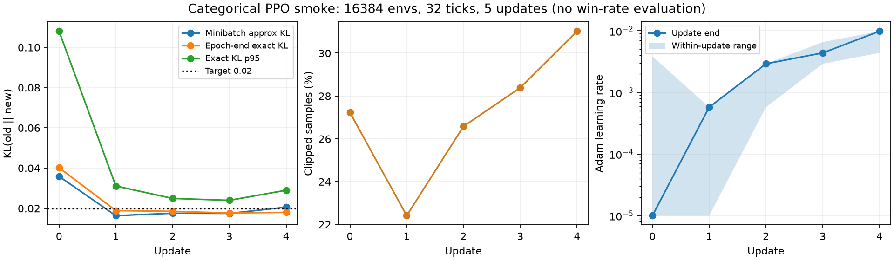

**后续评估默认采样。** 按用户要求，独立评估API/CLI、`battle_batch`及训练期间的快照eval均默认 `stochastic=True`；`self_play_ppo.json`显式启用，训练worker的报告校验和TensorBoard同步切换。报告保存 `stochastic`、`sampling_protocol=per_game_numpy_uniform_cdf_v1`、全局动作seed及每局派生seed，TensorBoard额外写 `Eval/stochastic=1`。默认动作seed跟随评估seed，独立CLI可用 `--sampling-seed` 固定地图并重复不同动作采样；显式 `--greedy` / `evaluation.stochastic=false` 仍可用于对照。

为支持之后从真实采样报告挑选输赢局录像，每局用独立NumPy RNG产生uniform，再在masked categorical概率上做逆CDF采样，单局随机流不受batch组成、其他局提前结束或模型构造影响。录像工具使用同一seed/协议重放，并核对完整逐局结果和原生Core trace。历史greedy及前述旧批次采样协议报告保留原标签，不能混作同一评估曲线；冻结实验源码未修改。

相关unittest共33项（32通过，1项GPU测试跳过），录像/分析pytest3项通过。新测试验证默认采样确实产生非greedy动作、不消耗全局Torch/NumPy RNG、mask合法、换序/挑选局可完整复现；真实checkpoint以batch5评估32局后，挑选输赢局以不同batch录像，完整match及原生Core重放一致。长期训练继续暂停，本次仅切换评估协议，不计作新训练版本。

## v19：新采样协议下重跑 v17 结构对照（已完成）

2026-10-07 按用户的新阶段要求建立从零对照。保持 v17 的轻量网络、H4、MDP 和纯历史自对弈；采用当前默认的 categorical adaptive LR、PPO 更新监控与可复现采样评估。v19 不引入持久事实、不增加 critic 历史输入、不扩容、不衰减奖励。旧 v17 的 fixed LR＋greedy 成绩只作历史参考，不能作为这些新消融的唯一对照。

配置 `rl/configs/v19.json`，源码 commit **`898c838b6e1d2f02b21305cf2a49392b8a1ba522`**；109个运行文件从该commit冻结至 `outputs/moe_cts/iterations/v19/source/`，train/eval/env/vendor import 合同通过。每次正式run随机初始化、新Adam、新历史池，无warm-start/resume；实际随机模型snapshot0 SHA256为 `79daf4b0b7859f2e356b7db2053eccd6391b393186d6a13d548af354fad18655`。只读核对它与原v17同seed的22个初始化张量逐位一致，没有把旧权重加载到本轮。

- 9×9、1v1，N=16384、T=32，即每更新524288个新样本；E=4/B=64，logical minibatch8192、256次Adam/update。episode最多1024tick、H4、地图池65536、训练seed20261013、座次轮换。
- actor10697/critic5089、总15786参数：C16两层3×3卷积，局部特征与全局均值、己将几何和WAIT/MOVE因子化。productive mask、combat与king threat特征保留；actor仅用局部H4＋最新public，critic仅用完整当前state。
- PBRS潜能 `Phi=.05*territory+.2*cities+.001*army`，potential_gamma与PPO gamma均.995，真实终局潜能归零；输赢±1、tick−.001，lambda.95、entropy coefficient.01。初始LR1e−4、adaptive desiredKL.02；PPO监控probe8192/chunk1024，teacher0。
- 历史池8（保留随机初始模型＋最近7个训练快照），pub50、均匀抽样、整局固定对手，不混baseline训练对手。保存间隔2000、完整checkpoint最多3；eval保留最近3＋best，人工诊断模型最多4。
- 每100迭代采样评估四AI，每AI200张地图×双座=400局，共1600局；seed与采样seed271828，CPU单线程/batch128、上限2000tick、按每局独立NumPy uniform/CDF流采样。win rate的分母包含draw。预算最少1h、最多3h，自动平台设置patience12/min_improvement2pp。

前置门禁：CPU三更新/192转移/48 timeout、三次采样eval全部成功；全规模GPU五更新/2621440转移、compute140777/s，allocated12.610GiB、reserved13.582GiB，loss/参数有限。首次GPU启动因`.venv`未找到nvcc，在第一tick前退出；改用backend已有的 `GENERALS_NVCC` 指向现有conda compiler后通过，没有修改env/vendor。短门禁不计正式成绩；末尾发布的训练模型没有后续rollout，不能据此声称已执行成熟历史池。

正式训练已正常退出，**1847次完整更新、每环境59104tick、968359936转移**。wall **7317.15秒（121.95分钟）**，collection2330.75秒＋update4967.20秒；compute **132689 transitions/s**，完整wall **132341/s**。GPU峰值allocated **12.616GiB**、reserved **13.916GiB**。完成6448272个episode（自然终止6426775、timeout21497，约0.33%）；18次selector全部完成，failed/cancelled/queued/running均0。publication计数38，最终池ID为0、31..37；已从可选池移除的30仍被部分未结束episode使用，符合整局固定对手规则。

本轮停止原因是 **`requested_stop`**：约两小时后，best1199之后六个已完成选模点未刷新best，aggressive最近1599/1699/1799为93.25/90/88%，没有持续上升。主动创建STOP，在完整PPO更新边界保存并排空eval后exit0；**不是自动patience12触发**。自动控制参考停留在1099，最终7个点未超过2pp阈值，尚不足12点；也不声称已连续一小时无提升。每环境1M tick只是调用上限，本轮未跑满。依据见 `outputs/moe_cts/iterations/v19/diagnostic/stop_decision.json`。

最终按预定“最低AI胜率→aggressive→overall”规则选中 **snapshot24/iteration1199**，每环境38400tick、629145600转移。训练结束后固定到 `outputs/moe_cts/iterations/v19/final_best/checkpoint.pt`，SHA256 **`6d06d1875c939f186543ada410818151cd70354bfb6fd0e8382aaa511d295a62`**；不是末尾checkpoint，也不是中途299模型。capture记录确认最终训练exit0后取该best，避免后续文件覆盖。

| 评测 | aggressive | expansion | defensive | random |
| --- | ---: | ---: | ---: | ---: |
| 实际随机初始模型，selector协议，400局/AI | 0.25% | 4.25% | 1.25% | 3.75% |
| 最终best1199，selector seed271828，400局/AI | **93.75%** | **97.5%** | **99.25%** | **99.5%** |
| 最终best1199，复用开发seed1001042，400局/AI | **90.5%** | **97%** | **99.5%** | **99.5%** |
| 最后selector1799，同selector协议，400局/AI | 88% | 95.75% | 99.25% | 99% |

开发复测分别为362/38/0、388/11/1、398/2/0、398/2/0（win/loss/draw），合计1546/53/1、overall96.625%；开发seed1001042此前用于调试比较，**不是heldout或最终独立验收**。selector也在18次评测中反复用于选模。这里四项超过80%证明该有限开发赛程表现良好，不表示任意随机地图保证、不表示世界级策略，更不结束后续已约定的完整实验阶段。best的开发aggressive比选模低3.25pp，需要继续保持跨seed评估。

完整18点采样selector，均为400局/AI：

| 迭代 | aggressive | expansion | defensive | random |
| --- | ---: | ---: | ---: | ---: |
| 99 | 59% | 77% | 93.75% | 96.25% |
| 199 | 87.75% | 96.75% | 99.25% | 99% |
| 299 | 90% | 97.25% | 99.75% | 99.25% |
| 399 | 87.5% | 97% | 99.25% | 99.25% |
| 499 | 85.75% | 95.5% | 100% | 99.75% |
| 599 | 86.5% | 96.5% | 99.75% | 99.75% |
| 699 | 87.75% | 94.5% | 99.5% | 99.5% |
| 799 | 89% | 94.75% | 99% | 99.5% |
| 899 | 90% | 95% | 99.5% | 99.75% |
| 999 | 92% | 95% | 99.25% | 99% |
| 1099 | 93.75% | 95% | 100% | 99.5% |
| 1199（best） | **93.75%** | **97.5%** | **99.25%** | **99.5%** |
| 1299 | 90% | 96% | 99.5% | 99.25% |
| 1399 | 88.5% | 95% | 98.5% | 99.5% |
| 1499 | 92% | 94.75% | 98.75% | 99% |
| 1599 | 93.25% | 94.75% | 99.25% | 99% |
| 1699 | 90% | 95.25% | 99.5% | 99.5% |
| 1799 | 88% | 95.75% | 99.25% | 99% |

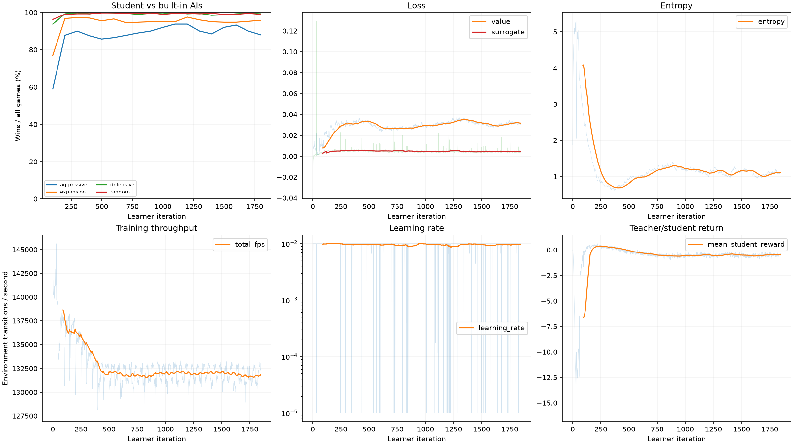

曲线与更新诊断：

- aggressive在199已到87.75%，499跌到85.75%后逐步回升，1099/1199到93.75%；best后不是单调退化，1599曾回到93.25%，随后又下降。1199→1799同地图、座次和采样随机流有38局从胜转非胜、15局转胜，净−23/400=−5.75pp；按地图聚类bootstrap的95%差值区间[−9.5,−2.25]pp。best是在该反复使用的selector上选出的，因此该差值只描述固定赛程，不是无偏的泛化或因果估计。expansion−1.75pp、defensive不变、random−0.5pp。
- 末100更新value loss0.03175、surrogate0.004389、entropy1.109、probe上的整轮精确categorical KL均值0.01450，优化过程平均clip fraction12.44%、grad norm0.251。熵早期下降后回升到约1.1，不符合持续熵塌缩的简单解释；`Loss/value` 是当前PPO的clipped value objective（取原始与裁剪平方误差的较大值），不是独立的原始预测MSE或critic解释方差，本轮未记录explained variance。
- 自适应LR实际持续工作：末100更新的LR均值0.009734，每次更新内LR最大值都触及上限0.01；它依据minibatch选中动作的KL估计调节，整轮8192样本的精确KL仅用于监控。1209/1216/1219在best后出现整轮KL约0.1845/0.0937/0.1118，说明偶有较大策略改动；时间相邻并不能证明这些尖峰造成后续胜率下降，历史对手变化和随机赛程也影响学习。
- 末100更新平均collection1.289秒、update2.688秒、compute131800/s；监控约0.0845秒/更新。历史池填满后吞吐约132k/s、显存稳定，没有观测到资源持续增长导致后期退步。末100 student回报−0.487、self-play episode胜率约63.17%；这些面向变化的历史对手和含PBRS/tick的回报，不能替代baseline胜率。

最终best1199的每AI一败一胜录像位于 `outputs/moe_cts/iterations/v19/final_best/analysis/videos/`，失败逐决策审查为 `analysis/failure_review.md/json`。八局共 **2266tick**，按各类时长选中位例，不是无偏失败样本。它们重现了selector中相应对局的全部match字段；录制trace的选中联合动作、digest及独立Core重放逐tick一致。**原CPU周期eval没有保存原始逐动作trace，因此不能宣称这些录像与原eval的每个动作逐tick相同**；这里验证的是完整对局统计重现及新录制轨迹的Core一致性。分析使用冻结local encoder重建真实3×3视野，区分“曾经见过”与“当前H4仍可读”，不向actor补充旁观全图信息。

- aggressive败局245tick：从未见到敌将。t25领地1/11、t100兵力38/71且领地13/32，长期经济落后；41次抽将、27次补将、31次相邻tick反向搬兵，存在回援但反复抽空。t242可以12→11补3兵却外攻，t243可见敌军距将2格仍抽将；t244己将1兵、相邻敌6兵，已无可用邻军。最终WAIT发生在此前的经济和部署劣势后，不能只改最后WAIT解释败局。
- expansion败局199tick：终局前总兵力82/73，但t184从将上抽55兵，主力沿另一端行军，t198约35兵仍距己将6格。敌军连续在距将4→3→2→1格的合法视野内推进，终局邻接敌22兵、己将8兵。学生最后选14→5，因seat0先斩将而未执行；不是WAIT或action-mask错误，也不能把总体兵多当作已经守住主城。
- defensive败局185tick：敌将t90..184连续可见，最后也在H4，**不能归因于遗忘敌将**。t179抽22兵，t180..183邻军23兵具备合法回援选项，却在其他位置行动；三次攻将的实际兵量均不足以超过增长后的守军，t183打平后敌将0兵仍存活。t184终于选择回援，但seat0先斩将，动作未执行；甚至补22兵也不足抵挡当时29兵进攻，没有证明最后改一步就可获胜。
- random败局1345tick：t100仍有优势，t143用33兵攻40兵中立城未占城，对手t241获城；学生两次短暂夺回后又丢城，t1000兵力27/1269。敌将最后t621可见，H4保留到624，625起输入不再含该地标；这支持记忆消融的动机，不证明遗忘造成此败局。t1343动作在共同边界合法，但源格被先手夺走而NOT_OWNER；t1344选动作又因先手斩将跳过。该长例有321个决策超出训练episode1024tick窗口，评测上限是2000，clock范围差异需单列；经济劣势在超出窗口前已经形成。

四个胜局分别74/66/81/71tick，均能集结并在敌将重新可见时完成足量攻击；部分胜局也有晚扩张、抽将、折返、敌将短期视野遗失。因此不把抽将或折返次数直接变成错误标签。这些例子支持检验信息状态、全图调度与信用分配，尚不能确认新增critic输入、持久记忆或更大网络有因果收益。

中途诊断另存且仍保留：299模型开发复测89.25/98/99.5/100%，八局与failure_review在 `diagnostic/best_at_299/analysis/`，**不是本轮最终模型结果**。999时aggressive92%，299→999的配对转胜30/丢胜22净+2pp、expansion净−2.25pp，当时继续观察的决定保留为过程依据；不将中期失败事实套用到1199。

TensorBoard：`outputs/moe_cts/iterations/v19/train/`（InitialEval step−1与训练Eval/、PPO/等）。最终预算/资源/退出见 `train/summary.json`；固定best溯源 `final_best/capture.json`，开发报告 `final_best/development_report.json`，曲线及录像 `final_best/analysis/summary.json`；终局PPO与成对趋势 `diagnostic/terminal_training_review.json`。

### v19 信息可用性补测

为给后续记忆消融建立全赛程对照，对不可变1199模型增加一轮CPU只读observer复测：沿用开发seed与sampling_seed1001042、200地图/AI、双座、batch128、上限2000tick，共额外执行1600局实例。session76509实际exit0，148098次决策全部满足每局decision数等于report ticks；新旧1600个完整game records及by-AI/overall汇总逐项一致，原开发报告保留。开发种子已复用，仍不是heldout。observer仅从合法3×3可见区域记录决策前信息，终止/截断poststate不计为下一次观测；没有修改policy输入或随机流。微型OFF/ON实战与八段已有录像的2266决策独立核验也通过。

| baseline | 败局数 | 从未见到敌将 | 曾见、最后H4可读 | 曾见、最后H4不可读 | 全决策中曾见但H4不可读 |
| --- | ---: | ---: | ---: | ---: | ---: |
| aggressive | 38 | 13 | 2 | 23 | 22.77% |
| expansion | 11 | 5 | 3 | 3 | 11.87% |
| defensive | 2 | 1 | 0 | 1 | 11.02% |
| random | 2 | 0 | 1 | 1 | 18.34% |

表中最后一列按实际决策数加权；信息分类描述输入中地标的可用性，不证明actor是否使用它，也不把缺失直接当作失败原因。28个“曾见、最后H4不可读”的败局，其末次决策距最后见将均至少8tick；aggressive的23局中22局至少32tick、1局16–31tick。因此，在这些已生成轨迹的最后决策上，H8比H4新增敌将地标覆盖为0/28。这支持将持久事实与短期历史分开实验，不能推导H8对更早决策或胜率没有帮助；换输入后整条轨迹也可能改变。

证据：`v19/final_best/development_information.json`、`development_information_recheck_contract.json`，及 `information_audit/v19_development_summary.json`（均位于 `outputs/moe_cts/iterations/` 对应目录）。这是一项补充诊断，不增加正式训练版本，也未改变v19选模或停止决定。

### v19 与 v17 的学习模型交叉对战

为补充固定 baseline 之外的强度测量，新执行 v17 best1699 与 v19 best1199 的采样交叉对战：9×9、800 张地图交换座次共1600局，地图seed314159265、sampling seed161803399、batch128、CPU单线程、max2000tick；双方保持各自H4、clock1024、合法动作mask及整场固定权重。v17模型来自原greedy selector，v19来自采样selector，本次双方动作均按各自Categorical概率采样。没有训练更新或GPU占用。

| 模型 | 胜 / 负 / 平 | 对战胜率 | 800张配对地图 bootstrap 95%区间 |
| --- | ---: | ---: | ---: |
| v17 / 1699 | 675 / 925 / 0 | 42.19% | 39.88%–44.63% |
| v19 / 1199 | 925 / 675 / 0 | **57.81%** | **55.38%–60.13%** |

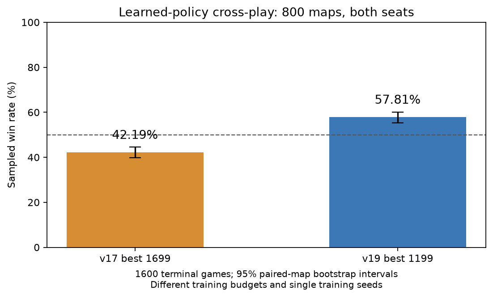

全部1600局为真实终局、无timeout；v19位于绝对seat0/1时分别514/800（64.25%）及411/800（51.38%），保留两座结果而非只测先手。800张地图中，v19双胜261张、两方各胜一局403张、v17双胜136张。区间以整张地图为重采样单位，双座始终一起保留，20000次bootstrap；不是将1600座次视为独立样本。对战255659tick，battle58.70秒、含加载及兼容检查61.90秒，实际session75292 exit0。

此次使用当前兼容解释器，完整核验v17/v19的108/109个冻结源文件与原Git commit及manifest；双方配置内容与原始提交一致。分别在隔离冻结源码中执行三帧CPU输入/前向probe，与当前解释器的输入逐字节一致、动作概率差为0。这些有限probe不等于所有状态的数值等价证明。仅记录预定首张地图的两局真实动作，不按输赢挑选；两局已通过Core逐tick digest、编码动作SHA、终局时间及赢家的精确重放核验。原生联合动作执行后拒绝数为331/577，双方采样动作均通过各自决策前mask，不能将该计数直接解释为单方mask非法动作率。

两段说明例均体现兵力调度与守将问题：第0局v19在38tick获胜，终局前总兵19/19，v17继续外扩，v19用10兵攻下4兵守将；第1局v17在110tick获胜，最后集中兵力连续推进，v19总兵27略多于v17的26，但将上补防后只有4兵，被10兵攻下。末期邻域敌军均已处于合法可见区域，不能把这两例归因为记忆缺失。两例来自同一张预定地图，均由seat1获胜，不据它们推断总体席位效果或某个超参数的因果作用。详细记录 `learned_crossplay/v17_1699_vs_v19_final_1600_trace_review.json`。

本次选定模型对战中v19占优，但两版训练预算、优化设置及选模方式不同，且各只有一个训练seed；不把差异归因为adaptive LR或某个单独设计，也不代表对任意学习型对手均占优。本补测不增加正式训练版本、不改变v19最终选模。原始report、真实会话记录、root赛程/配对统计审查位于 `outputs/moe_cts/iterations/learned_crossplay/v17_1699_vs_v19_final_1600{,_execution,_root_review}.json`；checkpoint SHA分别为 `b0905756…` 与 `6d06d187…`，完整值随报告保存。

## v20：仅让 critic 读取 actor 的 H4 信息（正式训练完成）

动机：同一完整棋盘下，actor 的短期可见信息不同，其未来行为和回报可以不同。检验 history-state critic 是否改善估值与自对弈学习；本轮不增加持久记忆、不扩大 actor、不改变资源 PBRS、gamma、lambda、rollout 或历史池。

实现：新增 `InformationSpatialPPOPolicy`，在完整 v17 随机构造完成后，critic 首层附加 actor 的 48 个 H4 地图通道，context 附加 actor 当前的 13 个公共特征。新增输入权重为零，原权重保留；构造使用局部 RNG fork，使 actor 初始化和全局随机流与对照一致。这不是加载旧 checkpoint：每次仍新建随机 policy、新 Adam、新 pool。critic 复用已存储的 `policy` 输入，不另复制 rollout history。actor/critic 参数独立；actor 不读取特权 state。

配置 `rl/configs/v20.json` 相对 v19 只增加 critic 信息输入及其类/group 声明，run_id=v20；knowledge_channels=0。其余 N16384×T32、E4/B64（524288 新样本、8192/logical minibatch、256 Adam/update）、gamma=.995/lambda=.95、H4、episode1024、pool8/pub50、sampled eval 每100更新1600局、adaptive KL=.02、最少1h/最多3h均保持。该适配器也提供未开启的 memory 扩展，为下一步 2×2 使用，当前训练不会创建或存储 memory。

验证：18 个 CPU tests 通过，包括禁用信息扩展时原模型/输出/梯度/RNG逐位一致、critic-only actor 初始化/动作概率/RNG逐位一致、新 critic 初始 value 在浮点舍入误差内一致、history/public 新权重梯度非零、actor 隐私，以及真实 self-play PPO 三次更新和 timeout bootstrap；categorical mask/WAIT-MOVE factorization 与轻量网络回归通过。未新增 vendor 补丁。上述 CPU 合同不作为训练提升证据；正式运行使用下述冻结源。

补充实际 smoke：v20 commit `61fea9053e9925b13dea590bb7ebc4a16a8e8c73` 的110个运行文件直接从Git blob冻结，排除所有尚未提交的记忆/架构/评测工作区改动。该冻结源跑N16/T8/episode8的五次fresh CPU更新，共640转移、80 timeout，teacher0；两次采样eval均成功，实际episode对手已执行训练后历史模型。独立CPU重新构造与自己的初始snapshot0全部张量逐位一致，actor10697/critic12209；actor初始张量和全局RNG与Light对照逐位一致，新增critic输入权重为零。证据 `outputs/moe_cts/iterations/v20/cpu_contract.json`。v19正常退出后，同一冻结源通过全规模GPU门禁：N16384/T32、E4/B64，五次完整更新、2621440转移，collection5.632秒/update16.150秒，compute120348/s，wall31.351秒（含启动，wall83616/s）；allocated12.951GiB、reserved13.703GiB，loss有限、teacher0、exit0。记录 `outputs/moe_cts/iterations/v20/smoke_gpu/summary.json`。这五次rollout仍仅执行初始随机对手，末尾发布的训练快照尚未被下一rollout使用，不能外推成熟pool吞吐或胜率。正式1–3h训练随后已从同一冻结源fresh启动，session74897、PID3066147，输出与TensorBoard为 `outputs/moe_cts/iterations/v20/train/`；CLI无resume/warm-start，不从GPU门禁权重续训。本轮已正常结束，最终成绩与终局证据见下文。实际seed snapshot0与独立fresh CPU构造全部张量逐位一致，actor初始化与Light对照一致、新critic输入列为零、独立Adam空状态；110个运行文件hash与所有import均来自冻结源。formal manifest的resume_source=null、初始source=random_initial_policy，证据 `v20/formal_initialization_contract.json`。

本轮实际随机初始模型已独立采样1600局，四项0.25/4.25/1.25/3.75%，与v19的全部1600局逐项完全相同，确认部署actor起点一致；不是直接复用旧报告。已记录InitialEval step−1。早期99/199两次selector分别为36/66.25/86.25/84.25%与83.25/93.75/99/99.75%，当时曲线仍上升，因此继续观察；这两点不能证明critic信息输入提升或损害最终能力。

### v20 最终训练与评测结果

正式训练已正常退出：**2034次完整更新、每环境65088tick、1066401792转移**；完整wall **9210.576秒（153.510分钟）**，collection2773.477秒＋update6416.855秒，compute **116035 transitions/s**、完整wall **115780/s**。GPU峰值allocated **13.132GiB**、reserved **14.039GiB**；完成7652727个episode，其中自然终止7625270、timeout27457（约0.3588%）。20次采样selector全部成功，无failed/cancelled/queued/running；teacher0，loss/参数有限。实际session74897 exit0，原PID3066147已消失；不是仅根据状态文件认定结束。

停训为人工平台判断后的`requested_stop`：best1399后六个已完成评测的aggressive为93.25/92.75/93.25/93.25/91.25/90%，峰到最后selector发布相隔45.468分钟，峰到正式退出48.052分钟，无新best或持续回升。按STOP在完整PPO更新边界保存并排空评测；**未触发自动patience12**，1399刷新自动参考后仅有六个不超过2pp阈值的点。每环境1M tick是调用上限，本轮按1–3h规则提前结束。依据`v20/diagnostic/stop_decision.json`与`train/summary.json`。

终局按预定最低AI胜率→aggressive→overall选中**snapshot28/iteration1399**，每环境44800tick、734003200转移；退出后复制到不可变`v20/final_best/checkpoint.pt`，SHA256 **72455df404b4f0049ed26f017a1a09a461f7fba179d97cf87a32b1f32c1bd082**。capture逐字节核验110个冻结运行文件与61fea90的Git blob、实际run config、完整终局曲线和best身份。

| 评测 | aggressive | expansion | defensive | random |
| --- | ---: | ---: | ---: | ---: |
| 实际随机初始模型，400局/AI | 0.25% | 4.25% | 1.25% | 3.75% |
| 最终best1399，selector seed271828 | 93.75% | 95.75% | 99.5% | 99.75% |
| best1399，复用开发seed1001042 | 93% | 96.25% | 99.5% | 99.5% |
| 末次selector1999 | 90% | 95.75% | 98.75% | 98.5% |

开发复测为372/28/0、385/15/0、398/2/0、398/2/0（W/L/D），overall1553/1600=**97.0625%**。实际CPU observer session66649 exit0，新运行全部1600局与145964个决策；不是复制v19结果。seed1001042此前用于开发，因此不是heldout。selector反复用于选模，有限赛程高胜率不构成任意地图保证或世界级强度证明。

完整20点采样selector（每AI200张地图×双座=400局）：

| 迭代 | aggressive | expansion | defensive | random |
| --- | ---: | ---: | ---: | ---: |
| 99 | 36% | 66.25% | 86.25% | 84.25% |
| 199 | 83.25% | 93.75% | 99% | 99.75% |
| 299 | 85.75% | 96.25% | 100% | 99.25% |
| 399 | 90.25% | 97.25% | 99.5% | 98.75% |
| 499 | 84.5% | 97.5% | 99.5% | 99.25% |
| 599 | 84.5% | 94.75% | 99% | 99.5% |
| 699 | 88.25% | 96.75% | 98.5% | 99.75% |
| 799 | 87.5% | 94.5% | 98.25% | 99.5% |
| 899 | 84.25% | 94.25% | 98.25% | 99% |
| 999 | 86.75% | 94.75% | 99% | 99.5% |
| 1099 | 89.75% | 95.25% | 99% | 99.25% |
| 1199 | 91.25% | 95.75% | 99.25% | 99.5% |
| 1299 | 90.25% | 94.75% | 100% | 99% |
| 1399（best） | 93.75% | 95.75% | 99.5% | 99.75% |
| 1499 | 93.25% | 94.75% | 98.5% | 99.75% |
| 1599 | 92.75% | 96.5% | 98.5% | 98.75% |
| 1699 | 93.25% | 95.75% | 99.25% | 99.75% |
| 1799 | 93.25% | 96.75% | 99.75% | 99.75% |
| 1899 | 91.25% | 97.75% | 98.75% | 100% |
| 1999 | 90% | 95.75% | 98.75% | 98.5% |

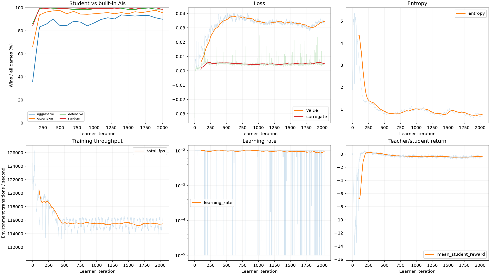

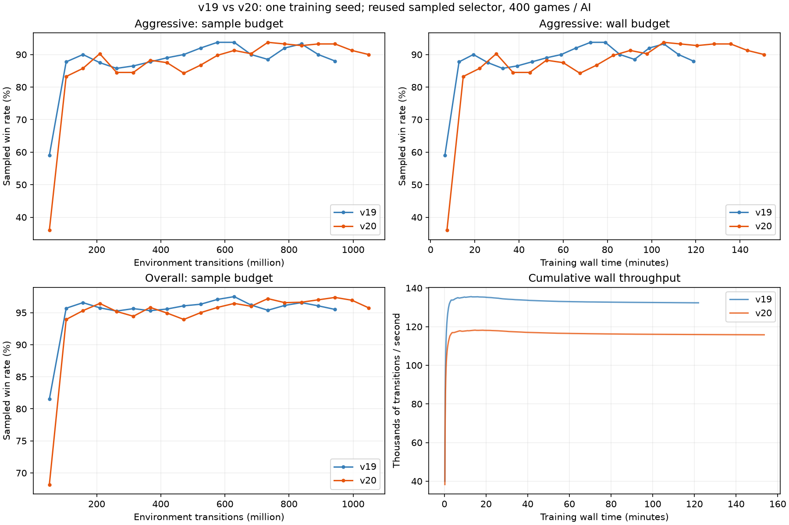

对照结论：v20并未显示一致的样本效率提升。同1199更新/629145600样本时，aggressive比v19低2.5pp（配对95%CI −5.75..+0.75）；两轮独立选出的best aggressive均93.75%，差值0pp（−2.75..+2.75），overall v20低0.3125pp（−1.25..+0.5625）。开发best比较aggressive提高2.5pp（−1..+6.25），overall提高0.4375pp（−0.75..+1.6875），尚不能确认跨训练种子的稳定收益。全部CI以整张地图为单位保留双座/四AI，用20000次bootstrap seed20261007；差异不同于独立Bernoulli置信区间。

v20完整wall吞吐比v19低**12.51%**，allocated峰值增加0.516GiB；总训练多31.56分钟、多10.12%样本。v20best1399比v19best1199还多16.67%训练样本，因此不能仅按最终best排名归因于critic history。同121.953分钟时v20实际采847773696条、v19终局968359936条。仅一个共同训练seed，critic从5089增至12209参数也与输入信息变化同时发生；本轮描述实际方案效果，不声称纯信息输入的无混杂因果收益。完整38份selector/60800逐局赛程与时间对照见`diagnostic/v19_v20_formal_comparison.json`。

末期趋势与PPO诊断：1399→1999 aggressive下降3.75pp（−7.25..−0.25），overall下降1.4375pp（−2.6875..−0.1875）；这些是复用选模赛程上峰值到末尾的条件比较，不是无偏泛化估计。末100更新exact whole-update KL均值0.01624/p95 0.03674、clip fraction10.98%、entropy0.7489、grad norm0.2550；clipped value objective均值0.03446，不是独立预测MSE/explained variance。entropy在中后期有起伏，末期低于v19，不能仅凭均值断言熵塌缩是败因。

自适应LR实际启用：末100均值0.009168，91%更新结束在上限0.01，每次更新内最大LR都达到该上限，平均4.72次调整；依据minibatch selected-action k3调节，整轮8192样本精确KL仅监控。638/1514/1761整轮KL达0.1265/0.1222/0.1124，存在大更新尖峰，但时间相邻不是退化因果证明。末100实际collection1.387秒＋update3.154秒，compute115450/s、区间wall115316/s，monitor0.0883秒/update；allocated约11.616GiB且稳定。未观察到资源持续增长解释末期回落。student平均回报−0.378面向变化的历史对手和含PBRS/tick目标，不能替代baseline胜率。

### v20 最佳模型行为与信息诊断

selector1399每AI各选一败一胜，实际CPU重现并生成8段MP4，合计969tick；选各类中位时长例，不是无偏失败样本，missing=[]。冻结61fea90工具、110runtime以及全部977 states/969联合动作通过Core/native逐tick digest、本地视野/H4/productive mask核验。demo真实session73950 exit0。原CPU selector未保存原逐动作trace，所以只证明完整比赛统计重现和此次录制轨迹的Core一致性，不声称与原eval动作逐tick相同。录制后compact review无新模型推理或新seed，六个指定末tick分支保持原对手动作，只判断该tick结果。

- aggressive败局242，283tick：t68..69见到敌将，H4至72，此后该地标不再出现在H4输入中；最后决策前已探索96.3%地图，己方兵42/敌88、领地15/49。t277从己将抽16兵后主力南移；末tick外攻46→55出18，敌方10→9出7杀3兵己将。改WAIT或邻军补1都仍死亡，不能把最后一步当作独立充分败因。
- expansion败局429，185tick：t82..164连续见敌将，H4至167；全局20次抽将、22次回援，不能说从不回防。末tick学生seat1的动作197被seat0的33→34出7先斩将而跳过；WAIT同样跳过，没有末tick合法邻军回援。原先计划动作不等于实际执行动作。
- defensive败局930，103tick：从未发现敌将，最后决策前仍有37/19兵、18/8地的全局优势。t97将48→57抽17，主力随后沿58/67移动，t100敌29兵夺58，接着58→57→48杀将。最后学生32→33仅移1，指定39→48回2可让己将以0兵存活该tick；这是局部可改善证据，不证明之后会赢，也不能忽略更早部署。
- random败局1464，96tick：t66..72见将，H4至75。最后己将40南攻49实际仅出2，将敌兵5削至3，随后敌49→40出2斩将；改WAIT仍被同一方向动作出4杀将。没有证明最后停手即可获胜。

四个胜局74/72/82/74tick，也有抽将、回援和局部折返；行为次数本身不是错误标签。上述例子支持继续检验长期知识和全图攻守调度，不足以把记忆缺失、大更新或某次抽将分别定为唯一败因。录像`final_best/analysis/videos/`，逐tick证据`compact_failure_review.json`、独立媒体/缺例审计`recorded_failure_audit.json`。

同一开发observer进一步统计：

| AI | 败局 | 从未见敌将 | 最后H4含敌将 | 曾见但最后H4已丢失 |
| --- | ---: | ---: | ---: | ---: |
| aggressive | 28 | 8 | 4 | 16 |
| expansion | 15 | 5 | 5 | 5 |
| defensive | 2 | 0 | 2 | 0 |
| random | 2 | 1 | 1 | 0 |

21个最后H4丢失的败局均距最后目击至少8tick，固定这些轨迹的末次决策上H8额外地标覆盖为0；所有决策中曾见但H4缺失约15.35%。这些是合法输入可用性，不是网络是否利用信息或遗忘造成失败的证明。它是一次single-pass观测，没有独立同模型第二报告重检，aggregate明确`no_independent_recheck_report=true`，但完整赛程/决策时序/源和checkpoint绑定已通过。

### v20 与 v19 最佳学习模型交叉对战

新运行800张地图换座共1600局，map seed314159265、sampling seed161803399、CPU单线程/batch128/max2000tick，双方均采样且整场固定自身权重。v20 **870胜/730负、54.375%**，按800张完整配对地图bootstrap 95%CI **52..56.75%**；v19为45.625%（43.25..48%）。v20处于绝对seat0/1时62.375%/46.375%，保留双方先后手差异。800图中v20双胜221、分胜428、v19双胜151；全部自然终局、无timeout。259807tick，battle59.761秒、含加载/兼容检查62.889秒，实际session43665 exit0。

root独立核验1600个地图/座次/逐模型sampling seed/决策数/赢家与配对初始digest，109/110冻结源和各自原Git配置均核验；当前兼容解释器的有限3帧×2lane probe与隔离原源动作概率差为0，不等于所有状态数值等价。两段预定首图双座trace共374tick通过Core/actionSHA/finaldigest精确重放：44tick例v19速攻获胜，330tick例v20长期优势推进；后例v19最终回援因先手夺源格而NOT_OWNER，不能视为决策前mask错误。双方原生联合动作拒绝566/536也不等于单方mask非法率。结果提示本次选定v20策略较强，但选模、预算和单训练seed条件不能支持critic信息改动的因果结论。证据`learned_crossplay/v19_final_vs_v20_final_1600*.json`。

本轮结论：保留history-state critic作为合理建模候选，目前未证实它优于state-only的计算预算效率。下一轮严格按2×2仅增加actor K、critic恢复state-only，保持其他因素；不会因开发集已超80%跳过组合、容量、gamma、tick课程和H8阶段。TensorBoard仍在`outputs/moe_cts/iterations/v20/train/`，最终审查`diagnostic/terminal_training_review.json`。

## v21：仅给 actor 增加持久事实记忆（已完成）

动机：H4会丢失更早的合法探索信息。单独检验不堆叠的持久知识是否改善自对弈，critic仍只读取当前privileged state，形成memory×critic-information消融的第三个条件。v21已完成正式训练、开发复测与录像分析；随后v22启用相同记忆和history-state critic，补齐组合条件。

新增MDP模块 `KnowledgeState`，每个episode/player各维护compact状态，只由己方地块3×3合法视野更新。两人局11通道为explored、mountain、last_seen_city、general_landmark、enemy_general_landmark、not_enemy_general、last_seen_empty、last_seen_neutral、last_seen_owner_0/1、last_seen_age。general地标保留最初合法看见的将位置；斩将变城市后地标仍保留。owner和city明确是最后观测值，age按经过tick/1024截断到1；未知格explored=0，owner未知sentinel=-3。没有读取隐藏general_pos或预测隐藏兵力。

知识单独存为 `knowledge`，不按H4重复堆叠。learner、episode固定历史对手与采样eval维护各自player-local知识；terminal observation先完成最后一次更新，随后reset清空选中lane所有seat，座位轮换不传递另一玩家的探索信息。模型池签名只在启用时加入schema与channels，防止不兼容旧pool加载；默认关闭路径不创建知识状态。clone提供独立信息状态，为之后搜索分支复用，不增加搜索算法依赖。

复用已提交InformationSpatialPPOPolicy，actor的11个新输入通道零初始化，保留全新随机Light函数及RNG；critic不接收H4或knowledge。actor12281、critic5089、合计17370参数。其余N16384×T32、E4/B64、gamma=.995/lambda=.95、episode1024、H4、历史池与采样eval协议与v19/v20相同。新增知识rollout约1.740GiB，compact learner+opponent状态合计70.875MiB；正式全程峰值和吞吐见终局结果。

同时将combat/king距离的9×9常数替换为实际H/W，供后续容量实验复用；v21仍只训练9×9。独立坐标枚举参考与旧9×9完整特征hash回归验证通过，不把支持形状运行当作地图泛化成绩。

实现阶段CPU单元36项中35通过、1 CUDA项跳过，覆盖隐藏信息、已探索事实、过期owner、将转城市、mask更新、clone、terminal/reset、双座历史对手、disabled行为、信息critic和几何回归。候选v21/v22各五次CPU更新、两次完整采样小eval通过；实际执行多个训练后历史模型，memory新权重已经学习，所有loss和TensorBoard指标有限。该阶段候选smoke未冻结，记录于各自 `preparation/smoke_cpu_verification.json`；不当作正式胜率结论。随后提交并执行的冻结源验证见下文，不重复运行已通过检查。

v21已独立提交为 `d55a835908556f28e3f7ab0fc1730598c30849e0`，111个运行文件从该commit的Git blob冻结，排除GPU评测、混合精度和大网络候选改动。冻结源N16/T8/episode8重新完成五次fresh CPU更新，640转移、80 timeout，两次完整采样小eval、failed0。独立重建确认初始policy与本轮snapshot0逐位一致、Adam空状态、actor新增知识权重为零，knowledge storage实际为[8,16,891]。证据 `outputs/moe_cts/iterations/v21/cpu_contract.json`；该阶段正式训练排在v20之后，CPU门禁不计正式训练版本成绩。

v20实际终局后，v21冻结源通过全规模GPU五更新：N16384/T32、2621440转移，compute97374/s、含启动wall36.188秒，allocated14.614GiB/reserved15.891GiB，所有loss/参数有限，session57616实际exit0。为验证历史模型真正被使用，门禁配置仅将pub50改pub1并关闭eval/预算；外部after-return Python Counter不加入tensor运算、不改动作/RNG或原summary，实际完成训练后snapshot1/2/3/4的251/168/126/54次概率前向（5949/2911/1069/365行）。这证明非初始历史模型真实执行，但不是成熟8模型池长期吞吐、双座动作执行或正式胜率证明。该observer已在独立fresh CPU ON/OFF实战中核验20项model/Adam/RNG/轨迹/知识结果逐bit一致，GPU观察器本身不做昂贵逐tick哈希。合同`v21/gpu_history_gate_contract.json`、原summary与`history_forward_audit.json`绑定一致。正式仍使用pub50、enabled sampled eval和1–3h预算，新进程随机初始化/新Adam/新pool，不加载门禁权重。

正式进程已从上述111文件冻结源启动，session58132、PID3188195，CLI仅`--config configuration.json --replace-policy --steps-per-env 1000000 --output train`，没有resume/warm-start；启动时实际随机seed快照创建于2026-10-06 23:03:29 UTC。自己的`train/history_pool/snapshot_00000000.pt` SHA为`e969ae13b5b3927895cf3c33606d75b558de1a7aef7d741007ccb15ee75ced0c`，与独立fresh CPU构造全部模型张量逐位一致；新K输入列为零、actor初始函数与Light对照一致。独立构造的Adam为空；seed快照仅含推理权重，不将其当作实际optimizer状态证据，正式CLI与新pool来源另外核对。初始化审查实际session79812 exit0，111文件hash/import与d55a835一致，`cuda_initialized=false`；证据`v21/formal_initialization_{contract,execution}.json`。

对这个实际正式seed新执行CPU采样1600局（每AI200图×双座、地图与sampling seed271828、batch128、max2000tick）：aggressive/expansion/defensive/random分别1/400、17/400、5/400、15/400，即**0.25%/4.25%/1.25%/3.75%**，overall38/1600；809576tick、1494自然终局、106超时draw。实际session45620 exit0，517.676秒含setup属于CPU评测时间，不是GPU训练吞吐。全部1600逐局字段及汇总与v19/v20各自实际初始报告完全相同，同时独立核对每局SeedSequence赛程与采样流；不是复制控制报告。`InitialEval` step−1的7项scalar已写入本轮TensorBoard并读回。报告SHA`39bc297cfd4898556225366bf049abd094dc99910d1489e4c4f59cbd6d4f352e`，绑定与对照分别见`v21/initial_evaluation_execution.json`、`diagnostic/initial/tensorboard_record.json`。首次模块名preflight错误的session48364 exit1发生在0games前，原日志及错误元数据保留；成功评测仅上述一次1600局。

首个完整selector99为**50.25%/71%/91.25%/92.75%**，overall76.3125%；root逐局核对800配对地图、全部map/controller/采样seed、双座均衡、checkpoint SHA与汇总，见`diagnostic/live_99_root_review.json`。早期184更新观察到wall吞吐97339/s，allocated13.539GiB、reserved16.211GiB、父进程RSS约2.123GiB且swap0；不是正式全程峰值。TensorBoard与实际输出：`outputs/moe_cts/iterations/v21/train/`。以下61分钟记录与partial图保留为中途归档，最终状态见后面的终局结果。

截至2026-10-07 00:04 UTC，实际PID3188195仍在运行，TensorBoard读到677更新、wall61.33分钟，未取得训练句柄terminal exit或生成terminal summary。六个selector均实际returncode0，最新审查完整核对9600个逐局ID/outcome/winner/seat/map/controller/sampling seed及分座聚合，并绑定冻结配置、报告与index；被保留的快照另外核对当前文件hash，已经清理的早期快照仅使用已记录标识，尚不冻结最终best。训练曲线如下；每行1600局采样，使用相同200图×双座协议：

| update | aggressive | expansion | defensive | random | overall |
|---:|---:|---:|---:|---:|---:|
| 99 | 50.25% | 71% | 91.25% | 92.75% | 76.3125% |
| 199 | 87.75% | 94.25% | 98.5% | 98% | 94.625% |
| 299 | 91% | 97.5% | 99.25% | 99.5% | 96.8125% |
| 399 | 88.75% | 96.75% | 99.25% | 99% | 95.9375% |
| 499 | 88.5% | 96.75% | 99.75% | 99.5% | 96.125% |
| 599 | 88.75% | 98% | 99.75% | 98.75% | 96.3125% |

99→299明显上升，299后aggressive连续三个评测在88.5%–88.75%，覆盖27.29分钟。299→599下降2.25pp，200地图配对bootstrap95%CI为[−5.75,+1.25]pp；499→599为+0.25pp、CI[−3.75,+4.5]pp。复用selector和postselected峰值使这些CI不是heldout或信息改动的因果证据。目前继续观察实际699/799，未发STOP，最终曲线与记忆覆盖失败分析待真实终局。证据 `v21/diagnostic/live_599_review.json`（SHA `1f3c71015333811fe2904edfeb9434b6d7cc9eb2e39d19e9162121180e4c532f`）。

最近100更新（578..677）wall吞吐95970 transitions/s，collection/learning合计138.91/406.84秒；parent Torch allocated均值13.536GiB、reserved16.213GiB。whole-update categorical KL均值0.02051、p95 0.03975、最大0.05991，entropy均值0.4900、clip fraction0.1117；82%更新结束时LR位于真实上限0.01，adaptive仍实际工作。更早544曾出现whole-update KL0.11422且LR降到1e−5；minibatch选中动作的KL自适应并不保证整轮累计KL不超过target0.02。以上均为中途窗口，不能当作全程速度/峰值或数值发散结论。Knowledge指标描述训练poststep的可用信息，不证明网络使用了记忆。

下图归档的是此前已实际完成99..499的partial快照，同时比较等样本及等wall预算；时间轴截到45.12分钟，v19/v20也只显示该窗口的真实点。17份实际returncode0报告、27200条对局、各冻结source/config/report/index及TB读取bytes已核验；连接线不代表补测了中间点，599只在上表增补。元数据 `v21/diagnostic/live_sample_wall_curves.json`，PNG SHA `710207102f47ca951c91cd66666d01a9a3b121be7491558d7897d56c4c1f1ddc`。这不是终局架构或记忆收益排名。

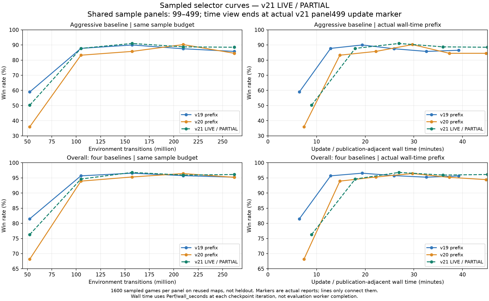

后续容量准备另外修复了测速parent与eval child的源码路径一致性，并加强MDP/native/vendor清单成员检查；从生产补丁commit `5019504` 的115个Git blob逐字节回读后，实际CPU父子进程的23模块path/SHA完全一致，CUDA未初始化（session75100 exit0）。旧v21的information-only freeze被明确拒绝，真实负例exit1；此为预期拒绝，不是GPU训练失败。外部gate helper SHA `60208a1e17c860d6f05698125943bb073b41268d2572edbb4f54739ca6fbd7a7`，证据 `full_capacity_preparation/source_only_frozen_5019504/execution.json`。仅执行同环境`-c`导入probe，没有实际`-m evaluator`、模型、对局或容量GPU门禁，也没有提前选择正式memory条件。生产改动仅补CUDA评测matmul/AMP精度验收，七项targeted CPU checks通过；v21/v22冻结源码不变。

### v21 最终训练、曲线与开发复测

实际训练session58132返回exit0，原PID3188195已退出；共**929次完整更新、每环境29728tick、487063552条转移、84.195分钟**。采样1256.357秒、更新3780.771秒，采样加更新**96695 transitions/s**，含保存和评测排空的全流程**96415/s**。显存峰值allocated **14.622GiB**、reserved **16.213GiB**。teacher0/student16384，resume=null；4187937个完成episode中4165544自然结束、22393超时（0.535%）。pool保留初始随机模型及最近7个，完整checkpoint最多3，eval权重最近3+best；仍被活局引用的退休对手在该局结束前保留。

停训原因为人工平台判断后的`requested_stop`：best299之后六个完整采样点均未超过峰值，299→899覆盖54.605分钟，最近两点aggressive为84.5%/85.75%。通过`train/STOP`在完整PPO更新边界结束，保存最终checkpoint并排空队列，9个周期评测全部完成，queued/running/failed/cancelled均0。**没有触发自动patience12，也没有用SIGINT结束**。每环境1Mtick是调用上限，本轮按1–3h和曲线平台规则提前结束。

每个selector为200张地图×双座×4AI，共1600局；双方策略按既定采样协议执行，draw计入胜率分母。完整曲线为：

| iteration | aggressive | expansion | defensive | random | overall |
|---:|---:|---:|---:|---:|---:|
| 99 | 50.25% | 71% | 91.25% | 92.75% | 76.3125% |
| 199 | 87.75% | 94.25% | 98.5% | 98% | 94.625% |
| **299（best）** | **91%** | **97.5%** | **99.25%** | **99.5%** | **96.8125%** |
| 399 | 88.75% | 96.75% | 99.25% | 99% | 95.9375% |
| 499 | 88.5% | 96.75% | 99.75% | 99.5% | 96.125% |
| 599 | 88.75% | 98% | 99.75% | 98.75% | 96.3125% |
| 699 | 90% | 98% | 98.5% | 98.75% | 96.3125% |
| 799 | 84.5% | 95.25% | 99.25% | 99.5% | 94.625% |
| 899 | 85.75% | 94.75% | 99.25% | 98.75% | 94.625% |

299→899 aggressive下降**5.25pp**，200地图cluster bootstrap95%CI **−9.25..−1.25pp**；44局从胜变非胜、23局反向变化。overall下降2.1875pp（−3.5625..−0.8125）。这是复用selector及postselected峰值上的条件比较，不是无偏heldout估计，也不证明某种训练机制导致回退。699/799/899新增报告分别独立核对全部1600赛程行，不重复运行对局；929结束时没有新造一个929评测点。

按预定最低AI胜率→aggressive→overall选中snapshot6/iteration299，累计157286400转移、9600tick/环境。真实退出后复制为不可变`v21/final_best/checkpoint.pt`，SHA256 **0bbff0ddd91033dc4ca6a47e5eb0969630bc34ecdfff7dae4515546b70b4aff6**；capture绑定111个冻结Git文件、formal配置、完整eval index、selector与checkpoint。工具仅从已提交Git blob冻结，不使用用户工作区的gallery工具。

新运行CPU单线程1600局开发复测（seed1001042、batch128、max2000tick，实际session21673 exit0），117505个决策、55负、无平局：

| AI | selector best | 开发采样胜率 | 开发W/L/D |
|---|---:|---:|---:|
| aggressive | 91% | **89.75%** | 359/41/0 |
| expansion | 97.5% | **97.75%** | 391/9/0 |
| defensive | 99.25% | **99.25%** | 397/3/0 |
| random | 99.5% | **99.5%** | 398/2/0 |

overall1545/1600=**96.5625%**。地图cluster bootstrap95%CI：aggressive86.5..92.75%，overall95.5625..97.5%。seed1001042在旧开发中已使用，**不是heldout**；四项超过80%不代表任意随机地图保证或世界级强度。开发报告SHA `a4001cb895e136a2bbfbcc5f50e8a613846e1bbca95d8915c1e483db90596cab`，实际执行与信息伴随文件见`final_best/development_execution.json`。

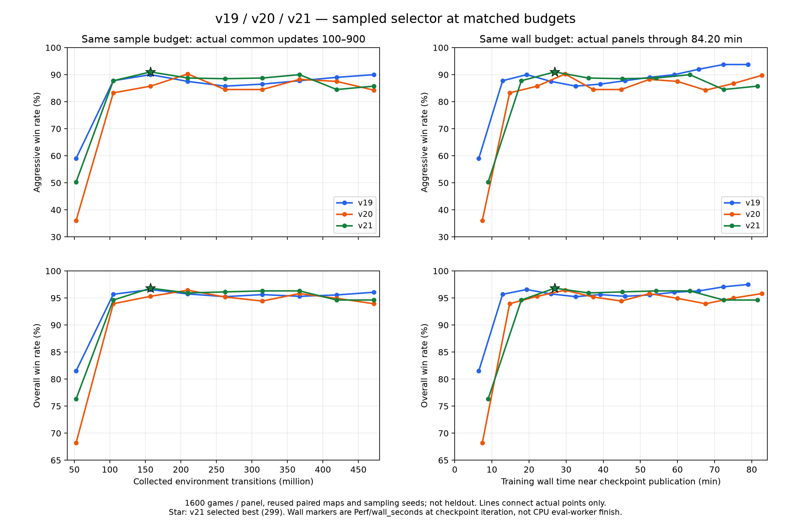

图中样本比较显示三轮共同99..899的真实评测点；wall窗口止于v21实际84.195分钟，其他轮仅显示该窗口内已有评测。横轴wall来自publication附近的训练Perf/wall_seconds，而不是异步eval完成时间；连接线不表示补测。原PNG SHA `2b372f4307703ef158c84833e861fb680966363596587a9d5a2af9edc66de50f`；对应JSON与旧v19/v20已通过的比较合同复用，不重新声称旧对局被全部Core重放。

末100更新whole-update categorical KL均值**0.01683**、p95 **0.02091**、max **0.10162**；clip fraction11.49%、entropy0.6998、grad norm0.2876，末步entropy回升到0.8515。adaptive LR初始1e−4，但上限是**0.01**，末100更新有96%的结束LR在上限附近，不能称“始终1e−4”。LR调节使用minibatch抽样动作KL，whole-update监控用固定probe的完整categorical分布，两者并非同一指标。存在KL尖峰和策略集中，但没有NaN，不能仅凭这些曲线归因baseline回退。

末100更新wall吞吐95944/s，接近best阶段97188/s，下降约1.28%；训练mean episode length由best附近93.67增长至119.46tick，student回报由0.354降到−0.237。历史池分布随训练改变，self-play回报不能直接解释为baseline胜率。clipped value objective由0.03107到0.04053，不是独立预测MSE或explained variance。

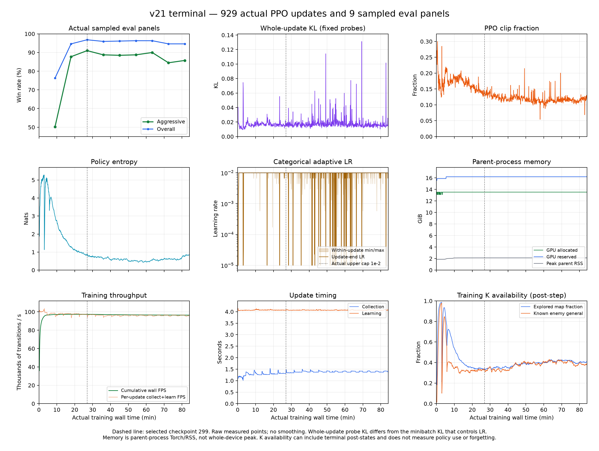

原PNG SHA `ab455fb2e26b9f43fe351b285f7b0a6b1835ec8e3caaad700b009fd50855d89d`。图中K覆盖是post-step信息可用性，包含终局，不是网络利用程度；常规allocated与全程峰值测量时点不同。终局汇总与TensorBoard审查见`v21/diagnostic/terminal_training_review.json`（实际session69816 exit0，仅分析已有数据）。

### v21 记忆正确性与最佳模型失败分析

开发评测在原始forward返回后观察实际K11输入，以仅使用合法可见信息的独立NumPy知识状态核验；117505次决策中K11不一致、lane映射不一致及H4敌将标记存在性不一致均**0**。1600次新局初始化全部匹配，31029次决策有非零观测年龄；已发现敌将但H4不再包含其标记的**10181次决策全部仍有K地标**，未发现K丢失。H4核验范围仅为敌将标记是否存在，**不是全部H4特征逐值核验**；native状态digest只作provenance，不是1600局全部独立Core重放。observer ON/OFF既有CPU合同覆盖动作、模型、Adam、RNG等20项逐bit一致，不增加GPU训练逐tick哈希。

55个开发败局中31局从未发现敌将、5局终局前H4仍含标记、19局早已发现但终局H4缺标记；**这19局的实际K仍全部含敌将地标**。aggressive41负分别25/3/13，expansion9负为4/2/3，defensive3负为1/0/2，random2负为1/0/1。19局中的18局末次见到敌将已至少8tick，仅1局间隔4..7tick；这是原轨迹上H8标记可用性的描述，不是训练H8的反事实胜率。赢局捕获敌将前自然再次看到敌将，不能把“终局H4有标记的胜率高”解释为记忆因果效应。结论是**信息维护正确，但是否被有效用于长程攻防仍未证明**。证据`information_audit/v21_development_summary.json`，companion SHA `adac1a48afc31413233939ccaf3e35de0ea0995c02b13f73433ecd4a4b01b7c3`。

最佳模型新录制4AI各一胜一负（实际session70876 exit0），均匹配原selector逐局结果，无补种子。8局751tick、759Core状态，8个MP4合计3405帧/3330715字节，实际ffprobe成功；独立重放核对新录制的完整native联合动作、合法视野、座次和状态，Core helper实际exit0。原selector没有保存逐tick动作，故不声称与原评测所有动作逐tick相同。录像并未直接记录K11，不能把开发K核验当作这8局的K逐值核验。

| AI | 败局 | 胜局 | 败局内实际行为 |
|---|---|---|---|
| aggressive | [game397/193tick](../outputs/moe_cts/iterations/v21/final_best/analysis/videos/aggressive_loss.mp4) | [game283/47tick](../outputs/moe_cts/iterations/v21/final_best/analysis/videos/aggressive_win.mp4) | 后期11兵/8地对60兵/43地，本营多次抽兵。倒数第二tick决策时30格仍是友军，actor计划29→30的2兵合并；P0先从31夺取30后，这个已计划动作才变成2兵对6兵攻击，下一tick敌军夺取29大本营。不能写成actor明知敌军6兵仍选弱攻。 |
| expansion | [game622/166tick](../outputs/moe_cts/iterations/v21/final_best/analysis/videos/expansion_loss.mp4) | [game668/48tick](../outputs/moe_cts/iterations/v21/final_best/analysis/videos/expansion_win.mp4) | 最后68兵/21地对94兵/38地，actor以27兵攻普通格1；敌军17→26以20兵夺取本营。敌将140..165持续可见，不能归因于忘记位置。 |
| defensive | [game1143/118tick](../outputs/moe_cts/iterations/v21/final_best/analysis/videos/defensive_loss.mp4) | [game1168/59tick](../outputs/moe_cts/iterations/v21/final_best/analysis/videos/defensive_win.mp4) | 总兵62对12却有48兵远在格3；此前将本营援兵向外搬走。敌军先夺40守军城市13，再用增长后的5兵攻本营14；计划中的learner动作因已死亡而不执行。 |
| random | [game1244/70tick](../outputs/moe_cts/iterations/v21/final_best/analysis/videos/random_loss.mp4) | [game1256/50tick](../outputs/moe_cts/iterations/v21/final_best/analysis/videos/random_win.mp4) | 67tick从本营59抽兵，随后在69集结；末tick仍以12兵进攻普通格70，而60格敌军以4兵夺取兵力薄弱的本营59。 |

四败局暴露薄弱本营守军、兵力与目标分离、经济劣势和联合行动先后顺序下的多步防守问题。只测试最后tick的WAIT/少数回援分支仍会死亡，不能证明更早无法防守，也没有求解最优动作。aggressive录制中的3次NOT_OWNER拒绝来自先手敌方在同tick夺取了原先合法的来源格，并非决策前mask错误。以上是选定案例的描述，不是整个策略的无偏失败分布；未加入针对baseline的硬规则或奖励hack。

独立录像盘点SHA `dfa911a9598f96be66010289d0d60cdaed7e0ef2e0278c66be620d46dc8b9a78`，compact Core/反事实审查SHA `7e96b3c813ad6a2313e37d7f1213a3ec22988cedc89cf0f1e682c2f5e61ca062`，均在`final_best/analysis/`。轻量CNN有全图mean→16维context→每格head的信息路径，不能据败局断言K未被使用；后续成熟网络实验要检验更丰富的逐格长程关系表达。

同299阶段/157286400样本时，v21 aggressive相对v19为+1pp（地图cluster95%CI −2.5..+4.5），相对v20为+5.25pp（+1.5..+9）；overall分别+0.25pp（−0.8125..+1.3125）与+1.5pp（+0.375..+2.6875）。这是早期相同样本条件，不能代替终局比较。三轮独立选优后的重复开发集配对比较中，v21相对v19 best aggressive为**−0.75pp（−4.25..+2.75）**、overall−0.0625pp（−1.1875..+1.0625）；相对v20 best aggressive为**−3.25pp（−6.5..0）**、overall−0.5pp（−1.5625..+0.5625）。每版1600行canonical地图/座次/controller/sampling seed/outcome与immutable checkpoint绑定通过，以完整200地图为cluster、20000次bootstrap seed20261007；实际CPU分析exit0，未增加对局。证据`diagnostic/development_best_comparison_v19_v20_v21.json`（SHA `1f8bf478a3d45f1da2c59a5b86d70d2109c991ced38f3ce50998aba4afcf3c5b`）。

本轮尚未证明持久知识提高了最终强度或相同计算预算效率。v21最佳较早，训练与最佳模型样本预算都少于v19/v20，且只有共同的一个训练seed；应结合上面的等样本/等wall曲线评估，不能只按独立选择的best排名。下一轮保持actor H4+K11，仅增加critic H4+K输入，补齐2×2；随后继续全部容量与课程/H8阶段。

## v22：持久知识与 history-state critic 组合（正式训练完成）

补齐 v19/v20/v21/v22 的 memory × critic-information 2×2。相对 v21，仅开启 `critic_actor_information`，critic group 引用已存的 policy/knowledge；actor仍是 H4＋11个非堆叠知识通道，critic为 S＋H4＋K。无需复制一份历史或知识 rollout，也无需增加 vendor 补丁。actor12281、critic13793、合计26074参数，新增critic输入权重零初始化；正式配置其余训练、历史池、采样评估与资源保留设置均与v19一致。

配置 `rl/configs/v22.json`，已提交为 **`af9283171681f4d89a0d6754e88251179082cffa`**，111个运行文件从该commit的Git blob冻结，排除尚未提交的架构、GPU评测与课程改动。冻结源完成fresh CPU门禁：N8/T4/episode8、E1/B2、五更新共160转移；20个联合tick核验双座privacy/reset及learner与opponent独立知识，两次采样eval各8局、全部成功。自己的初始化snapshot0与fresh learner逐位一致、新Adam空状态、新critic历史/知识列初始为零且更新后学到非零权重；实际执行历史模型1/2/3。knowledge storage实际[4,8,891]，全部111个文件hash与import路径通过，证据 `outputs/moe_cts/iterations/v22/cpu_contract.json`。既有工作区候选smoke只属准备，冻结源验证也不计正式训练或胜率成绩。此处不预先声称组合方案胜率更高。

v21实际训练退出后，v22冻结源完成**五次全规模GPU更新**（N16384/T32、2621440转移，实际session25400 exit0）。门禁仅改pub50→1、关闭eval/预算；collector160次调用全部正常返回，实际训练后历史snapshot1/2/3/4分别执行251/170/124/58次前向、5300/2861/1141/445行，证明不是只对初始随机模型采样。所有loss有限，teacher0/resume=null；allocated峰值15.045GiB/reserved16.321GiB。compute71805/s、含启动wall45.814秒；当时v21开发评测与录像在CPU并行，且池尚未成熟，**不作为受控正式吞吐比较**。合同`v22/gpu_history_gate_contract.json`绑定source、actual summary与observer；计数仅证明模型前向，不声称双方每个动作的执行覆盖。正式配置仍pub50、采样eval每100更新、至少1h/最多3h，另启新进程随机初始化、新Adam、新pool，不读取门禁权重。

v21终局报告提交`ad6d8f6`后，实际启动v22正式进程session**31517**、PID**3273985**，CLI仅`--config configuration.json --replace-policy --steps-per-env 1000000 --output train`，无resume/warm-start；正式配置SHA `0113142ccac7106422f0573d53e6237075e32f96bc5524231c552a5bcbd42372`、111冻结文件均核验。随机snapshot0实际创建于2026-10-07 01:04:13 UTC，source=random_initial_policy、pool resume_source=null，SHA **90a0ac59a239e7fa37d91ac1e7e2b8397365cdbf00605810841ffa51561334fd**。复用通用初始化工具，CPU session87292实际exit0：自己的seed与独立fresh构造所有模型张量逐位一致，actor12281/critic13793，新增actor知识及critic历史/知识输入列初始为零，actor起始函数与Light对照一致，imports均来自af92831冻结源，CUDA未初始化。独立构造Adam空状态；seed只含推理权重，不把它当作实际optimizer状态快照。证据`v22/formal_initialization_{contract,execution}.json`。

从本轮自己的seed复制不可变initial checkpoint与实际run config，独立CPU采样1600局已正常完成（原session58345、PID3276077实际exit0；地图/sampling seed271828、batch128、max2000tick）。aggressive **0.25%**（1胜/399负/0平）、expansion **4.25%**（17/347/36）、defensive **1.25%**（5/336/59）、random **3.75%**（15/374/11）；总体38胜1456负106平，**2.375%**，809576决策tick，wall515.69秒。实际1600条完整游戏记录及聚合与v19/v20/v21起点精确一致，地图、controller、sampling seed和座次逐条核验；本次确实独立执行，不是复制旧结果，也不声称缺少原逐动作trace时的全部action独立复现。报告SHA `6fbf760c33f5a3666909e20e42f7498f089ded685ad38f1d0ab5ac07e5ae6d2c`。`InitialEval`七个标量已实际写入step−1并单event读回通过，证据`v22/diagnostic/initial/tensorboard_record.json`（SHA `2d36a628878ff17c1b790b9b0e3dc181403b761614a71ee2a3af3ac1bd639f45`）。

TensorBoard与正式输出为`outputs/moe_cts/iterations/v22/train/`。早期实际35更新/18350080转移时wall261.68秒、全流程70124/s、当轮compute72046/s、whole-update KL0.01468、256 Adam，allocated13.534GiB/reserved16.319GiB；初始CPU评测同期运行，这些早期数值不是最终效率结论，首个完整selector99尚待完成。源码和正式配置不受后续容量准备改动影响。

### 正式采样评测曲线

以下只含实际完成的采样selector（每点1600局）：

| 更新 | aggressive | expansion | defensive | random |
|---:|---:|---:|---:|---:|
| 99 | 33.75% | 58.50% | 86.75% | 82.50% |
| 199 | 81.75% | 92.50% | 99.25% | 99.25% |
| 299 | 84.50% | 95.50% | 99.25% | 99.75% |
| 399 | 84.50% | 97.00% | 99.75% | 98.00% |
| 499 | 88.50% | 96.25% | 100.00% | 98.75% |
| 599 | 85.75% | 97.00% | 99.25% | 98.75% |
| 699 | 86.00% | 96.00% | 99.50% | 98.50% |
| 799 | 87.75% | 96.75% | 99.50% | 99.50% |
| 899 | 87.75% | 95.75% | 98.25% | 98.50% |

399与299的aggressive胜率同为84.5%，499升至88.5%；后四点85.75/86/87.75/87.75%，无持续提高。root在实际进程仍live时读取完整九个returncode0的selector及TB，确认超过1h、距best约56.75分钟后写STOP；原session31517实际terminal chunk845145 exit0。正式958完整更新、每环境30656tick、502267904转移，wall7111.728秒（118.529分钟）；collection1420.888秒＋update5675.934秒，compute70773.64/s、全流程70625.29/s。9个eval全部成功且已排空，failed/cancelled/queued/running均0；停止为人工平台判断的requested_stop，不是自动patience12。以下部分曲线保留截至499的历史窗口；时间标记为模型发布更新，不是异步eval完成时刻。终局完整曲线、best捕获与详细分析另附。

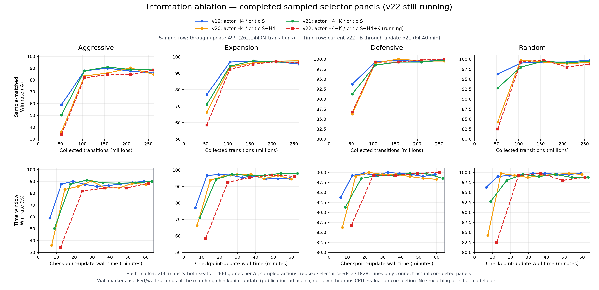

共同52428800转移（第99次更新）时的四条件早期对照：

| 条件 | actor / critic | aggressive | overall | 前100次update compute FPS |
|---|---|---:|---:|---:|
| v19 | H4 / S | 59.00% | 81.5000% | 138521 |
| v20 | H4 / S+H4 | 36.00% | 68.1875% | 120522 |
| v21 | H4+K / S | 50.25% | 76.3125% | 99054 |
| v22 | H4+K / S+H4+K | 33.75% | 65.3750% | 71999 |

200个完整地图cluster共同重采样20000次，seed20261007：aggressive的memory主效应−5.50pp（95%CI−9.00..−1.875）、critic-information主效应−19.75pp（−23.75..−15.625）、交互+6.50pp（−2.00..14.756）。只有一个早期点、一个训练seed、复用选模地图，CI只反映这些固定模型的地图变异；memory在critic-information=true时也给critic K，参数量随条件变化，不能把它解释为纯actor记忆或最终因果收益。四版早期PPO entropy均值3.964/4.340/4.153/4.265，value指标是clipped训练objective而非raw MSE/EV；未观测到价值估计正确性的直接证据。v19的whole-KL均值含一次0.982尖峰，也不能单看均值归因早期胜率。证据`v22/diagnostic/early_2x2_99.json`（SHA `1fd2e3ed26962858e796c2baad7bf9dc60e51d9c803005cd35fd5a383424f814`）。此处不选择后续容量的信息条件。

### 相同499预算与中期行为诊断

四条件在262144000转移时的实际采样评测与TB时间如下；每版1600局、同200地图cluster及双座，吞吐为从启动累计的wall值：

| 版本 | aggressive | expansion | defensive | random | wall分钟 | 转移/秒 |
|---|---:|---:|---:|---:|---:|---:|
| v19 | 85.75% | 95.50% | 100.00% | 99.75% | 32.58 | 134099 |
| v20 | 84.50% | 97.50% | 99.50% | 99.25% | 37.29 | 117167 |
| v21 | 88.50% | 96.75% | 99.75% | 99.50% | 45.12 | 96835 |
| v22 | 88.50% | 96.25% | 100.00% | 98.75% | 61.66 | 70862 |

实际CPU session54129 exit0，共同20000次配对地图bootstrap：aggressive的memory主效应+3.375pp（95%CI0.375..6.375），critic-information−0.625pp（−3.500..2.250），交互+1.250pp（−4.250..6.750）；overall分别+0.781pp（−0.063..1.656）、−0.156pp（−1.094..0.781）、−0.188pp（−1.938..1.563）。相较99点，记忆的早期负差已转为小幅正差，但收益伴随吞吐下降；这仍是单训练seed、复用选模地图的单预算点，不含训练随机性，不能据此断言最终收益。证据`v22/diagnostic/same_budget_499.json`（SHA `cd6381d2e5e017553ce7514410f5ce61c18ab482c4563c2e5cd4f399477d88ab`）。

独立保留499唯一中期快照（SHA `fcc73aea76d44913273dd63668fa339968a00206d85eba7b702787296e2ded98`），使用v22自己的af92831冻结源重新执行复用开发seed/sampling1001042：CPU observer session14838 actual exit0，1600局为aggressive **89.75%**、expansion **97.50%**、defensive **99.50%**、random **99.00%**，总体1543胜56负1和（96.4375%）。118282决策中K11/lane/H4标记核验无不一致、1600 fresh初始化全部匹配；9209次已见敌将但H4不含标记的决策全部保留K地标。56负中28局从未见敌将、14局最后H4仍含标记、14局曾见但H4已无标记，后14局K均保留。核验不证明actor有效使用记忆，开发panel也不是held-out。

真实八局采样demo及render session59696 exit0，随后recording-only Core/ffprobe session26293 exit0：862决策/870状态、3738视频帧（共3.734MB），轨迹、outcome/ticks和视频均匹配。四个代表性败局中，aggressive开局用小兵磨中立城，前50tick投入25兵仍未攻下、领土仅1对12；expansion开局扩张慢，defensive长期近营回运并有98次立即折返；random即使总兵68对66、领土24对19，仍因首都仅3兵被先手4兵夺将。后者预选回援动作未执行，不能用包含邻格回援的静态margin保证同tick安全。这些是录像行为描述，不能估计总体失败占比或证明网络容量、记忆的因果作用。

录像和详细诊断位于`v22/diagnostic/middle_at_499/analysis/`及`failure_analysis.json`；执行记录SHA `a59028a9f0bca60ffbbb0658a7587d7d849c28a13ad7d5a2563e855eb0678b96`。这些评测与录像确实在训练中期执行，最终best仍为同SHA的499，终局复用原证据与原句柄，不声称重新执行。绝对先手身份已经保留在actor的public输入中；静态战斗margin未模拟同tick联合动作的优先顺序，不把上述random个例归为缺少先手信息。

### v22终局分析与信息阶段结论

终局按既定最低AI→aggressive→overall规则仍选snapshot10/iteration499，保护权重SHA `fcc73aea76d44913273dd63668fa339968a00206d85eba7b702787296e2ded98`。训练实际exit0后创建`v22/final_best/capture.json`，以硬链接复用中期不可变CP，核验best/中期/终局三个SHA一致、111冻结文件仍匹配；开发和八录像/Core均通过明确reuse索引引用原路径与实际执行时间。新的终局捕获与数值/曲线分析actual CPU session78361 chunk498d9e exit0；原训练PID独立确认已不存在。

| 评测 | aggressive | expansion | defensive | random |
|---|---:|---:|---:|---:|
| 实际初始随机模型，400局/AI | 0.25% | 4.25% | 1.25% | 3.75% |
| 最终best499，selector271828 | 88.50% | 96.25% | 100.00% | 98.75% |
| 同best已有开发1001042，400局/AI | 89.75% | 97.50% | 99.50% | 99.00% |
| 最后selector899 | 87.75% | 95.75% | 98.25% | 98.50% |

499→899的aggressive净−3/400=−0.75pp，32局丢胜/29局转胜，地图cluster95%CI[−4.5,3]；overall−0.8125pp，CI[−2,0.375]。defensive从400/400到393/400（−1.75pp，CI[−3,−0.5]），属于这组复用selector中的回落，不是无偏泛化或训练原因证明。相较v19/v20明显的后期下降，v22 aggressive更像围绕较早平台波动；不能将单一best峰值作为所有条件的能力上限。

末100更新整轮精确KL均值0.02542/max0.07541，clip fraction12.58%、joint entropy0.7300、clip前actor+critic梯度范数0.2664、clipped value训练目标0.03831；它不是raw MSE或explained variance。自适应LR真实工作：末值范围1e−5..1e−2、68%更新末值处于0.01，平均每update调整10.57次；近似KL调节不是整轮硬上限。WAIT/MOVE gate熵均值0.05846很低，但含forcedWAIT和场景条件，不能仅据此归因全策略塌缩。末100 collection1.520秒/update5.922秒、monitor0.128秒；吞吐约70.4k/s且资源稳定。GPU峰值allocated15.29GiB/reserved16.32GiB；终局4,030,153局、自然终止4,001,947、timeout28,206（约0.70%），没有资源增长导致曲线平台的证据。21次publication，候选池0/14..20；进行中局仍持有12/13等已淘汰模型，符合整局固定规则，不将候选8误写成总驻留始终8。

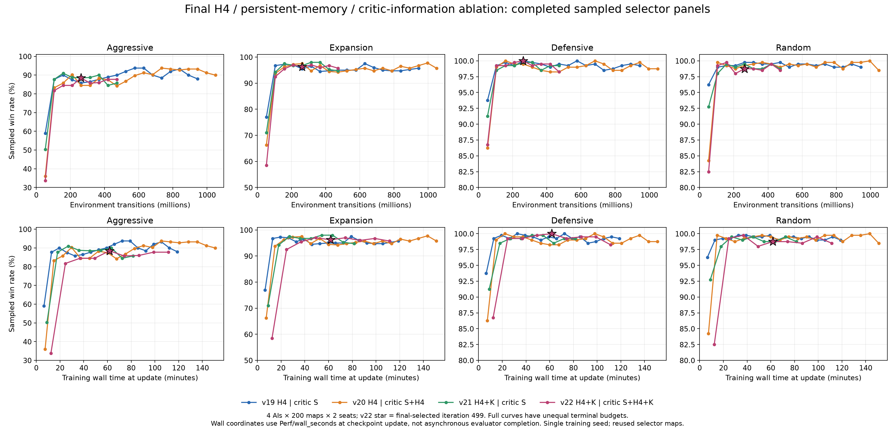

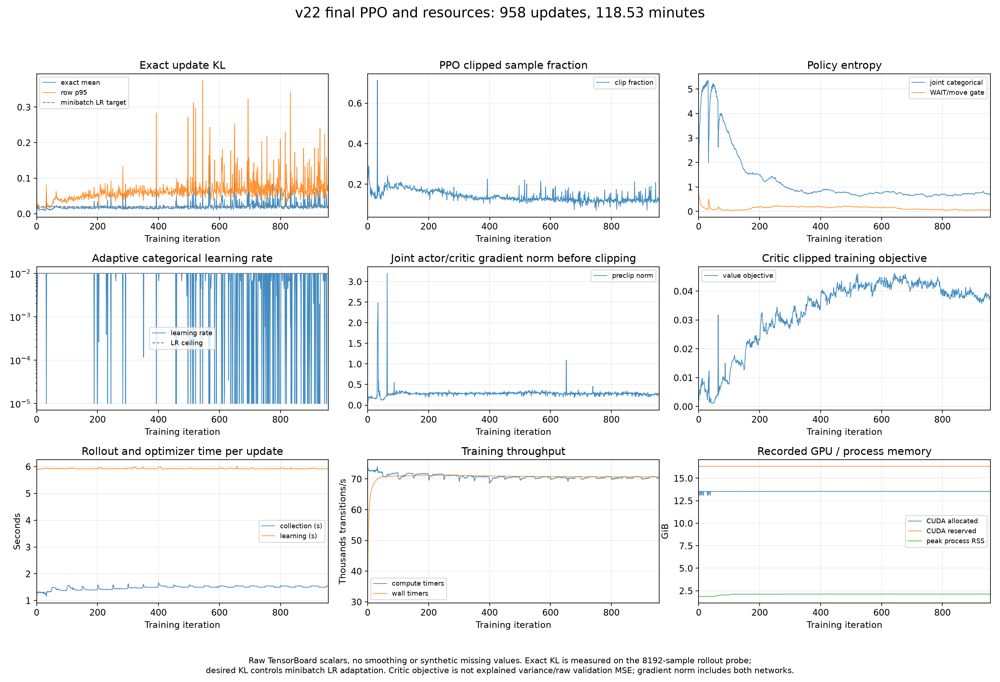

完整四条件比较actual CPU chunk766104 exit0，最终metadata写回3b3098 exit0，`v22/diagnostic/final_information_comparison.json` SHA `7242e92b3b570ab98deb904b04f485aa4edd526d5905bfca05e2546451169063`。共同899更新/471859200转移时，memory aggressive主效应−0.375pp（CI[−3.375,2.628]）、critic-information−1.875pp（[−5,1.25]），均没有稳定正差；499曾有memory正差，说明结论依赖学习阶段。共同84.195分钟窗口内各自已完成selector的最佳aggressive为v19 93.75/v20 90.25/v21 91/v22 88.5%；全程预算不等的best不能替代该window比较。重复开发中v22相对v19/v20/v21的aggressive为−0.75/−3.25/0pp，相应CI[−4.5,2.756]/[−6.75,0.25]/[−3.25,3.25]，仅单训练seed，不包含训练随机性。

容量共同采用actor H4+K11、critic S+H4+K11：遵循用户已接受的事实记忆和history-state critic语义，避免为了tiny baseline分数取消必要信息；这是工程基座选择，**不宣称v22赢得小网络强度或墙钟效率消融**。六档保持信息、固定1M critic与head一致，再检验表达能力和计算效率。tiny→capacity同时扩大critic并改变精度设置，其系统差异不能全归因actor扩容。持久记忆正确保留而仍有守将、经济和调兵错误，支持检验表示能力，不提供容量瓶颈的因果证明；保持原MDP，无baseline专用hack。

终局证据`v22/diagnostic/terminal_training_review.json` SHA `f0861ff013d602642e4e004a15be662adb3a359c63b87ac316afcb0983158e54`；捕获SHA `9eb9cf6ae90feba18ebd706143f888a990fbf6ea9f6ae5f16a3a5e93b8fedd44`。两张终局图实际root视觉检查，图SHA分别`74e3018f...a08a6dfd`/`0808947c...66dc6561`。TensorBoard仍在`outputs/moe_cts/iterations/v22/train/`，开发/录像位于前述middle_at_499，并由final_best复用索引绑定。

## 后续阶段基础模块准备（非正式训练版本）

成熟上游ResNetV2/ViT、可变观测布局/地块head和可选物理微批次已提交e8b79c5，设计与原始来源见[架构设计](rl_architecture_design.md)。候选整合CPU80 tests/117 subtests通过；严格FP32及BF16的两个1M真实GPU微基准已完成，high/TF32下FP32失败与关闭后的通过都保留。孤立微基准不含完整NT/成熟历史池，10M/100M与正式容量学习曲线仍待前序消融结束后执行。

评测worker补丁c2a956c提交后，从116个Git blob重新冻结容量源码；实际CPU父子进程24模块path/SHA一致、CUDA未初始化（chunk20d9a2 exit0），缺少baseline_pool的旧5019504容量冻结源被新门禁实际拒绝（预期exit1）。证据`full_capacity_preparation/source_only_frozen_c2a956c/execution.json`。这只证明源码导入，不证明完整容量或吞吐；六档仍须逐一执行NT524288/256Adam、成熟历史驻留、1600局CUDA评测和实际保存。100M减N增T不减少固定NT存储与训练工作，孤立1M timing不能外推100M时间；正式cadence与下一轮更新的预算余量应依据实际完整门禁测量后确定。

预算余量最小补丁已提交5da947a：`training_control.budget_reserve_seconds`默认0，保留原行为；启用时在完整rollout/GAE/更新、发布和eval结束后，若elapsed＋reserve达到max_seconds，停止开始下一轮。配置拒绝负值/非有限值及侵占最少1h的余量；max_seconds仍是名义预算，CUDA eval获得原预算剩余时间，不会被提前停止阈值误减。最终10项CPU测试actual chunk1dd581 exit0（0.651秒），包括真实PPO完整更新/Adam/save及fake evaluator的名义预算集成；没有运行CUDA worker。正式reserve须依据实际完整容量周期测量选择，它是估计余量而非硬实时保证；v22冻结源未使用此补丁。 新5da947a容量冻结从116 Git blobs逐字节回读（b85d17 exit0），实际父子25模块（含training_control）path/SHA一致（938bd1 exit0），root再次独立读回全部116 SHA/合同（2ce5df exit0）；旧C2记录保留历史边界，新gate SHA b1d43760…已锁定。首个ResNet1M完整门禁实际session82273，严格FP32/p512，结果未完成前不声称通过。

训练中GPU评估候选通过32局随机ResNet1M的实际BF16采样，按记录动作的四个真实败局共528tick在CPU/native/Core精确重放，生成四MP4；四类胜局缺失明确报告。deadline覆盖复制/hash/cache到worker结束，受剩余墙钟预算限制，超时回收worker；trace保留当前best加最近K个完成评测。默认CPU异步采样路径保持，满池100M峰值仍待真实门禁。

可选课程默认关闭：tick penalty按TB迭代0..1000线性1→0，资源PBRS和终局系数不动；gamma课程要求显式final/end_iteration，并在每个rollout之前同步PPO与PBRS gamma。真实CPU训练/resume验证同rollout采样、GAE、更新设置一致，10项课程测试通过；关闭课程的三次实际更新与此前Git版model/Adam/RNG逐bit一致。课程尚未进入任何正式配置，严格保持先固定gamma比较、再课程/rollout/lambda、再tick衰减、最后H8的阶段顺序；已完成的v20只使用61fea90冻结源，不受这些候选改动影响。

### 后续评测效率：原Python baseline的可选持久CPU分片

当前builtin路径的baseline规划是原版Python controller；`cpu_threads`只并行CPU模拟器，`opponent_seconds`还包含状态/观测转换、动作装配和回调。新增独立`baseline_pool.py`，用spawn固定lane分片，原factory保留绝对seat的种子派生；actor、采样流、joint pre-growth tick和绝对seat0→1回调顺序不变。全局评测复用worker，仅在上一批对局全部结束后以原factory重建controller、记忆和RNG；小批次调试默认`baseline_workers=1`串行，可显式设4。PeriodicEvaluator透传并验收worker数量，独立进程组清理评测与子进程；不修改训练对手、MDP、PPO或vendor，也不改正在运行的v22冻结源。

先重放八段实际录像，16copies合成128lane/12016决策，2/4进程逐tick动作、RNG和controller状态与serial一致；四进程synthetic稳态约1.922×，不把它当生产提速。新production API对应录像12016动作一致，覆盖绝对seat回调；相关CPU回归、actual joint-action/native digest比较、worker异常/意外退出、真实拒SIGTERM子进程的group清理、跨批次fresh RNG与partial-feedback拒绝reset均通过。最终pool 10项测试通过；另两项真实进程组测试通过，包含leader以7异常退出后poll清理存活子进程的失败路径。一次性录像replay helper归档到ignored实验目录，不放入提交用测试代码。

实际完整CPU评测复用v21固定best、seed/sampling1001042、200maps/AI×双座、B128/max2000：初版每batch重新spawn耗时89.245秒，比相同源码无诊断的串行80.478秒更慢，启动/清理抵消收益，该失败测量保留。跨13批次复用后actual session68918 exit0，耗时**72.900秒**（含启动/reset/清理1.505秒），整个function含setup72.996秒，较串行80.570秒约**1.104×**；三份完整1600局记录、117505决策tick及全部聚合精确相同。旧v21开发报告114.16秒含K/history观察器开销，不能拿它推导纯并行收益。

证据`controller_parallel_preparation/persistent_full_1600_comparison.json`，配对运行实际session29337/68918均exit0。这是一个固定轻量模型的两次顺序CPU测量，v22训练同期继续，不是多次受控硬件benchmark，也不证明大模型GPU评测同样提速。当前保留可选项；后续共同容量GPU门禁将实际检验eval时间、parent/child显存和host RSS，再决定同档ResNet/ViT共同使用的worker数。

## 容量阶段：1M 成对完整门禁与效率选择（尚未正式训练）

采用已记录的 actor H4+K11、critic S+H4+K11。两种成熟 actor 共用独立 1,053,033 参数 ResNet critic、128-channel head、MDP与StudentPPO；严格FP32、matmul highest、两类TF32关闭，physical512/inference512。N16384×T32=524288，每轮E4/B64、logical8192，实际Adam/clip/logical-observer均256。运行源来自5da947a的116个Git blobs，helper当时SHA `b1d43760b020c6493df5bbfa267d641ecc72602807388afab097785e5966b18c`；基座配置SHA `0113142ccac7106422f0573d53e6237075e32f96bc5524231c552a5bcbd42372`。

| 实际容量测量 | ResNet1M | ViT1M |
|---|---:|---:|
| Actor 参数 | 1,100,945 | 1,079,945 |
| 完整NT rollout+GAE | 27.716s | 26.457s |
| 完整256次Adam更新 | 235.925s | 224.653s |
| 1600局采样CUDA评测 | 565.735s | 543.044s |
| 全部门禁墙钟 | 840.012s | 804.545s |
| rollout+update吞吐 | 1,989 transitions/s | 2,088 transitions/s |
| parent peak allocated / reserved | 16.770 / 17.139 GiB | 17.599 / 18.141 GiB |
| sampled whole-device peak | 18.294 GiB | 19.297 GiB |
| host peak RSS | 2.061 GiB | 2.071 GiB |
| runner完整model+Adam文件 | 26,290,505 B | 25,928,201 B |

Res实际session82273、terminal cfa29e、exit0；ViT实际7690、terminal98c3a0、exit0，原parent/eval子进程已独立确认不存在。每个gate执行自己的随机模型和一次完整更新，不加载旧训练权重。rollout阶段实际使用8个原始随机pool模型；随后压力发布并保留16个退役handle，在update/publication/eval阶段共驻留24个真实whole policy。部分handle来自进行中对局，另有压力保留handle；这些同权重拷贝不代表24种已训练策略，也不测最大成熟pool分组的收集时间。

CUDA child在parent learner、storage、Adam、历史模型仍驻留时完整执行200地图/AI×双座=1600局，batch128、max2000、seed/sampling271828、stochastic=true、workers1，实际report精度与父配置一致。评测前生产模块释放unused allocator cache，live tensors不释放；报告中的peak_reserved包括释放前峰值，不能当成评测结束的当前占用。模型与trace属于临时门禁产物，均已清理，只保留数值证据。随机门禁胜率不用于选强模型或宣称训练能力。

保存、hash和publication时间远小于update及eval。上述单次顺序测量不能作为多repeat受控硬件排名：ViT这次更新约快4.8%，不是样本效率或最终强度结论。共同固定1M critic与精度改变也使tiny→capacity不再是纯actor参数量的因果比较。

完整1600报告显示baseline controller/转换/反馈约占评测wall的78.4%（Res）与83.9%（ViT）；policy只有66.97/33.51秒。因此下一步同时关注PPO分块和现有CPU baseline worker并行收益，不靠减少赛程或NT制造提速。容量正式eval不能沿用每100更新：按目前速度，3h内都未必到该点。每4更新的共同候选间隔预计可保留多个曲线点，但正式cadence、timeout与budget reserve尚未冻结，必须结合最终实测选定。

另已完成共同p1024的first-logical短诊断：Res session91542/terminal367a55 exit0、ViT89076/terminal0ecba9 exit0；完整NT后只执行1个logical8192/1次Adam，32局max64采样eval。parent peak allocated分别21.253/22.566GB，ViT仅剩0.774GB driver free。此诊断包含monitor.begin而跳过monitor.finish，不能将其时间乘256推算完整update，也不能替代1600/max2000门禁；尚未选择p1024为正式配置。

原始结果与actual执行绑定见 `outputs/moe_cts/iterations/full_capacity_preparation/{resnet,vit}_1m_fp32_p512_full_v22info/{gate_result,execution,capacity_evaluation}.json`。成对证据 `paired_1m_fp32_p512_full_capacity.json` SHA `98fa3e15cb93add4ff88fbf48de8fa2b523e039a28f113f29fef1e469a5f4b85`。全部六档从零1–3h正式训练尚未开始；其后的gamma/rollout/lambda、tick0..1000课程和最终H8仍在完整范围内。

### BF16/p512 与 baseline workers：ResNet 完整通过，ViT 对应测试进行中

ResNet1M原session16380、launch023d52、terminal66af8c实际exit0。沿用5da947a冻结源与同一MDP，policy/algorithm同时开启BF16，参数和rollout存储仍为FP32；helper新增可选同权重workers比较，SHA `be21e8e355d6f92092c6699cfedab8dcb8f7271cfcd620d43024fa44e6c012f4`。NT524288、E4/B64/logical8192、physical512，实际Adam/clip/logical-observer均256；24个whole-policy压力驻留及额外publication构造、CUDA eval均完成。

| ResNet1M 实际测量 | BF16/p512 |
|---|---:|
| 完整rollout+GAE / 256 Adam | 22.895 / 190.050s |
| rollout+update吞吐 | 2,462 transitions/s |
| workers1 / workers4 评测主体wall | 572.934 / 402.602s |
| 对应parent完整eval阶段 | 574.991 / 404.623s |
| baseline controller/转换/反馈时间 | 439.147 / 263.564s |
| parent peak allocated / reserved | 17.462 / 17.885 GiB |
| sampled whole-device peak / 最少free | 19.047 / 4.449 GiB |
| host peak RSS | 2.260 GiB |

workers4仅改变评测controller分片。两次实际1600局均为200maps/AI×双座、采样、max2000、batch128、seed/sampling271828、CUDA BF16；同checkpoint SHA下全部逐局记录精确一致。原helper逐文件验SHA后比较8条选中轨迹的4368个tick联合动作，全部一致。评测主体这次快1.423×、少29.73%；完整PPO update较此前严格FP32测量少19.44%。这些是一次顺序容量测量，不是多repeat精度排名、样本效率或正式策略强度结论。

原parent已独立确认不存在，完整runner model+Adam实际保存26,290,505B、save0.033s/hash0.012s，临时权重与轨迹全部清理。CPU复核重新比较完整对局记录、协议、case元数据和116源码SHA；临时动作payload已经删除，本次复核不声称重新执行Core replay。证据 `full_capacity_preparation/resnet_1m_bf16_p512_full_workers_comparison/{gate_result,baseline_worker_comparison,execution}.json`，result SHA `9fac3346fa466f46f9b410bb7c8e6c09c163ca4b2965197ea1c5637e579944b7`，execution SHA `a576094338fb13336ef9fbc5aebaee8986f058c451648354221d6774c0826806`。

ViT同规格完整测试随后独立启动原session64661、PID3410920、launchc29c96；以下记录其实际完成结果，不能把此前进行中状态作为终态证据。

### ViT BF16完整结果与1M正式执行选择

ViT原session64661、terminal74d5af实际exit0，root独立读回结果并确认原parent不存在、GPU无compute进程。NT524288/256Adam、24whole-policy驻留、保存/publication、两次1600局采样评测全部完成。workers1与4全部逐局结果一致，原helper比较7条选中轨迹的3421 tick联合动作一致；aggressive随机gate没有胜局，明确缺失该录像，不伪造第8局。

| ViT1M 实际测量 | BF16/p512 |
|---|---:|
| 完整rollout+GAE / 256 Adam | 15.599 / 150.043s |
| rollout+update吞吐 | 3,165 transitions/s |
| workers1 / workers4评测主体wall | 540.146 / 363.653s |
| 对应parent完整eval阶段 | 542.168 / 365.667s |
| baseline controller/转换/反馈 | 452.789 / 272.184s |
| parent peak allocated / reserved | 17.103 / 17.535 GiB |
| sampled whole-device peak / 最少free | 18.698 / 4.799 GiB |
| host peak RSS | 2.248 GiB |

workers4这次快1.485×、评测主体少32.68%；完整update较此前FP32单次测量少33.21%。真实runner model+Adam文件25,928,201B，save0.027s/hash0.011s，临时权重/trace已清理；CPU复核现存reports与元数据，不重新执行已删除的动作payload。证据 `full_capacity_preparation/vit_1m_bf16_p512_full_workers_comparison/{gate_result,baseline_worker_comparison,execution}.json`，result SHA `220c03152e998c69929fb458751743287784da199774176df9ab648c3056a291`，execution SHA `cf851f271cf6bab3b1fda783d1ccfd031e17a6f7af36304cbe610d2514b823cb`。单次容量测量不证明ViT胜率更高或成熟历史收集同速。

完整pair均实际exit0后，共同选择BF16/p512/inference512、workers4、pub2、每4updates一次1600局采样eval。较慢C+U=212.945s、完整E=404.623s，恒定耗时下K4周期约1256.403s、eval约占32.20%。timeout900、budget reserve1300，覆盖该Q加完整timeout后余187s用于保存/收尾与波动；它是工程余量，不是硬实时保证。预算min3600/max10800不变，plateau从tiny的12改为4：至少5个健康完成panel、至少1h，连续4次未超过2pp的既定worst/aggressive改善条件时结束。该规则不等同统计显著性检验。成对选择证据 `paired_1m_bf16_p512_full_capacity.json` SHA `922911f16095bd42ed4a55cceb3dda5f905cbeb23b8ee0c7114cbde74c7acb23`。

### v23：成熟ResNet 1M从零self-play配置

配置 `rl/configs/v23.json`，actor1,100,945、独立critic1,053,033参数；H4+K11 / S+H4+K11、9×9/episode1024、gamma.995/lambda.95、reward与自对弈算法保持信息阶段的指定基座。N16384×T32、E4/B64/logical8192/256Adam；采用上述完整pair选定的共同执行设置。纯历史池8、均匀抽取、整局固定对手，训练种子20261013/pool120261013，new weights/new Adam/new pool，无resume、warm-start或门禁权重。save_interval2000，完整checkpoint最多3（含final），eval最近3另加best，历史候选文件8；gamma/tick课程关闭，H8留到最后。

生产CLI配置默认合并＋完整policy替换的CPU检查已实际通过，两版候选仅run_id/backbone不同；v23配置SHA `88f5824eedb0b9006782b873f09297b5036497e78eff644db358d3d751265b14`。本节先保存配置与动机，运行源码/配置从该版本commit提取，正式启动和自己的seed0验证随后记录；此时尚无正式训练结果。v24独立提交配对ViT配置并在v23结束后从零训练。比较同时报告胜率对transitions与wall曲线；CUDA同步评测后的Perf/wall_seconds表示该update及eval均完成的时刻。固定critic结构不代表初始张量相同；单训练seed、重复selector，以及tiny→Map同时扩大critic与改变计算方式，均限制归因。全部六档正式训练与后续gamma/rollout/lambda、tick课程、H8仍须逐项完成。

正式启动：v23配置commit `2c3a69155bd82320e2a6b00bed0d2cc30e6fc3b7` 与v24配置commit `e817a78c898f2235202ce45ae461a86f1f324ab0` 各自从Git blob冻结116个运行文件及3个当前Map/CUDA录像分析工具，逐字节回读，运行文件均与已验证5da947a门禁源一致（actual chunk3f9935 exit0）。v23 source manifest SHA `614e16d441489dbb70ae47812f0f2b268a36c0940b80206c4edd19873bad4e12`，绑定自身配置SHA；v24相应manifest为`abef85d3b2f26050246320de603489a0f15438be5ad3530ddaf027ff381ba626`。在GPU无compute进程（b82b22）后，仅启动v23：original session12099、launch fe963d、Python PID3436959。CLI为冻结配置、`--replace-policy --steps-per-env 1000000 --output train`，无resume/warm-start；1M tick是调用上限，仍由1–3h/平台规则提前结束，不承诺实际达到1M tick。

实际初始快照0于2026-10-07 04:44:57 UTC创建，SHA `00b5393bdc4663d6c565f7961cd00a9fbf82acc41465321c46f12145c46b61dd`，pool resume_source=null、source=random_initial_policy。CPU独立构造核验全部328张量逐位一致，actor1,100,945/critic1,053,033；116运行文件及12模块path/SHA正确、实际run_config字节SHA与冻结配置相同，CUDA未初始化，actual CPU session64696 terminal aa0f29 exit0。独立空Adam不是正式optimizer-state证据，后续以实际完整checkpoint检查；初始化合同 `v23/formal_initialization_contract.json`。TensorBoard和训练输出 `outputs/moe_cts/iterations/v23/train/`；首个训练后1600局采样selector预定iteration3，本段尚未报告任何正式胜率。v24保持未启动，不复用v23初始化或模型池。

首个完整正式更新iteration0已完成：524288新转移、collection21.831秒、learning190.831秒，compute2465/s、含启动wall2359/s。实际`model_0.pt` SHA `6dfffbeb0986def5382f113424c0c6b690980e587ab76d4da11e577721a84315`，328份Adam状态step均256、参数与两份moment均finite、无distillation optimizer；CPU读回77个TensorBoard scalar及physical512/logical8192/4096chunks/256minibatches/BF16字段，actual chunk67e42b exit0。whole-update exact KL0.04418、clip24.27%、entropy1.9428，adaptive LR本轮最高0.001139、末值1e−5；这是首轮诊断，不能推出长期稳定性或强度。合同 `v23/first_update_contract.json`；不再将独立Adam构造当作实际训练optimizer证据。

### v23 首个正式采样评测（早期观察，训练未结束）

snapshot2 / iteration3，即4轮完整更新、2,097,152条新转移、每环境128tick。冻结配置下执行200maps/AI×双座，共1600局，CUDA BF16推理、FP32参数、采样、workers4、seed/sampling271828。actual eval PID3447812已退出，index completed/returncode0；worker402.299秒，完整1600局统计经独立CPU审查，TensorBoard四项胜率与报告一致。

| AI | 胜 / 负 / 和 | 采样胜率 |
|---|---:|---:|
| aggressive | 4 / 396 / 0 | 1.00% |
| expansion | 32 / 327 / 41 | 8.00% |
| defensive | 31 / 311 / 58 | 7.75% |
| random | 53 / 341 / 6 | 13.25% |

该panel对应实际TB `Perf/wall_seconds=1264.937`，完整wall吞吐1657.91 transitions/s；step2→3增加616.217秒，已包含此次同步eval，画wall曲线时不另加worker时间。训练compute约2450 transitions/s、完整update约191秒；初期history-pool episode胜率不能作为baseline强度。仅4轮更新的一个panel不足以判定容量效果或平台，至少1h和多个健康评测后才按预定停止规则判断。

checkpoint SHA `bff137cce5d39835507edfb2bcd4e1b5a9bea93d62bc66089c60a51b5f61742d`，report SHA `c7b6cda2f60a090a063e337c49ba1d6554228dcda7146ddc8beeb821097bb61b`。独立审查 `outputs/moe_cts/iterations/v23/diagnostic/first_eval/readback_contract.json`（actual379c8c exit0，root92d80a读回）验证赛程、聚合和8条真实胜负trace的SHA/header/3324joint-tick结构；本阶段未做Core重放，终局选定best后再生成录像及失败分析。原training session12099仍运行；v24未启动。

### v23 三个正式采样点：尚未终局

第三个selector snapshot6/iteration11已completed/returncode0、原eval PID3477970退出。1600局184胜1329负87和，四AI各400局；CP/report SHA、全部对局数量与15组聚合统计、TB四胜率和同步eval后wall已CPU读回匹配。未重复第一panel的完整赛程/trace审计，没有新比赛。三个实际点如下：

| iteration / 新转移 | aggressive | expansion | defensive | random | 含同步eval的wall分钟 |
|---|---:|---:|---:|---:|---:|
| 3 / 2,097,152 | 1.00% | 8.00% | 7.75% | 13.25% | 21.08 |
| 7 / 4,194,304 | 1.25% | 8.75% | 18.75% | 17.50% | 41.63 |
| 11 / 6,291,456 | 1.75% | 7.75% | 21.75% | 14.75% | 62.51 |

aggressive仍弱，defensive早期提高，另外两项波动；仅三个早期点不能判定容量收益、学习上限或平台。selector复用选模地图，最终另做开发评测。同步eval耗时已经包含在横轴中，不重复相加。原训练继续，v24等待实际终局；第三点CP SHA `273c3054c77c4b0a47cb29216a490bd60f87e06e79174b83a9f42e80b26e33a7`，窄读回`v23/diagnostic/third_eval_readback.json`（actual375515 exit0，root396084），绘图actual3cf3c2 exit0，root视觉核验。

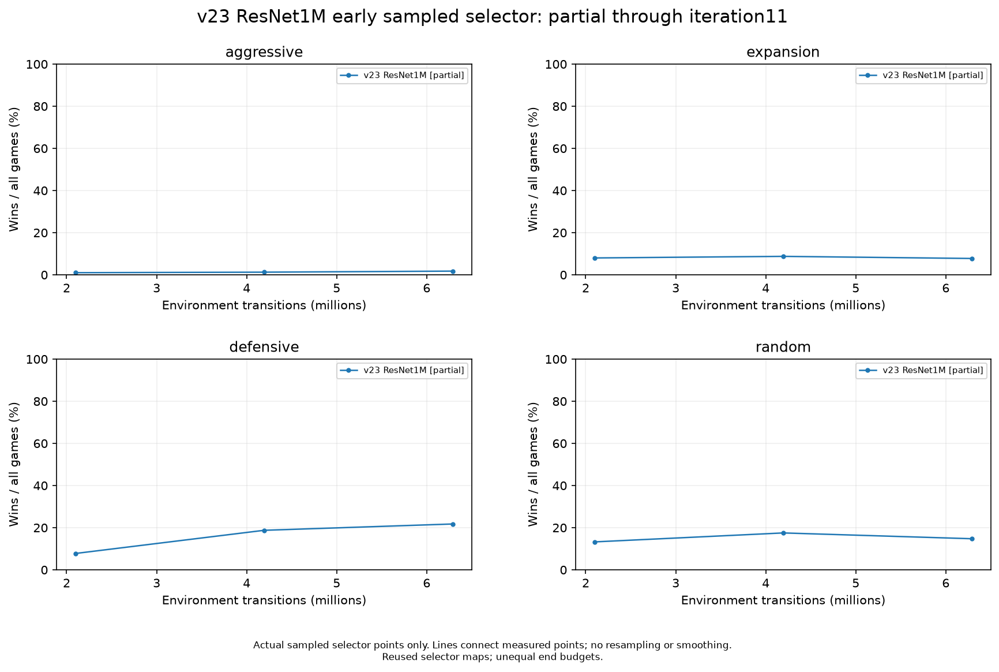

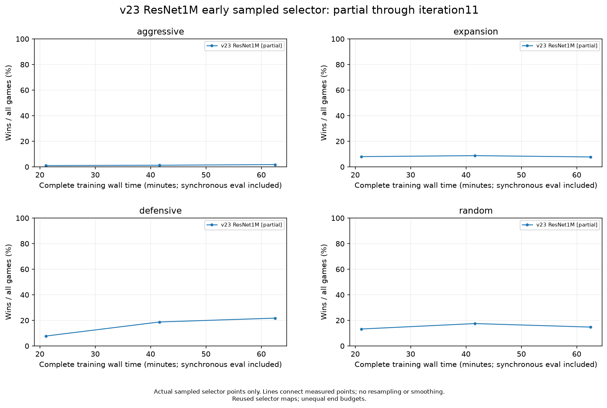

随后snapshot8/iteration15第四个1600局selector也completed0：aggressive **2.00%**、expansion **9.75%**、defensive **22.25%**、random **17.50%**，总体206胜1307负87和（12.875%）。post-sync TB wall4997.485秒（83.29分钟），已包括390.551秒worker；四WR、CP/report SHA、specific PID3493318退出及聚合统计经窄CPU读回匹配（actual ea06cc exit0，`diagnostic/fourth_eval_readback.json`）。上图保留明确的前三点窗口；最终另画完整曲线。现有4个健康panel仍未满足预定至少5点的平台停止条件，原v23继续，不能当作终局结果。

### v23 早期PPO与效率观察

固定06:05 UTC event截面：collection/Loss/Episode覆盖iteration0..15，PPO/resource/wall仅0..14，因为第15轮同步eval当时尚未返回；缺项保留null，不把后来的第四panel补进旧截面。16轮collection均值22.808秒、learning190.876秒（标准差0.223秒），compute2454 transitions/s；更新占两者合计89.3%，本窗口没有更新持续变慢的证据。当前仅定位到更新阶段的成本，尚无profiler证明具体算子瓶颈；性能诊断等待v23/v24都真实结束再执行。

15个可用整轮probe的exact KL为0.0210..0.0442、无明显尖峰；训练minibatch clip fraction首4轮均值27.5%到末4轮35.6%，adaptive LR真实调整，范围1e−5到约0.001297。joint entropy由1.943到4.703，但probe WAIT概率45.53%到3.96%、WAIT/MOVE gate熵0.635到0.135，末次约98.86%整轮KL来自条件MOVE变化。不同rollout状态和合法mask在变，且未记录合法动作数，不能把熵增长直接归为退化或战略进步。相对target .02的偏离也说明minibatch adaptive不等于整轮KL硬上限。

完成局的history-pool胜率约78..92%，不是baseline强度；TB没有各snapshot胜率/活动人数，不能归因于随机seed0对手。episode约84到466tick、未折扣shaped return约0.246到−4.019；自然终局的未折扣PBRS和包含`−(1−gamma)*sum(Phi)`，局变长且资源势增加也会使raw return更负，不能据此判断折扣目标下降。clipped value objective不是最终raw MSE/EV；parent allocator采样也不是整卡峰值。实际CPU分析0b73e3 exit0，root fcacda/7d0982读回，源event副本SHA `8893e4ae609a74f1b3225ef1ba01a77d03422202a780133ab0bad9922845414c`，详细值与范围见`v23/diagnostic/early_learning_dynamics_iteration15.json`。

### v23 早期失败录像：snapshot4 / iteration7

保留第二个正式selector的不可变快照与原动作记录，CPU按记录联合动作重放并渲染四AI各一胜一负，共8局、4466tick。冻结分析工具实际exit0，native/Core逐tick状态与原记录匹配；没有重新加载策略推理或生成新比赛。该模型只有8轮更新、每环境256tick，是早期行为观察，不能当作终局best或用8段录像估计胜率。

aggressive败局131tick，全局从未合法看到敌方本营。最后决策时，己方本营35只有2兵，相邻可见敌军34有7兵、可出6兵；模型却从相邻友军44向53出5兵，随后本营被攻占。自己另有21兵在距离本营曼哈顿3格处连续18个决策未动。这支持检查兵力调度与本营防守，不能归因为“发现敌将后忘记”，也未验证替代动作能赢下整局。

另外三类败局同样有局部防守不足：expansion末期仍从本营出兵；defensive总兵248对202、领土40对31，却让7兵本营暴露于相邻34兵敌军，seat0先攻占后模型的计划WAIT未执行；random末期主力66兵距本营5格，邻军已不足以抵挡真实半兵进攻。上述为选中录像的事实描述，不是总体败因比例或容量瓶颈的因果证明。defensive胜局1376tick超过训练1024上限，属于现有eval max2000协议。

详细观察：[observations.md](../outputs/moe_cts/iterations/v23/diagnostic/middle_at_iteration7/observations.md)；录像：[aggressive loss](../outputs/moe_cts/iterations/v23/diagnostic/middle_at_iteration7/analysis/videos/aggressive_loss.mp4)、[aggressive win](../outputs/moe_cts/iterations/v23/diagnostic/middle_at_iteration7/analysis/videos/aggressive_win.mp4)，其余六段在同一目录。执行与SHA记录为该目录`execution.json`，actual CPU replay/render session80094 terminal907232 exit0；仅此次早期捕获约39MiB。渲染结束早于第三次eval开始86.6秒，但与活动训练共享过CPU，wall曲线保留实际耗时，不当作无干扰微基准。

### v23 正式训练终局：预算内尚未学好对战

原训练session12099实际返回exit0（terminal62f8ca），parent/launcher/最后eval PID均已退出；summary显示5次完整selector、无失败/取消/未完成任务。按启动前确定的平台规则结束：至少1小时、至少5个健康panel、连续4次未超过worst/aggressive的2pp改善条件；总体胜率改善不重置该计数。这是工程停止条件，不是统计检验，也不证明容量上限。

共20次完整更新、10,485,760新转移、每环境640tick，正式wall **6230.790秒（103.85分钟）**。collection共458.176秒、update共3818.948秒，均值22.909/190.947秒；compute **2451.59 transitions/s**，含同步评测的wall **1682.89 transitions/s**。5次eval worker共1942.835秒，占正式wall约31.18%；wall横轴直接使用post-sync TensorBoard时间，不另加worker耗时。parent Torch peak allocated/reserved为17.80/18.25GiB，不是整卡含eval子进程峰值。

| iteration / 新转移 | aggressive | expansion | defensive | random | 含同步eval的wall分钟 |
|---|---:|---:|---:|---:|---:|
| 3 / 2,097,152 | 1.00% | 8.00% | 7.75% | 13.25% | 21.08 |
| 7 / 4,194,304 | 1.25% | 8.75% | 18.75% | 17.50% | 41.63 |
| 11 / 6,291,456 | 1.75% | 7.75% | 21.75% | 14.75% | 62.51 |
| 15 / 8,388,608 | 2.00% | 9.75% | 22.25% | 17.50% | 83.29 |
| 19 / 10,485,760 | 2.00% | 8.00% | 26.25% | 17.50% | 103.85 |

最终选模为snapshot10 / iteration19，worst/aggressive均2%，总体215胜1313负72和（13.4375%）。相对首点，defensive提高18.5pp，aggressive只提高1pp；expansion无净提升、random提高4.25pp。模型与原8条实际动作trace已在训练结束后不可变捕获到`v23/final_best/`，CP SHA `f3af66c82676036d24800dc179be99544d3fa58e36006fc4e61e82617fc00c3d`。第五panel CPU读回actual edb2c5 exit0，root ced797核验捕获CP与8条trace SHA；开发地图评测与最终best录像分析另行记录，不沿用iteration7的早期录像。

该结果只支持“当前1M ResNet在这轮时间预算内尚未学好baseline对战”。640tick/env和20次更新远少于tiny基座的数百到数千轮；容量、独立critic扩容、吞吐、历史池成熟度与采样宽度均同时变化，不能推出大网络能力更差或1M无益。接下来按相同配置从零训练v24，比较相同新转移量与相同wall下的曲线；两版终局后再做实际profiler，优化测得的更新成本，然后继续10M/100M配对实验。

完整五点曲线来自实际终局review，不插入合成点、不平滑：

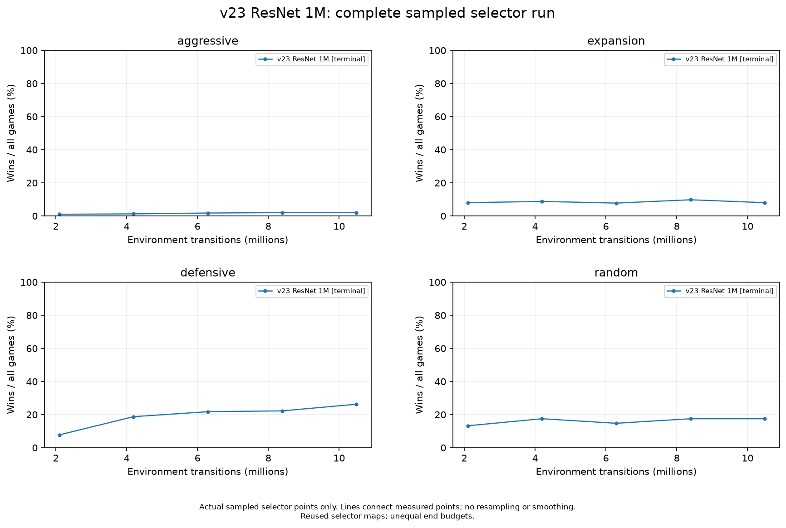

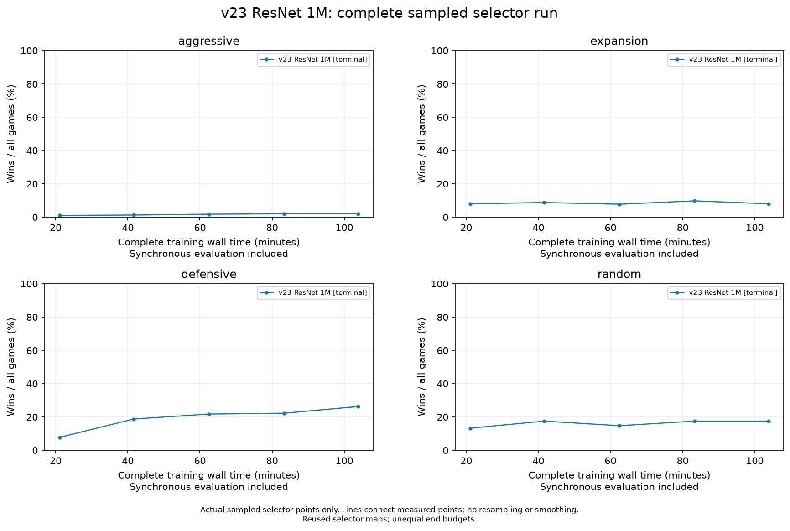

最终best使用开发seed/sampling1001042另做1600局CUDA BF16采样对战，原session23960实际exit0（becc7a）。该seed在此前版本用过，因此是开发数据，不是独立held-out；仍采用每AI200地图×双座、max2000、batch128、workers4。root8236c0核对完整赛程/统计、CP身份与8条实际trace SHA；report SHA `e72a229de4a8293e64a9b00ae566c767a03cecf61d65370e1c9be893a8c24ccc`。开发评测不计入上述正式训练wall。

| AI | 开发评测胜 / 负 / 和 | 开发采样胜率 |
|---|---:|---:|
| aggressive | 10 / 390 / 0 | 2.50% |
| expansion | 31 / 334 / 35 | 7.75% |
| defensive | 99 / 263 / 38 | 24.75% |
| random | 59 / 335 / 6 | 14.75% |

总体199胜1322负79和（12.4375%），与selector的低胜率判断一致。最终selector的四AI各一胜一负已使用记录联合动作生成8段录像，合计4857tick；CPU original session88415 actual exit0（397460），逐tick native/Core与原trace匹配，无新策略推理或比赛。三场胜局长于训练1024tick上限：expansion1419、defensive1039、random1180，遵循eval max2000；不能把这些选中胜局当作整体胜率。

最终录像：[aggressive loss](../outputs/moe_cts/iterations/v23/final_best/analysis/videos/aggressive_loss.mp4)、[aggressive win](../outputs/moe_cts/iterations/v23/final_best/analysis/videos/aggressive_win.mp4)、[expansion loss](../outputs/moe_cts/iterations/v23/final_best/analysis/videos/expansion_loss.mp4)、[expansion win](../outputs/moe_cts/iterations/v23/final_best/analysis/videos/expansion_win.mp4)、[defensive loss](../outputs/moe_cts/iterations/v23/final_best/analysis/videos/defensive_loss.mp4)、[defensive win](../outputs/moe_cts/iterations/v23/final_best/analysis/videos/defensive_win.mp4)、[random loss](../outputs/moe_cts/iterations/v23/final_best/analysis/videos/random_loss.mp4)、[random win](../outputs/moe_cts/iterations/v23/final_best/analysis/videos/random_win.mp4)。复核输出为`v23/diagnostic/terminal_training_review.json`（actual f124f4 exit0），包含完整TB、开发统计、地图簇bootstrap区间与8例录像身份；绘图actual f7f9f2 exit0，两张最终PNG均由root视觉核验并逐字节复制到文档目录。录像执行与文件SHA见`final_best/analysis/replay_render_evidence.json`。

终局历史池仍处于早期：4154局自然结束、0截断，平均每lane仅0.254局完成；11次发布包含随机初始snapshot0与10个训练快照。最终13361/16384个活动lane（81.55%）使用snapshot0，退休的1/2/3仍供1569个未结束lane使用。冻结实现只在episode reset均匀选择冻结对手、整局不换，snapshot0作为候选永久保留。这是终局活动占比，不能推成整轮对手样本比例，也不能认定13361局全部是未结束的初始对局，因为reset也能重新抽到0；缺少逐快照transition/战绩记录，不能量化随机对手带来的贡献。

首4→末4轮PPO均值：exact endpoint KL **0.03310→0.02425**，minibatch clip **27.48%→34.37%**，entropy **2.785→4.640**，采集WAIT **37.99%→3.89%**，preclip grad norm **0.366→0.542**。adaptive LR仍正常调整，末轮为1e−5，前一轮为5.7665e−4；KL/clip来自不同更新位置，反向变化不构成矛盾。WAIT减少不证明面对baseline的调度正确；update占C+U约89.29%，先定位实测更新瓶颈再优化。raw PBRS episode return是未折扣和，不能代替PPO的折扣GAE/clipped surrogate来判断退化。完整20轮CPU诊断actual7cd936 exit0，rootfc7345/344c8e读回：[final_training_dynamics.md](../outputs/moe_cts/iterations/v23/diagnostic/final_training_dynamics.md)。

最终best的四段败局均选到map_index0、learner seat0，因此以下只描述同一地图上的具体失败，不能估计四种对手的总体败因分布。每行发生在大本营35被攻占前的决策；敌军与相邻友军均当前可见，数值为移动前兵量，出兵量由真实native执行记录验证。

| 对手 / pre-tick | 本营兵量 | 相邻敌军实际进攻 | actor实际行动 | 相邻可调度友军 |
|---|---:|---|---|---|
| aggressive / 108 | 6 | 34→35，出8 | 远处8→7，出1 | 26有7兵，44有2兵 |
| expansion / 123 | 5，增长后6 | 34→35，出12 | WAIT | 44有27兵 |
| defensive / 326 | 21 | 34→35，出33 | 远处2→3，半兵出3 | 26有20兵，44有24兵 |
| random / 578 | 1 | 44→35，出7 | 远处5→6，半兵出4 | 26有23兵，34有21兵 |

四局计划动作均在pre-state mask内且真实执行，随后敌方夺将；不是这些例子的非法action输出。defensive败局总兵248对208，却仍未保护本营。更早的真实动作也有防守遗漏：expansion pre113在敌军距本营2格时从本营出24兵只留1；random pre577在相邻敌军8兵当前可见时从本营出22兵只留1，下一tick被夺将。aggressive在pre88..91见过敌将49，H4在94后不再含它，但K持续保留到108；random的K从33持续到578，defensive终局current/H4/K都知道敌将位置，expansion从未探索敌将。这些事实支持检查调度、防守和已知信息的利用，不能断言actor实际使用了K，亦未执行替代动作证明整局会赢。原动作、H4/K与关键帧读回见`final_best/analysis/recorded_behavior_final.json`（root344c8e），详细观察见[observations.md](../outputs/moe_cts/iterations/v23/final_best/analysis/observations.md)（root7e149f）。四AI全部8局的pre-state计划动作均合法；expansion_win的7次native执行失效是seat0先夺取seat1原计划源格，须和决策时合法性区分。

### v24：配对ViT 1M从零self-play配置

配置 `rl/configs/v24.json` 独立提交，actor1,079,945、critic1,053,033参数。配置原始字节SHA `25d8371a7704cb31d5de256ebd9b96400751396066f1b6e9ee89b57f347ae154`；相对v23仅run_id和policy.backbone改变，信息输入、MDP、PPO、BF16/physical512、历史池、1600局采样eval与1–3h预算完全一致。v23源码来自其配置commit `2c3a69155bd82320e2a6b00bed0d2cc30e6fc3b7`，v24源码将来自本次独立配置commit；训练均使用各自Git blob冻结，不包含后续工作区修改。单卡按v23→v24顺序执行，v24不从v23权重、Adam或历史池续训。此段记录配置，尚不构成正式训练或样本效率结果。

正式启动：v23终局报告、完整曲线与最终录像分析完成并提交44dec92后，确认GPU无compute任务（96862b），仅启动v24原session66320 / launch768365 / Python PID3532285。使用自身e817a78冻结源码、配置与分析工具，SHA预检185787通过；`--replace-policy --steps-per-env 1000000 --output train`，输出启动前不存在，无resume/warm-start。百万tick是CLI上限，真实预算仍为min1h/max3h与共同plateau规则。root55999e直接核对该PID的cmdline/stat，TensorBoard目录为`outputs/moe_cts/iterations/v24/train/`。

自身随机初始snapshot0 SHA `82c5fe6b5bb8d8c46e4d54bc0b78cedf51f6a8b5805cbb96a9d735e845bac7cc`，246张量与训练seed20261013独立构造的新ViT策略逐位一致，pool resume_source=null；116冻结文件及12模块path/SHA正确，实际run_config字节与自身冻结配置相同。actual CPU verifier84206/301ed9 exit0、root453f93回读；合同 `v24/formal_initialization_contract.json` SHA `37bb17cf24f2292a17c558425b5d750d15462b5bf82f35539dde9918c3998245`。核验未初始化CUDA或运行forward/game，独立空Adam不当作实际训练optimizer证据。

首个正式完整更新iteration0：524288新转移、collection **15.012秒**、learning **150.514秒**，compute约 **3167 transitions/s**、含启动wall **2994.63/s**。实际`model_0.pt` SHA `ee1d8d3d96619d3790819847906477aca7e9bb9bfc83a178b94e4b1f3837195e`，246份Adam state均step256、模型/两份moment finite、无distillation optimizer；实际TB physical512/logical8192/4096chunks/256minibatches/BF16均匹配。CPU窄验actualb9647a exit0、root284006读回；合同 `v24/first_update_contract.json` SHA `2962a807101b28090f9873081b78a6b07e2dea2c1bf3018dbce51ca238c29e48`。whole-update KL0.017802、clip23.67%、entropy1.9679、末LR0.000759375（5次调整）。这只是自己的首轮计算证据，尚无正式baseline胜率，不能推出长期样本效率或架构强度优劣；训练继续等待iteration3首个1600局采样panel。

### v24 首个正式采样评测：同样本量的早期观察

snapshot2 / iteration3已completed0，actual PID3555622退出；4个完整更新、2097152新转移、128tick/env，1600局（200maps/AI×双座）、CUDA BF16采样、FP32参数、highest/TF32关闭、workers4、seed/sampling271828。全部15组计数/胜率/平率、CP/report/config SHA和TB四胜率经窄CPU读回匹配（actual9ae146 exit0，root9b172c），不是新增比赛或终局结果。

| AI | 胜 / 负 / 和 | v24采样胜率 | v23相同iteration3胜率 |
|---|---:|---:|---:|
| aggressive | 1 / 399 / 0 | 0.25% | 1.00% |
| expansion | 23 / 344 / 33 | 5.75% | 8.00% |
| defensive | 15 / 328 / 57 | 3.75% | 7.75% |
| random | 21 / 371 / 8 | 5.25% | 13.25% |

总体60胜1442负98和（3.75%）。post-sync TB wall **1020.636秒（17.01分钟）**，已包括349.798秒eval worker；v23相同2097152转移的wall1264.937秒（21.08分钟），本次早期完整耗时少19.31%。这一个点低于v23的早期胜率，但更快；仅128tick/env不足以判断架构优劣或平台，不能拿首点代替最终配对实验。原session66320继续，v24自己的终局best、开发评测、完整曲线和Core录像尚待完成。

CP SHA `3154192a5748dd89c4c60683e466d3e03f8274807c7b87bedbf4fcb9952ec9db`，report SHA `8a2e5f906b405e2871c299c6581dc44fc811c371beacf65b4bec64e525e04885`；读回 `v24/diagnostic/first_eval_readback.json` SHA `61513a5380572dd5ef2bd56454eeaa36d2fa152c02b15d866ca902113ea4dec2`。不为单点另外生成曲线，最终展示完整实际panel及同transitions/同wall比较。

### v24 四个正式采样点：训练仍在进行

原session66320和Python PID3532285仍运行；root实际轮询返回live（da6d81、eb1027），specific cmdline/stat匹配自己的冻结配置和输出（2fe999）。以下四个selector各为1600局、200地图/AI×双座，采样CUDA/BF16；全部completed/returncode0，无失败或取消。时间取同步评测返回后的实际TensorBoard `Perf/wall_seconds`，已包含worker耗时。

| iteration / 新转移 | aggressive | expansion | defensive | random | 完整wall分钟 |
|---|---:|---:|---:|---:|---:|
| 3 / 2,097,152 | 0.25% | 5.75% | 3.75% | 5.25% | 17.01 |
| 7 / 4,194,304 | 1.25% | 8.25% | 4.00% | 7.25% | 33.82 |
| 11 / 6,291,456 | 1.50% | 10.25% | 5.75% | 8.00% | 50.71 |
| 15 / 8,388,608 | 1.25% | 14.00% | 8.75% | 11.00% | 67.67 |

第四点140胜1341负119和，总体8.75%；worker354.033秒，post-sync wall4060.478秒。aggressive在1.25%附近，而其他三项仍有早期上升；四点尚未满足预定至少五个完整panel的平台停止条件，不手动更改本轮协议。相同8,388,608样本的v23为2%/9.75%/22.25%/17.5%，wall83.29分钟；这组ViT执行更快，expansion较高、其他三项较低，不能据此宣布最终架构胜负。selector是重复选模地图；终局选定best后还需开发评测、真实动作Core录像、完整曲线与配对分析。

第二/三点窄审查actual01002c exit0，root本次b98932回读；合同SHA分别`17cfd246c14f4ffc77a0dff9407aef61a6d3a7b208f0ff53eda776d3fd917ab4`、`1d8e78bdf74ab7dfc16202396af7c088b0e11ed7bbb63883289309dcf72bc42e`。第四点actual97be2f exit0、root68e89b回读：`diagnostic/fourth_eval_readback.json` SHA `2ae8081a7696adc7920340bb422fb8e21efdd5ae454f9fd25f543bcfc29e5164`，重算1600局的15组胜/负/和及胜/平率、核对四个TB胜率与worker/config/CP身份；specific evaluator3591809已退出。CP SHA `5dd343119b7822f45d5d24ab90339405133e2ed723899931a329bc0f4b30b120`，report SHA `9e378201f6e5c259bfe2ca13f871e2dea5ce22677d1fde84e120e54bee51f8a3`。本次没有重跑旧panel、初始权重门禁、游戏或GPU诊断。

### v24 正式训练终局：ViT 1M配对结果

本轮检查成熟ViT actor在共同信息、MDP和PPO下的样本与计算效率。Actor1,079,945参数，独立ResNet critic1,053,033参数；相对v23，配置仅run_id/backbone不同。共同设置为9×9/P2、episode1024、actor H4+K11/critic S+H4+K11、gamma0.995/lambda0.95、资源PBRS/终局±1/tick−0.001；N16384×T32=524288、4 epochs/64 minibatches、logical8192/physical512、每轮256 Adam steps。BF16前向、FP32参数与storage、matmul highest；纯均匀历史self-play池8、整局固定对手、每2更新发布、每4更新同步1600局采样eval。课程关闭，H8尚未启用。自身e817a78冻结源、初始化/Adam/历史池均从零，不加载v23或门禁权重。

原training66320实际22f0eb/exit0，20完整更新、10,485,760新转移、640tick/env，wall **5082.107秒（84.70分钟）**；5个selector全部completed0，无failed/cancelled/unfinished。停止按启动前冻结规则：至少1h、至少5个健康panel、patience4、worst/aggressive严格改善超过2pp。首点worst/aggressive=.25%，后四点最高2%，未越过2pp门槛，故触发evaluation_plateau；overall改善不会重置计数。这是工程早停，不能称四条曲线均平坦或模型能力上限。

| iteration / 新转移 | aggressive | expansion | defensive | random | 含同步eval的wall分钟 |
|---|---:|---:|---:|---:|---:|
| 3 / 2,097,152 | 0.25% | 5.75% | 3.75% | 5.25% | 17.01 |
| 7 / 4,194,304 | 1.25% | 8.25% | 4.00% | 7.25% | 33.82 |
| 11 / 6,291,456 | 1.50% | 10.25% | 5.75% | 8.00% | 50.71 |
| 15 / 8,388,608 | 1.25% | 14.00% | 8.75% | 11.00% | 67.67 |
| 19 / 10,485,760 | 2.00% | 12.00% | 8.75% | 11.50% | 84.70 |

按worst→aggressive→overall选择最后snapshot10/iteration19，selector137胜1349负114和（8.5625%）。虽然15的overall为8.75%，19的最低AI胜率更高；没有使用开发集重新选模。CP SHA `deb05cbbeb24a96e0cfa2f77bd0dca718ade5def18a89425fd54c7ee1a7a8cae`，在真正终局后不可变捕获自身配置、权重和8条原动作trace。完整五点来自终局review；图由root实际查看并逐字节复制，没有合成点或平滑。

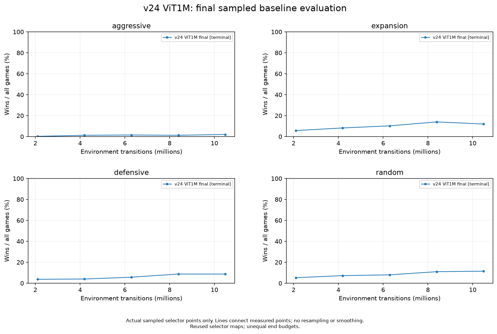

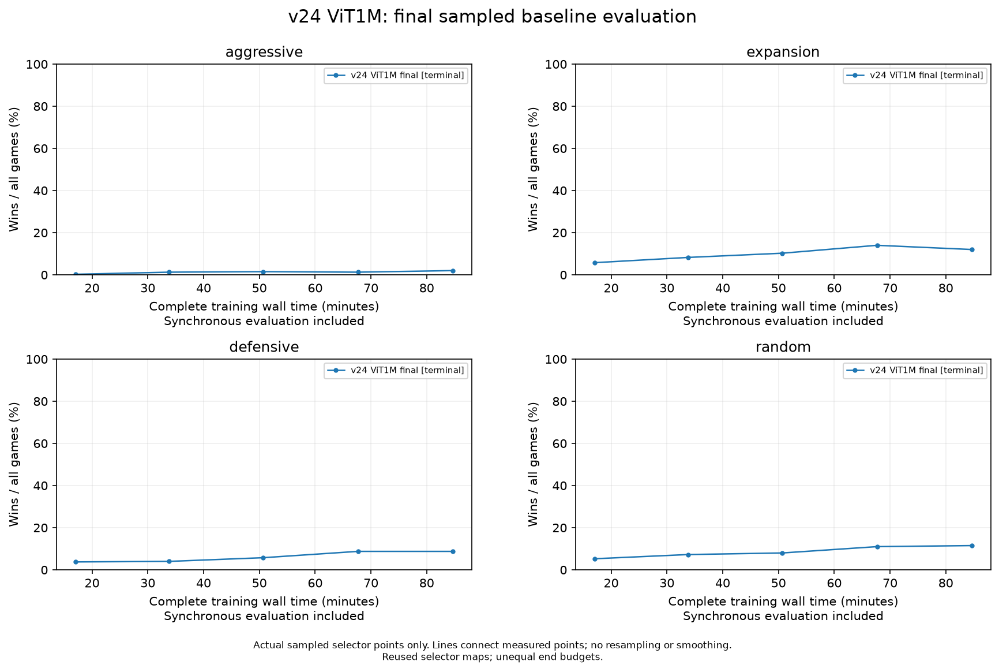

固定best的开发评测使用复用seed/sampling1001042、200maps/AI×双座、max2000tick、CUDA/BF16/4 baseline workers；不是held-out。原root13938实际659aee/exit0，1600局143胜1346负111和（8.9375%），function含setup349.848秒，未计入正式训练wall。root440c7b核验CP、完整计数和8条开发trace SHA；receipt为final_best/development_execution.json。

| AI | 开发胜 / 负 / 和 | 采样胜率 |
|---|---:|---:|
| aggressive | 10 / 390 / 0 | 2.50% |
| expansion | 47 / 321 / 32 | 11.75% |
| defensive | 48 / 276 / 76 | 12.00% |
| random | 38 / 359 / 3 | 9.50% |

Collection311.458秒/update3004.796秒，均值15.573/150.240秒；compute **3161.93 transitions/s**，含同步eval的wall **2063.27/s**。更新占C+U90.61%；五次selector worker共1755.228秒、约34.54%wall，已经包含在wall中。parent Torch peak allocated/reserved17.008/17.740GiB，进程peak RSS2.240GiB，不能代替整个GPU含子进程峰值。

首4→末4轮均值：whole-policy exact KL .015385→.005807、minibatch clip20.94%→7.07%、entropy2.908→4.978、采集WAIT38.68%→2.93%、preclip grad norm .08377→.07118、value loss .002902→.003989。自适应LR正常启用，update0末.000759375、update1达.01上限，此后维持上限，前两轮提高5/14次。小KL和LR饱和是观测事实，不证明scheduler缺失或critic collapse；没有记录value target/advantage分布或explained variance。raw PBRS episode return是未折扣和，与PPO折扣GAE不同，下降也不能单独证明训练退化。详细20轮诊断：[final_training_dynamics.md](../outputs/moe_cts/iterations/v24/diagnostic/final_training_dynamics.md)。

历史池仍浅：1854局自然结束、0截断，平均.113局/lane；18238次assignments、11次publication包含随机初始snapshot0。终局seed0占15001/16384活动lane（91.56%），退休1/2/3仍占761lane，符合整局固定对手。seed0可被reset重新抽中；此占比不能解释为全部初始局未结束或整轮transition mixture。缺少逐快照暴露/战绩，不能量化随机对手的贡献。

最终selector四AI各一胜一负已按原joint actions生成8段MP4，共2528tick：CPU original20429实际002350/exit0，native/Core逐tick与原trace匹配，无新比赛或策略推理。全部learner计划动作在pre-state mask内；random_win pre99的一次native失效是seat0先夺取seat1原合法源格。四败均map0/seat0，以下只描述该地图的选中失败，不能估计总体败因占比，也没有替代动作获胜反事实。

| 对手 / pre-tick | 可见局部威胁 | learner真实行动与失败事实 |
|---|---|---|
| aggressive / 88 | 本营2兵，敌44有4兵、出3 | 35→34出1、留1；敌44→35夺将。总兵己5/敌46，从未见敌将，终局已有明显资源劣势。 |
| expansion / 221 | 本营2增长至3，敌44有54兵、出53 | 26→35真实回援1，补至4仍被夺将；有回援但量不足。K仍记得49，H4末期不含。 |
| defensive / 462 | 本营117，敌34有211兵、出210 | 远处0→9半兵出2；己总兵426对280，未集中局部防御。97兵距本营5格，城市53有34兵距2格；本营pre307之后持续积兵，不能称末期抽空。 |
| random / 438 | 邻敌44有4兵、出3；本营仅1 | pre437从本营出11至34留1，pre438又34→43出11，随后夺将。34是普通格，K一直记得敌将49。 |

这些例子显示守将、经济和兵力调度尚未成熟；合法mask、K保留正确不代表网络有效使用，也不能据四例归因容量或reward。四个胜例86/572/108/549tick，低于训练1024上限；精选胜例不能反推整体强度。详细[observations.md](../outputs/moe_cts/iterations/v24/final_best/analysis/observations.md)与recorded_behavior_final.json保留原动作、H4/K和真实执行事实。

| AI | 胜局录像 | 败局录像 |
|---|---|---|
| aggressive | [win](../outputs/moe_cts/iterations/v24/final_best/analysis/videos/aggressive_win.mp4) | [loss](../outputs/moe_cts/iterations/v24/final_best/analysis/videos/aggressive_loss.mp4) |
| expansion | [win](../outputs/moe_cts/iterations/v24/final_best/analysis/videos/expansion_win.mp4) | [loss](../outputs/moe_cts/iterations/v24/final_best/analysis/videos/expansion_loss.mp4) |
| defensive | [win](../outputs/moe_cts/iterations/v24/final_best/analysis/videos/defensive_win.mp4) | [loss](../outputs/moe_cts/iterations/v24/final_best/analysis/videos/defensive_loss.mp4) |
| random | [win](../outputs/moe_cts/iterations/v24/final_best/analysis/videos/random_win.mp4) | [loss](../outputs/moe_cts/iterations/v24/final_best/analysis/videos/random_loss.mp4) |

终局review实际5e57d6/exit0，root6a8583读回，SHA `f580a7c721e828c258ec0dd3fd39834035c12e97f1a402889b8f624d8d97b7d9`；summary SHA `ce577d0b...3b81`。两图actual a85e0e/exit0，root视觉检查并42f48b复制。开发report SHA `c26806b2...d18c`，回放与视频身份见final_best/analysis/replay_render_evidence.json。TensorBoard仍在outputs/moe_cts/iterations/v24/train/。

### 两轮1M终局配对：ViT更快，当前有限预算的强度未整体胜出

真实CPU comparator274b77/exit0读取两轮终局review，逐项绑定source、configuration、summary、capture/CP、全部selector和开发report；runtime116文件SHA相同，配置仅run_id/backbone不同。实际actor ViT/ResNet参数比.980925，共同critic结构/数量不等于初始张量相同。相同10,485,760新转移、20更新时：

| AI | ResNet v23 | ViT v24 | ViT−ResNet pp | 地图簇bootstrap95%CI pp |
|---|---:|---:|---:|---|
| aggressive | 2.00% | 2.00% | 0.00 | −1.75..1.75 |
| expansion | 8.00% | 12.00% | +4.00 | .50..7.50 |
| defensive | 26.25% | 8.75% | −17.50 | −22.50..−12.50 |
| random | 17.50% | 11.50% | −6.00 | −10.25..−1.75 |
| overall | 13.4375% | 8.5625% | −4.875 | −6.9375..−2.8125 |

共同200张地图的双座/四AI整体重采样20000次，seed20261007；CI仅描述固定模型在复用地图上的差异，不包含训练随机性或选模偏差。复用开发集结果方向相同：aggressive均2.5%，ViT expansion+4pp、defensive−12.75pp、random−5.25pp、overall−3.5pp（CI−5.5..−1.5625）。单训练seed和浅历史池不能将结果解释为架构最终上限。

ViT compute吞吐3161.93对2451.59/s（**1.290×**），完整wall2063.27对1682.89/s（**1.226×**）；update共3004.796对3818.948秒。总体是这两轮真实计时，含同步eval与同期CPU分析，不是隔离kernelbenchmark。截止90分钟最后完成panel分别为ResNet83.29分钟/8388608样本与ViT84.70分钟/10485760样本；相差84.583秒，不称严格共同wall坐标，未插值。截止60分钟对应41.63/50.71分钟，差9.08分钟；截止120分钟两者已经停止，不能假造之后的训练收益。

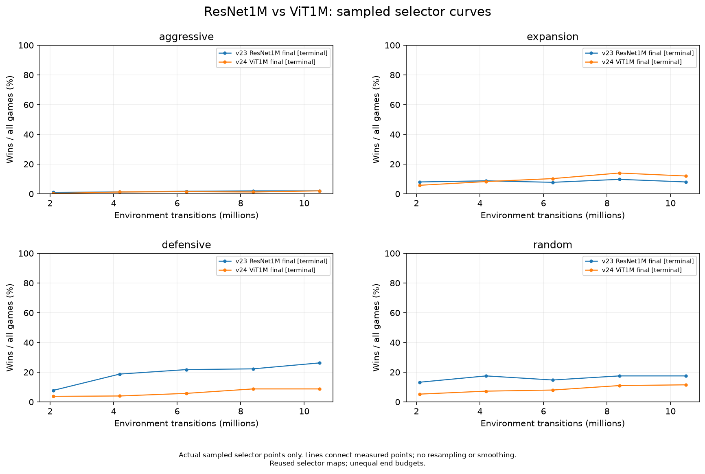

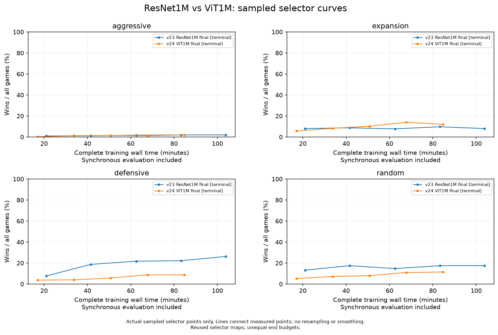

配对artifact为full_capacity_preparation/actual_1m_terminal_pair.json，SHA `889165e330cd66240ed8bd11e61145453e7971876d946a65961ead134ee1c39a`；两图actual c7c9d8/exit0并由root视觉核对。1M两轮完成不替代四个10M/100M完整门禁及从零正式训练。下一步实际profile两种1M更新、定位可优化成本，再继续容量阶段；gamma/rollout/lambda、tick TB0..1000且足够末阶段训练、H8最后仍全部保留。

### 容量阶段性能诊断：1M ResNet / ViT 与重复 mask 校验

两轮正式1M训练结束后，分别用各自冻结源码与配置执行实际PPO profiler，随机初始化seed20261017，真实N16384/T32、NT524288、4epoch/64minibatch/logical8192/physical512、BF16与FP32 master/storage。先收集完整rollout/GAE，再保留8候选加16压力尾部（24个whole policies），每家实际完成256次Adam/clip/observer。只捕获ordinary第3/4 logical batch及epoch边界第64批的短trace，关闭shape/stack/memory dump；不保存模型或运行新baseline比赛，不将诊断算作容量验收或正式训练。

| 实测项目 | ResNet1M | ViT1M |
|---|---:|---:|
| Actor batch512 CUDA event p50 / p95 | 7.702 / 8.025 ms | 3.884 / 3.912 ms |
| Actor batch512 同步wall p50 / p95 | 7.710 / 8.036 ms | 3.892 / 3.927 ms |
| 含profiler instrumentation的完整update | 229.842 s | 177.468 s |
| ordinary捕获kernel数 | 111620 | 75206 |
| ordinary捕获kernel时长和 | 1385.009 ms | 1097.984 ms |
| ordinary可可靠关联scope的kernel时长比例 | 30.324% | 29.686% |

Actor延迟在profiler和包装全部移除后测量，8次warmup/20次测量、固定batch512；包含输入适配、backbone/head和FP32 logits，不含mask、采样、critic或游戏。ViT该测量降低49.57%，不能直接外推为完整self-play提速。完整update时间含instrumentation，不代替此前正式或无profiler的吞吐结果；CUDA event跨度也不是纯kernel时长和。

ViT普通窗口actor/backbone捕获时长109.765ms，比ResNet201.921ms小；两者固定ResNet critic约203.158/202.093ms。大量kernel涉及卷积weight-gradient、GroupNorm backward和类型转换，但约60–70%的捕获CUDA时长在autograd worker上没有可靠scoped link，保持unknown；不能把主线程backward分类约28微秒解释成反向几乎免费，也不能据此给出完整GPU利用率或actor/critic反向占比。

每32个physical forward的mask自身GPU计算均约1.904ms，但mask检查中的主机同步等待分别246.808/321.918ms。等待包含之前的GPU计算，actor更快时等待发生位置也会变化，不能把累计等待直接当作可节省收益。history/gather和Adam/clip未显示为优先成本；保留PPO监控，不用专门选择的epoch边界窗口占比外推整个训练。

最小候选commit `ef2b38cfa8d620da524dd28545c256fc93e6b53e`：Spatial/Map公开API仍默认检查mask合法行；microbatched StudentPPO先检查整个logical batch，再在physical chunks保留shape检查、跳过重复合法行GPU→host检查。仅3个adapter生产文件改变，vendor、MDP、reward、动作概率、优化公式、学习率及RNG协议均不改。CPU新增microbatch套件10项及原有Spatial/Map/Student/Information20项通过；有效概率、梯度、参数、Adam与RNG逐位一致，末chunk非法行在任何physical forward/Adam之前拒绝。CPU actual48924/9c6cde、55181/0890f1均exit0。是否有实际性能收益仍由无profiler GPU A/B决定，不以CPU正确性替代测速。

root actual ResNet63882/7d9e5e、ViT27289/1a1443均exit0；profile result SHA分别`f710cb59788e5e1de2fac3d6dfa5bd74e68d4db0a4f76ca8038611692236342b`、`8226924270bb9014f49a16ca283215e1361612906bd2225f33bf806f5a3abc28`。两家CPU trace分析实际62464/ab393d、70347/3b3bb2 exit0，root3035d8/1b6bac读回。入口为[ResNet trace分析](../outputs/moe_cts/iterations/full_capacity_preparation/performance_preparation/resnet_1m_profile/fresh_trace_analysis/analysis.md)、[ViT trace分析](../outputs/moe_cts/iterations/full_capacity_preparation/performance_preparation/vit_1m_profile/fresh_trace_analysis/analysis.md)。源码从Git blob冻结116文件，候选只改变3个runtime成员；A/B与后续10M/100M门禁使用明确的新source身份，v23/v24已完成训练的源码和成绩保持原绑定。

### 两家1M重复mask校验：无profiler GPU ABBA实际结果

候选代码commit `ef2b38c`；从Git blobs冻结116运行文件，父子25模块路径/SHA一致。ResNet原session52882/6756b2、ViT原87604/d21356均实际exit0。各自真实NT524288 rollout与24模型驻留后，从完全相同的初始权重、空Adam、LR和CPU/CUDA/monitor RNG执行control→candidate→candidate→control；每臂8个logical8192，physical512，首批预热，control/candidate各14个测量批。每臂8次Adam/clip/observer，四臂32次。control为每physical合法行校验，candidate每logical一次完整合法行校验，仍保留公开API、shape与缺失mask检查。

|actor|control平均秒/logical|candidate平均秒/logical|耗时下降|样本访问吞吐提高|完整最终状态|
|---|---:|---:|---:|---:|---|
|ResNet1M|0.739740|0.726952|1.729%|1.759%|四臂逐位一致|
|ViT1M|0.584546|0.570156|2.462%|2.524%|四臂逐位一致|

完整状态核对包含模型、梯度、Adam、loss、LR、非计时monitor与CPU/CUDA/monitor RNG，最大差0；ResNet end-state SHA `4aa13cb0…`，ViT `162fb81e…`。实际result SHA分别`cf480abcd1cb648eb9c9f88a92cce9bc649767e676080a97df18d8326519a5ff`与`942db9c1bc50d54830cc2dad169bc36a7d9745c08820ac8ba2d2cf7a47743891`，配对原始JSON位于`outputs/moe_cts/iterations/full_capacity_preparation/performance_preparation/mask_validation_abba_pair.json`。

这是截取8个逻辑批的短诊断，未执行完整256批、未做save/eval或正式学习，不作为容量/胜率结果。计时包含gather、完整PPO逻辑批体和末尾同步，排除状态复原、CPU snapshot以及monitor begin/finish，首8批没有epoch64 probe；不能等同完整一轮提速。profiler同步等待包含此前排队GPU工作，不能把246/322ms等待全当作可省成本。两个架构都有小幅稳定收益且数值完全一致，保留最小补丁。单卡空闲后已实际启动10M ResNet BF16/p256完整容量门禁（original39678，3f5884），不复用这次短诊断替代满存储/256Adam/1600局验收。

### 10M ResNet：完整BF16/p256容量验证实际通过

root原session39678（launch3f5884，terminal f121a9）实际exit0；结果读回ef0093，`full_capacity_gate_passed`。新版源码ef2b38c的116 Git blobs、共同H4+K11/SH4K11基座配置SHA `0113142c…`、helper `be21e8e…`绑定。实际actor9,960,381参数、固定critic1,053,033；N16384/T32/NT524288，logical8192/physical256，E4/B64，各256次Adam/clip/observer。BF16 forward/FP32 master与storage、highest/TF32关闭，8候选＋16整局退休压力＝24 whole-policy驻留。

|真实阶段|秒数|parent peak allocated GiB|
|---|---:|---:|
|初始化＋8模型池|10.282|13.900|
|完整NT rollout＋GAE|72.294|14.728|
|24模型驻留构造|2.074|14.181|
|完整256批PPO更新|452.941|18.492|
|runner保存模型＋Adam|0.071|14.236|
|Adam仍驻留时额外真实模型构造|0.085|14.279|
|parent仍驻留的1600局CUDA采样评测|437.927|14.236|

整次wall975.891秒（16.265分钟），parent最大reserved18.879GiB/RSS2.402GiB；whole-device采样peak20.042GiB、minimum free3.455GiB，19448次采样、无采样错误。完整checkpoint132,604,681B、SHA `cbf14596…`、hash0.057秒，执行后临时权重全部清理。Eval为4AI各200地图×双座、batch128/max2000、workers4、采样；1600局完整记录通过，参数FP32、推理BF16，worker完整setup+eval436.218秒，815208次决策。阶段peak仅parent allocator，不能当成child独立峰值。

这是随机容量验证，不把baseline结果当作正式学习胜率；收集只使用8个同权重随机对手，24压力尾部在更新/发布/评测阶段保留，不能声称覆盖成熟24分组的收集吞吐。actual result SHA `fefe333797df152080b76a903615e1fccaa8bf4d51b5c0812cd41c7709ba2fec`，eval SHA `0a09acced13e59e78d41da4e530122aba5f93166494c3ea21d1b8c379d110fc5`，执行记录`full_capacity_preparation/resnet_10m_bf16_p256_full_workers4_ef2b38c/execution.json`。配对ViT10M原88259/fb17d4已启动；两家完成后共同选择v25/v26正式cadence、timeout和reserve，再从各自commit冻结并从零训练。

### 10M配对门禁完成：v25/v26正式设置的实测选择

ViT原88259/fb17d4→a28934实际exit0，root c035ff读回：同一ef2b38c冻结源、H4K11/SH4K11、N16384/T32/NT524288、E4/B64/logical8192/p256/BF16；256次Adam/clip/observer、24驻留、完整save＋额外publication、1600局双座采样CUDA评测全部完成。actor10,008,521，critic1,053,033，与ResNet actor相差0.48%；正式训练结果尚无。

|实际容量测量|ResNet10M|ViT10M|
|---|---:|---:|
|完整rollout＋GAE 秒|72.294|46.985|
|完整PPO更新 秒|452.941|332.565|
|collection＋update环境转移/s|998.198|1381.341|
|完整paused-parent评测 秒|437.927|384.105|
|parent update peak allocated GiB|18.492|17.664|
|whole-device采样peak GiB|20.042|19.100|
|完整门禁wall 分钟|16.265|12.945|

ViT C+U耗时为ResNet的72.3%（compute吞吐约1.384×）；eval包含不同随机策略造成的实际对局长度（Res815208 vs ViT838040决策），不能把eval wall全部归因actor速度。ViT worker policy总105.167→54.126秒只是各自分布的累计值，仍不代替固定输入latency。ViT完整checkpoint133,129,033B，save0.071/hash0.057秒；parent RSS最大2.349GiB，driver minimum free4.396GiB，15469次采样无错误，临时权重全部清理。actual result SHA `b6e3a5742caf0fbd9236ac3c7c91e9a508c22a5cd0cb095cbd32bdbec43cc022`，eval `a9f63b57c07f7ebc548561344627c98fb6c67d37a3adaa95027022697e64ead4`。

CPU实际选择入口3f99fd exit0从两家完整结果/源码身份/实际排程计算一次共同设置，不开展胜率超参搜索：pub2、每发布1个learned snapshot即每2更新做1600局采样评测、timeout900秒、reserve1680秒、min3600/max10800秒、plateau4且margin2pp。保持pool8、checkpoint3、eval3+best、MDP/PPO/critic一致。成本规则以慢侧L525.235s、E437.927s为依据：reserve向上取分钟覆盖1.25L＋timeout＋save/hash/publication代理＋120秒。20%评测占比目标给出K6，但五点在3h中不能容纳，预算可行的共同K2约36.6%评测占比，预计五点加余量9132.4秒；这是明确的测量/学习预算取舍，非强度结论或硬deadline保证。正式mature历史分组与实际对局长度可能改变耗时，继续监控。

最终v25/v26候选SHA分别`a6d28ef3f904900379c997864d9cc148794f50b239084e529be427329a33910e`、`50d6c6c4ca4ea67c55d0ff8a102f688d79513591b39758f6bee021e1c66513fa`，仅run_id/backbone不同。配对artifact `full_capacity_preparation/paired_10m_bf16_p256_full_capacity.json`。下一步各自配置commit与Git blob冻结，再分别fresh1..3h正式训练；不用随机门禁权重初始化。100M两个完整门禁和正式训练、全部后续课程与H8仍待完成。

## v25 / v26：10M成熟网络的从零配对正式训练

动机：在已完成的1M有限预算配对之后，验证约10M actor是否在同样信息、MDP、固定critic和PPO下改善样本/时间效率；不以随机门禁胜率选方案。ResNet v25独立commit `1e7330102aab2be63ef66ff86197b86036f28af4`，ViT v26独立commit `0f92515174c1deaf1f62a7bd04d693fca80828ac`；从各自Git blobs冻结116运行文件及3个分析工具，逐文件与实际ef2b38c门禁源相同，配置只run_id/backbone不同。CPU dataclass配置验收e5d95b通过；父/子25模块各自source/SHA预检分别57886/f91265与31799/774b01 actual exit0，无CUDA初始化。

共同配置为9x9/P2/episode1024、actorH4K11与criticSH4K11、N16384/T32/NT524288、E4/B64/logical8192/p256、BF16/FP32 master/storage、adaptiveKL.02、gamma.995/lambda.95、原PBRS/terminal/tick。纯uniform frozen neural-history8，整局对手固定；pub2/eval每2updates，4AI各200地图×双座采样/worker4/batch128/max2000，timeout900/reserve1680、min1h/max3h、plateau4和2pp规则。保存2000、regular3/evalrecent3+best；不加载旧权重或门禁模型，train API直接读取完整冻结JSON，避免CLI默认merge引入其他policy参数。

v25原session86930（ad8c00）/PID3689896已actual fresh启动，source/config预检通过，resume=null、warm_start=null；实际history seed0与自己同seed fresh构造328 state tensors逐位一致，CPU13868/73e3d4 exit0、actor9,960,381/critic1,053,033，初始化结果SHA `df8a8afb4fb8786523f620bd03e30e4d9ac3c9114b51cc97e5dd8cf166487d66`。独立CPU Adam为空不能声称观察了formal初始Adam；第一轮自身checkpoint/TB现已CPU验证：328个模型tensor/Adam state有限、全部step256，NT524288/logical8192/physical256/8192chunks/BF16一致。TensorBoard位于`outputs/moe_cts/iterations/v25/train/`；第一selector在iteration1。此时尚无正式baseline panel或终局结论，v26自身冻结配置等待v25真实终局后从零启动。后续100M两家门禁/正式、gamma/rollout/lambda、tick0..1000与足够末阶段、H8均保留。

v25首轮实际完成（iteration0）：C71.032s/U453.056s，完整初始wall533.583s、wall982.58FPS；自身checkpointSHA `11b7ef3b0f850b0c332b58ede6501d9ce1366877b110a88ca875c7fa62b8c8db`、132579255B，全部328 Adam state step256，参数和moments均有限。CPU验收c81e7b exit0，root7d6127读回；formal没有安装clip/observer逐次计数hook，独立完整门禁三计数另列，不冒称formal实测。first-update contract为`v25/first_update_contract.json`。初始这一轮LR从1e-4经最大5.0625e-4最后降到1e-5，共14次变化；approx KL0.03088、max0.04318、endpoint exact KL0.04216/p95 .13199、clip .24832、entropy1.96290、grad .41798。学习率下限和KL偏高值得后续追踪，但一轮不能证明架构退化或长期收缩，不改已冻结配对协议。原86930继续，首个正式1600局selector在iteration1完成第二更新后；当前无正式baseline panel。

### v25 首个正式采样评测（两个更新，训练继续）

snapshot1 / iteration1现已completed/returncode0：两轮完整更新、1,048,576条新转移、64tick/env；200maps/AI×双座，共1600局，CUDA BF16采样、四个baseline worker。窄CPU读回actual `0fc32e exit0`、root `a44ee0` 验证自己的116文件冻结源、配置、checkpoint/report字节身份、实际双座赛程、15组统计及TensorBoard坐标一致。未运行新游戏或加载模型。

| AI | 胜 / 负 / 和 | 采样胜率 |
|---|---:|---:|
| aggressive | 2 / 398 / 0 | 0.50% |
| expansion | 27 / 340 / 33 | 6.75% |
| defensive | 16 / 322 / 62 | 4.00% |
| random | 26 / 368 / 6 | 6.50% |

总体71胜1428负101和（4.4375%）。post-sync TB wall1489.262秒（24.82分钟），已包含431.071秒worker，不能重复加入评测耗时。checkpoint SHA `b60508a392ca0869bf96714bbdd0612766b8c9c90654434cba662d35abaef7ac`；详细读回 `v25/diagnostic/first_eval_readback.json`。首点样本和历史池均很浅，不能据此判定架构强度、平台或调整配对方案；原86930仍live（408054/fb8055），按共同最低1h/最高3h及预先冻结的评测规则继续，v26等待v25终局。

仅CPU读取既有首轮指标的配对诊断发现：v23 Res1M首轮也到LR下限，iteration1/2末值回升至0.00017086/0.00057665；实际20轮的final/max LR均未到0.01。v24 ViT1M则从iteration1到0.01。故不把“首轮触底”解释为持续收缩，也不误写两家1M都达到上限。三家critic规格相同但初始化张量不同，物理batch也不同，首轮差异不提供容量因果结论。证据 `v25/diagnostic/first_update_capacity_comparison.json`（root2876ec读回）。

### v25 第二个采样点与早期学习动态（仍未终局）

snapshot2 / iteration3已completed/returncode0：4轮完整更新、2,097,152新转移、128tick/env，第二个1600局采样panel。CPU窄读回 `f13788 exit0`，root `4b864e/1901d5` 验证checkpoint/report身份、实际赛程、15组统计与TB对应坐标；没有新游戏、模型加载或重复完整源码审计。

| AI | 第一panel胜率 | 第二panel胜 / 负 / 和 | 第二panel胜率 |
|---|---:|---:|---:|
| aggressive | 0.50% | 9 / 391 / 0 | 2.25% |
| expansion | 6.75% | 20 / 344 / 36 | 5.00% |
| defensive | 4.00% | 23 / 319 / 58 | 5.75% |
| random | 6.50% | 30 / 365 / 5 | 7.50% |

总体82胜1419负99和（5.125%），较首点+0.6875pp；aggressive +1.75pp，其他项有升有降。只有两个早期点，不作显著提升、平台或能力上限结论。C71.713秒/U452.474秒，worker433.605秒，post-sync TB wall2972.329秒（49.54分钟，已含eval）；完整wall吞吐705.56转移/秒。checkpoint SHA `94792179c7076d98bafa087ff82dd467cc7249848accd72ac4731a2e9bc94af7`，报告SHA `52580f51a75e1fbbaa13af6679f4d0e12f4b6071b4b48728bd11c3865dee5d69`；读回 `v25/diagnostic/second_eval_readback.json`。原86930继续（704e68/cf6a91确认live），下一panel按冻结配置在iteration5；v26保持待启动。

实际it0..2完整TB窄读 `db8eda exit0`、root `69c2d6`：末LR为1e−5→7.59375e−5→1e−5，endpoint exact KL .04216/.03271/.03619、clip .2483/.2520/.3423、rollout WAIT .5255/.3907/.3180，C+U吞吐约1000转移/秒且没有早期持续变慢。学习率会回升，并非一直固定在下限；这些数据不证明成熟学习效果或具体失败原因。详细 `v25/diagnostic/early_learning_dynamics_iteration2.json`。

补充跨容量归因限制：v19–22为T32/pub50，即每1600条单lane累计interaction发布；v23–26为T32/pub2，即每64条发布，周转加快25倍。pool8包含永久初始seed＋最新7个learned候选，满池learned最新到最旧跨度从300update/9600interaction变为12update/384interaction；累计interaction可跨episode reset。当前v25仅seed和iteration1/3三个候选，未满池，metadata也不能证明实际对手样本份额。故tiny→capacity除critic与计算方式外，还改变了历史池时间尺度，不能归为纯actor扩容；100M计划T512/pub1又改变该尺度。同档ResNet/ViT保持共同协议。CPU实际 `6dd98c exit0`、root `19b05f/97cf6d`，证据 `full_capacity_preparation/capacity_comparison_protocol_notes.json`；不据此归因当前低胜率，也不中途调整本轮配对配置。

### v25 第三个、第四个采样点与早期实际败局（训练继续）

snapshot3 / iteration5完成：6次更新、3,145,728条转移、192tick/env；相同1600局采样赛程。CPU验收 `8df58a exit0`、root `cd98bc`，详细 `v25/diagnostic/third_eval_readback.json`。snapshot4 / iteration7随后完成：8次更新、4,194,304条转移、256tick/env；CPU验收 `13ff98 exit0`、root `7488a4`，详细 `v25/diagnostic/fourth_eval_readback.json`。四点趋势如下：

| AI | it1 | it3 | it5 | it7胜率 | it7胜 / 负 / 和 |
|---|---:|---:|---:|---:|---:|
| aggressive | 0.50% | 2.25% | 0.50% | 0.50% | 2 / 398 / 0 |
| expansion | 6.75% | 5.00% | 6.50% | 7.50% | 30 / 339 / 31 |
| defensive | 4.00% | 5.75% | 9.25% | 9.00% | 36 / 307 / 57 |
| random | 6.50% | 7.50% | 10.75% | 10.75% | 43 / 347 / 10 |
| 总体 | 4.4375% | 5.125% | 6.75% | 6.9375% | 111 / 1391 / 98 |

第三点总体较第二点+1.625pp，但aggressive−1.75pp，按预设最弱项优先选择的best仍为it3。该点post-sync TB wall4449.432秒（74.16分钟，包含426.805秒worker）；C71.860/U453.008秒，完整wall吞吐707.00转移/秒。该点仅六次更新，不能判断收敛或容量能力上限。

第四点总体仅较第三点+0.1875pp，aggressive无改善，best仍是it3。post-sync TB wall5917.756秒（98.63分钟，包含418.302秒worker）；C71.980/U453.456秒，完整wall吞吐708.77转移/秒。尚未满足plateau所需最少五个健康panel；原86930继续，下一点在it9。停止规则观察最弱项/aggressive并设2pp幅度，不能把按该规则的停止表述成所有baseline曲线均已收敛。

补充it0..5实际PPO监控（CPU `c0d714 exit0`、root `c69477`，`v25/diagnostic/early_learning_dynamics_iteration5.json`）：it3/4/5 endpoint exact KL .03079/.03450/.03153、clip .3225/.3779/.3726、grad norm 2.421/1.867/2.099；末LR7.59375e−5/1e−5/1e−5，而每轮max LR均高于下限，说明反复触底和回升，不是更新停滞或单调收缩。总体categorical entropy上升，同时WAIT/move gate entropy下降，合法支持集也随局面变化，不能把原始总熵直接当作探索能力。自对弈episode win较高仍不代表baseline强度；原配对协议保持不变。

仅从现有两个panel的逐局记录分析，aggressive自然终止败局的局长中位数113→112tick；总体WAIT按tick加权30.68%→20.18%。policy摊销耗时135.98→135.74微秒/decision，obs基本稳定；决策数减少3.11%但opponent单位耗时增加6.21%，所以eval wall不能只用局长解释。证据 `v25/diagnostic/early_eval_behavior_lengths_panels1_2.json`（`b2deba/09bdd6 exit0`）。it0..3父进程TB观察的GPU allocated最大14.81GB、reserved最大19.83GB、peak RSS2.56GB；这些不是整卡峰值或全系统RAM。观察时checkpoint1/3、历史池3/8、eval目录2/3＋独立best，指定模型/日志范围逻辑大小0.375GiB；尚未验证满池淘汰，亦不代表整个run磁盘占用。证据 `v25/diagnostic/early_resource_retention_iteration3.json`（`c9bc30/09bdd6 exit0`）。

对it3已保存的aggressive败局map0/seat0，完成112tick CPU/native/Core单局动作重放（`d2f945 exit0`；无新比赛或模型推理）。pre111本营35有3兵、增长后4，当前可见敌44有7兵；敌实际44→35出6兵，于tick112夺将，learner同tick33→24出2兵而未回援。相邻己26有9兵、34有5兵；pre104/106还各从本营向26送出3兵。更早pre50兵力22比44、领土9比21，说明守将失误伴随已有资源劣势。全部learner动作合法，敌将49整局未曾进入current/H4/K，因此本局不支持动作错位或遗忘已知敌将的解释。这是一个早期真实现象，不能估计失败频率、归因架构/reward，或证明改一个动作就能赢。关键帧与末20tick见 `v25/diagnostic/early_aggressive_loss_trace_analysis.json`（root `af1626`）；最终best仍会另做完整回放与报告。

### v25 终局：10M ResNet 在两小时预算内仍处于早期学习

本轮为上文已冻结的 v25 配置，从随机权重、空优化器和新历史池开始；10M actor＋固定1.053M critic，H4＋K11 / S＋H4＋K11，纯历史模型自对弈。没有使用随机容量门禁或其他 run 的模型初始化。正式进程实际 exit0，停止原因为 `evaluation_plateau`，不是异常或显存耗尽。

共完成 **10次更新、5,242,880条新转移、320tick/env**，实际完整wall **123.09分钟**；collection716.739秒、update4530.849秒，compute吞吐 **999.10转移/秒**，包括同步评测的完整wall吞吐 **709.87转移/秒**。parent allocator peak allocated18.161GiB、reserved18.598GiB；这是训练父进程PyTorch报告值，不是整卡或评测worker独立峰值。940局自然结束、0截断。

五次selector均为采样、4AI各200张地图×双座，共1600局；post-sync wall已包含评测，不另加worker时间：

| iteration / 新转移 | wall分钟 | aggressive | expansion | defensive | random | 总体 |
|---|---:|---:|---:|---:|---:|---:|
| 1 / 1,048,576 | 24.82 | 0.50% | 6.75% | 4.00% | 6.50% | 4.4375% |
| 3 / 2,097,152 | 49.54 | 2.25% | 5.00% | 5.75% | 7.50% | 5.1250% |
| 5 / 3,145,728 | 74.16 | 0.50% | 6.50% | 9.25% | 10.75% | 6.7500% |
| 7 / 4,194,304 | 98.63 | 0.50% | 7.50% | 9.00% | 10.75% | 6.9375% |
| 9 / 5,242,880 | 123.09 | 1.00% | 7.50% | 12.25% | 11.25% | 8.0000% |

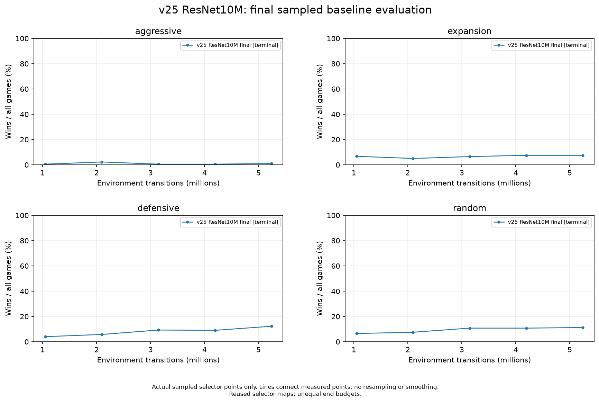

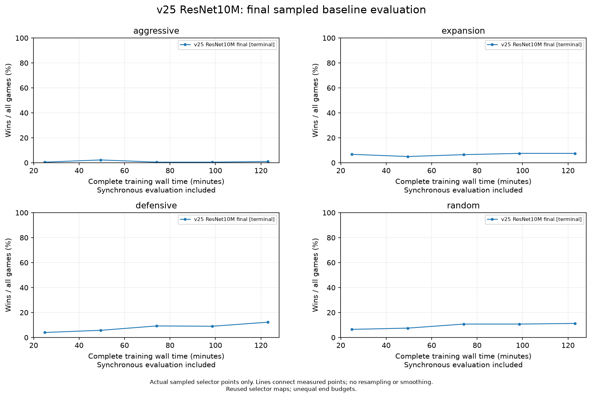

按预设最弱项/aggressive优先的selector，**best仍为it3**，而非总体最高的it9。停止规则要求最弱项达到严格2pp改善并有4个patience间隔；不能因此称全部曲线收敛。it3→it9总体+2.875pp，地图簇bootstrap95%CI为[1.50,4.25]pp；defensive+6.50pp [3.25,9.75]，aggressive−1.25pp [−2.50,0]。expansion和random也上升，但区间分别跨零/含零。使用共同200地图、双座配对及20000次重采样；这些区间只描述复用selector地图上的固定模型差异，不包含训练随机性或选模偏差。

另对终局best it3做1600局采样开发评测（seed1001042，200地图/AI×双座）；这是历次run复用开发种子，**不是独立保留集**。额外评测wall418.737秒在训练停止后发生，不计入上述正式训练时间。

| AI | selector best | selector latest | best开发集胜 / 负 / 和 | best开发胜率 |
|---|---:|---:|---:|---:|
| aggressive | 2.25% | 1.00% | 4 / 396 / 0 | 1.00% |
| expansion | 5.00% | 7.50% | 23 / 339 / 38 | 5.75% |
| defensive | 5.75% | 12.25% | 28 / 307 / 65 | 7.00% |
| random | 7.50% | 11.25% | 37 / 356 / 7 | 9.25% |
| overall | 5.125% | 8.000% | 92 / 1398 / 110 | 5.75% |

全部10轮PPO更新的endpoint exact KL均值.03150、最大.04216、末值.02291；clip fraction均值33.18%、末值35.15%。末LR在1e−5与7.59375e−5间反复触底和回升，各轮最大LR均高于下限，不能解释成没有自适应LR或停止更新。entropy1.963→4.541、rollout WAIT52.55%→6.67%，而WAIT/move gate entropy下降；合法动作支持集随局面变化，原始总熵不是独立探索能力指标。平均C71.674/U453.085秒，未见更新计时持续恶化或非有限数值。只有10次更新，明显不足以判断10M网络的能力上限。

有限预算中的对手分布也不成熟：终点16,384条活动lane里，seed0占 **15,755（96.16%）**，学习模型仅629（3.84%）；池内ID0..5，6次发布含初始seed，17,324次episode assignment。seed可在reset后被再次抽到，因此此数不是“仍处于初始局”的比例，也不是全程transition mixture。当前TB未记录逐快照交互占比；它提示冷启动和整局固定对手的时间尺度限制，但不证明低胜率由此导致。与1M各20更新/640tick相比，10M该轮仅10更新/320tick；大模型的有限wall比较同时受经验量和局面深度限制。

终局best自身checkpoint SHA `94792179c7076d98bafa087ff82dd467cc7249848accd72ac4731a2e9bc94af7`。四AI各一胜一败共8个实际selector录像，4700tick，全部按原joint actions完成native/Core重放验证；没有为录像另跑比赛。四败均为首张地图/seat0，以下只作定性案例，不能估计总体失败频率或证明替代行动必胜：

| 对手 / 局长 | 直接终局事实 | 敌将长期记忆 |
|---|---|---|
| aggressive / 112 | pre111本营增长后4兵，可见敌44→35出6；自己33→24出2，本营邻26有9、34有5仍未回援。 | 敌将49从未被观测，K未知。 |
| expansion / 226 | 最后35→26出3，把本营降至1；可见敌44→35出16夺将。 | 自tick73记录在K，终局仍存在。 |
| defensive / 308 | pre304本营24兵外送23，pre305再外送1；终局敌44→35出38，己邻26仍有12。 | 自tick22记录在K。 |
| random / 815 | pre813本营增长后58兵，35→26出57只留1；随后敌34→35出6。己另有223兵城市与邻将58兵。 | 自tick73记录在K。 |

四败的计划动作全部符合mask、native invalid为0。八局唯一native invalid在expansion胜局pre58：seat1的合法源48先被seat0的39→48攻占，是联合顺序执行而非计划mask错位。这些案例支持守将和兵力调度尚弱；三局K已保留敌将位置，不支持“忘记曾见过敌将”的解释。K存在不证明网络实际使用了它，也不能据四例归因架构或reward。

| AI | 胜局录像 | 败局录像 |
|---|---|---|
| aggressive | [win](../outputs/moe_cts/iterations/v25/final_best/analysis/videos/aggressive_win.mp4) | [loss](../outputs/moe_cts/iterations/v25/final_best/analysis/videos/aggressive_loss.mp4) |
| expansion | [win](../outputs/moe_cts/iterations/v25/final_best/analysis/videos/expansion_win.mp4) | [loss](../outputs/moe_cts/iterations/v25/final_best/analysis/videos/expansion_loss.mp4) |
| defensive | [win](../outputs/moe_cts/iterations/v25/final_best/analysis/videos/defensive_win.mp4) | [loss](../outputs/moe_cts/iterations/v25/final_best/analysis/videos/defensive_loss.mp4) |
| random | [win](../outputs/moe_cts/iterations/v25/final_best/analysis/videos/random_win.mp4) | [loss](../outputs/moe_cts/iterations/v25/final_best/analysis/videos/random_loss.mp4) |

终局入口：[完整训练诊断](../outputs/moe_cts/iterations/v25/diagnostic/terminal_training_review.json)、[开发评测](../outputs/moe_cts/iterations/v25/final_best/development_report.json)、[逐帧行为事实](../outputs/moe_cts/iterations/v25/final_best/analysis/recorded_behavior_final.json)、[终点对手占用](../outputs/moe_cts/iterations/v25/diagnostic/terminal_self_play_opponent_occupancy.json)。训练原session86930实际9376d2/exit0，开发原56500实际41b00e/exit0，录像原89264实际b71e13/exit0。终局review实际3b5569/exit0，完整曲线335d82/exit0且已由root视觉核对。TB：`outputs/moe_cts/iterations/v25/train/`。下一轮v26保持同档共同协议，从零启动；不以这轮失败中途改变对照组。

### v26 已从零启动：10M ViT，首轮更新验收通过

v25完整终局报告提交 `be78f29` 后，实际启动v26原session30384/PID3797686（374b48），直接读取自身冻结commit `0f92515174c1deaf1f62a7bd04d693fca80828ac` 的完整JSON；resume/warm_start均null，MDP、PPO、critic、历史池、评测及预算与v25相同。CPU fresh验收80576/5c6f62 exit0：288个seed0状态张量与自身全新构造逐位一致，actor10,008,521/critic1,053,033；不把独立Adam为空当作formal初始Adam实测。

自身iteration0 checkpoint及TB实际CPU becadc/exit0验收：NT524288、logical8192、physical256/BF16、256logical/8192microbatches；288个参与参数的Adam step均256、参数与moments有限。C46.330秒/U333.235秒、初始完整wall388.619秒（1349.11转移/秒）；endpoint exactKL .02269、clip22.02%、LR1e−4→7.59375e−4（5次变化），WAIT50.80%。首轮计时不是成熟速度或强度结果，formal未安装clip/observer计数hook。checkpoint SHA `e25e93d2bad2066c8809fdf9d3710850023e268789b4e62664105f5f02ea8342`；[首轮核验](../outputs/moe_cts/iterations/v26/first_update_contract.json) SHA `f09a77d6…`，root658ce3/a1e04b读回。TB：`outputs/moe_cts/iterations/v26/train/`。仍在正式训练，首个1600局采样panel于iteration1后完成；尚无v26正式baseline胜率。

另外为后续真实tick TB0..1000实验加入默认0的 `training_control.min_completed_updates`（独立commit `e61b2d2`）：只推迟平台早停，按包括resume历史的绝对已完成更新数判定；时间预算与reserve仍优先。这是实验控制准备，不改变冻结v25/v26协议或宣称课程已验证。既有控制器套件CPU67790/8bdd3a exit0，12tests＋31subtests通过，包含真实small train恢复后绝对计数3→4→5和预算优先测试；不改vendor/MDP。今后若预算先耗尽且课程未到1000与足够零tick阶段，应报告实验不完整，不能缩短衰减边界。

### 用户调整路线：暂缓网络扩容，转入小网络gamma实验

用户指出ResNet/ViT训练太慢，要求先跳过架构探索、推进其他项。当前v26已按请求停止：精确终止自己的PID3797686，原session30384实际af1a53/exit143，无评测子进程；保留已完成iteration0的checkpoint/TB，未完成的第二更新丢弃。**v26未完成正式预算、没有baseline panel，不报告其终局胜率或架构强度。** 暂不执行两家100M容量门禁及正式训练；已完成v23–v25结果保留。

下一阶段以v22已实现的信息语义和小网络为共同基座（H4K11/SH4K11、InformationSpatialPPOPolicy/spatial16、N16384/T32、E4/B64、uniform历史池8/pub50、每100updates异步CPU采样1600局、min1h/max3h及bounded retention），分别从零训练v27固定gamma.995和v28固定gamma.999。两者只改run_id、PPO gamma及与其匹配的PBRS potential_gamma，不复用v22模型。保留原lambda.95、reward/tick、actor/critic和adaptiveLR，不开启gamma或reward课程，以便解释固定gamma差异。历史v22平均C1.483/U5.925秒每更新、完整吞吐70,625转移/秒仅作预算参考，不保证新run速率。后续顺序仍为gamma课程、rollout/lambda、真实tick0..1000衰减及足够零tick训练，最后H8。

v27配置独立commit `5ebbfc504e9f265ea910e2e5f7fa58998ebd92d0`、v28 `8620d5a531d2e132a82e8c1a362c45435731da62`；各自从Git blobs冻结116运行文件，两份runtime字节相同（1ffedc exit0）。v27原session51203/af15da、PID3808814已实际fresh启动，日志确认从自身source导入、resume/warm_start均null；已有多个完整更新，初期约7.2秒/update，尚无baseline panel，不作为稳定性能结论。TensorBoard为 `outputs/moe_cts/iterations/v27/train/`。v28保持冻结等待，从零开始且不继承v27优化器/历史池；首个v27采样panel在iteration99。

### v27：固定 gamma=0.995，小网络从零对照（已完成）

用户暂缓慢速ResNet/ViT探索后，回到v22信息组合基座，建立与v28固定.999匹配的fresh控制。v27源码commit `5ebbfc5`，独立冻结116个Git文件；随机权重、新Adam、新历史池，resume/warm_start均null。实际930更新、每环境29760tick、487,587,840新转移，完整训练115.005分钟；9次selector均成功并排空。best499之后四点没有超过88.5%，约50分钟未提升后按完整更新边界人工STOP，停止原因`requested_stop`，不是自动patience12。

**MDP与网络。** 9×9/P2，N16384/T32，训练episode上限1024，地图池65536，训练seed20261013。Actor读取H4局部地图和当前公开信息＋非堆叠K11事实；critic读取真实state＋actor地图history/当前公开信息/K11。两家独立的两层3×3/16通道卷积＋全局池化/公开信息融合，actor12,281、critic13,793，总26,074参数；声明输入组4831/5816维，H4中的旧公开scalar未被网络使用。Actor另有将军相对XY，动作仍649类（WAIT＋81格×4方向×2模式）、合法mask及WAIT/MOVE分解。没有ResNet、循环层或新增策略hack。[参数与结构](../outputs/moe_cts/iterations/v27/diagnostic/policy_description.json)。Reward为胜负±1、固定tick−.001，以及匹配gamma的PBRS：领地.05、城市.2、兵力.001；本轮没有gamma/tick课程。

**算法与自对弈。** Student-only PPO，teacher=0；每轮524288样本，4epochs/64minibatches，每批8192、256次Adam更新；lambda.95、entropy.01、adaptive categorical LR初值1e−4/desiredKL.02。Uniform神经历史池8，每50更新发布，整局固定对手；不加入baseline训练对手。每100更新异步CPU采样评测，4AI各200地图×双座=1600局、max2000tick、seed271828、B128；best按最低AI胜率/aggressive/overall排序。历史磁盘池8、checkpoint最多3、eval快照3＋best。最终池0/13–19，活动对手仍有12而最终19尚未参加后续采样；seed0终点占1227/16384（7.49%），该时点占用不是整轮经验比例。

**效率与PPO动态。** C累计1377.547秒、U累计5506.468秒（约80%的C＋U用于更新），compute 70,829、完整wall 70,662转移/秒；CUDA峰值allocated 15.293 / reserved 16.324GiB。完成3,914,749个episode，28,094次truncated（0.718%）。最后100更新it830–929完整wall70,422转移/秒、C均1.520/U均5.919秒；exactKL均.02566、clip均12.48%、entropy均.7108、value loss均.03870，末LR.001975。全程最大whole-update KL为it569的.14525，自适应当轮末LR到1e−5；最后100轮熵较中期.671回升。曲线与有限更新指标显示性能平台伴有波动，不能简单归因学习率失效或熵持续塌缩。自对弈win与baseline胜率不同，value loss也不能替代critic解释能力；冻结v27/v28没有新增return/advantage/EV统计。新版默认监控已验证，从v29起采用，保持固定gamma配对运行源一致。

**全部采样selector曲线。** 表中wall为模型更新/快照对应时间，CPU评测与后续训练重叠，不是评测完成时的同步wall，不能再加worker耗时。

| TB iteration | 新转移/百万 | 快照训练/分钟 | aggressive | expansion | defensive | random |
|---:|---:|---:|---:|---:|---:|---:|
| 99 | 52.429 | 12.28 | 33.75% | 58.50% | 86.75% | 82.50% |
| 199 | 104.858 | 24.55 | 81.75% | 92.50% | 99.25% | 99.25% |
| 299 | 157.286 | 36.83 | 84.50% | 95.50% | 99.25% | 99.75% |
| 399 | 209.715 | 49.18 | 84.50% | 97.00% | 99.75% | 98.00% |
| 499 | 262.144 | 61.62 | 88.50% | 96.25% | 100.00% | 98.75% |
| 599 | 314.573 | 74.03 | 85.75% | 97.00% | 99.25% | 98.75% |
| 699 | 367.002 | 86.44 | 86.00% | 96.00% | 99.50% | 98.50% |
| 799 | 419.430 | 98.86 | 87.75% | 96.75% | 99.50% | 99.50% |
| 899 | 471.859 | 111.27 | 87.75% | 95.75% | 98.25% | 98.50% |

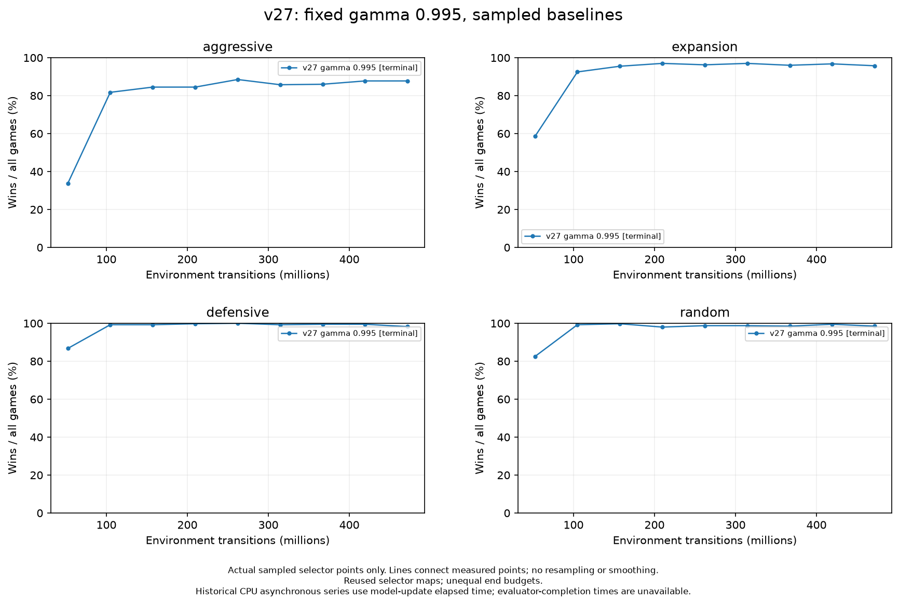

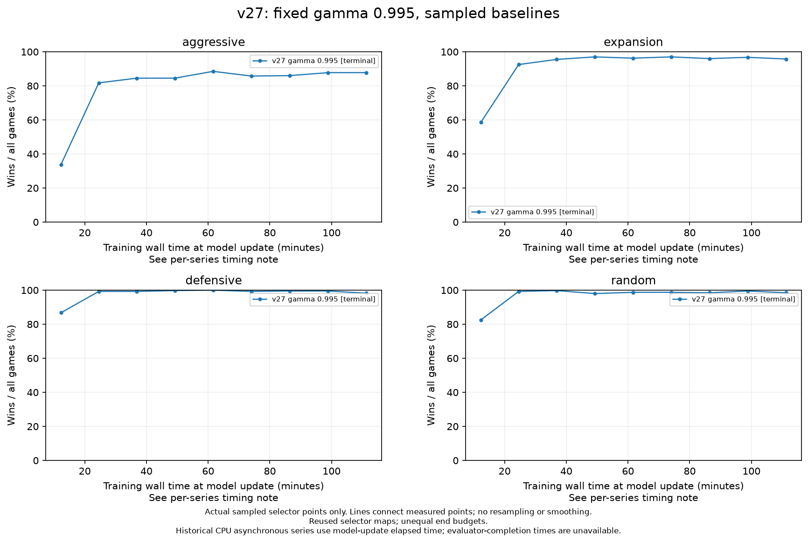

**最终最佳模型开发评测。** 自身best499已独立捕获，SHA `fcc73aea…`；另外实际执行1600局采样CUDA/FP32/B128/workers4、seed/sampling_seed1001042/max2000，完整开发阶段70.452秒（另计于训练预算），保存8条joint-action轨迹。参数与推理tensor为float32，实际报告`matmul_precision=high`、`cudnn_allow_tf32=true`；不能称纯FP32算子或highest。v28开发评测须匹配这组实际设置，CPU训练期eval的highest另计。该开发seed此前用过，不是未见heldout；每AI400局，CI按200地图双座聚类bootstrap。

| AI | best499 selector | latest899 selector | 开发胜/负/和 | 开发胜率 | 开发地图簇95% CI |
|---|---:|---:|---:|---:|---:|
| aggressive | 88.50% | 87.75% | 361/39/0 | 90.25% | 87.00–93.25% |
| expansion | 96.25% | 95.75% | 391/8/1 | 97.75% | 96.25–99.00% |
| defensive | 100.00% | 98.25% | 398/2/0 | 99.50% | 98.75–100.00% |
| random | 98.75% | 98.50% | 397/3/0 | 99.25% | 98.25–100.00% |

开发overall1547胜/52负/1和，96.6875%。best→latest的aggressive差−.75百分点，配对地图CI[−4.5,+3.0]；defensive差−1.75百分点，CI[−3.0,−.5]。这是重复selector上选过模型后的条件比较，不能当独立泛化或因果证据。本轮给出了当前.995基座的曲线和失败行为，gamma优劣仍待v28从零对照；高9×9 baseline成绩也不能证明更大地图或世界级能力。

**逐帧失败观察。** 八个录像共895tick，全部记录动作/native/Core重放一致。四个精选败局都是大本营被攻陷而非timeout；以下只描述这四局，不估计问题普遍性，也没有新推理或counterfactual。

- aggressive（284tick/seat1）：pre123–132看到敌king，H4保留至135，K持续到283。pre273家中送11军只剩1，pre275回援成13，pre276再送12；主栈向3→4→5→6→7后出现7↔6往返。pre283家中增长后5、邻敌13，敌seat0先送12在tick284攻陷，student当步动作被跳过。这局66次立即往返，10次敌方可动军距家≤2时仍从家出兵。事实记忆没有丢失；不能由本局断言网络是否有效使用K。
- expansion（101tick/seat0）：一直没有见敌king；末步家中2、邻敌5，自己先送1攻击邻敌，随后敌方送3攻陷只剩1的家。
- defensive（84tick/seat0）：pre76已见敌king；末段家中增长后2、邻敌5，连续从家送1攻击，最终被3军攻陷；自己的8军主栈仍距家6格。
- random（111tick/seat1）：一直没有见敌king；末段家中3、邻敌5，距家2格有15军，却操作其他军团，敌先送4攻陷。这些例子显示可见威胁下的守家和军队调度仍有改进空间；延长信用分配是否改善，要用后续gamma/rollout/lambda实验验证。

| AI | 胜局录像 | 败局录像 |
|---|---|---|
| aggressive | [win](../outputs/moe_cts/iterations/v27/final_best/analysis/videos/aggressive_win.mp4) | [loss](../outputs/moe_cts/iterations/v27/final_best/analysis/videos/aggressive_loss.mp4) |
| expansion | [win](../outputs/moe_cts/iterations/v27/final_best/analysis/videos/expansion_win.mp4) | [loss](../outputs/moe_cts/iterations/v27/final_best/analysis/videos/expansion_loss.mp4) |
| defensive | [win](../outputs/moe_cts/iterations/v27/final_best/analysis/videos/defensive_win.mp4) | [loss](../outputs/moe_cts/iterations/v27/final_best/analysis/videos/defensive_loss.mp4) |
| random | [win](../outputs/moe_cts/iterations/v27/final_best/analysis/videos/random_win.mp4) | [loss](../outputs/moe_cts/iterations/v27/final_best/analysis/videos/random_loss.mp4) |

追溯入口：[源/配置manifest](../outputs/moe_cts/iterations/v27/source_manifest.json)、[终局review](../outputs/moe_cts/iterations/v27/diagnostic/terminal_training_review.json)、[开发报告](../outputs/moe_cts/iterations/v27/final_best/development_report.json)、[逐帧事实](../outputs/moe_cts/iterations/v27/final_best/analysis/recorded_behavior_final.json)。原训练51203/dbb4d0 exit0、开发47333/efac77 exit0、demo59181/8bfba8 exit0、behavior10124/7e4bc8 exit0；review66876/48d63a、完整曲线0d18c3均exit0且已视觉核对。TB：`outputs/moe_cts/iterations/v27/train/`。下一轮v28保持同源同配置，仅改匹配的PPO/PBRS gamma为.999，从零启动；随后v29按ee60ca1预声明的1000终点/至少1200更新课程运行，不将配置或边界测试当正式课程成绩。

### v28：固定 gamma=0.999，从零对照（已启动）

沿用v27的v22信息组合小网络、MDP、N16384/T32、NT524288/E4/B64、lambda.95、历史池8/pub50、CPU采样eval每100更新/1600局及1–3h预算；配置仅run_id、PPOgamma及匹配PBRSgamma .995→.999。源码commit `8620d5a531d2e132a82e8c1a362c45435731da62`、116运行文件与v27逐字节相同；configuration SHA `b39771725fc5124d2f6b73ea90278f3934488bf0feb50427f2697cad82fd016f`。没有课程、权重/Adam/历史池继承或中途改动。目的同时观察长期终局折扣与累计tick惩罚的共同变化，不把胜率变化单独归因某一个奖励项。

首次启动77021/c9491b在第一个env step前因编译器变量错误退出（3d8cb7 exit1、零完整更新）；CUDA loader读`GENERALS_NVCC`而非`NVCC`。仅修启动环境，保留`failed_bootstrap_train`与`failed_bootstrap.stdout.log`，重新fresh创建正式目录。新原session82663/d20e62、PID3933826（以自身startup日志/执行状态为准），启动确认自身冻结source、resume/warm_start均null、编译器路径有效，已有完整更新。最初两轮约7.1–7.2秒/update，只是启动窗口；尚无baseline panel或强度结论。失败启动耗时另记，不混入正式训练计时。

首30个完整更新CPU只读TB（a7979b exit0，观测it0–29、当时latest35）均有限：C均1.273/U均5.909秒，完整wall约69948转移/秒，exactKL均.01866、clip均24.76%、entropy均4.5605，末LR.01；v27同期clip均17.76%。这是启动窗口的描述，不推断baseline强度或gamma优劣。原始tags/窗口保存在[early_training_dynamics.json](../outputs/moe_cts/iterations/v28/diagnostic/early_training_dynamics.json)。

TB：`outputs/moe_cts/iterations/v28/train/`。先完成该固定gamma对照的完整曲线、最佳开发评测、录像和失败分析，再进行已冻结的v29 gamma课程；rollout/lambda、真实TB0..1000 tick衰减及H8仍按顺序保留，容量探索暂缓。

#### v28 首个采样panel与初期自对弈动态（继续训练）

it99 / snapshot2实际completed0：100次更新、52,428,800转移、3200tick/env，四AI各200地图×双座，共1600唯一采样局。新正式82663/d20e62、CPU一次赛程/TB验收8c3d78、watcher68853/71acf6 exit0；root8bbec4读原报告并复用generic paired做实际地图簇配对。真正模型快照训练wall732.699秒（12.212分钟），worker587.473秒，二者异步重叠、不相加。CPU评测cost明显长于v27首次193.199秒；训练同样100更新的wall与v27的737.020秒接近，这一个早期点不是稳定吞吐结论。

| AI | v27 同100更新胜率 | v28 胜/负/和 | v28 胜率 | v28 平均tick |
|---|---:|---:|---:|---:|
| aggressive | 33.75% | 0/400/0 | 0.00% | 132.35 |
| expansion | 58.50% | 2/358/40 | 0.50% | 436.32 |
| defensive | 86.75% | 5/262/133 | 1.25% | 1018.11 |
| random | 82.50% | 2/324/74 | 0.50% | 881.63 |

v28 overall9胜/1344负/247和，0.5625%胜率/15.4375%和局，平均617.1025tick。与v27这个相同样本/固定selector时点的overall差−64.8125百分点，200地图簇配对CI约[−67.25,−62.37]；aggressive差−33.75，CI[−38.5,−29.0]。这证明当前seed/配置下显著的早期学习差距，不证明最终强度、训练seed泛化或gamma的普遍因果结论。两个报告的CPU/FP32/highest、sampling protocol/seed/max2000和完整game/map/seat赛程一致；不比较不同样本或复用旧模型成绩。[实际首panel配对](../outputs/moe_cts/iterations/v28/diagnostic/first_selector_matched_gamma_comparison.json)。

it50–99共同自对弈窗口的额外只读TB（8f5fee exit0）：v28已完成episode聚合的length均935.59tick、truncated均78.89%（45个记录点），v27为458.53tick/6.68%（50点）；WAIT均1.20% vs2.87%。因此长局不能简单解释成等待，eval中aggressive仍快速将其击败。whole-update KL均.01862 vs.01701、clip均16.19% vs18.78%，这段更新监控不支持“持续更高clip即唯一失败原因”。这是按日志batch等权平均，不是episode-count加权的整轮统计，也不是baseline胜率。后续真正终局best模型保留trace再观察调兵/交战；当前没有逐tick轨迹，不虚构行为。[initial_pool_phase_dynamics.json](../outputs/moe_cts/iterations/v28/diagnostic/initial_pool_phase_dynamics.json)。

未达到至少1h、仅一个panel，保持冻结训练继续观察it199及后续曲线；不因首点差而修改gamma、lambda、奖励、学习率或中断重启。自身Git analysis工具已a07e07从source commit冻结，runtime/config核对通过；尚未执行终局开发、录像、review或完整曲线，不能标记v28完成。

#### v28 第二采样panel：仍在学习（训练继续）

it199 / snapshot4实际1600局completed0，CPU一次完整赛程/TB验收a47109 exit0，root核对原report字节SHA `695bbfb7…`；checkpoint `a421c6bd…`。累计104,857,600转移/6400tick-env，快照训练wall1466.425秒（24.440分钟）、异步worker613.724秒，不相加。

| AI | v28 it99 | v28 it199 胜/负/和 | v28 it199 胜率 | v27 同200更新胜率 |
|---|---:|---:|---:|---:|
| aggressive | 0.00% | 8/392/0 | 2.00% | 81.75% |
| expansion | 0.50% | 31/330/39 | 7.75% | 92.50% |
| defensive | 1.25% | 104/141/155 | 26.00% | 99.25% |
| random | 0.50% | 126/162/112 | 31.50% | 99.25% |

v28 overall269胜/1025负/306和，16.8125%胜率；相比首点有明显提升，但仍显著落后.995控制的同样本曲线，不能由两点判断最终差距。继续原82663及冻结配置，不改LR/reward/MDP；第三it299/snapshot6的worker为3961905，其实际完成结果见下一段。本轮仍不足1h，尚非平台，更不是v28终局。

#### v28 第三采样panel：早期差距缩小（训练继续）

it299 / snapshot6实际completed0，CPU一次完整1600局赛程/TB验收f05ec9 exit0，root69e09c读回；watcher32131/3d99d8 exit0、两个目标均完成，原训练82663继续。累计157,286,400转移/9600tick-env，快照training wall2205.194秒（36.753分钟），worker155.730秒，异步不相加。

| AI | v28 it199 | v28 it299 胜/负/和 | v28 it299 胜率 | v27 同300更新胜率 |
|---|---:|---:|---:|---:|
| aggressive | 2.00% | 213/187/0 | 53.25% | 84.50% |
| expansion | 7.75% | 295/105/0 | 73.75% | 95.50% |
| defensive | 26.00% | 379/21/0 | 94.75% | 99.25% |
| random | 31.50% | 380/20/0 | 95.00% | 99.75% |

v28 overall1267胜/333负/0和，79.1875%，平均158.486tick。相比it199明显提升、和局消失，eval worker也由613.724降至155.730秒；说明早期长局/较弱策略造成的评测成本已缓解，而非评测进程卡死。其仍落后.995同样本控制，但第一点的巨大差距已经缩小，不能把早期慢学当最终能力结论。CP SHA `e67a25b2…`、report `b8e45986…`。真实训练已约40分钟，尚不足1h且曲线明显上升，继续原冻结配置观察399/499，未触发平台STOP。

#### v28 第四采样panel：继续追近 .995（训练继续）

it399 / snapshot8实际completed0，CPU一次1600局完整赛程/TB验收ed0f04 exit0；累计209,715,200转移/12800tick-env。快照training wall2946.030秒（49.101分钟），worker104.685秒，CPU异步不相加。checkpoint SHA `cfddfc09…`、report `2b70ecf3…`，root原报告字节核对。原82663及冻结配置继续，下一it499待验收。

| AI | v28 it299 | v28 it399 胜/负/和 | v28 it399 胜率 | v27 同400更新胜率 |
|---|---:|---:|---:|---:|
| aggressive | 53.25% | 309/91/0 | 77.25% | 84.50% |
| expansion | 73.75% | 366/34/0 | 91.50% | 97.00% |
| defensive | 94.75% | 393/7/0 | 98.25% | 99.75% |
| random | 95.00% | 392/8/0 | 98.00% | 98.00% |

overall1460胜/140负/0和，91.25%；aggressive与.995同样本控制的差距由it299的31.25百分点缩小到7.25。曲线仍明显上升，不因尚未超过80%停止，也不由四个复用selector点宣称泛化或最终gamma结论。中期诊断预先固定it492–541，与v27已保存窗口匹配，届时只读C/U/真实wall、KL/clip/entropy/LR以及episode聚合；不改当前源、MDP或训练超参数。

#### v28 第五采样panel：四AI均超过80%（训练继续）

it499 / snapshot10实际completed0，CPU一次1600局完整赛程/TB验收44e0cc exit0，watcher62114/1a1d01 exit0（两个目标全完成）；root核对原report字节SHA `abae4e3d…`、checkpoint `6b4bf010…`。累计262,144,000转移/16000tick-env，快照training wall3690.279秒（61.505分钟）、worker97.336秒，CPU异步不相加。

| AI | v28 it399 | v28 it499 胜/负/和 | v28 it499 胜率 | v27 同500更新胜率 |
|---|---:|---:|---:|---:|
| aggressive | 77.25% | 339/61/0 | 84.75% | 88.50% |
| expansion | 91.50% | 380/20/0 | 95.00% | 96.25% |
| defensive | 98.25% | 396/4/0 | 99.00% | 100.00% |
| random | 98.00% | 397/3/0 | 99.25% | 98.75% |

overall1512胜/88负/0和，94.50%。aggressive相对前一点又升7.5百分点，与.995同500更新差3.75；不是早期0%的最终能力失败。虽然此selector四项均>80%，它是反复用于选择模型的固定seed，未证明随机训练seed或世界级能力。已超过1h但曲线仍在升，保持82663原配置继续看599/699；不以达到baseline阈值代替用户要求的完整方案实验。中期固定492..541已具备读取条件，等待实际诊断artifact后报告，不将未读指标当证据。

中期预先固定的it492–541已完成一次CPU诊断（304b84 exit0，root846b86读回；[原始数据](../outputs/moe_cts/iterations/v28/diagnostic/mid_training_dynamics.json)，SHA `5dd84395…`）。50轮26,214,400转移，collection76.255秒、update295.967秒、真实wall372.536秒，即70,367转移/秒；v27同窗口70,515，计算速度基本一致。KL均0.01598、clip13.57%、entropy1.4856；v27为0.02224/12.77%/0.6713。自适应LR终值在48/50轮触顶、2/50轮触底，选定33个tag共1650点均有限。这些是日志窗口的描述，不能单独证明最终强度或gamma作用机制。

该窗口episode指标按每次日志batch等权：length100.59tick、自对弈win81.72%、truncated0.237%；不能当baseline胜率或按episode数加权的整轮结果。WAIT20.64%、backtrack7.99%（v27同窗20.05%/12.90%）；终局开发轨迹尚未生成，暂不推断具体守家/调兵行为。v28冻结源未包含后续新增return/advantage/EV监控，不能由value loss补造这些指标。

#### v28 第六采样panel及固定gamma中途配对（训练继续）

it599 / snapshot12 actual completed0，共1600采样局，CPU验收5a300a、root36e090核对report SHA `e16eeb2a…`。四AI胜/负/和为aggressive343/57/0、expansion389/10/1、defensive397/3/0、random398/2/0，胜率85.75%/97.25%/99.25%/99.50%；overall1527/72/1，95.4375%。累计314,572,800转移/19200tick-env，快照training wall4435.102秒（73.918分钟）、异步worker89.758秒。仍使用原82663和同一冻结配置，等待后续曲线。

实际CPU复用generic paired完成截至it599的相同样本对照（b42b0a exit0，root e8e7f8读回；[interim_fixed_gamma_comparison.json](../outputs/moe_cts/iterations/v28/diagnostic/interim_fixed_gamma_comparison.json)，SHA `af4946b1…`）。it99复用原结果；其余点各200地图簇/20k bootstrap，完整game/map/AI/seat schedule及CPU/FP32/highest/B128/workers1/采样seed271828等协议相同。

| iteration | v28−v27 aggressive百分点（95%地图簇CI） | overall百分点（95%地图簇CI） |
|---:|---:|---:|
| 199 | −79.75 [−83.75, −75.50] | −76.375 [−78.688, −74.000] |
| 299 | −31.25 [−36.50, −26.00] | −15.563 [−17.688, −13.500] |
| 399 | −7.25 [−11.50, −3.00] | −3.563 [−5.063, −2.125] |
| 499 | −3.75 [−8.00, +0.25] | −1.375 [−2.750, −0.063] |
| 599 | 0.00 [−4.50, +4.50] | +0.250 [−1.063, +1.500] |

第六点全部四AI及overall差值CI包含0，说明当前点估计已接近，不证明等效或最终优劣；这是单训练seed、反复使用selector地图的中途对照。it599 v27/v28快照训练wall4441.586/4435.102秒接近，eval worker89.981/89.758秒另记，不相加。约84分钟的资源实测：GPU17.5GiB、输出17MB、磁盘剩余897GB，无需改变保留策略或训练规模。

#### v28 第七采样panel：aggressive提升至90.25%（训练继续）

it699 / snapshot14 actual completed0、1600采样局，CPU验收2a78a3 exit0，root核对report SHA `8d60736b…`与实际WLD；observer11156/97dce2 exit0，两目标全完成。四AI胜/负/和分别361/39/0、390/10/0、399/1/0、396/4/0，胜率90.25%/97.50%/99.75%/99.00%，overall1546/54/0（96.625%）。累计367,001,600转移/22400tick-env，快照training wall5178.963秒（86.316分钟）、异步worker82.305秒，不相加；checkpoint SHA `0a2d4362…`。

aggressive较it599上升4.5百分点，曲线仍有明显提升，继续原82663/冻结配置看799/899。该点比v27同700更新的86%高4.25百分点，仅是selector点估计；当前六点配对artifact截至599，没有把尚未计算的it699 CI或终局gamma优劣当结果。最佳独立开发评测、trace/demo、完整曲线及最终配对均待真正终局后完成。

it799 / snapshot16随后actual completed0（d762c2 exit0，root核对report SHA `05a9bc91…`）：四AI采样WLD363/37/0、391/9/0、397/2/1、396/4/0，胜率90.75%/97.75%/99.25%/99.00%，overall1547/52/1（96.6875%）。累计419,430,400转移/25600tick-env，快照training wall5922.427秒（98.707分钟），异步worker89.838秒另记；checkpoint SHA `482aa279…`。aggressive只增加0.5百分点，是一个较平的点，不足以确认平台；原82663继续，原observer9949继续等it899。

it899 / snapshot18 actual completed0（当前CPU0fc076/b46f82 exit0验收，root读回SHA `666e97e8…`）：四AI WLD366/34/0、395/5/0、399/1/0、399/1/0，胜率91.50%/98.75%/99.75%/99.75%，overall1559/41/0（97.4375%）。累计471,859,200转移/28800tick-env；真实快照training wall6665.492秒（111.092分钟），异步worker82.279秒另记；checkpoint SHA `b53799f5…`。相比上点aggressive增加0.75百分点，最近两点提升较小，继续观察999/1099确认平台。

17:09UTC工具观察registry丢失，旧session82663不可再轮询，但实际PID3933826/PPID1/start_ticks426509309仍活着、日志继续增长（a80dba/65d5c0），没有重启或继承另一轮权重。以真实OS进程和自身日志/评测索引继续追踪；停止仍通过自身`train/STOP`在完整更新后正常保存并收尾，不把丢失的观察句柄当训练结束，也不声称未观测到的原session exitcode。新的CPU观察只负责已有评测结果，不新增对局。

#### 固定gamma的九个共同采样坐标（v28仍训练）

v27正式训练已结束，其全部九个selector点均已与v28对应点对齐。实际CPU83482/f5e1a4 exit0，只新增699/799/899的配对bootstrap，原六点与metadata不变；root4803b4读回JSON并目视核对两图。18份报告协议及完整地图/座位赛程相同，每点200地图簇、20k bootstrap。[完整九点数据](../outputs/moe_cts/iterations/v28/diagnostic/fixed_gamma_selector_comparison.json)，SHA `0591e502…`。

| iteration | v28−v27 aggressive百分点（95%地图簇CI） | overall百分点（95%地图簇CI） |
|---:|---:|---:|
| 699 | +4.25 [+0.50, +8.00] | +1.625 [+0.375, +2.938] |
| 799 | +3.00 [−0.50, +6.50] | +0.813 [−0.313, +1.938] |
| 899 | +3.75 [0.00, +7.50] | +2.375 [+1.250, +3.563] |

固定.999前期明显慢学，随后追上并在部分后期点有更高胜率；这不是由采样计算速度大幅变化解释的。不能由这些复用selector地图的点估计断言最终模型或训练seed泛化更优。v28尚未终局、独立开发评测尚未执行，不在这里选择后续实验的base。图只连接真实观测点；时间轴为各快照生成时的训练wall，不加异步worker时长、不插值补评测。稀疏评测下相同wall预算的最近可用snapshot可能不同，最终报告需列出实际坐标与时间差。

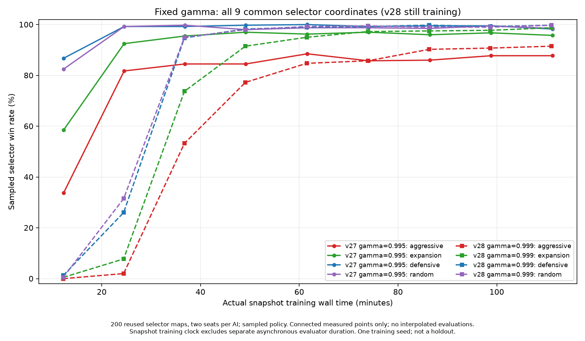

it999 / snapshot20 actual completed0（持久CPU observer4024597，744a7a exit0读取验证；root核对原report SHA `b2f0bfe1…`）：aggressive361/39/0、expansion389/11/0、defensive400/0/0、random400/0/0，胜率90.25%/97.25%/100%/100%，overall1550/50/0（96.875%）。累计524,288,000转移/32000tick-env；快照training wall7409.136秒（123.486分钟），独立worker97.168秒；checkpoint `cf6f31f2…`。aggressive较上点回落1.25百分点，best仍899。

在1099结果出现前明确本轮平台观察规则：699的90.25%是最后一次≥2百分点的aggressive跃升；随后799/899/999分别90.75%/91.50%/90.25%。若1099仍低于92.25%，四个后续点、约50分钟没有≥2百分点提升，则正常STOP完成本轮；若达到该值则继续，最长3h预算不变。这是趋势停止规则，不将2百分点当统计显著性检验。保留实际best快照，不以最后一个模型替代best；之后补齐终局开发、录像/失败分析及完整曲线。

#### v28 终局与固定 gamma 配对结论（2026-10-08，已完成）

固定 γ=.999 的 v28 已在完整更新边界正常停止：1133 更新、36,256 tick/env、594,018,304 转移，wall 8398.899 秒（139.982 分钟）。预先声明的四点平台规则已满足：699 之后799/899/999/1099的 aggressive 为90.75/91.50/90.25/90.25%，未达到92.25%；不是数值故障或磁盘不足。原训练句柄在运行中丢失，未重启训练；root f5739f 直接观察到原 PID/start_ticks 对应进程的内核退出状态0，随后进程消失。11次采样 selector 全部 completed/returncode0、队列排空。最终模型为真正终局选择的 **it899/snapshot18**，而非最后模型，checkpoint SHA `b53799f5…`；不可变捕获8a7938。配置及116个源文件与冻结版本相符，v27/v28只有run_id与匹配的PPO/PBRS gamma不同。

本轮沿用v22小网络信息条件：actor H4+K11、critic S+H4+K11，actor12,281/critic13,793参数；N16,384/T32，NT524,288，每轮E4/B64、逻辑batch8192/256次Adam，λ=.95，categorical自适应LR/KL=.02。episode1024，历史池8、整局固定uniform神经网络对手、pub50/eval100；训练没有baseline对手。PBRS资源系数与终局±1、tick−.001不变，PPO/PBRS同γ=.999；保持high、FP32张量及原保留上限，不改变MDP或奖励以追逐单个baseline。

| 指标 | v27 固定.995 | v28 固定.999 |
|---|---:|---:|
| 完整更新 / 全局转移 | 930 / 487,587,840 | 1133 / 594,018,304 |
| 正式训练 wall | 115.005分钟 | 139.982分钟 |
| collection / update | 1377.547 / 5506.468秒 | 1679.556 / 6703.524秒 |
| C+U计时吞吐 / 完整wall吞吐 | 70,829 / 70,662转移/秒 | 70,859 / 70,726转移/秒 |
| Torch峰值 allocated / reserved | 15.293 / 16.324GiB | 15.334 / 16.324GiB |
| 完成episode / timeout占比 | 3,914,749 / 0.718% | 3,893,773 / 3.088% |
| selector-best iteration | 499 | 899 |

训练算力吞吐接近，.999早期胜率明显落后不能归因于速度下降；本轮早期长局与timeout较多，后期学习追上。异步CPU评测worker时长不加到快照训练wall上，父进程Torch显存不包含独立子进程/native峰值。两轮预算因平台停止不同，最终best强度不能替代相同样本效率比较。九个共同坐标的配对已在前文报告；最终共同wall预算取实际较短终局6900.305秒，两轮最近实际可用点均899（v27快照6676.017秒，v28 6665.492秒），相对预算分别早224.288/234.813秒，未插值假造同一时刻。

第二次独立CUDA开发评测采用正常module入口，原session5989/fe1c80 exit0：seed1001042，200随机地图×四AI×双座=1600采样局。协议与v27相同：B128/workers4/max2000、high/TF32允许、参数和输入float32。FP32张量不表示强制纯FP32矩阵核。首次stdin入口因multiprocessing spawn不能重载 `<stdin>` 而失败，35219/b3b408 exit1、零局，保存在`failed_development_bootstrap`；没有改权重或继承其他模型，以下全为修复入口后的真实完整结果。

| AI | v27 开发胜率 | v28 胜/负/和 | v28 开发胜率 | v28−v27百分点（95%地图簇CI） |
|---|---:|---:|---:|---:|
| aggressive | 90.25% | 361/39/0 | 90.25% | 0.00 [−3.75,+3.75] |
| expansion | 97.75% | 389/11/0 | 97.25% | −0.50 [−2.50,+1.50] |
| defensive | 99.50% | 399/1/0 | 99.75% | +0.25 [0.00,+0.75] |
| random | 99.25% | 398/2/0 | 99.50% | +0.25 [−0.75,+1.25] |
| overall | 96.6875% | 1547/53/0 | 96.6875% | 0.00 [−1.1875,+1.1875] |

实际CPU30ce31 exit0复用generic paired，以200完整地图簇做20k bootstrap、seed20261007；完整map/AI/seat/game-ID赛程及精度控制一致。九个selector对照原样复用，没有重新bootstrap。开发地图seed此前使用过，因此不能称未见holdout；模型由selector选择、只有一个训练seed，CI不包含训练随机性与选择偏差。**固定.999后期selector点更高，但这次最终开发评测没有显示相对.995的明确增益，亦不能证明两种gamma等效。** .995在当前预算内早期样本效率更好；继续预声明的.995→.999课程，检验能否保留早期优势，之后再选择rollout/lambda的共同基座。

末100更新1033–1132：真实wall吞吐70,463转移/秒，KL均.01723/max.05943、clip14.67%、entropy1.2698、grad norm均.3457、value loss均.03037；选定指标均有限。LR仍自适应，末值.01；whole-update KL最大峰为it623/.09396，不能把监控值等同触发minibatch LR的统计。best899到最后selector1099，overall降1.3125百分点、地图簇CI[−2.375,−.3125]，expansion降3pp[−5.25,−.75]；aggressive降1.25pp[−4.75,+2.25]，证据不足以断言其真实退化。继续训练不保证单调提高baseline表现，应保留best。这些描述未确定退化机制；冻结v28没有新版return/advantage/EV监控，不能从value loss补造EV。

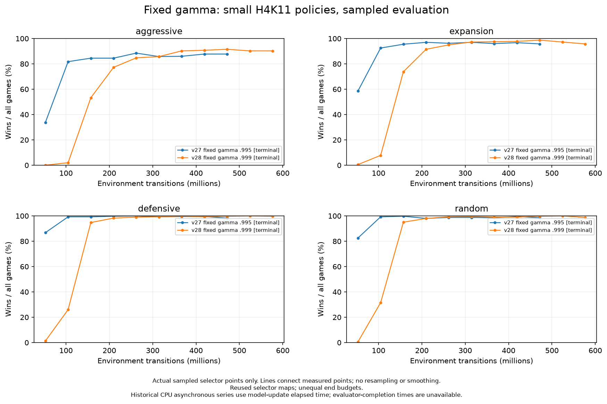

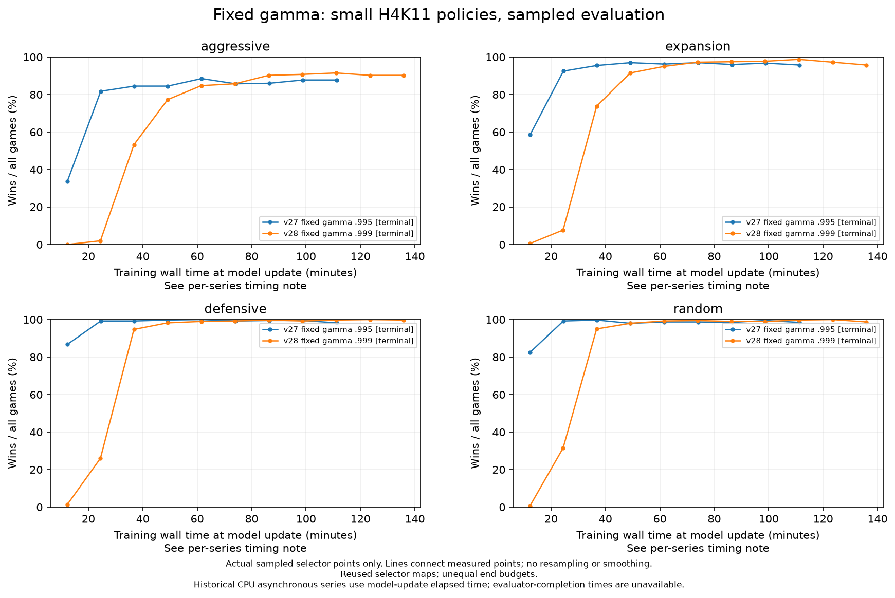

终局8条真实joint-action轨迹各AI一胜一负：CPU33938/642522 exit0、1082 decision tick、8局recorded/native/Core校验通过；8个MP4的H264/1140×816/24fps与帧数时长均核对。复用v24行为helper、仅参数化v28，CPU91199/1e5f8e exit0；未运行新对局或模型推理。以下`pre_tick`是下一tick动作前的观测；绝对seat0先行动。

- aggressive败局game4/seat0/236tick：整局未见敌将，末期兵力约10对106；多次从家将2兵送出1。pre235家将增长后2，actor从35回援1，敌军43出5随后夺将。该局24次立即折返、24次近将可见机动敌军时仍从家将出兵，反映本局守家与调兵不足，不是所有败局频率。
- expansion败局game404/seat0/327tick：与aggressive例共用同一地图，不能当独立地图；未见敌将。相邻城市敌军61→82、家将30→35，actor继续其他区域移动；pre326选57→58半军2，邻城敌军出81夺将。已有全局和邻近兵力劣势，最后一个动作不是唯一原因。
- defensive败局game1017/seat1/60tick：敌将pre26–57可见，H4/K11均保持到pre59，并非记忆丢失。自有19兵调往34后敌主力接近家将；pre59家将增长后4，邻军15出14先夺将，actor计划34→35但未执行。
- random败局game1263/seat1/25tick：14次WAIT、仅两块领土，持续把将兵送到邻格。pre24才见邻军3，家将1、邻格自军12，actor已计划回援，但seat0先出2夺将，回援未执行；不能说看到威胁后完全不防守。

四败局均真实夺将而非timeout，所有重建learner mask合法；终局被跳过的动作不是非法动作。观察支持继续研究信用分配和时间尺度，但未证明gamma因果作用、事实通道使用效果或普遍败因；不据此加入baseline特制规则。

原始结果：[终局review](../outputs/moe_cts/iterations/v28/diagnostic/terminal_training_review.json)、[固定gamma最终配对](../outputs/moe_cts/iterations/v28/diagnostic/final_fixed_gamma_comparison.json)、[开发1600局](../outputs/moe_cts/iterations/v28/final_best/development_report.json)、[录像](../outputs/moe_cts/iterations/v28/final_best/analysis/videos/)、[重建行为](../outputs/moe_cts/iterations/v28/final_best/analysis/recorded_behavior_final.json)。TB：`outputs/moe_cts/iterations/v28/train/`。

### v29 — gamma 课程（2026-10-08，正式训练已启动）

在v27/v28实际终局、1600局开发对照、完整曲线与八局录像分析完成后，从已提交配置ee60ca14冻结的116源文件启动新v29。正式session87039、launch277677，PID4062503/start_ticks427497185；自身source/config启动回读3cbb17，run_config与冻结JSON相同，resume/warm_start均null、历史池全新。v27/v28结论commit1efe80f；不用旧权重起跑，也不继续ResNet/ViT实验。

只检验gamma课程：PPO与PBRS在采集前同步 `γ(u)=.995+.004×min(u/1000,1)`，绝对TB u1000达到.999。tick_scale始终1、tick−.001，PBRS资源/胜负系数不衰减。其他设置同固定gamma控制：N16384/T32/NT524288/E4/B64，λ=.95、H4K11/SH4K11小网络、episode1024、历史池8/pub50、100更新一次1600局采样CPU异步selector、high和FP32张量。每轮目标在同一rollout/GAE内一致，跨rollout课程改变目标且episode可跨越边界，不称为全程平稳MDP。

预算1–3h、min_completed_updates1200：平台早停不能抢在完成u1000..1199的200个最终gamma更新之前；预算仍优先，未完成阶段如实记录。人工趋势规则延续固定gamma的≥2百分点aggressive提升/四个后续selector无此提升，并同时满足最低更新与时间要求；最长3h停止。在最终阶段仍上升则继续至预算。不能为了赶时间缩短1000日程，也不把达到80%当实验完成。

新版return/advantage/critic EV仅加入诊断（68c95fe），不改变训练目标或随机采样。首3轮真实TB c5f0a2：gamma为.995/.995004/.995008、tick_scale1；raw/buffer advantage及有效critic EV均已记录且有限，归一化buffer std约1。这只是启动验证，不是课程结果或稳定吞吐。以后用实际C/U、whole-update KL/clip、自适应LR、return/raw advantage尺度与EV，联合解释曲线。snapshot/checkpoint上限3、历史池8仍保持。

TB：`outputs/moe_cts/iterations/v29/train/`；原始stdout：`outputs/moe_cts/iterations/v29/train.stdout.log`。先观察first30实测计算成本与it99/199的真实采样panel，不改变正在运行的配置。gamma阶段完成后才固定下轮基座，随后单一rollout候选N4096/T128、单一λ=.99、TB0..1000 tick衰减、最后H8。

#### v29 首个采样评测与新增 critic 指标（训练继续）

it99/snapshot2已经真实completed0，仍是original87039/PID4062503/start427497185这轮从零训练。52,428,800转移/3200tick-env，实际快照training wall737.073秒（12.285分钟），异步CPU worker281.689秒另记；checkpoint `6ba751f7…`、report `edd5a1bc…`。原observer18220的一次完整赛程/TB/哈希验收通过，root53ab84读原结果、be1fc7复用generic paired对照两个固定gamma的同样本时点，没有新评测对局。

| AI | v27 固定.995 同100更新 | v29 胜/负/和 | v29 胜率 | v28 固定.999 同100更新 |
|---|---:|---:|---:|---:|
| aggressive | 33.75% | 104/296/0 | 26.00% | 0.00% |
| expansion | 58.50% | 203/190/7 | 50.75% | 0.50% |
| defensive | 86.75% | 315/85/0 | 78.75% | 1.25% |
| random | 82.50% | 289/109/2 | 72.25% | 0.50% |

overall911胜/680负/9和，56.9375%，mean249.276tick。报告为200地图×四AI×双座1600采样局，CPU/highest/float32/B128/workers1/seed271828/max2000控制与完整game/map/AI/seat排程一致；各比较200地图簇/20k bootstrap。v29−v27 aggressive差−7.75pp、95%CI[−12.25,−3.25]，overall−8.4375pp[−11.4375,−5.4375]；v29−v28 aggressive+26pp[+21.75,+30.25]、overall+56.375pp[+53.6875,+59.00]。这是复用selector地图的单seed初期对照，不是最终优劣或课程泛化；尚未走到u1000，保持原配置继续看199及后续，不因首点低于.995控制而中断课程。[实际首点评测配对](../outputs/moe_cts/iterations/v29/diagnostic/first_selector_matched_gamma_comparison.json)。

新增监控的first30窗口实际读92c61c、root eab23f：29tag×30=870点均有限，无缺失。collection38.679秒/update177.201秒；C+U吞吐72,858转移/秒，u0完成到u29完成的严格端点间隔29NT/208.836秒=72,805转移/秒，含启动开销的0..29累计wall为69,836转移/秒，口径不能混用。每轮monitor均.12784秒，不由这个短窗口宣称稳定整轮效率。gamma实际.995000005→.995115995、tick_scale均1；尚非课程终点。

critic EV是**收集时value对本轮shaped GAE bootstrap target的方差解释度**，覆盖全部有效storage样本而非8192个policy probe。`returns=V_old+A_GAE`，不是完整对局MC胜负；使用FP32 population variance，`EV=1−Var(returns−V_old)/Var(returns)`，target方差不足或非有限时省略EV并标valid0。真实终止势能清零，timeout保留最终势能并加入old value bootstrap后截断done；普通rollout末端同样自举。

first30 EV均值.7786、末轮.9697/valid30轮；末轮return std.45466、raw advantage std.07914，说明差值方差相对target方差小，但raw advantage mean仍−.10105，EV会忽略整体均值偏差。buffer advantage零均值/单位标准差来自标准化。固定gamma且边界自举一致时，shaped value包含`V_base−Φ(s)`，资源势能结构可能贡献大量target方差；当前没有Φ/去势能分解，不能断言它主导这些数值，也不能把高EV当作已学会终局胜负预测。γ课程跨轮还改变目标分布，return mean由+.229降到−2.958不能直接解释成胜率退化。终局需结合采样对战曲线判断。[first30实际标量摘要](../outputs/moe_cts/iterations/v29/diagnostic/early_training_dynamics.json)。

#### v29 第二采样点：课程初期持续学习（训练继续）

it199/snapshot4已实际completed0，共1600采样局，独立observer18220/533409真实exit0、PID4066227消失；两目标验收已结束，不再轮询旧handle。原正式87039仍继续。累计104,857,600转移/6400tick-env，快照training wall1474.215秒（24.570分钟），wall吞吐71,128转移/秒；异步worker140.585秒另记。report `41e42a27…`、checkpoint `da551576…`，root a96bcb读真实报告并复用generic paired，未重跑旧point的bootstrap或新评测对局。

| AI | v29 it99 | v29 it199 胜/负/和 | v29 it199 胜率 | v27 同200更新 | v28 同200更新 |
|---|---:|---:|---:|---:|---:|
| aggressive | 26.00% | 292/108/0 | 73.00% | 81.75% | 2.00% |
| expansion | 50.75% | 341/58/1 | 85.25% | 92.50% | 7.75% |
| defensive | 78.75% | 390/10/0 | 97.50% | 99.25% | 26.00% |
| random | 72.25% | 387/13/0 | 96.75% | 99.25% | 31.50% |

overall1410胜/189负/1和，88.125%，mean120.889tick；aggressive增加47百分点，明确仍在学习。相同200地图×四AI×双座、CPU/highest/float32/B128/workers1/seed271828/max2000采样控制与完整赛程一致；200地图簇20k bootstrap。v29−v27 aggressive为−8.75pp、95%CI[−13.50,−4.25]，overall−5.0625pp[−6.875,−3.3125]；v29−v28为+71pp[+66.25,+75.75]/+71.3125pp[+68.6875,+73.875]。课程初期仍落后固定.995，远好于固定.999，不能用两点决定最终gamma。约半小时且课程仅进行初段，保持冻结配置继续训练，不触发平台停止。[实际第二点配对](../outputs/moe_cts/iterations/v29/diagnostic/second_selector_matched_gamma_comparison.json)。

中期诊断预先固定492..541窗口（声明后的读回最新为u278），与v27/v28原中期窗口匹配：届时只读一次真实C/U/wall、common PPO/action/episode指标，并记录v29新增return/raw advantage/critic EV；两控制的缺失newtags不造比较。实际u1199完成后再验u999/u1000及u1000..1199是否有200轮.999/tick_scale1，以实际TB和累计样本证明最终阶段，不用计划日程代替完成。持续观察实际新selector直到真终局，不指定必须出现未发布的终局点。

自身三个Git-tracked分析工具已从v29 source commit冻结一次（d83972 exit0，manifest SHA `3e24e576…`），无新训练/推理/评测；后续不重复冻结。真正终局后先不可变best捕获，再独立CUDA开发与joint-action记录，CPU原动作Core重放、失败分析和完整sample/wall曲线；录像输入需显式用development_report而非无trace的selector_report。之后才选择下轮gamma基座并推进rollout/lambda、tick0..1000及H8。架构探索仍暂缓。

it299/snapshot6随后实际completed0（同一continuation observer79020/4090879，21df0d验收；root直接核对原report SHA）：四AI采样WLD317/83/0、377/23/0、393/7/0、392/8/0，胜率79.25%/94.25%/98.25%/98.00%，overall1479/121/0（92.4375%），mean102.103tick。157,286,400转移/9600tick-env，快照training wall2210.964秒（36.849分钟），异步worker119.068秒另记；checkpoint `bef5db5f…`、report `1494d6eb…`。aggressive再增6.25pp，仍低于固定.995同点84.5%、高于固定.999同点53.25%；这里仅列实际点估计，未新增该点配对CI，不伪造统计结果。原正式87039继续，课程尚在u1000前；新唯一CPU observer动态观察后续现有panel至真终局，同一training PID/start绑定且没有重启，不要求预算内必须发布某个预设末点。窗口492..541与实际最终200轮验证保持预声明。

it399/snapshot8实际completed0（同一observer79020，4dd27c验收；root059108读原report，原CP/SHA与validation一致）：aggressive331/69/0、expansion374/26/0、defensive396/4/0、random391/9/0，胜率82.75%/93.50%/99.00%/97.75%，overall1492/108/0（93.25%），mean93.527tick。209,715,200转移/12800tick-env，快照training wall2953.199秒（49.220分钟）、wall吞吐71,013转移/秒，异步worker105.338秒另记；CP `f0c4e2bf…`、report `4986b018…`。aggressive增加3.5pp；与固定.995同点差−1.75pp、固定.999同点差+5.5pp，仅为selector点估计，这里未新增CI。四项>80%不替代完整课程验证，保持原训练与预声明最低最终200轮要求。

已只读核对本版独立开发评测语义：frozen evaluate_builtin仅用policy配置和checkpoint actor权重，输入H4/action mask/K11及训练时clock normalization；不构造PPO、不调用critic、不将PBRS gamma或reward tick输入actor，也不将课程应用为另一次参数变换。因此保存初始.995的run_config不会把中途best转换为.995策略。终局报告另读实际TB selected_iteration的Curriculum/gamma，标明生成best那次更新所用的γ，并与初始.995、最终.999和真正完成的最终阶段分开；checkpoint本身积累了此前整个课程的学习。源路径为本版`evaluate_builtin.py:201–243,291–331`和`spatial_ppo.py:144–181`。

#### v29 第五采样点与实际中期窗口（训练继续）

it499/snapshot10实际completed0（observer620ae3，root b863d8原report SHA/WLD验收）：aggressive336/64/0、expansion368/32/0、defensive392/8/0、random393/7/0，胜率84.00%/92.00%/98.00%/98.25%，overall1489/111/0（93.0625%），mean98.964tick。262,144,000转移/16000tick-env，快照training wall3698.889秒（61.648分钟），异步CPU worker104.942秒另记；CP `5269e31b…`、report `129355ad…`。同200地图×四AI×双座1600采样局、CPU/highest/float32/B128/workers1完整排程及TB通过验收。aggressive较399增加1.25pp，小于预声明2pp趋势阈值；固定.995/.999同点为88.5%/84.75%，此处仅点估计，没有新增CI。最少最终200轮尚未开始，保持原87039训练。

492..541中期窗口按预声明一次实读71ad4d/root c84b2d，50轮26,214,400转移，C76.245秒/U296.099秒；u491→u541实际wall372.671秒，吞吐70,342转移/秒（C+U为70,404）。44tag×50=2200实录点均有限。同窗口v27/v28旧JSON的wall吞吐70,515/70,367，v29分别低0.25%/0.04%，差异很小，不能解释胜率差。whole-update KL均值.02007/max.09470，clip均值.12600、entropy.86643，LR最终到floor4轮/ceiling45轮、共195次内部变化；自适应LR仍开启。episode长度均值126.084、timeout批次均值.116%、WAIT.25245/backtrack.08506；episode统计为等权训练批次均值，不是baseline胜率或按episode数加权。

新增return std均值.68522/raw advantage std.20194、buffer std.999999、critic EV均值.91305/min.90469（50/50 valid）。这是shaped bootstrap target的诊断，不据此断言终局价值准确；v27/v28缺少这些tag，不造旧版比较。实际γ .996967971→.997164011的全部50点符合课程，tick_scale均1/tick−.001，尚未达到.999。[中期实测与缓存控制对照](../outputs/moe_cts/iterations/v29/diagnostic/mid_training_dynamics.json)。下一步等待真实最终γ阶段和后续采样曲线；不继续已暂停的ResNet/ViT容量探索。

it599/snapshot12实际completed0（原79020/4a2f98；root c86e7f原report SHA/WLD核对）：aggressive331/69/0、expansion371/29/0、defensive393/7/0、random393/7/0，胜率82.75%/92.75%/98.25%/98.25%，overall1488/112/0（93.00%）、mean105.194tick。314,572,800转移/19200tick-env，快照wall4443.730秒（74.062分钟）、worker112.433秒另记，CP `43181b0b…`、report `99446808…`。同一1600局CPU采样协议与完整赛程验收通过。aggressive较499下降1.25pp，固定.995/.999同点均85.75%；只列点估计，未新增bootstrap。原87039仍正常继续至实际最终200轮后判定平台，当前课程还未到.999；没有为了近期回落重启、修改配置或提前停止。

it699/snapshot14实际completed0（root6bfed3原report SHA/WLD/采样协议验收）：aggressive337/63/0、expansion376/24/0、defensive393/7/0、random386/14/0，胜率84.25%/94.00%/98.25%/96.50%，overall1492/108/0（93.25%）、mean102.761tick。367,001,600转移/22400tick-env，快照wall5188.877秒（86.481分钟）、异步worker119.918秒另记，CP `c51d2c7d…`、report `6ef96d8a…`。CPU/highest/float32/B128/workers1/200地图双座位1600采样局的排程、哈希和TB验收通过。aggressive较599回升1.5pp，399以后在82.75%–84.25%间波动，未达到相对399锚点≥2pp的预声明提升；固定.995/.999同样700更新为86.00%/90.25%，仅点估计、未新增CI。课程尚未到最终.999，保留原训练到实际u1000..1199最少200轮，不因当前平台提前停止。

it799/snapshot16实际completed0（root e1f854原report SHA/WLD/采样协议验收）：aggressive330/70/0、expansion373/27/0、defensive394/6/0、random389/11/0，胜率82.50%/93.25%/98.50%/97.25%，overall1486/114/0（92.875%）、mean107.401tick。419,430,400转移/25600tick-env，快照wall5934.281秒（98.905分钟）、异步worker134.891秒另记，CP `e2ba2cf4…`、report `2cac8e02…`。1600局CPU/highest/float32/B128/workers1采样排程与TB验收通过。固定.995/.999同800更新aggressive为87.75%/90.75%，本点差−5.25/−8.25pp，仅点估计。399锚点82.75%后的499/599/699/799四点均未达到84.75%的趋势阈值；若无课程最低轮次限制已满足平台观察，但当前还未完成u1000..1199最终200轮，不能提前STOP。原87039训练正常继续，保持1–3h预算和最少1200更新约束。

it899/snapshot18实际completed0（root b2ab02原report SHA/WLD/协议验收）：aggressive336/64/0、expansion376/24/0、defensive387/11/2、random391/9/0，胜率84.00%/94.00%/96.75%/97.75%，overall1490/108/2（93.125%）、mean106.469tick。471,859,200转移/28800tick-env，快照wall6679.986秒（111.333分钟）、异步worker142.466秒另记；CP `7d88282f…`、report `8b9ec1fb…`。相同1600局CPU采样排程/TB验收通过，aggressive仍未相对399锚点提升2pp；固定.995/.999同900更新为87.75%/91.50%，本点差−3.75/−7.50pp，仅点估计。本轮保持原87039到实际最终200轮，最终决定还要看独立CUDA开发对照，不用未结束课程冒充最终方案。

it999/snapshot20实际completed0（observer580bff，root f4b55d原report SHA/WLD/协议验收）：aggressive346/54/0、expansion377/21/2、defensive393/5/2、random391/9/0，胜率86.50%/94.25%/98.25%/97.75%，overall1507/89/4（94.1875%）、mean121.024tick。524,288,000转移/32000tick-env，快照wall7426.074秒（123.768分钟）、异步worker165.026秒另记；CP `9a3e0978…`、report `7b2eb52a…`，1600局CPU采样控制/排程/TB验收通过。较899增加2.5pp、较旧399趋势锚点增加3.75pp，达到预声明≥2pp趋势阈值，**趋势锚点更新为it999/86.50%**，四个后续点观察重新计数。这不是统计显著性结论，终局配对分析再报告CI。固定.999同1000更新aggressive90.25%；固定.995训练已终止，无1000更新对照，不造数据。

root ae6df8已观察原87039超过u1000，按日程进入.999阶段，但实际u1000..1199全部200轮TB验收仍待完成；课程终点附近的快照不等于完成最终阶段。新趋势锚点意味着即使达到最少1200更新也不能只凭此前399后的平台STOP：继续按四后续点无≥2pp提升/预算最长3h判断，预算优先。root03726e只读资源：磁盘剩余897GB、v29整个目录25MB；驱动GPU占用17896MiB/24564MiB、util97%，不同于PyTorch allocated指标，不混用。无内存/磁盘压力，保持有界快照和原冻结配置。

it1099/snapshot22实际completed0（observer6b1dd8，root5c481e原report SHA/WLD/协议验收）：aggressive325/75/0、expansion368/30/2、defensive388/12/0、random391/8/1，胜率81.25%/92.00%/97.00%/97.75%，overall1472/125/3（92.00%）、mean128.930tick。576,716,800转移/35200tick-env，快照wall8172.389秒（136.206分钟）、异步worker172.374秒另记；CP `9de73abe…`、report `0d14c1b4…`，1600局CPU采样排程/TB控制验收通过。aggressive较999下降5.25pp；固定.999同1100更新为90.25%，点估计差−9pp，此处未新做CI。999回升尚未延续，但这是999新锚点后的第一个无≥2pp提升观察点，不能绕过四后续点规则；实际最终200轮也尚未验收。保持原配置继续至趋势判定或3h预算，最终报告联合新增return/A/EV和对战录像分析，不将单点下跌归因于某项未经检验的机制。

#### v29 实际最终200轮完成，it1199采样结果（训练继续）

原observer ec5d42一次实际TB验收、root9de8af回读：u999 γ=.99899601936，u1000/u1199 γ=.99900001287；u1000..1199整段200个γ值均.999，tick_scale全1/tick−.001。missing0/duplicate0，Perf累计steps逐轮一致；终段104,857,600转移，u1199累计629,145,600。u999→u1199真实wall1492.456秒（24.874分钟）、吞吐70,258转移/秒，异步worker不加到快照时钟。这是实际完成证明而非日程推测。[最终200轮实际TB验收](../outputs/moe_cts/iterations/v29/diagnostic/course_final_phase_validation.json)，SHA `765155eb…`。

it1199/snapshot24实际completed0（root3f50b1原report SHA/WLD/CPU采样协议验收）：aggressive344/56/0、expansion369/26/5、defensive395/5/0、random394/6/0，胜率86.00%/92.25%/98.75%/98.50%，overall1502/93/5（93.875%）、mean118.127tick。快照training wall8918.530秒（148.642分钟），worker149.974秒另记，38400tick-env；CP `1cec241b…`、report `1d80cdf2…`。同1600局采样控制及完整赛程/TB通过。较1099回升4.75pp，但仍低于999趋势锚点86.5%；999之后两个点未达88.5%，尚不满足四点观察。两个固定gamma控制都没有1200更新评测（已经真实终止），不造同时点比较。

课程最低训练量和最终阶段评测均完成，**整个v29实验尚未结束**：原87039继续等待后续1299/1399等实际发布点，若无新≥2pp提升则在四后续点满足后正常STOP；最长3h预算优先，不要求预算外快照。随后不可变best、CUDA开发/录像、失败分析、完整曲线及三种gamma对照，才固定rollout基座。ResNet/ViT仍暂缓，rollout/λ、tick0..1000、H8仍待实施。

it1299/snapshot26实际completed0（observer4b6692，root4339fa原report SHA/WLD/协议验收）：aggressive334/66/0、expansion374/25/1、defensive384/16/0、random395/5/0，胜率83.50%/93.50%/96.00%/98.75%，overall1487/112/1（92.9375%）、mean118.053tick。681,574,400转移/41600tick-env，快照wall9664.674秒（161.078分钟）、异步worker149.934秒另记，CP `443b5ecb…`、report `15090f36…`。同1600局CPU采样控制及完整排程/TB验收通过。999/86.5%锚点后的1099/1199/1299已有三个未达到88.5%的点；最终200轮已实际完成。继续观察下一真实发布1399评测，若仍无≥2pp提升则正常STOP；3h上限优先，不延长预算以等待额外快照或对局。

### v29 终局：gamma课程完成，但未优于固定gamma（2026-10-08）

**结论与下一轮选择**：完整执行了γ .995→.999课程及最终阶段，未得到比固定γ更强的模型。v27固定.995与v28固定.999的最佳模型开发aggressive均90.25%、overall均96.6875%；v29为82.00%/93.0625%。后续固定.995：固定两组最终成绩没有明确差异，而.995早期学习更快、目标保持不变。此选择只是当前单seed实验的工程基座，不是gamma最优性或模型等效性的证明。继续一个N4096/T128候选，然后一个λ.99候选、真正TB0..1000 tick衰减，最后H8；ResNet/ViT容量探索按用户要求暂缓。

**配置和真实终局**：source `ee60ca14b18b7efba5efda381e25c987c9c73cfb`，配置SHA `2eae3b9b9daecd565c94695dcecfc0bec823ba0b390d2f9b62eace60f94a35b5`，116个Git运行文件冻结。9×9/1v1，N16384/T32/NT524288，H4K11 actor与SH4K11 critic，小网络26074参数；E4/B64、logical minibatch8192、256Adam/update，λ.95、categorical adaptive KL.02、初始LR1e−4、entropy.01；纯历史池self-play、每局固定对手、pool8/pub50；episode1024；PBRS资源系数与terminal±1、tick−.001保持固定。γ与PBRS γ每rollout同步，0..1000线性.995→.999。全部从随机权重、新Adam和新池开始。

it1399/snapshot28实际completed0：aggressive312/88/0、expansion346/52/2、defensive392/8/0、random391/8/1，采样胜率78.00%/86.50%/98.00%/97.75%，overall1441/156/3（90.0625%）。快照wall10410.810秒、worker157.452秒另记，734,003,200转移/44800tick-env；report SHA `fceb2362…`、checkpoint `e81398ad…`，完整1600局CPU采样排程/TB验证通过。999/86.5%趋势锚点后1099/1199/1299/1399四点均没有≥2pp提升；最终200轮已完成。因此在20:59:12 UTC按完整更新边界正常写STOP，未SIGTERM、未重启。original87039/f9ddac真实exit0，训练PID消失；唯一continuation observer79020/6ab1cb也真实exit0，14个selector全部completed0，无queued/running/failed/cancelled。停止原因`requested_stop`，不是自动patience12。

最终1435更新/u1434、45,920tick/env、752,353,280全局转移，训练wall10,672.756秒（177.879分钟）；C2160.310秒/U8494.468秒，compute70,611.8转移/秒、完整wall70,492.9转移/秒。allocated peak15.286GiB/reserved16.324GiB；4,867,578次episode完成，timeout81,004（1.664%）。teacher0/student16384；池最终0+23..29、共30次publication含初始与最终，按既定保留策略管理快照。旧对手可因整局绑定继续驻留，不把pool8直接当作全部驻留权重数量。相对固定.995/.999的wall吞吐仅−0.239%/−0.329%，计算速度差不足以解释胜率差。[终局summary](../outputs/moe_cts/iterations/v29/train/summary.json) / [完整review](../outputs/moe_cts/iterations/v29/diagnostic/terminal_training_review.json)。

**真正完成的最终阶段**：u999实际γ=.99899601936，u1000和u1199为.99900001287；u1000..1199共200轮全部γ.999、tick_scale1/tick−.001，missing/duplicate均0、累计样本逐点一致。该阶段104,857,600转移、真实wall1492.456秒、吞吐70,258.4转移/秒；u1199累计629,145,600。不是以预定日程推定完成。[TB最终阶段验证](../outputs/moe_cts/iterations/v29/diagnostic/course_final_phase_validation.json)。

**完整采样曲线**：所有14点为CPU/highest/FP32/B128/workers1、seed271828、每AI200地图双座400局、max2000。下表wall为快照发布时训练时钟，异步worker耗时不相加；四AI依次aggressive/expansion/defensive/random，单位%。

| iteration | 快照wall分钟 | aggressive | expansion | defensive | random |
|---:|---:|---:|---:|---:|---:|
| 99 | 12.285 | 26.00 | 50.75 | 78.75 | 72.25 |
| 199 | 24.570 | 73.00 | 85.25 | 97.50 | 96.75 |
| 299 | 36.849 | 79.25 | 94.25 | 98.25 | 98.00 |
| 399 | 49.220 | 82.75 | 93.50 | 99.00 | 97.75 |
| 499 | 61.648 | 84.00 | 92.00 | 98.00 | 98.25 |
| 599 | 74.062 | 82.75 | 92.75 | 98.25 | 98.25 |
| 699 | 86.481 | 84.25 | 94.00 | 98.25 | 96.50 |
| 799 | 98.905 | 82.50 | 93.25 | 98.50 | 97.25 |
| 899 | 111.333 | 84.00 | 94.00 | 96.75 | 97.75 |
| 999 | 123.768 | 86.50 | 94.25 | 98.25 | 97.75 |
| 1099 | 136.206 | 81.25 | 92.00 | 97.00 | 97.75 |
| 1199 | 148.642 | 86.00 | 92.25 | 98.75 | 98.50 |
| 1299 | 161.078 | 83.50 | 93.50 | 96.00 | 98.75 |
| 1399 | 173.513 | 78.00 | 86.50 | 98.00 | 97.75 |

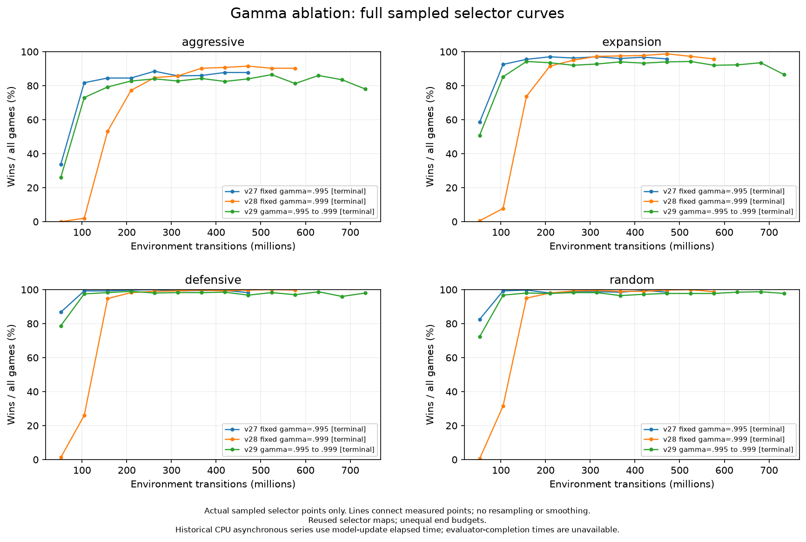

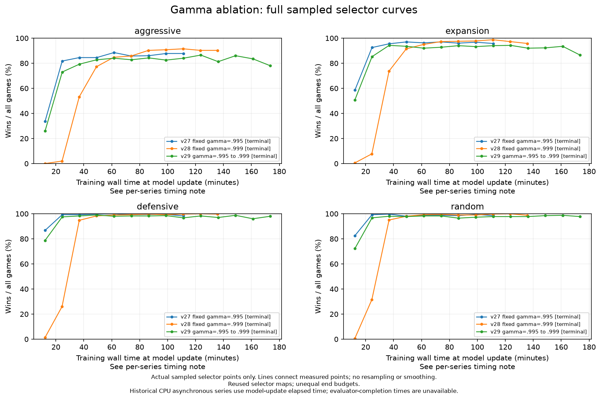

两张图包含固定.995全部9点、固定.999全部11点和课程全部14点；不补不存在的末点、不插值、不以worker耗时替换训练时钟。前期课程快于固定.999但慢于固定.995；后期aggressive和expansion回落。γ课程是真正完成过的实验，不能因为选中best恰在终点附近而说最终阶段未运行。

**不可变best与独立开发采样**：沿用已有aggressive优先选模规则，best999/snapshot20，SHA `9a3e097850161b77cec7640204490c76668841978f62522ff8ae876d1e072d55`。其更新时γ=.99899601936，位于精确.999阶段之前，但权重包含此前全部课程；后续最终阶段没有产生更好的selector。训练config保留初始.995不会在评测时转换权重：actor评测不调用PPO、PBRS或critic，实际γ另读训练TB。

独立CUDA开发original39634/77f6d4 exit0，1600局全部完成，seed与sampling_seed1001042、200地图×四AI×双座、采样B128/workers4/max2000，actual high/TF32true/FP32输入权重，与v27/v28实际协议一致。selector使用CPU/highest，两种协议成绩分开记录。开发报告SHA `2e804f5579401fa71707a3e11116dbad17b282f5a6531b558aea164488c4ea28`；v29 WLD为328/72/0、379/19/2、389/10/1、393/7/0，overall1489/108/3，mean116.415tick。实际eval wall140.986秒/含setup141.352秒，不混为训练吞吐。[开发报告](../outputs/moe_cts/iterations/v29/final_best/development_report.json)。

| best开发结果 | fixed .995 v27 | fixed .999 v28 | .995→.999 v29 |
|---|---:|---:|---:|
| aggressive | 90.25% | 90.25% | 82.00% |
| expansion | 97.75% | 97.25% | 94.75% |
| defensive | 99.50% | 99.75% | 97.25% |
| random | 99.25% | 99.50% | 98.25% |
| overall | 96.6875% | 96.6875% | 93.0625% |
| selected iteration | 499 | 899 | 999 |
| selected全局转移 | 262,144,000 | 471,859,200 | 524,288,000 |

三者相同实际游戏/map/AI/seat排程，按200地图簇20k paired bootstrap（seed20261007）。v29−v27 aggressive−8.25pp、95%CI[−12.00,−4.50]，overall−3.625pp[−5.0625,−2.2500]；v29−v28 aggressive−8.25pp[−12.75,−4.00]，overall−3.625pp[−5.125,−2.250]。固定两组开发aggressive差0pp、CI[−3.75,+3.75]；overall差0pp、CI[−1.1875,+1.1875]，未证明等效。固定.999在相同900更新selector更好：三组aggressive87.75/91.50/84.00%，课程−固定.999为−7.5pp[−11.75,−3.50]，课程−固定.995为−3.75pp[−7.50,0]。共同真实wall预算115.005分钟以内的最新发布点也恰为899，距预算分别224.3/234.8/220.3秒；只比较真实已有快照。预算内发布不等于异步结果当时已经可见。

99/199既有bootstrap、v27-v28既有对照全部复用，只新增其余实际匹配点与两个课程开发pair；没有重做已有游戏。单训练seed、重复使用的开发地图、选best与不同停止预算限制结论，CI仅条件于这些模型和地图，不能证明gamma因果或泛化强度。[完整三组对照与CI](../outputs/moe_cts/iterations/v29/diagnostic/final_gamma_comparison.json)，SHA `9ac19cba…`。

**PPO/critic与行为趋势**：新增return/原始A/EV仅监控，不改变目标、更新或RNG。u1000..1199实际200轮，return std均值.88663/raw A std.18956、critic EV.95421、whole-update KL.02663、clip.12354、entropy1.53770；LR最终floor42/ceiling99轮。末200轮u1235..1434 return std.88233/raw A std.18362、EV.95658、KL.02803/clip.11908/entropy1.60733，LRfloor46/ceiling133轮；所有44tag有限、EV valid200/200。末200轮C307.082/U1183.940秒，wall1492.255秒、70,267.9转移/秒。

episode批次平均长度由中期126.084到最终阶段169.993、末段180.614tick；WAIT由.25245到.17383/.16632，backtrack由.08506到.06638/.06388；最终阶段/末段known-enemy-king均值约.551/.553。自对弈批次win约.565/.569，不能当作baseline胜率。高EV仍伴随baseline回落：它拟合的是shaped bootstrap target，不证明终局胜率价值准确。return尺度、entropy和episode时间一起变化但未隔离因果；固定.999中期也有高entropy且最终更强，不能只因entropy升高就判定失败原因。跨rollout课程目标变化、策略与历史对手分布变化都可能参与，暂无NaN/失配gamma证据。[终局两段真实诊断](../outputs/moe_cts/iterations/v29/diagnostic/final_training_dynamics.json)，SHA `226eb1be…`。

**八局真实录像与失败分析**：开发报告选每AI一赢一输，复用对应GPU joint-action trace在Core/native CPU重放，game/seed/终局一致，8个MP4实际ffprobe通过；2125个决策全部符合各自pre-state legal mask。6个native拒绝是P0先行动抢占P1所选source（expansion114/120/151/220/431、defensive326），不是pre-state mask非法；3次终局P1计划动作被跳过另计。FFmpeg仅在该次展示调用中threads2→1，无冻结/生产源码补丁。[原动作重放证据](../outputs/moe_cts/iterations/v29/final_best/analysis/replay_render_evidence.json) / [实际行为记录](../outputs/moe_cts/iterations/v29/final_best/analysis/recorded_behavior_final.json)。

- aggressive loss game4：己方home34、敌king2，pre35起已知道敌king。pre212把home22兵导出21，只留1；pre217敌32有28兵、pre219敌42有24兵，仍在西侧推进。pre220 home5、敌43有22兵，learner46→45移1；敌43→34以21兵终结，tick221。最后动作确实执行。
- expansion loss game405：home2/敌king34，pre37起已知敌king。pre882 home228→1/export227，附近敌5已有1061兵；pre897敌5有1290，pre898敌4时仍将己方1的205兵移向10。pre899敌3有1288、home增长10，P0先3→2击杀，learner计划10→19被跳过，tick900。
- defensive loss game847：home37/敌king26，pre294..377敌king可见；最后home导出在297，随后仍保有守军，不能解释为最后一刻清空大本营。敌28从pre328起在邻格，pre377为73兵/home50，主力33兵在35距home8；敌以72兵击杀增长到51的home，计划56→47跳过，tick378。这里主要是可见压力下未及时补防。
- random loss game1347：home39/敌king54，pre86起已知。pre134 home22→1/export21；pre144/145敌46/47有19/17兵逐渐接近，主力却继续59→58→57。pre146敌38有15、home7，主力17在75距home4；敌移14兵击杀，计划57→48跳过，tick147。

这些是选中四个失败样本，不能推为总体频率。共同问题是已知敌king/可见威胁没有变成及时的守备、回援与兵力协调；知识记忆正确不等于被策略有效利用。防守局尤其说明并非所有失败都是home被清空。下一轮先通过rollout/λ检验信用分配与学生更新节奏，不加入针对aggressive的专用训练对手或手写决策。

| baseline录像 | 胜局 | 负局 |
|---|---|---|
| aggressive | [win](../outputs/moe_cts/iterations/v29/final_best/analysis/videos/aggressive_win.mp4) | [loss](../outputs/moe_cts/iterations/v29/final_best/analysis/videos/aggressive_loss.mp4) |
| expansion | [win](../outputs/moe_cts/iterations/v29/final_best/analysis/videos/expansion_win.mp4) | [loss](../outputs/moe_cts/iterations/v29/final_best/analysis/videos/expansion_loss.mp4) |
| defensive | [win](../outputs/moe_cts/iterations/v29/final_best/analysis/videos/defensive_win.mp4) | [loss](../outputs/moe_cts/iterations/v29/final_best/analysis/videos/defensive_loss.mp4) |
| random | [win](../outputs/moe_cts/iterations/v29/final_best/analysis/videos/random_win.mp4) | [loss](../outputs/moe_cts/iterations/v29/final_best/analysis/videos/random_loss.mp4) |

v29的训练、selector排空、best开发/录像、失败分析、全程曲线及三组对照均实际完成；整个后续迭代任务继续。TensorBoard位于`outputs/moe_cts/iterations/v29/train/events.out.tfevents.*`。

### v30：N4096/T128较长rollout正式启动（2026-10-08）

根据完整gamma结果采用固定γ.995，配置commit `6a83721f7bba43694ae0d1997156bad14049f362`；从v27只改N16384→4096、T32→128及run_id。NT524288/E4/B64/logical8192/256Adam、λ.95、H4K11/SH4K11小网络、episode1024、tick/PBRS/terminal、纯历史池pool8/pub50、CPU1600局采样eval100、seed20261013、save2000/ring3均保持。不是纯T消融：学生更新间隔32→128tick，每lane pub1600→6400/eval3200→12800，时间相关性、reset混合与对手cadence同时变化；按同全局样本及真实wall比较，不承诺四倍速度。

现成Python环境CPU dataclass加载与精确三叶子diff已actual exit0。116个运行文件仅从本commit的Git blobs冻结一次，manifest SHA `c97bf37e2618ccc8b466604ace14f8208b6a86ca3c03cdd7a86c5aa9377e8482`、配置SHA `602cb69c51f372fa504903103fb91129291befd42ac56f4bdbc2adcbf7f17f36`。原第一次conda Python调用在import时缺tensordict，未创建train/未采样；失败日志保留`diagnostic/pre_training_import_failure.log`，改用仓库已有`.venv/bin/python`后正常首次正式启动，无依赖安装、源码补丁或重复freeze。正式original session43364/launch9f2cbe、PID34774/start428767355、2026-10-07T21:33:07.234250 UTC（北京时间10-08 05:33），自己的冻结train.py与配置SHA实际匹配，resume/warm_start均null，新Adam/新历史池。

CLI实际run_config相对声明后的v27仅多出显式默认eval baseline_workers1/devicecpu/timeoutnull，实际旧协议一致；policy subtree整块替换，未混入默认actor。预算1..3h/iterations ceiling100000，min_completed_updates默认0（不带v29课程1200约束）。平台观察保持≥1h、aggressive锚点后的四个点无≥2pp改进即正常STOP，最长3h优先。首99/199后动态观察真正存在的panel，终局排空后再做不可变best、独立CUDA开发、四AI赢/输录像、失败分析及完整样本/wall对照，之后才选择λ候选的基座。

已预声明早期0..29单次telemetry窗口与可达到时的492..541中期窗口；读取return/raw advantage/critic EV、KL/clip/LR/entropy、actual C/U/wall与显存，旧固定gamma控制缺少的新增tag不补造。初期20次更新约1049万转移、约7.8–8.1秒/轮，仅运行性观察，不判断学习或速度收益；尚无baseline panel。TensorBoard：`outputs/moe_cts/iterations/v30/train/`。ResNet/ViT仍暂缓，后续单个λ.99、TB0..1000 tick衰减并实际留足最终200轮、H8最后的范围不变。

v30预声明0..29实际CPU诊断71f614 exit0：30更新/15,728,640转移，C62.864秒/U177.165秒（每轮2.095/5.906），C+U吞吐65,528.2/s；u29完整wall247.900秒、63,447.5/s，启动开销包含在wall。1035个实际记录点全部finite，EV valid30/30；return std均值.61096/raw advantage std.07479、EV.85430、whole-update KL.01427/clip.15942/entropy4.54247，自适应LR均值.00935。是启动诊断，不与旧训练终局速度作公平窗口比较、不推为baseline学习效果。窗口内TB current allocated max12.248GiB/reserved14.221GiB，不是完整训练peak。固定γ未启用课程，Curriculum/*按自身实现不记录；Episode/*在u0/8/16/21/24未记录完成episode，实际只有25点，不补0；缺失位置以原诊断JSON为准。只读统计最初沿用课程标签/密集episode假设而失败，修正统计输入后通过，无训练改动或重复运行。[实际早期诊断](../outputs/moe_cts/iterations/v30/diagnostic/early_training_dynamics.json)，SHA `f6f88552…`。唯一CPU selector observer69739/PID39345/start428799528动态观察真实panel直到终局排空；不新增对局/推理。

#### v30 首个采样点：初期样本效率上升，wall速度下降（训练继续）

it99/snapshot2实际completed0，52,428,800转移/12,800tick-env；aggressive176/224/0、expansion245/150/5、defensive365/34/1、random343/57/0，采样胜率44.00%/61.25%/91.25%/85.75%，overall1129/465/6（70.5625%）、mean196.295tick。快照训练wall830.506秒（13.842分钟）、累计wall吞吐63,128.7转移/秒，异步worker228.600秒单列；report SHA `615fd493…`、checkpoint `b7f464d3…`。唯一observer69739真实动态验收，完整1600游戏/map/AI/双座/逐game采样seed排程及26个Perf/Eval TB点全部匹配；独立aggregatecert f165ee exit0重新从实际game导出四AI与overall counts/WLD/rates，root041deb直接读原report与index。验证SHA `f5447aa0…`、aggregatecert SHA `25f5cf54…`。[实际首点验证](../outputs/moe_cts/iterations/v30/diagnostic/selector_99_validated_per_panel.json)。

新一次CPU paired map bootstrap9acc8b exit0（200地图簇/20k/seed20261007），仅比较v30it99与固定.995的v27it99，不重复已有gamma统计/游戏。相同52,428,800全局转移，v27胜率33.75%/58.50%/86.75%/82.50%，overall65.375%。v30−v27 aggressive+10.25pp、95%CI[+5.00,+15.75]；expansion+2.75pp[−2.50,+8.25]；defensive+4.50pp[+1.00,+8.00]；random+3.25pp[−1.50,+8.00]；overall+5.1875pp[+2.4375,+7.9375]。v27真实快照wall737.019653秒、v30830.505981秒，多93.486秒，同样本累计wall吞吐低11.26%；包含启动，不把这个首点当作稳定中期效率。worker时间不混入训练时钟，不以不同每环境tick直接比较样本量。[首点配对结果](../outputs/moe_cts/iterations/v30/diagnostic/first_selector_matched_rollout_comparison.json)，SHA `ca27a5d5…`。首次只读pair算完后误读不存在的configuration.json而未写产物（e0dc58 exit1），更正为实际frozen_config.json后完成；执行收据保留失败，无GPU/训练/源码改动。

首点支持初期样本效率改善，但只有一个训练seed与一个早期快照，N/T联合变化也不能隔离T因果；不同wall下的最佳模型尚未比较，不能决定最终rollout基座。初始趋势锚点it99/aggressive44%；尚不足至少1h预算，原43364继续。后续真实panel若提升≥2pp则更新趋势锚点，连续四后续点无该提升再结合≥1h正常STOP，最长3h优先；最终仍需best独立CUDA开发、八局真实录像/失败分析、完整sample/wall曲线和v27对照，之后才推进λ。

#### v30 第二采样点：胜率继续学习，与对照接近（训练继续）

it199/snapshot4实际completed0，104,857,600转移/25,600tick-env；aggressive328/72/0、expansion377/23/0、defensive394/6/0、random395/5/0，采样胜率82.00%/94.25%/98.50%/98.75%，overall1494/106/0（93.375%）、mean98.936tick。快照training wall1682.904秒（28.048分钟）、累计wall吞吐62,307.5转移/秒，异步worker97.329秒单列；report SHA `aa90b76d…`、checkpoint `a89c514c…`。唯一observer69739验收全部1600局游戏/map/AI/seat/逐game采样seed及26个Perf/Eval TB点；实际独立aggregatecert c80016 exit0，root e17240直接原report/index一致。验证SHA `81e3c27b…`、aggregatecert `5b6314b4…`。[第二点实际验证](../outputs/moe_cts/iterations/v30/diagnostic/selector_199_validated_per_panel.json)。

新一次仅第二点CPU配对ac41aa exit0，复用首点而不重算；相同104,857,600全局样本、200地图簇20kbootstrap/seed20261007。固定.995 v27同点81.75%/92.50%/99.25%/99.25%，overall93.1875%。v30−v27 aggressive+0.25pp，95%CI[−4.25,+4.75]；expansion+1.75pp[−1.25,+5.00]；defensive−0.75pp[−2.50,+0.75]；random−0.50pp[−2.00,+0.75]；overall+0.1875pp[−1.3125,+1.7500]。该点没有显示明确胜率增益，不能把首点改善外推为持续领先。对照真实snapshot wall1472.756秒，v30多210.149秒；worker耗时不加入训练时钟。[第二点配对](../outputs/moe_cts/iterations/v30/diagnostic/second_selector_matched_rollout_comparison.json)，SHA `a63428e6…`。

相对首点aggressive增加38pp，学习仍明显，**趋势锚点更新it199/82%**；四后续点观察重计数，且未到最少1h，不触发平台STOP。原43364与冻结配置继续。N/T系统混杂、单训练seed与条件地图CI限制保持；两点不足以决定最终rollout、证明同强度或T因果。终局完整对照后才进入λ、TB0..1000 tick课程和最后H8，ResNet/ViT仍暂缓。

#### v30 第三采样点：趋势锚点更新到299（训练继续）

it299/snapshot6实际completed0，157,286,400全局转移/38,400tick-env；aggressive337/63/0、expansion380/20/0、defensive397/2/1、random390/10/0，采样胜率84.25%/95.00%/99.25%/97.50%，overall1504/95/1（94.00%）、mean88.562tick。快照training wall2574.043秒（42.901分钟），异步worker110.509秒另记；report SHA `e2e029c1…`、CP `ecda8cab…`。同CPU/highest/FP32/B128/workers1/seed271828/max2000采样协议，完整1600游戏/map/AI/双座/逐game sampling seed、26个Perf/Eval TB点与实际配置/CP hash一致；唯一observer动态认证，独立aggregate2e2905 exit0从game导出counts/WLD/rates，root8a3e3b直接原report/index读回。[实际第三点验证](../outputs/moe_cts/iterations/v30/diagnostic/selector_299_validated_per_panel.json)，SHA `a31f8c75…`、aggregatecert `1868c7bd…`。

aggressive较199增加2.25pp，达到预声明≥2pp趋势阈值，**趋势锚点更新为it299/84.25%**，四后续点观察重新计数；这不是统计显著性判断。同样本固定.995 v27it299胜率84.50%/95.50%/99.25%/99.75%，点估计差−0.25/−0.50/0/−2.25pp；本点未新增bootstrap，完整终局对照再统计，已有99/199 pair届时复用。前期44→82→84.25%仍在学习，当前未到最低1h，保持原43364/冻结配置继续。不以四baseline单点均>80%结束附件要求的完整逐项实验，也不声称泛化或世界级能力。

#### v30 第四采样点：aggressive到88%，仍有上升趋势（训练继续）

it399/snapshot8实际completed0，209,715,200全局转移/51,200tick-env；aggressive352/48/0、expansion388/12/0、defensive393/7/0、random394/6/0，采样胜率88.00%/97.00%/98.25%/98.50%，overall1527/73/0（95.4375%）、mean77.729tick。快照training wall3502.211秒（58.370分钟），异步worker84.903秒单列；report SHA `6e79a619…`、CP `17918f86…`。CPU/highest/FP32/B128/workers1/seed271828/max2000采样1600局，唯一observer确认完整game/map/AI/seat/RNG、26个Perf/Eval TB点与实际配置/hash；独立aggregate2ff840 exit0由game重算counts/WLD/rates及selectionscore，root234049直接原report/index和验证SHA读回。[实际第四点验证](../outputs/moe_cts/iterations/v30/diagnostic/selector_399_validated_per_panel.json)，SHA `3b72e845…`、aggregatecert `b99818c8…`。

aggressive较299提高3.75pp，达到预声明≥2pp趋势阈值，**锚点更新it399/88%**、四后续点计数重置；这不等于统计显著性结论。同样本固定.995 v27it399为84.50%/97.00%/99.75%/98.00%，点估计差+3.50/0/−1.50/+0.50pp；本点未新增CI，终局完整N/T对照再统计，99/199既有pair复用。发布时略少1h，实际评测与root记录时原训练已超过1h且持续更新；当前仍在学习，不能因最低时间到达而平台STOP。原43364/冻结源配置继续，终局后开发/八录像/行为与完整sample/wall分析、再选择λ基座的流程不变。

#### v30 第五采样点：首个锚点后未提升点（训练继续）

it499/snapshot10实际completed0，262,144,000全局转移/64,000tick-env；aggressive347/53/0、expansion387/13/0、defensive396/4/0、random387/13/0，采样胜率86.75%/96.75%/99.00%/96.75%，overall1517/83/0（94.8125%）、mean79.766tick。快照training wall4439.998秒（74.000分钟），异步worker85.665秒单列；report SHA `25368171…`、CP `15c8bf09…`。同CPU/highest/FP32/B128/workers1/seed271828/max2000采样1600局，唯一observer确认完整game/map/AI/seat/RNG、实际配置/hash及26个Perf/Eval TB点；独立aggregate a82ed0 exit0从game重算counts/WLD/rates和selectionscore，root0d319e直接原report/index与模型/两证书SHA读回。[实际第五点验证](../outputs/moe_cts/iterations/v30/diagnostic/selector_499_validated_per_panel.json)，SHA `1de7fd97…`、aggregatecert `d775b256…`。

aggressive较399下降1.25pp，**锚点仍为399/88%，锚点后未达≥2pp改进点数1/4**。这一个波动点不足以判断平台或退化，不改变冻结配置，不恢复/重启训练。原43364/PID34774仍真实运行；完整N/T对照在终局一次完成，既有99/199配对复用。本次还将早期诊断文字中的缺失episode位置修正为JSON实际u0/8/16/21/24（非连续前五轮），未改任何原始指标或训练。中期492..541窗口须真实完成后再读取，最终best开发/八录像/行为分析、全程sample/wall曲线及后续单个λ、tick衰减、H8流程保持。

#### v30 预声明中段492..541：采集更慢，更新耗时相同

50个真实完整更新、26,214,400转移；一次CPU读取 d3ebae exit0，root15d036读回SHA/结果。39个tag共1950点全部finite、无重复/缺失，critic EV valid50/50、每轮256个Adam minibatch。使用旧v27/v28/v29同区间缓存，未重读旧TB或补造v27/v28不存在的return/A/EV；课程v29仅作背景，主要控制仍是同γ.995的v27。[中段真实诊断](../outputs/moe_cts/iterations/v30/diagnostic/mid_training_dynamics.json)，SHA `de1b7679…`。

| 同492..541窗口 | v27 N16384/T32 | v30 N4096/T128 |
|---|---:|---:|
| collection合计 | 75.678秒 | 173.106秒 |
| PPO update合计 | 295.764秒 | 295.989秒 |
| 完整训练wall差分 | 371.754秒 | 469.739秒 |
| wall转移/秒 | 70,515.4 | 55,806.3 |
| whole-update KL均值 | .02224 | .01397 |
| clip fraction均值 | .12768 | .10212 |
| entropy均值 | .67131 | .56288 |
| rollout WAIT均值 | .20045 | .33670 |
| backtrack均值 | .12900 | .04461 |
| value loss均值 | .04171 | .05229 |

v30中期wall吞吐低20.86%；采集合计2.287倍，PPO update仅1.00076倍，每轮C3.462/U5.920秒。固定NT并未带来速度收益；T增加导致更多环境/策略调用，N减少后的kernel开销与占用可能参与，但没有单独profiling隔离每项原因。异步worker时间未再加到训练wall。窗口内TB current allocated max12.248GiB/reserved14.287GiB，对照13.538/16.324GiB；这是当前分配观测，不能当完整正式训练峰值。当前方案省逐环境资源但采集效率下降，最终仍结合完整样本/wall胜率和best开发结果选择λ基座。

v30 return std均值.58193、raw A std.23986、critic EV.82997；最后LR处于floor1/50、ceiling48/50，区间共52次自适应变化。KL/clip较低和backtrack减少伴随WAIT增多、entropy降低，不自动等于更好的守备或探索，也不能解释单个499胜率下降。self-play episode批次均长102.661tick/win.70754，不是baseline胜率。未见NaN或PPO采样/更新数量失配；保持原冻结实验继续观察，无奖励、学习率或历史池临时补丁。完整任务仍包括单λ候选、用户指定TB0..1000的tick衰减并实际200轮最终阶段、H8最后；剩余容量探索保持暂缓。

#### v30 第六采样点：aggressive连续两点回落（训练继续）

it599/snapshot12实际completed0，314,572,800全局转移/76,800tick-env；aggressive335/65/0、expansion378/22/0、defensive397/3/0、random389/11/0，采样胜率83.75%/94.50%/99.25%/97.25%，overall1499/101/0（93.6875%）、mean83.286tick。快照training wall5378.517秒（89.642分钟），异步worker76.299秒单列；report SHA `55c1548e…`、CP `56403f76…`。同CPU/highest/FP32/B128/workers1/seed271828/max2000采样1600局；唯一observer确认完整game/map/AI/双座/RNG、实际配置/hash及26个Perf/Eval TB点。独立aggregate dbb43b exit0重算counts/WLD/rates/selectionscore；root6ec161直接读原1600局report/CP SHA，098a60确认currentindex completed0及两证书hash。[实际第六点验证](../outputs/moe_cts/iterations/v30/diagnostic/selector_599_validated_per_panel.json)，SHA `166372f9…`、aggregatecert `784e6229…`。

aggressive较499下降3pp、较399锚点下降4.25pp，expansion也连续两点下降，defensive仍接近99%。**锚点399/88%保持，锚点后未达≥2pp改进点数2/4**，尚未满足预定平台停止条件。两次回落值得观察，但未单独做配对显著性或因果归因；完整终局分析再一起处理，已有99/199配对结果复用。早/中期完整诊断已有，无重复TB扫描、临时奖励/算法改动或训练重启。原43364继续，后续真实699/799等panel动态观察，满足趋势规则再正常STOP并排空eval；完整best开发、八录像/败局行为、样本/wall曲线及后续λ→tick课程→H8范围保持不变。

#### v30 第七采样点：第三个锚点后未提升点（训练继续）

it699/snapshot14实际completed0，367,001,600全局转移/89,600tick-env；aggressive333/67/0、expansion376/24/0、defensive398/2/0、random394/6/0，采样胜率83.25%/94.00%/99.50%/98.50%，overall1501/99/0（93.8125%）、mean84.214tick。快照training wall6317.668秒（105.294分钟），异步worker76.148秒单列；report SHA `1a15c738…`、CP `6eef70e1…`。同CPU/highest/FP32/B128/workers1/seed271828/max2000完整1600局，唯一observer验证game/map/AI/双座/RNG、实际配置/CP/report hash及26个Perf/Eval TB点；独立aggregate 863fb6 exit0重算counts/WLD/rates/score，root8682d5 actualindex completed0、069a80直接原report/CP/验证SHA、aa1381 aggregate SHA与真实counts读回。[实际第七点验证](../outputs/moe_cts/iterations/v30/diagnostic/selector_699_validated_per_panel.json)，SHA `8484c852…`、aggregatecert `d2a1995a…`。

aggressive较599下降0.5pp、较399锚点低4.75pp；expansion第三次回落，defensive/random仍较高。**趋势锚点399/88%保持，锚点后未达≥2pp改进点数3/4**。原43364继续，只等待后续真实评测，不补跑对局或新增bootstrap/telemetry。若下一个799仍没有相对88%锚点≥2pp提升，按已声明四后续点/至少1h规则立即正常STOP；最长3h仍优先。停止后必须确认原进程真实terminal/exit0与当前eval队列排空，再捕获best开发、八局录像/失败分析、完整sample/wall曲线与v27对照；随后选择一个λ候选、真实TB0..1000 tick课程与最终200轮、H8最后。此处不把三点回落当作因果或泛化结论。

#### v30 终局：长 rollout 未显示持续收益，后续恢复 N16384/T32

本轮完整训练、开发评测、八局实际动作录像与终局分析均已完成。原训练43364实际terminal `cfac7c exit0`：2026-10-07 23:37 UTC写自身train/STOP，在完整更新边界正常停止；不是信号中断，也没有恢复或重新训练。唯一观察器69739正常完成，原训练/观察器PID均消失；最终index八个selector全部completed/return0、queued/running/failed/cancelled均0。最后it799反弹到87.25%，仍低于399锚点88%；499/599/699/799四个后续点均没有≥2pp锚点改善，且已超过1h，依预声明趋势规则停止。该规则不等于统计显著性判断。

实际820更新、429,916,160全局转移、104,960tick/env；wall 124.086分钟，collection 2577.880秒、PPO update 4849.595秒。compute 57,881.9转移/秒，完整wall 57,744.4转移/秒。完整训练peak allocated/reserved为13.589911/14.291016GiB，分别不同于TB当前分配观测；比v27 allocated少1.7033GiB。3,706,881 completed episodes中24,888次截断（0.6714%）。历史池保留8个可抽样模型，18次新发布；正在进行的对局仍固定旧对手，active id10可暂时留在8个可抽样id之外，不能把pool_size8说成内存严格只有8份模型。

| update | 全局转移(M) | 快照training wall(min) | aggressive / expansion / defensive / random (%) | overall (%) |
|---|---:|---:|---|---:|
| 99 | 52.429 | 13.842 | 44.00 / 61.25 / 91.25 / 85.75 | 70.5625 |
| 199 | 104.858 | 28.048 | 82.00 / 94.25 / 98.50 / 98.75 | 93.3750 |
| 299 | 157.286 | 42.901 | 84.25 / 95.00 / 99.25 / 97.50 | 94.0000 |
| 399 | 209.715 | 58.370 | 88.00 / 97.00 / 98.25 / 98.50 | 95.4375 |
| 499 | 262.144 | 74.000 | 86.75 / 96.75 / 99.00 / 96.75 | 94.8125 |
| 599 | 314.573 | 89.642 | 83.75 / 94.50 / 99.25 / 97.25 | 93.6875 |
| 699 | 367.002 | 105.294 | 83.25 / 94.00 / 99.50 / 98.50 | 93.8125 |
| 799 | 419.430 | 120.945 | 87.25 / 95.00 / 99.00 / 99.00 | 95.0625 |

最佳仍是it399/snapshot8，CP `17918f86030b93036482c52bde563cb628003dd472a8e1531ea22fa7051dccad`。终局保护best权重与报告一致，immutable capture实际6e1f8b exit0；三个分析工具从本轮6a83721 commit冻结一次（dd7281 exit0）。普通清理剪除部分旧快照，但其报告/完成时hash认证保留。诊断capture工具原先只支持configuration.json和旧的默认字段格式，310acd/5aa804在创建capture前失败；仅对ignored分析helper增加frozen_config.json兼容及精确三个评测默认值（workers1/devicecpu/timeout_secondsnull），未改运行时源码、模型或配置。原始Git/frozen/manifest116文件逐位检查保持有效；兼容修改记录在diagnostic/terminal_capture_helper_compatibility.json。

独立开发实际81458/797512 exit0：复用development seed+sampling_seed1001042、200张地图/AI×2座，共1600局；CUDA逻辑0、high/TF32true、FP32、B128/workers4/max2000，与v27真实协议一致。原始device字段cuda与旧cuda:0是同逻辑设备别名。开发用时71.723秒、含setup72.098秒，report SHA `b718fafd…`。它是此前用过的开发集，不能称未见holdout。

| baseline | 开发W/L/D | v30胜率 | 相对v27最佳开发差值，配对地图95%CI |
|---|---:|---:|---|
| aggressive | 353/47/0 | 88.25% | -2.00 pp [-5.75, +1.75] |
| expansion | 389/11/0 | 97.25% | -0.50 pp [-2.50, +1.50] |
| defensive | 397/3/0 | 99.25% | -0.25 pp [-1.25, +0.50] |
| random | 398/2/0 | 99.50% | +0.25 pp [-0.50, +1.25] |

overall为1537/63/0，96.0625%，相对v27 −0.625pp，配对CI[−1.875,+0.625]。开发所有AI区间均含0，不能证明更差或等效；这也不足以支持承担长rollout的计算成本。[实际开发报告](../outputs/moe_cts/iterations/v30/final_best/development_report.json)，[实际开发配对](../outputs/moe_cts/iterations/v30/diagnostic/final_rollout_development_comparison.json)，root bb592c exit0、SHA `b308221a…`。最初literal device别名检查f773ba失败于配对前，无新游戏或输出，纠正为同逻辑0后才完成。

完整selector对照CPU426d45 exit0，SHA `1b65de48…`；99/199 pair原样复用，新增六个公共299..799采样坐标。aggressive差值依次−0.25/+3.50/−1.75/−2.00/−2.75/−0.50pp，六点地图簇95%CI均包含0，首点的改善没有持续。真实共同预算6900.305秒内，latest是v27it899（6676.017秒）与v30it699（6317.668秒）；aggressive −4.50pp CI[−8.75,−0.25]、overall −1.25pp[−2.6875,+0.1875]。v30it799快照wall7256.703秒超出共同预算，未偷纳入或插值。完整wall吞吐比v27低18.28%，已测中段低20.86%；PPO更新时间几乎相同，速度成本主要在collection。两组N/T联合改变与单训练seed限制仍保留；条件地图CI不能提供训练随机性区间或纯T因果。[完整N/T终局对照](../outputs/moe_cts/iterations/v30/diagnostic/final_rollout_selector_comparison.json)。

全程曲线使用所有实际已完成评测；sample是全局转移，wall是快照update处真实Perf/wall_seconds，异步worker时长单列、不二次叠加，不补造terminal update820评测或使用平滑。v27九点、v30八点，无遗漏；连线只连接观测点，分析不采用插值。

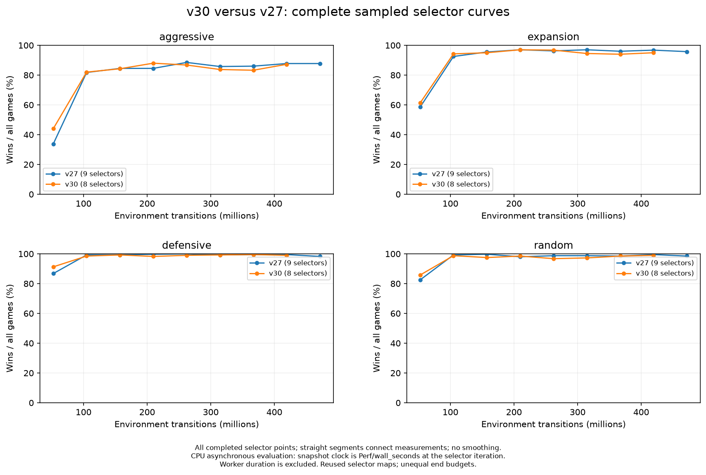

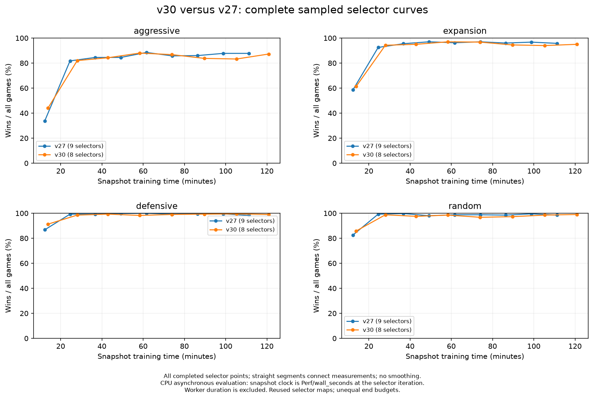

末100更新u720..819/末300u520..819分别81个实际指标×100/300，8100/24300点均finite、覆盖完整、无重复；critic EV valid100/100及300/300。末100 C346.257/U591.337/wall938.840秒，wall55,844.2转移/秒；末300 wall55,847.2。末100 entropy均值.685842，whole-update exact KL均值.014676/max.074236，clip .103200，raw advantage std .250796，return均值−.422516/std .624697，critic EV .838677；归一化A std≈1是预处理结果。LR在ceiling94/100、floor4/100，264次minibatch自适应变化；whole-update KL是监控，调LR使用minibatch KL，故二者不应逐点等同。WAIT29.256%/backtrack5.991%，self-play episode return−.173710、length101.711、win62.0505%，不是baseline胜率。没有NaN或PPO批次数失配；较高EV也不能证明低频夺将/守将估值准确。末期entropy小幅回升伴随799反弹，尚不能建立因果。[终局TB诊断](../outputs/moe_cts/iterations/v30/diagnostic/final_training_dynamics.json)，604a2e exit0、SHA `05fd8987…`；[通用终局报告](../outputs/moe_cts/iterations/v30/diagnostic/terminal_training_review.json)，38b11d exit0、SHA `f9a5b1a3…`。

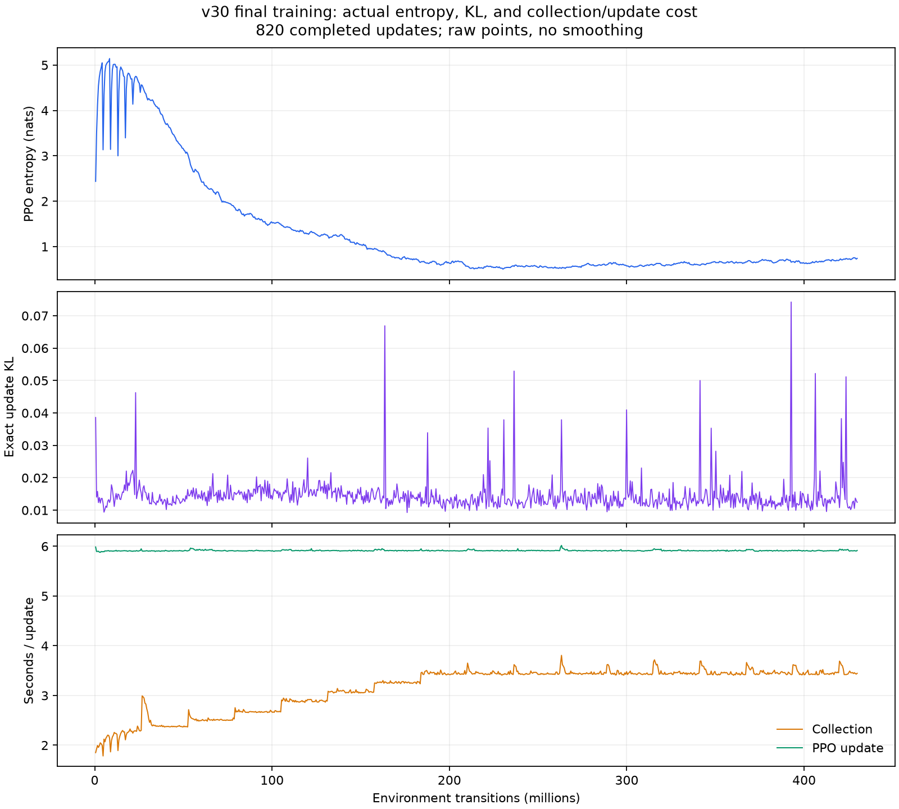

八局demo来自开发评测真正记录的joint actions，逐tick由native/Core核对重放，不重新采样策略。原47813/ab0a1f exit0，8个MP4、2615tick；FFmpeg仅presentation线程从2限制为1，冻结工具与训练源码不改。行为分析240d98 exit0、SHA `7f732c6c…`：全部Core前后digest、native执行/移动/占领结果、joint-action合法mask和actor局部视野/H4时序一致。原始报告中的terminal P1动作跳过与规则拒绝不同，不能把它们都解释为非法策略动作。

| baseline | 失败局 | 胜局 |
|---|---|---|
| aggressive | [178tick](../outputs/moe_cts/iterations/v30/final_best/analysis/videos/aggressive_loss.mp4) | [89tick](../outputs/moe_cts/iterations/v30/final_best/analysis/videos/aggressive_win.mp4) |
| expansion | [116tick](../outputs/moe_cts/iterations/v30/final_best/analysis/videos/expansion_loss.mp4) | [188tick](../outputs/moe_cts/iterations/v30/final_best/analysis/videos/expansion_win.mp4) |
| defensive | [527tick](../outputs/moe_cts/iterations/v30/final_best/analysis/videos/defensive_loss.mp4) | [51tick](../outputs/moe_cts/iterations/v30/final_best/analysis/videos/defensive_win.mp4) |
| random | [1318tick](../outputs/moe_cts/iterations/v30/final_best/analysis/videos/random_loss.mp4) | [148tick](../outputs/moe_cts/iterations/v30/final_best/analysis/videos/random_win.mp4) |

失败行为：aggressive局前25tick仍仅1领土，对手11；后期敌军距离home3→2→1，学生仍远处推进，home终局增长后6对可见10攻击，P0先执行已夺将，P1计划动作跳过；没有最后一tick补救。expansion局敌将自64tick可见，112..114时home附近风险5且有8兵可回援，但选择外围合兵、随后把邻近9兵移走；115时已无直接增援并失守，不是没有看到敌将。defensive局长时间资源/主力劣势，终局己79兵/敌244、home6对172攻击，仍在远处移动；问题形成在更早的资源与部署阶段。random失败1318tick中294个决策超过训练1024tick窗口，敌将曾在128..648可见、966次已见但H4缺失；本次验证H4信息时序，并未据此独立验收每个K11通道，因此不把该案例归因为事实记忆丢失。末期己23兵/敌788，home没有及时集结。四失败最后一tick固定原对手动作的WAIT分支均仍输，只说明最后一tick等待无法补救，不声称找到最早败因、全局最优动作或完整反事实胜率。四胜局即使最终总兵少于对手也能夺将，说明资源领先不是胜负充分条件。录像是挑选样本，不能估计失败类型频率。[实际行为与局部反事实证据](../outputs/moe_cts/iterations/v30/diagnostic/recorded_behavior_review.json)。

**下一轮工程决策：恢复v27 N16384/T32，固定gamma/PBRS .995，单独试λ.95→.99。** 长rollout首点有早期改善，却没有持续样本收益；独立开发无明确改善，wall成本显著。选择原rollout是当前机器预算下的工程取舍，不证明长rollout本质无效。λ.99会增加现有32tick GAE内后部TD残差权重；1/(1−γλ)的66.89是无限递推几何尺度，不是实际32tick采样被延长或最终奖励必须在该长度内出现。后续仍按顺序tick TB0..1000衰减并真实至少200轮最终零tick训练，再做H8；ResNet/ViT剩余探索遵用户请求暂缓，不把baseline>80%当完整附件任务结束。

### v31：固定短rollout，仅提高GAE λ（正式训练进行中）

v30完整报告与三曲线已提交1c6ddb1：较长N4096/T128没有持续样本/开发收益，wall吞吐低18.28%；本轮恢复v27 N16384/T32。唯一算法变化λ.95→.99，run_id=v31，γ/PBRS .995、NT524288/E4/B64/8192逻辑batch/256Adam、H4K11与SH4K11、小网络26074参数、episode1024、tick−.001、history8/pub50/eval100及所有MDP配置固定。保持categorical adaptive LR/desiredKL.02、原entropy .01；不混入tick衰减或H8，不增加baseline训练对手。

动机是加强现有32tick采样内后部TD残差的权重，观察更长期credit与守将/终局学习是否改善；无限递推几何尺度66.89不代表实际rollout超过32tick。代价可能是advantage方差增大或更新不稳定，故记录raw return/A std、EV、每epoch及全轮exactKL/clip/自适应LR、entropy、WAIT/backtrack与真实C/U/wall和显存。代码无需新增算法补丁，仅配置一个λ候选，不做网格搜索。

正式1–3h，从随机权重、新Adam、新历史池开始，不加载v27/v30权重；相同seed20261013。每100update四baseline×200map×双座1600局CPU采样selector（271828），按aggressive趋势锚点≥2pp更新、至少1h后四个后续点无该改进则正常train/STOP，最长3h优先。旧内置plateau12仍是配置兜底；报告明确实际停止来源。bounded checkpoint3/eval3+best/history抽样池8，活动episode可暂留旧对手。每个正式版本先commit，再一次从其Git blobs冻结116运行文件/配置，用自身冻结源训练和eval；不用新的大型网络门禁或冗余smoke。终局完整排空评测后固定best，1600局CUDA开发（复用1001042/highTF32true/FP32/B128/workers4）、8局实际joint-action录像与Core失败分析、完整sample/wall对照v27，再决定后续tick衰减基座。H8仍最后，ResNet/ViT剩余探索暂缓。此处是预声明，没有训练或胜率结果。

v31实际启动记录：配置commit `a2d2447e0a4a8b923c5f2a58c1c9630a7f9e6ca0`，仅run_id/λ两叶变化，CPU配置验证2c9041 exit0且未初始化GPU；280ee2从commit冻结116运行文件/774804bytes一次，config SHA `f0b02e2c…`、manifest `1969d2c0…`。首次44727/e57435在首个GPU step因设置NVCC而加载器要求GENERALS_NVCC失败，真实4d3176 exit1、PID消失，没有成功环境转移或PPO update；已经构造的初始模型/历史池/第一次采样动作被舍弃。失败目录与日志保留于diagnostic/failed_initialization，未改源/配置/重新冻结或加载失败权重。

仅将启动环境改为GENERALS_NVCC绝对路径，重新从零启动独立train输出：original60387/launchac95b8，PID153382/start429621062，2026-10-07T23:55:26.367747 UTC（上海10月8日07:55）。99e4f8回读原PID/start/live及compiler环境，run_config相对raw仅加入相同workers1/devicecpu/timeout_secondsnull默认值；λ.99/γ.995/N16384/T32确认。自身历史池只有seed0，source=random_initial_policy、resume_source=null、22张量，没有warm-start。原60387实际28e963仍运行；启动确认时已记录it3、2,097,152全局转移（4个完整更新），C1.300/U5.888秒、约72,933 compute transitions/s。没有已完成selector，不把初始化日志/self-play episode win当baseline胜率。100000更新ETA是安全iteration ceiling，实际max_seconds10800约束3h。后续继续原job观察每100update真实panel，早期0..29/中段492..541各只读一次实际诊断窗口，终局完成分析；不因丢失观察而重复启动。

#### v31 早期0..29：λ.99的数值与速度检查（正式训练继续）

确认原60387 exactPID/start真实运行且已logged36后执行固定0..29的30更新、15,728,640转移窗口诊断。首次CPU8243c6在已读取窗口后引用v27缓存时误用metrics（实际metric_summary），写产物前KeyError；12c329 exit0修正并进行一次必要恢复读取，4e46b7 exit0持久化完整收据。明确当前v31 TB总读2次、旧TB0次；失败和恢复均记录，没有改训练/配置/RNG或重复启动。最终45tags/1330points全finite、必需更新指标完整、无重复；EVvalid30/30。四Episode标签实际25次，未记录u0/1/23/24/29属于没有完成episode，不填零。无课程配置，因此Curriculum指标合法缺省，不伪造gamma/tick TB点。[真实早期指标](../outputs/moe_cts/iterations/v31/diagnostic/early_training_dynamics.json)，SHA `ca7c722f…`；[实际失败/恢复执行凭据](../outputs/moe_cts/iterations/v31/diagnostic/early_training_dynamics_execution.json)，SHA `fb6cf7d4…`。

C39.133/U177.362秒、完整wall endpoint225.915秒；compute72,651.1、wall69,622.0转移/秒。v27已有同0..29缓存为72,815.2/69,773.1，相对wall−0.217%，本早期阶段速度接近控制。每轮256Adam，PPO监控平均.127806秒。TB当前allocated最大13.535265GiB/reserved16.318359GiB，仅窗口观察，不是整个训练峰值；继续按原3h/保留数量约束运行。

| 0..29共同指标均值 | v27 λ.95 | v31 λ.99 |
|---|---:|---:|
| whole-update exact KL | .013472 | .012201 |
| clip fraction | .177572 | .144728 |
| entropy | 4.618808 | 4.531571 |
| WAIT | 9.9671% | 11.4854% |
| self-play episode批次mean length | 496.255 | 465.199 |
| self-play episode批次mean win | 62.3880% | 71.9931% |

v31 raw return均值−1.527273/std .324489、raw A均值−.078794/std .108792、critic EV均值.769594/最后.970963；归一化A std≈1由预处理产生。LR最后值floor1/30、ceiling26/30、42次minibatch变化，categorical adaptive仍正常启用。v27缓存没有R/A/EV/backtrack，不补造比较；v30虽有这些新tag但N/T不同，只是背景。当前KL/clip没有出现数值爆炸，尚不说明守将或baseline强度改善。Episode统计是每次日志中已结束对局批次均值，既非全局对局加权胜率，也非baseline胜率；较高EV不足以证明终局价值准确。保持冻结λ.99实验，等待真实selector99，最少1h和四锚点后未提升规则不变；不因早期回报或四baseline单点成绩缩短完整λ→tick→H8范围。

#### v31 第一采样点：与λ.95控制接近（正式训练继续）

it99/snapshot2 actualcompleted/return0，52,428,800全局转移、3200tick/env；CP `8a9c5033…`、report `876dc0f1…`。四AI W/L/D依次137/263/0、231/167/2、360/40/0、346/54/0；采样胜率34.25%/57.75%/90.00%/86.50%，overall1074/524/2（67.125%）、mean200.683tick。快照training wall738.131秒（12.302分钟），异步worker214.477秒独立记录；不能把worker时长再加进训练曲线坐标。root1d5219直接读取原report/模型hash，f7f89f读取当前index completed0。单panel observer确认原worker164314/start429694988真实live后正常完成/消失，无长期observer或新对局；CPU882848 exit0完成1600games/200mapclusters/AI双座/逐game采样seed、WLD/count/rate/selectionscore、CP bytes、26个Eval/Perf TB点核验，06690c exit0持久化执行收据。CPU/highest/FP32/B128/workers1/seed271828/max2000与v27一致；本panel TB读一次，旧TB和early窗口未再读取。

| 同52,428,800样本 | v27 λ.95 | v31 λ.99 | v31−v27配对地图95%CI (pp) |
|---|---:|---:|---|
| aggressive | 33.75% | 34.25% | +0.50 [−4.25,+5.25] |
| expansion | 58.50% | 57.75% | −0.75 [−6.00,+4.75] |
| defensive | 86.75% | 90.00% | +3.25 [−0.50,+7.00] |
| random | 82.50% | 86.50% | +4.00 [−0.75,+8.50] |
| overall | 65.375% | 67.125% | +1.75 [−0.5625,+4.00] |

200配对地图簇/20k bootstrap/seed20261007，各AI和overall区间都含0，尚无明确早期λ收益，不能声称等效或泛化。v27缓存真实snapshotwall737.020秒，v31仅多1.112秒，首点时间效率接近；开发最佳模型还未比较。conditional地图CI仅针对这两个已训练快照和复用选模地图，不能估计训练seed随机性。[首点实际验证](../outputs/moe_cts/iterations/v31/diagnostic/selector_99_validated_per_panel.json)，SHA `1ef77329…`；[首点λ配对](../outputs/moe_cts/iterations/v31/diagnostic/first_selector_matched_lambda_comparison.json)，SHA `70c4ff94…`；[实际执行凭据](../outputs/moe_cts/iterations/v31/diagnostic/first_selector_matched_lambda_comparison_execution_receipt.json)，SHA `5977fb57…`。

初始趋势锚点it99/aggressive34.25%，尚不到至少1h，没有平台停止判断。原60387保持冻结配置继续，后续真实199及100更新间隔评测若提升≥2pp则更新锚点，四后续点无该提升且≥1h再正常STOP，最长3h优先。终局仍需完整队列排空、best开发/八真实录像/失败分析、sample/wall全曲线与v27对照，再选择tick TB0..1000课程基座及真实至少200轮最终零tick训练；H8最后，ResNet/ViT暂缓，不能以早期指标或四baseline门槛提前结束。

#### v31 第二采样点：继续学习，但慢于λ.95控制（正式训练继续）

it199/snapshot4 actualcompleted0，104,857,600全局转移、6400tick/env；CP `3944c17d…`。W/L/D依次302/98/0、370/30/0、393/7/0、393/7/0，采样75.50%/92.50%/98.25%/98.25%，overall1458/142/0（91.125%）、mean113.624tick。快照training wall1473.063秒（24.551分钟），异步worker111.098秒单列。root771912直接原report/index读回，随后核对report/CP字节hash和全部诊断产物。单job临时观察器只绑定真实worker174273/start429768481，index完成return0且worker消失；original3483/e1f609 exit0，分析bbb4dc exit0、收据1ee417 exit0。1600games/200maps/逐game RNG/AI双座、WLD/count/rate/selectionscore、CP和26个TB Eval/Perf点全部通过；旧TB/early/未来panel未读，首点pair未重算。首次b4c795因误断言CLI为--checkpoint（实际位置参数）在读TB前失败，修复后实际90dbbd确认身份，失败保留，无训练或源码影响。

| 同104,857,600样本 | v27 λ.95 | v31 λ.99 | v31−v27配对地图95%CI (pp) |
|---|---:|---:|---|
| aggressive | 81.75% | 75.50% | −6.25 [−10.75,−1.75] |
| expansion | 92.50% | 92.50% | 0.00 [−3.50,+3.50] |
| defensive | 99.25% | 98.25% | −1.00 [−2.50,+0.25] |
| random | 99.25% | 98.25% | −1.00 [−2.50,+0.50] |
| overall | 93.1875% | 91.125% | −2.0625 [−3.6875,−0.4375] |

200配对地图簇、20k bootstrap/seed20261007，本点aggressive/overall的条件CI均低于0，显示这个阶段落后，不能外推最终性能、归为训练随机性显著或说明所有任务λ.99无效。v27实际缓存snapshotwall1472.756秒，v31多.307秒，采样/时间开销接近；这是学习效果差异，不是本点计算变慢。[第二点实际验证](../outputs/moe_cts/iterations/v31/diagnostic/selector_199_validated_per_panel.json)，SHA `aa9b8fda…`；[第二点λ配对](../outputs/moe_cts/iterations/v31/diagnostic/second_selector_matched_lambda_comparison.json)，SHA `41d6acca…`；[真实执行凭据](../outputs/moe_cts/iterations/v31/diagnostic/second_selector_matched_lambda_comparison_execution_receipt.json)，SHA `b6bb7462…`。

相对it99 aggressive提高41.25pp，学习仍显著上升，**趋势锚点更新it199/75.5%，锚点后四点观察重新计数**。这里≥2pp是趋势启发式，不等于统计显著性判断。尚未到最低1h，原60387固定λ.99配置继续，不因落后中途换奖励/学习率或停止。最终仍从完整sample/wall曲线和best开发/八真实录像/行为诊断选择tick课程基座；TB0..1000衰减和真实200轮最终零tick、H8最后、剩余容量暂缓的完整范围保持。

#### v31 第三采样点：aggressive继续提高，尚落后于控制

it299/snapshot6 completed0，157,286,400全局转移、9600tick/env。aggressive/expansion/defensive/random分别78.50%/90.75%/97.75%/98.25%，W/L/D为314/86/0、363/37/0、391/9/0、393/7/0；overall1461/139/0（91.3125%），mean103.835tick。快照真实training wall2209.241秒（36.821分钟），CPU异步worker111.504秒另列。相同样本v27 λ.95为84.50%/95.50%/99.25%/99.75%、overall94.75%，本轮点差−6.00/−4.75/−1.50/−1.50pp、overall−3.4375pp；此处仅描述真实同坐标，不新增中途bootstrap或据此下最终结论。

root df0375 exit0直接核验原report和CP；97121d exit0回读独立证书，1600完整调度、逐局RNG、地图双座、WLD/selectionscore、CP字节和26个实际finite Eval/Perf TB点全部通过。CP SHA `523a1e40…`、report `84f93f2b…`、[第三点证书](../outputs/moe_cts/iterations/v31/diagnostic/selector_299_validated_per_panel.json) SHA `67840020…`。后续仅保留一个CPU只读观察器original65720/5d6dc8，PID188097/start429870940，复用已完成99/199证书，逐个核验后续实际panel，不启动新对局/推理/旧TB扫描/中途bootstrap。299 worker已在观察器启动前结束，不能声称观察器见过其live进程；root之前实际index观察与completed0凭据保留。[观察器实际启动收据](../outputs/moe_cts/iterations/v31/diagnostic/remaining_selector_observer_launch_execution.json)，feac42 exit0、SHA `10532b31…`。

aggressive较199提高3pp，**趋势锚点更新299/78.5%，后续四点无≥2pp提升计数重置**；expansion则回落1.75pp，不能只观察最弱AI而忽略其他表现。最低1h尚未满足，原60387/冻结配置继续。用户再次明确跳过耗时ResNet/ViT扩容，当前小网络λ→tick衰减→H8顺序保持；完整终局曲线/开发/录像/行为分析后才选择tick基座。

#### v31 第四采样点：aggressive提高到85.25%（正式训练继续）

it399/snapshot8 completed0，209,715,200全局转移、12800tick/env。四baseline采样胜率85.25%/95.75%/98.75%/98.00%，W/L/D为341/59/0、383/16/1、395/5/0、392/8/0；overall1511/88/1（94.4375%），mean91.53125tick。快照training wall2950.300秒，异步worker112.598秒另列。v27已有终局缓存的同点为84.50%/97.00%/99.75%/98.00%，overall94.8125%，wall2951.062秒；本轮差+0.75/−1.25/−1.00/0pp、overall−.375pp。该点已追近控制，尚不能据单点判断λ最终收益；不新增中途bootstrap或旧TB扫描。

root cdd6bd直接原report/index读取，随后逐字节核对CP/report与唯一原65720生成的[第四点证书](../outputs/moe_cts/iterations/v31/diagnostic/selector_399_validated_per_panel.json)，SHA `c98a4ac3…`；1600games/地图双座/逐局RNG/WLD/selectionscore及26个实际finite TB点均一致，没有新增游戏或模型推理。趋势锚点由299/78.5%更新为399/85.25%（+6.75pp），后续四点观察计数归零；训练尚不到最低1h，继续原60387。剩余次序为完整λ终局评估后选择tick0..1000/至少200轮零tick训练基座、最后H8，容量探索继续暂缓。

#### v31 第五采样点：86.5%，尚未达到平台停止条件

it499/snapshot10 completed0，262,144,000转移、16000tick/env；四baseline胜率86.50%/94.75%/98.75%/99.25%，W/L/D为346/54/0、379/19/2、395/5/0、397/3/0；overall1517/81/2（94.8125%），mean88.04563tick。快照training wall3695.312秒，CPU异步worker112.330秒单列。同样本v27缓存为88.50%/96.25%/100.00%/98.75%、overall95.8750%，本轮差-2.00/-1.50/-1.25/+0.50pp、overall-1.0625pp；中途仅描述点差，不新增bootstrap，最终比较仍包含best开发与全程曲线。

唯一原65720观察器实际认证1600调度/地图双座/逐局RNG/WLD/CP字节及26finite TB点；root实际读取原report和[第五点证书](../outputs/moe_cts/iterations/v31/diagnostic/selector_499_validated_per_panel.json)，SHA `e0d9543f…`，并逐字节核对CP `ae919b6a…`、report `e24c0188…`。aggressive较399只+1.25pp，因此**锚点保持399/85.25%，锚点后未达到≥2pp提升计数1/4**。训练已超过最低1h，但不能仅因此或胜率>80%停止；继续原60387，达到542完成更新后只读一次预声明492..541窗口。没有改λ/奖励/对手/训练source，tick衰减与H8后续范围保持。

#### v31 中段492..541：计算成本接近控制，仍需等待终局效果

root467e59实际logged545证明完整窗口已到，再由唯一CPU诊断2cdd64 exit0读取当前TB一次，34941e exit0持久化收据；旧TB/early读取0，没有新对局/GPU/源码或配置变化。69项指标×50=3450点、窗口全部实际scalar4225点均finite，无重复/缺失，EVvalid50/50，Episode四项50/50。真实491→541边界为3635.986816→4008.249512秒，严格50更新/26,214,400转移/12800Adam；不以49个更新的时长配50份样本。[中段诊断](../outputs/moe_cts/iterations/v31/diagnostic/mid_training_dynamics.json)，SHA `b4b7bdf1…`；[实际执行收据](../outputs/moe_cts/iterations/v31/diagnostic/mid_training_dynamics_execution.json)，SHA `2f5a28d9…`；root c94f4e/fcf613回读并核对覆盖/边界。

C75.8796/U296.0673/wall372.2627秒，compute70,478.86、wall70,419.09转移/秒；v27同窗已有缓存C75.6782/U295.7640/wall371.7542、wall70,515.42，因此本轮wall −.1366%，计算成本基本接近。v30 N4096/T128的同窗wall55,806.28，比本轮低约20.75%，但N/T不同只作背景，不隔离λ因果。异步评测worker时长未再次加入training wall。

| 492..541每更新指标均值 | v27 λ.95 | v31 λ.99 |
|---|---:|---:|
| 全轮exact KL | .022236 | .015789 |
| 全轮exact KL窗口最大 | .087957 | .024384 |
| clip fraction | .127677 | .126141 |
| entropy | .671313 | 1.048496 |
| WAIT | 20.0452% | 15.9737% |
| backtrack | 12.9005% | 11.8243% |

v31每更新raw return均值−.284341，其每更新std的均值.570555；raw A均值−.001261、std均值.266578，EV均值.781431。上述std是每更新分布std的平均，不是跨整窗口合并后的分布std；归一化A std≈1由预处理产生。v27没有这些新指标，不补造比较。value loss .066357 vs .041708来自不同λ下的shaped bootstrap targets，不能直接解释为critic更差。更高entropy/较少WAIT描述策略行为，不能代替baseline效果；近期selector499 aggressive86.5%仍低于控制88.5%。EV衡量整体拟合，不能证明低频守将/夺将估值准确。

每轮256Adam；monitor平均.128255秒，占U2.166%。自适应LR final在ceiling47/50、floor0/50，44次minibatch变化；全轮监控KL与调LR使用的minibatch KL不应逐点等同。Episode批次mean return−.000024、length118.778、win72.7467%，不是全局对局加权率或baseline胜率。当前TB allocated窗口最大13.541477GiB/reserved16.322266GiB，是当前allocator观测，不冒充全训练峰值；固定gamma/tick合法未产生Curriculum tags。原60387/唯一selector observer65720继续，锚点399/85.25%、后续未明显提升1/4；不重复此窗口。完整λ终局后决定tick课程基座，TB0..1000且至少200真实零tick更新，再做H8；容量暂缓。
