# RL training log

<!-- fullmap_4096_e4_interrupted_20261107 -->
## 全尺寸大预算基准 v10（预算切换归档，2026-11-07）

旧1237301独立网络，8×H200，每卡4096真实对局、双座current、T512/E4/M64、physical1024、seed2026102901。按用户要求在U60保留checkpoint后停止，改用2048对局/卡及T512/E1/M256，所有快速消融从头训练。

最后记录U60，fresh玩家样本2,013,265,920；固定面板U20/U40平均均0.375%，aggressive 0.5%，expansion 0%，defensive 1%，random 0%。U60评估未由训练父进程完成登记，不计入曲线。近期约36,900玩家样本/s，单轮约909s（采样69s＋PPO840s）。这是中断归档，未完成224轮。模型保留在H200旧实验runs/v10_full_joint_ref/model_60.pt，源码和原始日志保留。

[旧报告](fullmap_t512_ablation_20261106.md)；[快速消融](fullmap_t512_fast_ablation_20261107.md)。

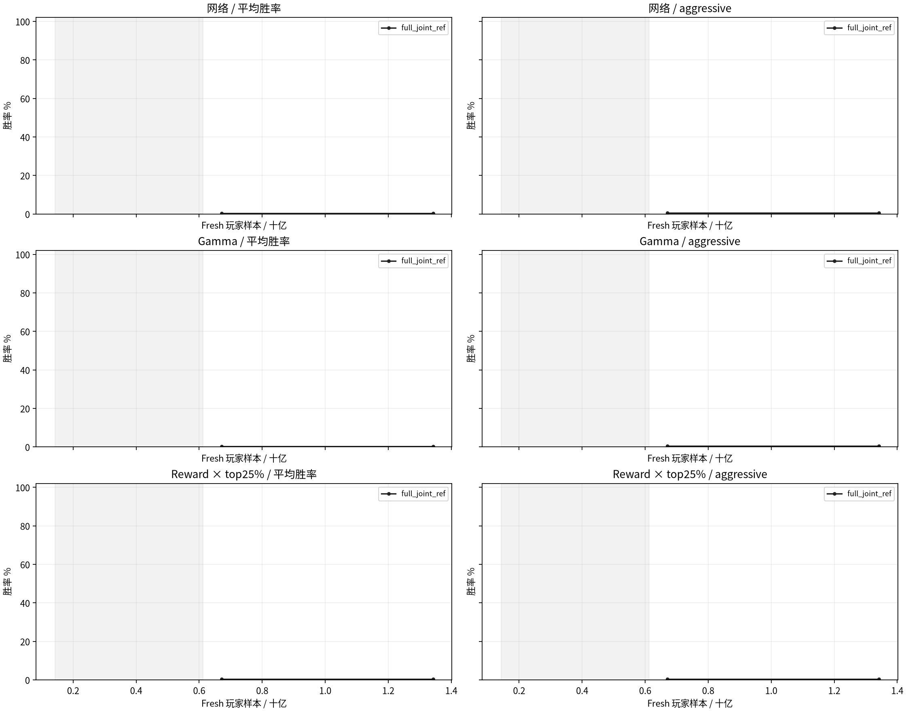

<!-- fullmap_e1_interrupted_for_map9_20261107 -->
## 全尺寸E1基准 v10（切换9×9归档，2026-11-07）

8×H200，每卡2048真实对局、双座current、T512/E1/M256、physical1024、seed2026102901。按用户要求停止并改为9×9全组重训。最后记录U101，fresh玩家样本1,694,498,816；U100 checkpoint保留。最新固定面板U100平均0.375%、aggressive 0.50%。近期每轮约144s（采样36s＋PPO108s），约116,000玩家样本/s。未完成224轮。

[全尺寸归档](fullmap_t512_fast_ablation_20261107.md)；[新9×9消融](map9_t512_ablation_20261107.md)。

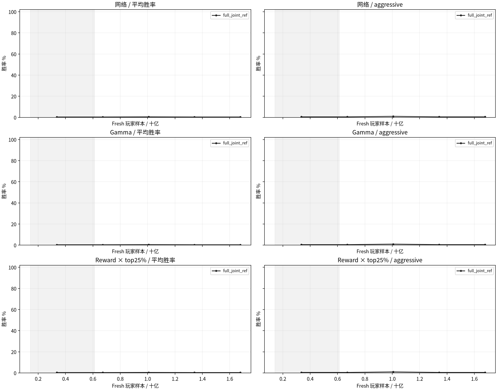

<!-- map9_t512_20261107:v10_9x9_joint_ref -->
## v10_9x9_joint_ref

9×9快速消融＋课程，T512/E1/M256、双座current，seed2026102901，224轮；2048真实对局/卡，physical=8192。网络=joint_independent，gamma=default，reward=constant，保留比例=1.0。

最佳固定面板U224：平均97.500%，aggressive 92.50%。这是训练面板选模结果；独立评估见[实验报告](map9_t512_ablation_20261107.md)。

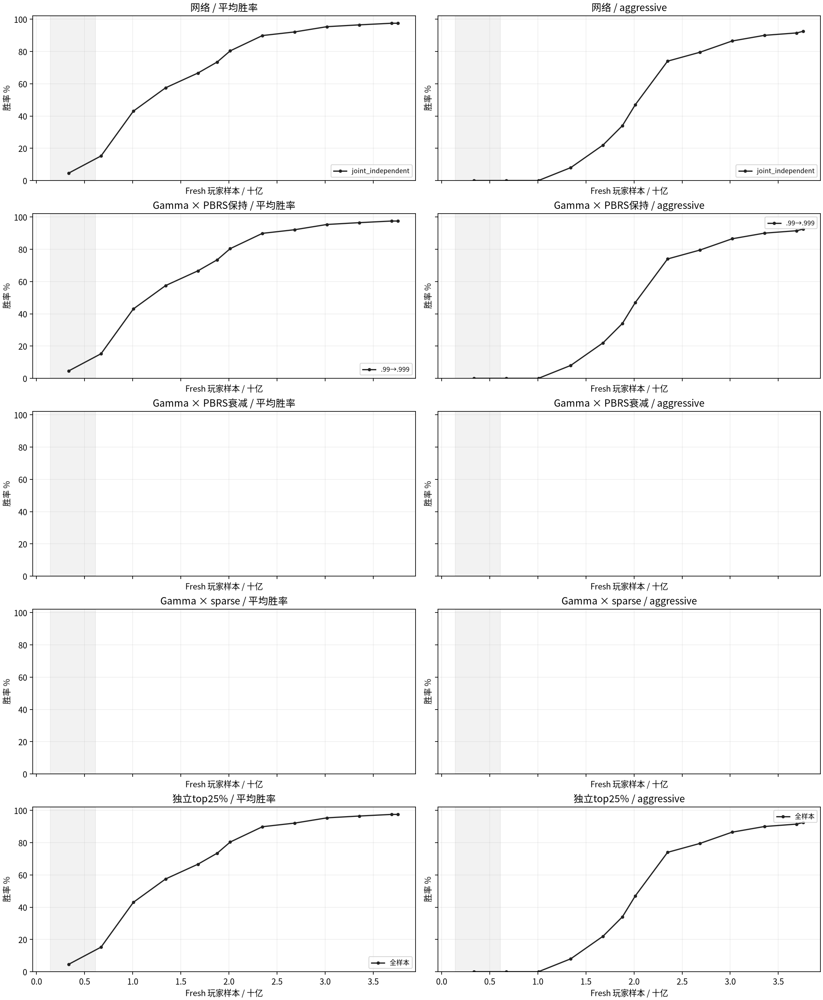

<!-- map9_t512_20261107:v11_9x9_early_shared -->
## v11_9x9_early_shared

9×9快速消融＋课程，T512/E1/M256、双座current，seed2026102901，224轮；2048真实对局/卡，physical=8192。网络=early_shared，gamma=default，reward=constant，保留比例=1.0。

最佳固定面板U200：平均99.250%，aggressive 98.00%。这是训练面板选模结果；独立评估见[实验报告](map9_t512_ablation_20261107.md)。

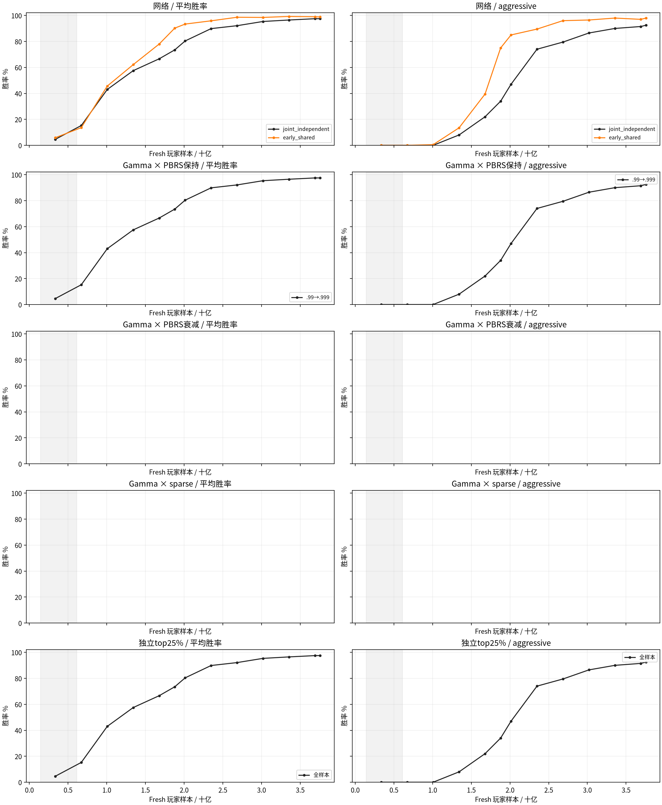

<!-- map9_t512_20261107:v12_9x9_post_attention -->
## v12_9x9_post_attention

9×9快速消融＋课程，T512/E1/M256、双座current，seed2026102901，224轮；2048真实对局/卡，physical=8192。网络=post_attention，gamma=default，reward=constant，保留比例=1.0。

最佳固定面板U160：平均99.125%，aggressive 97.50%。这是训练面板选模结果；独立评估见[实验报告](map9_t512_ablation_20261107.md)。

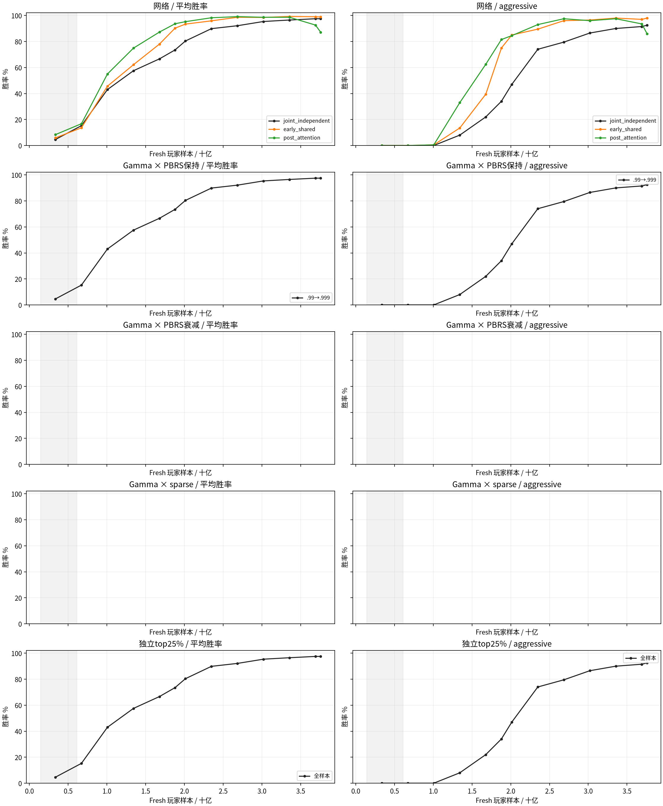

<!-- map9_t512_20261107:v13_9x9_gamma1_fixed -->
## v13_9x9_gamma1_fixed

9×9快速消融＋课程，T512/E1/M256、双座current，seed2026102901，224轮；2048真实对局/卡，physical=8192。网络=joint_independent，gamma=fixed1，reward=constant，保留比例=1.0。

最佳固定面板U40：平均4.125%，aggressive 0.00%。这是训练面板选模结果；独立评估见[实验报告](map9_t512_ablation_20261107.md)。

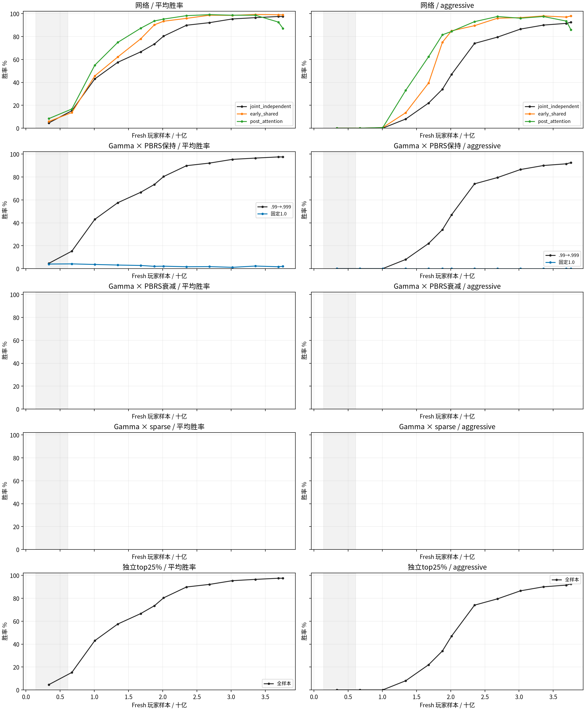

<!-- map9_t512_20261107:v14_9x9_gamma1_ramp -->
## v14_9x9_gamma1_ramp

9×9快速消融＋课程，T512/E1/M256、双座current，seed2026102901，224轮；2048真实对局/卡，physical=8192。网络=joint_independent，gamma=ramp1，reward=constant，保留比例=1.0。

最佳固定面板U180：平均92.000%，aggressive 82.00%。这是训练面板选模结果；独立评估见[实验报告](map9_t512_ablation_20261107.md)。

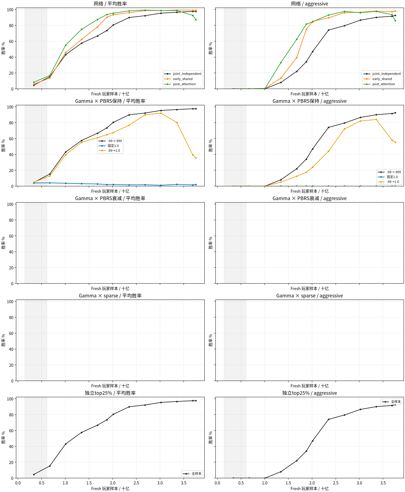

<!-- map9_t512_20261107:v15_9x9_pbrs_decay -->
## v15_9x9_pbrs_decay

9×9快速消融＋课程，T512/E1/M256、双座current，seed2026102901，224轮；2048真实对局/卡，physical=8192。网络=joint_independent，gamma=default，reward=decay，保留比例=1.0。

最佳固定面板U224：平均97.250%，aggressive 92.50%。这是训练面板选模结果；独立评估见[实验报告](map9_t512_ablation_20261107.md)。

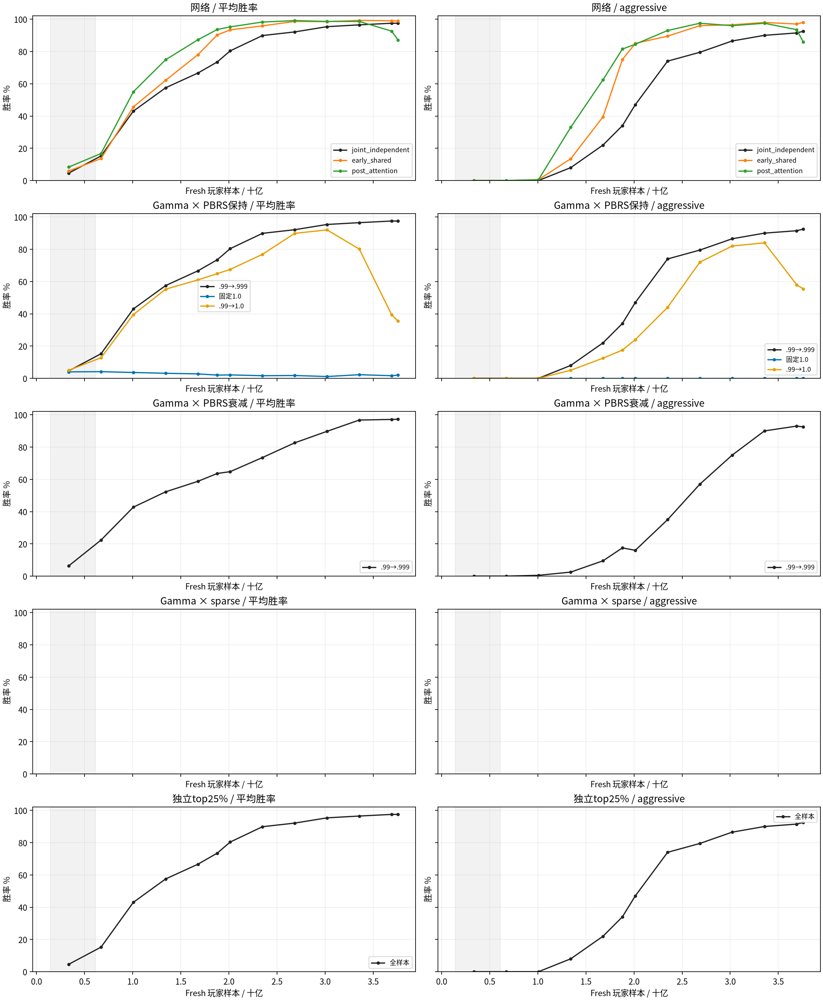

<!-- map9_t512_20261107:v16_9x9_sparse -->
## v16_9x9_sparse

9×9快速消融＋课程，T512/E1/M256、双座current，seed2026102901，224轮；2048真实对局/卡，physical=8192。网络=joint_independent，gamma=default，reward=sparse，保留比例=1.0。

最佳固定面板U224：平均99.125%，aggressive 97.00%。这是训练面板选模结果；独立评估见[实验报告](map9_t512_ablation_20261107.md)。

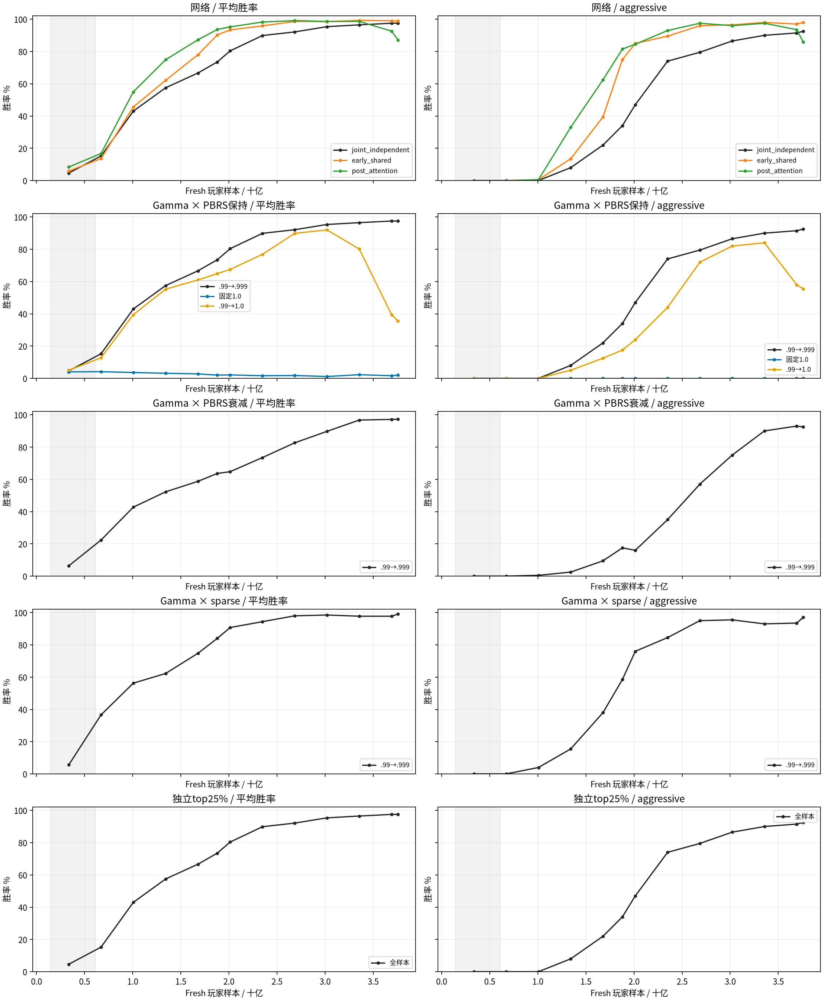

<!-- map9_t512_20261107:v20_9x9_gamma1_pbrs_decay -->
## v20_9x9_gamma1_pbrs_decay

9×9快速消融＋课程，T512/E1/M256、双座current，seed2026102901，224轮；2048真实对局/卡，physical=8192。网络=joint_independent，gamma=fixed1，reward=decay，保留比例=1.0。

最佳固定面板U40：平均4.500%，aggressive 0.00%。这是训练面板选模结果；独立评估见[实验报告](map9_t512_ablation_20261107.md)。

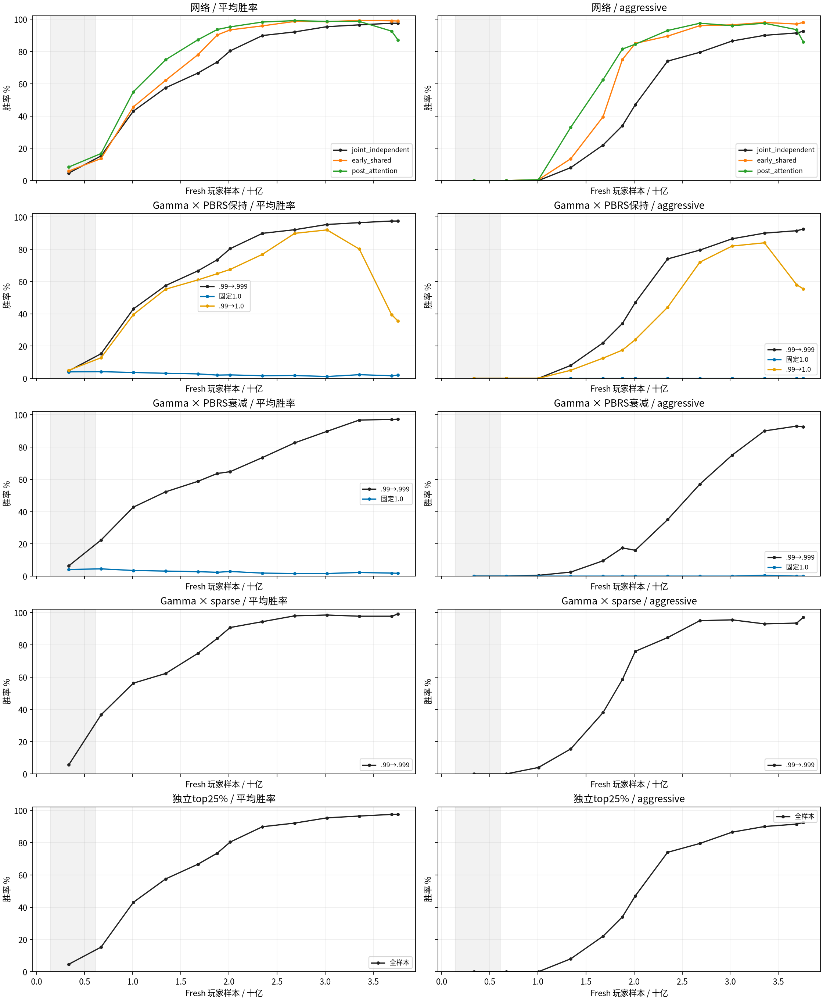

<!-- map9_t512_20261107:v21_9x9_gamma1_sparse -->
## v21_9x9_gamma1_sparse

9×9快速消融＋课程，T512/E1/M256、双座current，seed2026102901，224轮；2048真实对局/卡，physical=8192。网络=joint_independent，gamma=fixed1，reward=sparse，保留比例=1.0。

最佳固定面板U220：平均97.250%，aggressive 93.50%。这是训练面板选模结果；独立评估见[实验报告](map9_t512_ablation_20261107.md)。

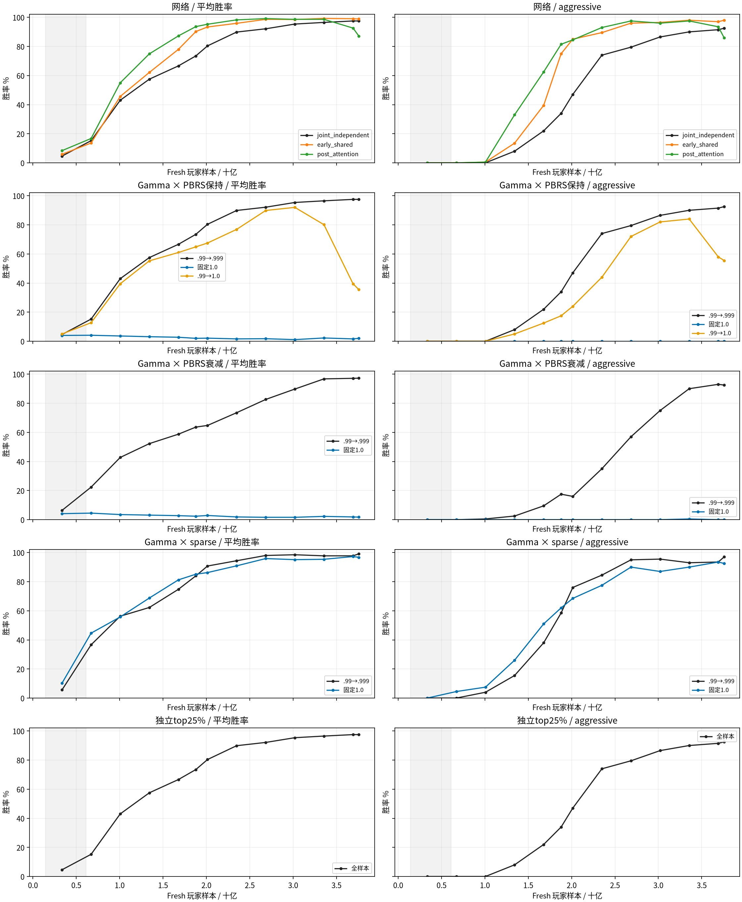

<!-- map9_t512_20261107:v17_9x9_top25 -->
## v17_9x9_top25

9×9快速消融＋课程，T512/E1/M256、双座current，seed2026102901，224轮；2048真实对局/卡，physical=8192。网络=joint_independent，gamma=default，reward=constant，保留比例=0.25。

最佳固定面板U224：平均88.625%，aggressive 72.00%。这是训练面板选模结果；独立评估见[实验报告](map9_t512_ablation_20261107.md)。

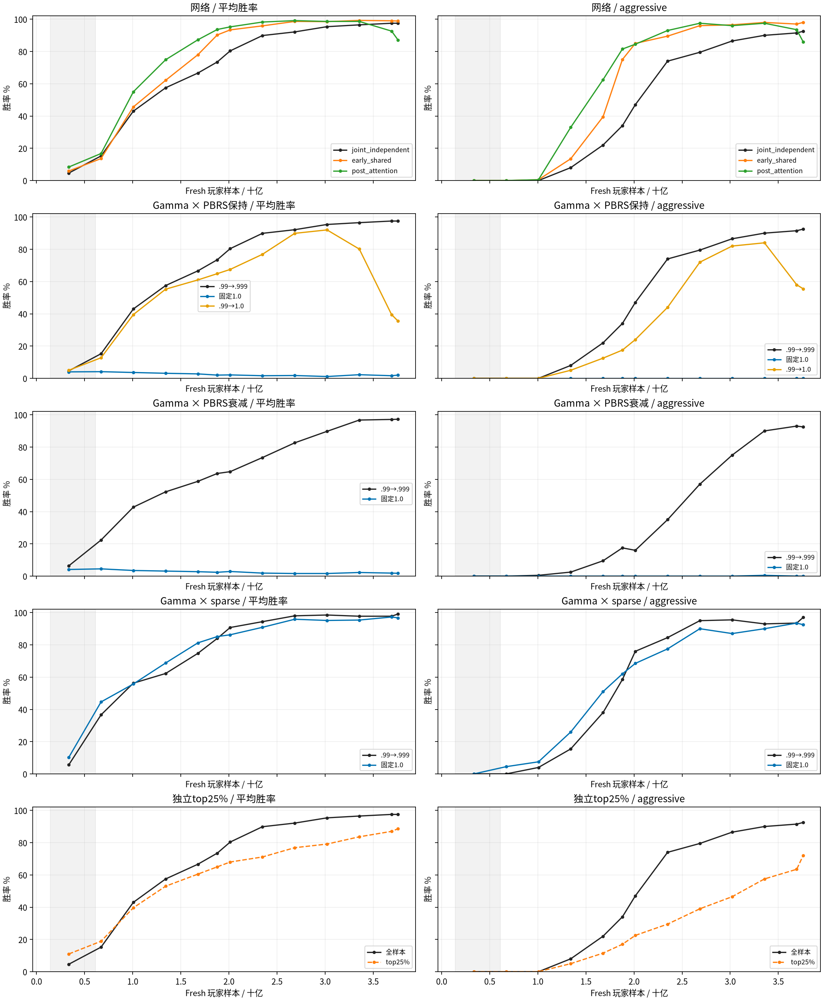

<!-- sparse_features_20261109 -->

## v24–v29: early_shared / sparse / gamma=1

[Configurations and changes](sparse_features_20261109.md); [live/final results](sparse_features_20261109_results.md).

| Run | Updates | Latest original4 | Latest aggressive | Latest all7 | Steady player/s | Peak allocated/reserved GiB |
|---|---:|---:|---:|---:|---:|---:|
| v24_9x9_sparse_baseline | 224/224 | 90.3% | 93.0% | 85.3% | 441,906 | 21.02/22.37 |
| v25_9x9_sparse_hl128 | 224/224 | 98.5% | 95.5% | 91.6% | 447,148 | 21.02/22.28 |
| v26_9x9_sparse_binary_ce | 224/224 | 96.8% | 94.5% | 91.4% | 444,812 | 21.02/22.37 |
| v27_9x9_sparse_compact | 224/224 | 95.2% | 96.5% | 89.4% | 437,300 | 18.65/19.90 |
| v28_9x9_sparse_temporal | 224/224 | 92.9% | 95.5% | 86.5% | 425,359 | 19.35/20.69 |
| v29_9x9_sparse_dedup | 224/224 | 80.9% | 90.0% | 74.1% | 434,269 | 19.35/20.55 |

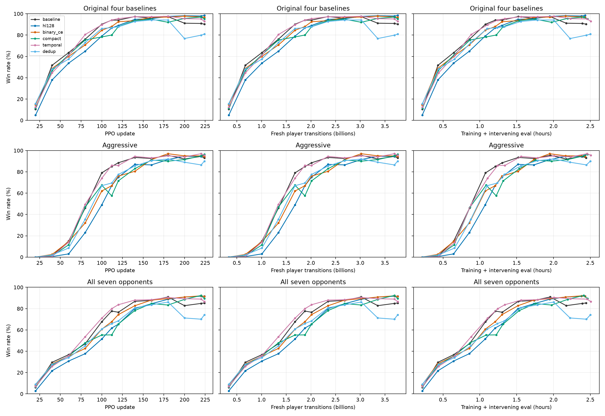

<!-- /sparse_features_20261109 -->

<!-- late_decline_audit_20261110 -->

## 2026-11-10：最近一周后期衰退的胜／平／负拆分

结论：近期 v12、v14、v24、v28、v29 在目标地图评估上的明显衰退，均以平局增加为主，但不是所有性能衰退都属于这种情况。11 月 3 日地图课程在旧布局上的退化主要是败局增加；同日全尺寸 packed run 的平局减少、败局增加。单看总胜率不能区分这些现象，也不能由平局增加直接推导训练根因。

检查范围为 11 月 3–10 日的本地实验档案：34 份现代 run 的 `evaluation_curve.json`，另加 11 月 3 日课程官方图、课程旧图、直接官方训练及 full_packed 的四组评估曲线。课程官方图和旧图是同一 run 的两个评估分布，不计成两个 run；旧布局训练后补测官方图的 control 训练早于本窗口，未计入。短暂初始化或尚未学到有效策略就停止的尝试不当成“高胜率后崩溃”。

主表统一采用原四 baseline、每 checkpoint 800 局、采样动作、各自固定地图与交换座位。峰值选可用训练后半程内最高胜率，比较最后一个完整评估点；下降至少 3 个百分点作为人工复核筛选条件，不是统计显著性标准。所有主表配对均逐局核对评估配置、地图种子、初始地图 digest、双方 controller seeds 一致，原始局数与汇总完全相符。平局原因均为 `tick_limit`，现代报告无评估错误。

| Run／评估分布 | 更新区间 | 胜率 | 平局数 | 败局数 | 净变化解释 |
|---|---:|---:|---:|---:|---|
| v12 post_attention | 160→224 | 99.125%→87.125% | 1→74 | 6→29 | 少赢96局；平局+73，败局+23 |
| v14 gamma 0.99→1 | 180→224 | 92.000%→35.500% | 17→471 | 47→45 | 少赢452局；平局+454，败局−2 |
| v24 sparse baseline | 140→224 | 97.375%→90.250% | 7→65 | 14→13 | 少赢57局；平局+58，败局−1 |
| v28 temporal | 180→224 | 97.625%→92.875% | 6→48 | 13→9 | 少赢38局；平局+42，败局−4 |
| v29 temporal+dedup | 160→224 | 94.125%→80.875% | 27→139 | 20→14 | 少赢106局；平局+112，败局−6 |
| 11/03 地图课程：旧布局面板 | 120→224 | 98.500%→92.250% | 1→9 | 11→53 | 少赢50局；败局+42，占净回落84% |

这里是总数的净变化，不代表每个旧胜局只会转为某一种结果。逐局配对确认：v12 有74局胜→平、28局胜→负，同时5局负→胜、1局平→胜；v14 有450局胜→平、29局胜→负，同时也存在负→胜等反向变化。旧布局回归面板则有49局胜→负、9局胜→平，7局负→胜、1局平→胜。

v24 本表按四 baseline 峰值选 U140；此前七对手选模采用 U180，因此与此前“778胜／11平／11负”口径不同，并非数据变更。v29 四 baseline 峰值 U160，而七对手峰值为 U180。

反例与边界：

- 11/03 课程 run 的官方目标面板最终仍为98.75%，旧布局面板却从98.50%降至92.25%。这支持分布迁移／遗忘的解释；不能称为该模型在所有地图上都崩溃。
- 11/03 full_packed 从 U100 的13胜／311平／476负，变为最后完整基线评估 U180 的6胜／198平／596负。平局减少113局，败局增加120局；属于一直低胜率、后期生存表现变差。训练后来停止，不能把 U180 标成训练最终 checkpoint 或 U224。
- 11/04 full-map T512 的 U110→112 为160胜／278平／362负→78胜／342平／380负，平局是主要净变化，但只有停止前最后一个回落点，不能确认持续性后期坍塌。
- 同批 patch3 的 U220→224 为79.375%→77.500%，平局35→34、败局130→146，是败局增加。幅度仅1.875个百分点且只跨最后4轮，应作为末轮波动观察，不与 v14 的56.5个百分点坍塌等同。
- v13／v20 曾有很高平局率，但从未形成高胜率阶段；不能混同为“先学好、后退化”。

独立种子补测也复现主要现象。下表每点1600局，使用既有 best/final heldout；新 sparse study 的 best 按七对手选取，与主表四对手峰值可不同。

| Run | 1024 tick：胜／平／负，best→final | 2000 tick：final 胜／平／负 |
|---|---|---|
| v12 | 1583／0／17 → 1367／170／63 | 1368／168／64 |
| v14 | 1499／16／85 → 597／913／90 | 600／908／92 |
| v24 | 1538／40／22 → 1442／124／34 | 1449／117／34 |
| v28 | 1575／12／13 → 1478／94／28 | 1487／85／28 |
| v29 | 1502／63／35 → 1302／261／37 | 1317／244／39 |

延长到2000 tick并未恢复高胜率，不能只解释为1024 tick评估过短。独立面板上 v24／v28 的败局也增加，说明“全由平局造成”的字面结论过强；平局仍然贡献了大部分净胜局损失。

七对手面板结论一致：各点1400局，从各自七对手峰值到U224，v24 少赢79局，其中平局+72、败局+7；v28 少赢55局，平局+72、败局−17；v29 少赢168局，平局+179、败局−11。v27 末轮从92.357%降到89.357%，平局+30、败局+12，但仅跨U220→224。v25／v26 的七对手回落分别仅0.071／0.571个百分点，不能据此称为明显崩溃。

这次审计仅定位结果类型，未证明优化根因。v12 使用 PBRS、gamma 最终0.999；v14 使用 PBRS、gamma最终1；v24／v28／v29 使用 sparse、gamma=1。因此平局型衰退既不是 sparse 独有，也不能全部归咎于 gamma=1。后续值得检查达成终局的行为、截断 bootstrap 与 critic 偏差，但需要行为和训练指标的对应证据。

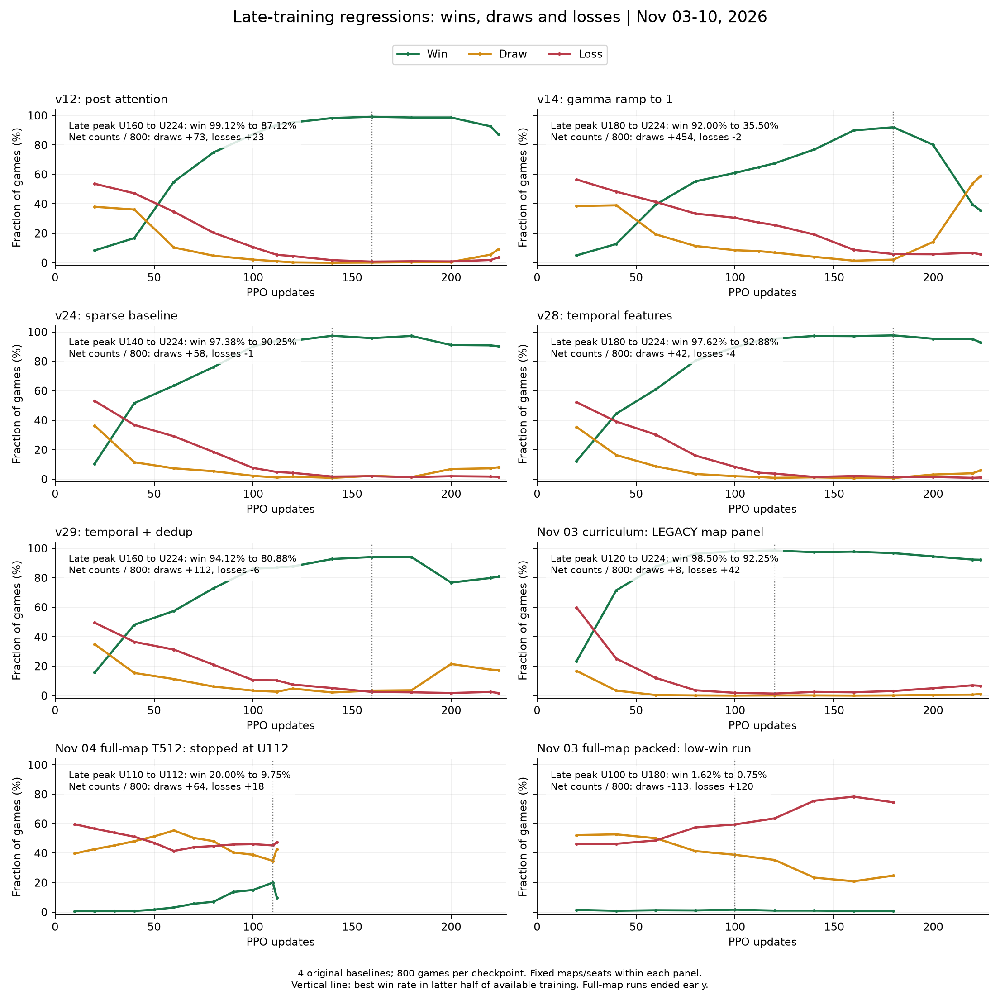

可复现分析：`outputs/analysis/late_decline_audit_20261110_actual01/analyze.py`；完整38条评估曲线汇总 `all_panels.csv`，逐局转移矩阵、配置配对检查及补测数据在 `audit.json`。全部为离线读取既有结果；未启动训练或新对战。

<!-- /late_decline_audit_20261110 -->

<!-- terrain_distance_20261110 -->

## v30–v32：temporal＋HL128，时限与路径消融

[配置与改动](terrain_distance_20261110.md)；[最终结果、独立评估与曲线](terrain_distance_20261110_results.md)。三组224轮及独立评估均已完成。下表是训练期间开发集结果，吞吐受不同时段GPU竞争影响，不能直接横向归因。

| Run | PPO轮 | 原时限 | 原时限七对手 | 统一2048四基线 | 统一2048七对手 | 玩家样本/s | 峰值allocated/reserved GiB |
|---|---:|---:|---:|---:|---:|---:|---:|
| v30_9x9_temporal_hl128 | 224/224 | 2048 | 90.86% | 98.25% | 90.86% | 158,564 | 19.35/20.58 |
| v31_9x9_temporal_hl128_4096 | 224/224 | 4096 | 90.43% | 97.88% | 90.43% | 296,438 | 19.35/20.64 |
| v32_9x9_temporal_hl128_paths | 224/224 | 2048 | 93.14% | 98.75% | 93.14% | 426,078 | 20.00/21.38 |

独立评估统一2048 tick，每个U224模型2800局、采样动作：v30／v31／v32七对手胜率分别为91.50%／90.11%／93.54%，Aegis分别为66.50%／65.00%／73.50%。路径组增加0.633 GiB／卡观测buffer，并改善本轮学习曲线；延长到4096 tick未见收益。路径组开发集选出的best为U220，独立七对手胜率93.43%，未复现开发集末轮回落。三组均只训练一个种子。

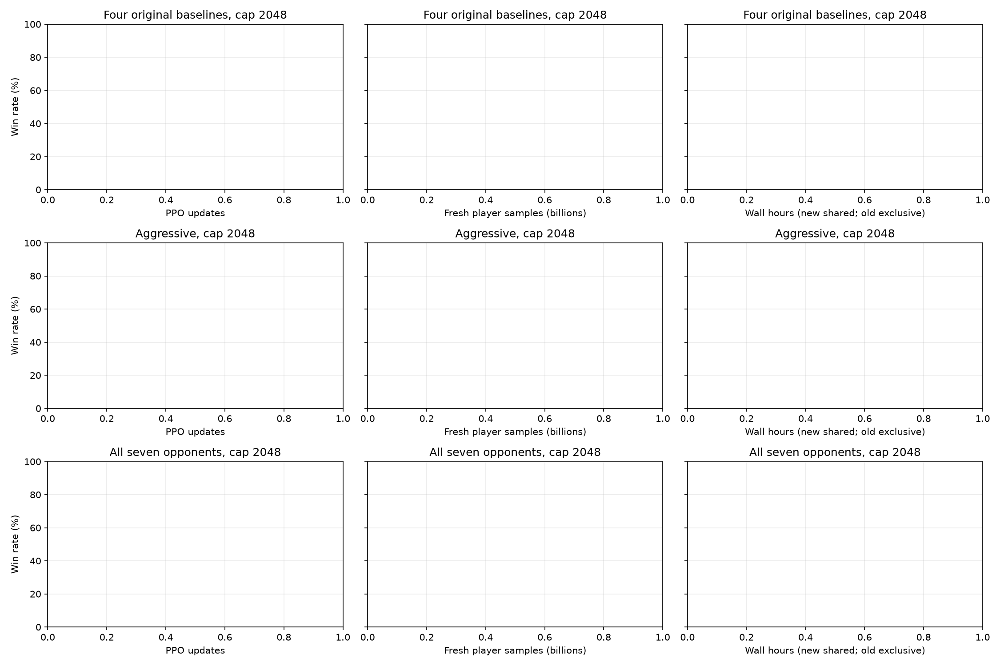

<!-- /terrain_distance_20261110 -->

## 2026-11-11：v32观测构建优化

基于默认配方提交`88e810e`，减少结束对局引起的重复观测编码。训练桥接层仅为timeout行保存重置前历史／记忆／路径快照；重置后整批下一步观测只构建一次。局部reset仅更新结束行的记忆与历史；探索指标直接从记忆状态读取，episode计数合并为一次CPU同步。动作合法性和模拟器错误检查保留。完整终局观测接口仍是`GeneralsTask.step()`的默认行为，具体契约见[训练设计](rl_training_design.md#rollout与存储)。本次不改变v32的MDP、超时bootstrap、网络或PPO目标，没有修改vendor。

**8×H200完整PPO对照**：旧／新／新／旧交替运行，各预热1轮、计时3轮，每种实现合计6轮。每卡2048局、4096玩家轨迹，9×9＋课程，T512/E1/M256，物理minibatch8192，early_shared＋temporal_paths＋HL128，BF16/compile。各次从同一个v32 U224完整网络权重开始，优化器重新初始化；每轮全局16,777,216条新玩家样本。PyTorch2.8.0+cu129，测试期间无其他GPU任务。

| 指标 | 优化前 | 优化后 | 变化 |
|---|---:|---:|---:|
| 每轮rollout耗时 | 15.350 s | 13.413 s | −12.62% |
| 每轮PPO梯度更新耗时 | 23.693 s | 23.681 s | 基本不变 |
| 每轮总耗时，含GAE | 39.097 s | 37.148 s | −4.98% |
| 全局玩家样本/s | 429,120 | 451,631 | ＋5.25% |
| 全局棋盘tick/s | 214,560 | 225,816 | ＋5.25% |
| 各卡最大peak allocated | 19.692 GiB | 19.692 GiB | 不变 |
| 各卡最大peak reserved | 21.033 GiB | 20.994 GiB | 基本不变 |

各阶段用每轮最慢rank的耗时汇总；全局吞吐按“总样本数／各轮完整耗时的rank最大值之和”计算，阶段最大值不能直接相加。两次旧实现分别429,859／428,384样本/s，新实现分别451,238／452,025样本/s。收益集中在rollout；PPO更新仍占主要时间，因此端到端增益小于环境步增益。

为缩短准备时间，本次每级地图池为256张，默认正式训练为65,536张；课程阈值不变，4轮短跑始终位于第0级。计时包括策略／critic推理、模拟、存储、GAE和PPO更新，排除初始化、预热、eval、日志和checkpoint写盘。这是工程短测，不能直接代表全部课程阶段及评估开销下的长期吞吐；峰值显存也不能替代正式大地图池的预算。

**RTX4090局部测量**：同为2048局／4096轨迹，用已训练的v32 actor采样行动，256tick预热＋256tick计时。最终源码反序复测的`env.step()`平均耗时6.154→4.612 ms（−25.1%），不含actor推理。235/256帧有reset，平均每帧5.06局结束，两边reset序列及最终观测哈希一致。另取8帧profile，其中7帧有reset：局部编码、特权编码、动作mask及记忆特征各从15次降到8次；profile不计入速度结果。

**正确性**：CPU和CUDA覆盖部分自然终局、部分timeout、换座、无特权输入、历史与路径快照保留；另用旧源码和新源码逐步哈希对照，强制64tick超时，128tick预热＋128tick验证，观测／奖励／done／timeout／指标／timeout行终局特征完全相同。最终两组相关回归共88 passed，另有76个subtests。H200四次短跑的各卡loss及终局统计完全相同，均发生了真实timeout；各跑4轮后的rank0完整模型权重SHA256均为`4d2dd0368b572b2c702a13a993479d1288c23f7e7e93bf8b2170800de5cca2b3`。

原始配置、源码快照与SHA256清单、profile、逐卡报告及汇总脚本位于`outputs/experiments/observation_build_20261111_actual01/`，本地和H200均保留；入口为`summary.json`、`summarize.py`、`run_ppo_bench.py`及`bench_observations.py`。复用的`rl/tools/benchmark_training.py`解除旧E4硬限制，支持正整数epoch，已验证E1/E4；两种实现使用相同工具。未保存新的训练模型，全部benchmark进程已退出。

## v33–v36：配对采样、超时语义、联合critic与D4

[固定配置、选择规则、实现与预检结果](episode_critic_d4_20261111.md)。四组各4轮的8×H200预检已通过，actor导出及68局Arena链路检查通过；峰值allocated约19.62 GiB／卡。完整训练预计每组224轮／单训练种子，全部采用配对采样。**按用户最新要求，正式训练尚未启动，预检进程已退出**。

## 2026-11-11：同步、地图池与时间特征修复

[实现、实测与边界](rl_rollout_and_map_bank_20261111.md)。新增初始地图池内容寻址缓存、确定性多进程生成及可选有界滚动图池；默认仍使用固定65536池，滚动模式尚不作为胜率已验证的配方。H200主机CPU生成五级课程池，4worker相对单进程在9×9／全尺寸分别提速3.77×／3.61×；两个worker持续生成约97.9／174.4新base seeds/s。滚动池可将常驻容量设为8192而持续引入新种子；当前不混入超时／联合critic／D4对照。

移除重复GPU→CPU同步，保留异步合法性／状态检查。RTX4090的2048局、已训练actor对照中，`env.step()`均值4.347→4.189ms（−3.64%），actor＋step profile的同步20→8次/帧；逐帧trace与旧实现一致。该数字不是H200完整PPO吞吐。默认clock固定尺度2048并截断，age显式配置2000；旧actor/config保留旧时钟语义，2048范围内当前MDP输入不变。

主回归82通过，补充20通过／4 subtests（有重叠）。8×H200两轮小规模集成smoke通过，16,384玩家样本，滚动图池／课程切换／联合critic／D4／超时与导出均跑通，进程已退出。**没有启动正式训练或新胜率评估**，所以本条没有新增胜率曲线；旧预检的冻结源码已标记需要更新，下一次正式训练前应以新冻结源码补做容量验证。

## 2026-11-11：地图生成迁移至原生CPU

[实现、顺序基准与容量评估](rl_native_mapgen_20261111.md)。将1v1出生点／城市公平性、可达性，以及课程连通性修复／配对／距离计算迁至C++；保留NumPy种子和随机序列，直接填充预分配地图池。旧Python、初次原生版、优化后的原生版依次在H200主机做八rank×2/4/8进程对照。每rank4进程时，9×9合计1472→11274基础种子/s（7.66×），全尺寸2669→8088（3.03×）；每种子生成五级课程布局，数字不是环境step/s。

327,680个布局的完整地图池哈希一致，9种配置5376个布局在本地与H200逐字段一致。主回归75通过／3 subtests；后续上传专题11通过／3 subtests，有重叠。预取深度独立为8，首次reset不提前替换初始池；异步chunk上传将单块显式stream同步从24次降为1次，实测全尺寸上传写入35.74→12.59 ms。

八rank持续生成测试中，全尺寸最慢rank的4/8进程产能分别1210／2188种子/s。单卡16384局、65536池、R4的6400次reset/s压力测试：4进程产生6.34秒补图等待，8进程不足1毫秒；地图及环境测试峰值allocated约2.474 GiB，不包含PPO。下批9×9共同配置准备为65536池、R4、chunk1024、prefetch8、每rank4进程。**本次只做工程基准，没有正式训练、模型或新的胜率曲线**；原预检保持历史快照，正式控制器继续关闭。
