# RL 训练迭代日志

当前目标：随机种子的 9×9、1v1 地图，部署 student 对 aggressive 胜率超过 90%、expansion 超过 95%、defensive 与 random 达到 100%；每个方案从零开始，训练只使用历史模型自对弈。达到目标或连续 20 个训练版本无有效提升后停止。在 `codex_dev` 分支依次管理训练方案；main 保留 baseline commit `0189d55`。

**当前状态：v12 已完成且未改善；v13 的 greedy 历史对手运行门禁通过，准备从零训练。** v1–v8 属于此前目标（各 AI 超过 80%）的历史实验，使用了续训或已有权重初始化；v6–v8 还混入少量 aggressive 训练对手，不能作为本轮从零训练的公平对照。旧目标已由 v8/update199 在新 seed161803398 的 8000 局达成：83.35% / 92.65% / 97.80% / 96.95%；该模型没有达到当前更高目标。

## v9 起：从零训练的纯自对弈比较约定

- 每个方案随机初始化 policy，使用新的 Adam 与历史池；禁止旧 checkpoint、warm start、resume、蒸馏初始化，以及 baseline AI 训练对手。历史初始随机模型作为快照 0 保留，随后均匀抽取冻结 student，整局固定对手。
- v9 保留 v8 的 Light CNN、局部观测、动作与 PPO 参数；取消额外 critic 潜能偏移（`value_potential_offset=false`，也不输出未使用的 `critic_potential`）。原偏移使 TD advantage 精确抵消潜能差分，随机初始化会直接面对稀疏输赢；取消后保留标准 `gamma*Phi(next)-Phi(current)` 奖励及终局归零，让初期获得扩张信号。建立新的从零参考；后续改动根据曲线与失败录像决定，不作大量参数搜索。
- 开发对比固定训练种子 20261013、历史池种子 120261013。选模 seed271828、每 AI 200 地图×双座次；诊断 seed1001042 已用于旧实验，只作为重复开发集。旧阶段的新种子 314159265、161803398 也不能再次称为未见测试。
- 正式候选固定权重和确定性局部 student 后，预注册未使用的随机种子，以每 AI 至少 1000 地图×双座次复核。draw 计入总局数；100% 指该有限赛程无败无平，不代表所有可能地图的数学保证。
- 从 v9 重置连续无提升计数。按重复诊断集四 AI 的 `win_rate/目标胜率` 最小值衡量进展：最小值提高超过 0.01，或最小值距参考不超过 0.01 且四项均值提高超过 0.01，重置计数；始终记录完整四项胜率，点估计改善不作统计显著性声明。
- 每轮至少 1 小时、最多 3 小时；连续 12 个选模点没有超过 2pp 的改善可结束该轮。若达到目标，则先完成独立复核再结束总任务。历史池 8、完整 checkpoint 3、评估快照最近 3+best；每个版本最多保留 4 个人工诊断模型。

v9 配置见 `rl/configs/v9.json`：16,384 环境、32 tick rollout（524,288 samples/update）、4 epoch×64 minibatch（8192 samples/minibatch）、gamma0.995、episode1024、C16 两层3×3 actor/独立 critic、fixed LR1e-4。取消 critic 潜能偏移；移除 baseline 训练桥接及其专用 C++ 加速，保留原版评估 AI。训练开始后和结束时补充验证、结果、曲线与录像分析。

## v1–v8 的历史评估与停止约定

- 使用原环境控制器和原生整 tick 规则，双方在增长前从局部观测决策。每张地图交换两座位；部署只用 student 局部输入和确定性 argmax。
- 胜率 = wins / (wins + losses + draws)，超时为 draw，不能用 decisive win rate 或四 AI 总体胜率替代各 AI 胜率。
- 训练选模seed=271828，按四AI最低胜率、aggressive、overall依次选择。v1–v5每AI50地图/100局，v6–v7为100地图/200局，v8为200地图/400局；各版本配置和结果如下。
- 候选达到目标后，另用训练及选模未使用的随机种子、每 AI 至少 500 地图复核，报告每 AI/座位胜率和 95% 区间。仅固定小选模集达标不宣称完成。
- 每轮通常 1–3 小时；根据胜率平台停止。达到目标，或连续 10 个训练版本未带来有效提升后停止，并记录原因。
- 历史池固定 8 个模型；完整 checkpoint 最多 3 个；已完成评估最多保留最近 3 个权重及一个 best，报告与曲线点全部保留。录像每 AI 最多一败一胜。

## 历史参考：long_run_v1（不计本轮 v1）

16,384 环境 × 每环境 1,000,000 tick，32 tick rollout、4 epoch、64 minibatch，两阶段 MoE CTS；episode 1024、gamma 0.995。共训练约 26.35 小时，采样加更新约 172,976 transitions/s。

固定旧选模集最佳 snapshot340（update 16999）：aggressive 57%、expansion 62%、defensive 79%、random 80%。该模型在独立 seed=1001042 的 400 局只有 34%、50%、76%、73%。

最终完整 checkpoint 在同一独立 seed=1001042：aggressive 42%、expansion 55%、defensive 76%、random 77%；最近 20 个旧选模点 aggressive 仅约 +0.34pp / 100k tick，已接近平台。失败录像中存在大量合法但零兵移动与立即折返。

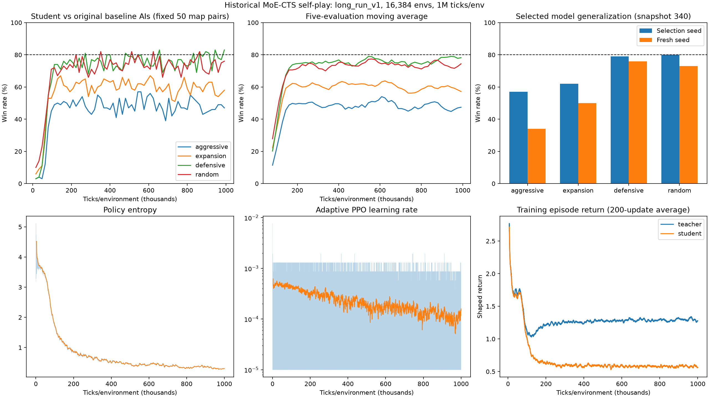

## v1：当前 MoE CTS 的续训参考

已完成；代码 commit `040bdc2`。保持原 reward/obs/action/网络/两阶段更新；增加可控时限、平台停止、最佳模型保留和资源/队列指标。默认 CTS 数值更新路径未改；54 个核心测试、1 个录像测试、22 个 vendor 回归通过。

- 配置：`rl/configs/v1.json`；从 `outputs/moe_cts/long_run_v1/train/checkpoint.pt` 恢复模型、两套 Adam 和历史池。训练源码冻结在 `outputs/moe_cts/iterations/v1/source/`，不受后续工作区修改影响。
- 9×9、1v1，16,384 GPU 环境，32 tick rollout、4 epoch、64 minibatch，episode 1024、gamma 0.995；新训练地图 seed=20261005。
- 上限 3600 秒；至少 1800 秒后连续 8 个评估点无超过 2pp 的有效提升停止；每 100 更新评估一次。实际因 `evaluation_plateau` 停止：874 更新、每环境新增 27,968 tick、458,227,712 transitions、约 330 万 completed episodes。
- 时间 2655.3 秒（44.3 分钟），采样加更新 **172,960 transitions/s**，全流程 172,569/s；显存峰值 allocated 16.03 GiB、reserved 16.53 GiB。9 次评估全部完成，无失败和积压。
- 最佳 snapshot627/update31299，续训仅 1600 tick/环境；权重 `outputs/moe_cts/iterations/v1/train/evaluations/best.pt`。后续 aggressive 曲线 60→56→54→58→52→49→51→51→47%，继续续训无益；末段 student 回报约 0.6–0.7，teacher 约 1.1–1.2，能力差距仍明显。

| 评估 | aggressive | expansion | defensive | random |
| --- | ---: | ---: | ---: | ---: |
| 续训前，新选模 seed=271828，100 局/AI | 46% | 62% | 83% | 71% |
| 最佳训练快照，同选模集 | **60%** | **70%** | **84%** | **80%** |
| 最佳快照独立 seed=1001042，200 局/AI | **56%** | **66.5%** | **80.5%** | **83.5%** |

独立集前 50 张地图与旧 checkpoint 的审计集完全配对：aggressive 42→50%、expansion 55→60%、defensive 76→77%、random 77→83%；整套扩大到 100 地图后的数据列在表中。v1 相对旧基线有提升，但未达到目标；连续无提升版本计数为 0。小选模集及重复挑选快照有方差，最终达标仍需全新随机种子的大赛程复核。

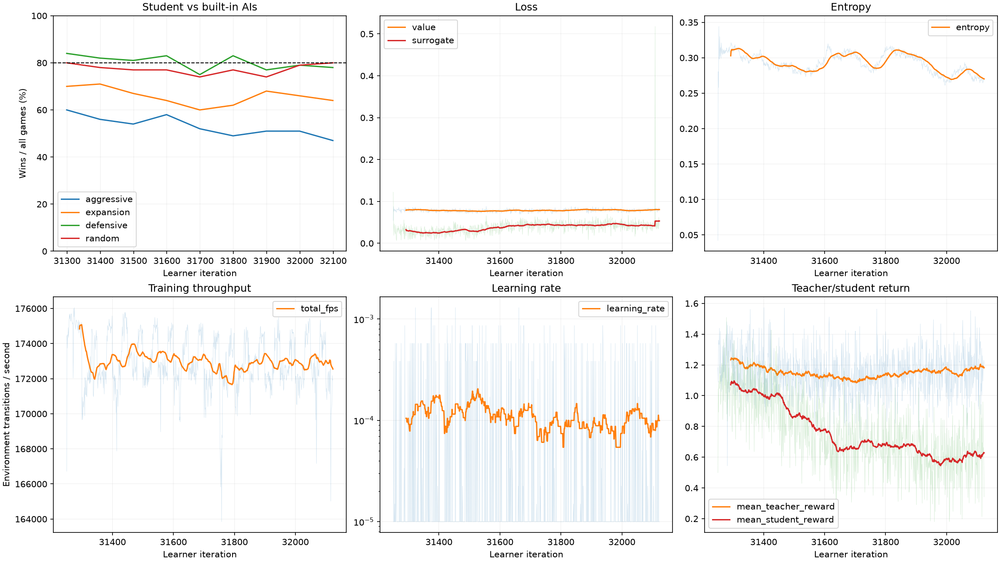

每 AI 一败一胜录像及独立 Core 逐 tick 重放结果在 `outputs/moe_cts/iterations/v1/diagnostic/best_at_31299/analysis/`；选取各类中位时长案例，不代表无偏行为统计。

- aggressive 失败例 185 tick：24 次零兵动作；末十 tick 持续把将军增长的兵送走，敌军绕上侧贴近时仍在操作下侧小兵，缺乏集结和防守。离线精确复现 8 局全部 1560 次动作；敌将最后 46 tick 持续可见，最终错误不能归因于遗忘。teacher/student 最后都以 >90% 概率用 2 兵攻击 9 兵敌将；存在有效防御，但对应概率仅约 1e-10。详见 `outputs/rl_iteration_audit/v1_teacher_student_failure_probe/diagnosis.json`。
- expansion/defensive/random 失败例零兵动作占比分别约 25%、56%、62%。动作 mask 是直接可改的效率问题；不能靠过滤零兵动作解决全部 aggressive 失败。
- 同一最佳权重只开启 productive mask 的推理对照：60% / 76% / 89% / 88%（原选模集）；aggressive 未提升。下一轮验证该 mask 的训练效果、固定 LR 和 TF32 吞吐；后续独立试验 student PPO、可见兵力比较特征和 terminal/dense reward 配比。

TensorBoard：`outputs/moe_cts/iterations/v1/train/`；完整训练摘要 `train/summary.json`，独立评估 `diagnostic/best_at_31299/fresh_evaluation.json`。

## v2：productive mask、固定学习率与 TF32

已完成，代码 commit `5b20967`；配置 `rl/configs/v2.json`。从 v1 最佳 student/teacher/actor/critic 权重 warm start，重新初始化两套 optimizer 和历史池。训练地图 seed=20261006；同一选模种子继续对照。

- 动作：可选 `productive_actions=true`，按下一 tick 的公开增长规则过滤零兵 MOVE，WAIT 始终可用。少数 seat-order 敌方先攻击的变化仍可能使实际移动零兵；完整评估统计实际动作。
- 算法：MoE CTS 两阶段、teacher/student=0.75/0.25、网络及 reward/obs 保持上一版本；main LR 固定 1e-4，student LR 3e-4。
- 16,384 环境、32 tick rollout、4 epoch、64 minibatch、episode 1024、gamma 0.995。训练上限 7200 秒，至少 3600 秒后可因 8 个评估点平台停止。
- `matmul_precision=high`；同配置、同初始权重和 seed 的 10 更新 GPU 短测：highest 198,116/s，high 209,534/s（采样加更新），约 +5.8%；allocated 峰值约 16.0 GiB，所有参数/损失有限。短测只证明吞吐和可运行，不能推断训练胜率。
- 模型权重 warm start 支持、productive mask/privacy/Core-GPU 对照、动作指标及精度恢复均有回归；核心 60 项、录像 1 项、vendor 22 项已通过，追加历史池 MDP 签名检查后，7 项训练控制/初始化测试再次通过。
- 历史池 8、完整 checkpoint 3、评估权重 3+best；训练源码仍冻结。TensorBoard：`outputs/moe_cts/iterations/v2/train/`。

实际因 `evaluation_plateau` 停止：2221 更新、每环境 71,072 tick、1,164,443,648 transitions、774.7 万 completed episodes。耗时 **6000.85 秒（100.0 分钟）**；采样加更新 **194,465 transitions/s**，全流程 194,047/s；显存峰值 allocated **16.05 GiB**、reserved **16.79 GiB**。22 次周期评估全部完成，无失败或积压。相对 v1 的整体吞吐约 +12.4%，包含多项配置变化，不能全部归因于 TF32。

最佳 snapshot36/update1799（每环境 57,600 tick），权重 `outputs/moe_cts/iterations/v2/train/evaluations/best.pt`，SHA256 `ba8a3d4e79bd68f08704da9e328b9151827dfdae1ee546813fd20010278832c6`。

| 评估 | aggressive | expansion | defensive | random |
| --- | ---: | ---: | ---: | ---: |
| v2 最佳，同选模 seed=271828，100 局/AI | **70%** | **80%** | **96%** | **92%** |
| v2 最佳，诊断 seed=1001042，200 局/AI | **55%** | **76.5%** | **95%** | **92.5%** |
| 相对 v1 同诊断集 | −1pp | +10pp | +14.5pp | +9pp |

该诊断种子已在此前版本使用，不能作为最终达标的全新测试集。v2 显著改善其他三个 AI，但主要瓶颈 aggressive 没有提升；按最弱对手/ aggressive 的主目标计连续无提升版本为 **1**。尚未达标；选模集 expansion=80% 也不满足“超过80%”。

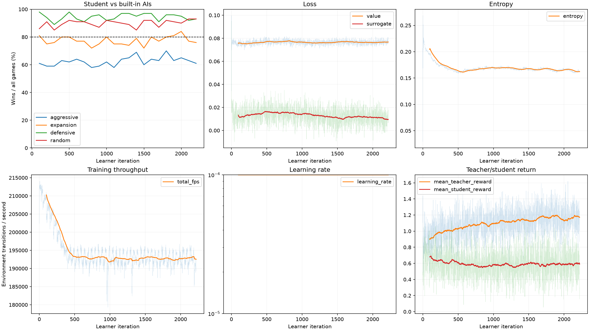

- aggressive 选模曲线在 58–70% 间波动，最佳点后四次评估降为 63/65/63/61%。末 100 更新 student 回报均值 **0.589**，teacher **1.172**；teacher 回报持续提高，student 无相应上升。latent loss 均值 0.00175 不能证明 student 已掌握教师策略；下一轮用原版 PPO 直接训练局部 student。
- productive mask 基本消除了零兵动作：最佳快照的 400 局评估为 0；训练末段仍约 0.12%，来自双方动作在同一 tick 的交互。最佳评估立即折返约 10.5%，仍有集结和防守问题。entropy 从约 0.21 降至 0.16，后半段较平稳；value loss 约 0.077。
- 最佳模型每 AI 一败一胜录像及 Core 全程逐 tick 对照：`outputs/moe_cts/iterations/v2/diagnostic/best_at_1799/analysis/`。另对中期 update599 的失败逐 tick 审计：aggressive 局持续抽空将军，defensive 局有长达 37 tick 的折返并忽视邻接大军回防；Core 反事实验证了提前回防/消耗敌军可避免当时的直接死亡。这些属于中期案例，不能冒充最终最佳模型的统计。
- 原 dense reward 下，中期 defensive 430 tick 败局的初始折扣回报仍为 +0.255，说明扩张收益可能掩盖最终失败；这是后续独立 reward 实验的依据，本轮及 v3 保持 reward 不变。

最终 update1799 最佳模型的 8 局录像也已独立分析，**1907 tick 全部 Core 逐帧重放一致**：

- aggressive 败局 223 tick，decision220 将主城16兵中的15兵移走；可见入侵军在三步路径上。220改 WAIT/HALF 或221回援均能撑过原死亡 tick；222再防守的125种合法动作全部无解，错误在于提前防守和集结时序。
- defensive 败局582 tick，89/129次攻击本次兵力不足以占领可见目标，其中42次指向同一城市，出现9兵攻121兵。末段连续43次WAIT，军力391对52；该局仅9次立即反向动作，不能沿用中期模型的震荡结论。580单步改动已无解，577起四步集中才有存活分支。
- 以上反事实保留后续双方录像动作，真实 baseline 重新决策可能不同；只证明当时存在更早的生存分支，不证明能取胜。胜局的WAIT比例反而更高，因此不统一惩罚WAIT或所有弱攻击。详见 `outputs/rl_iteration_audit/v2_final_failure_analysis/analysis.md`。

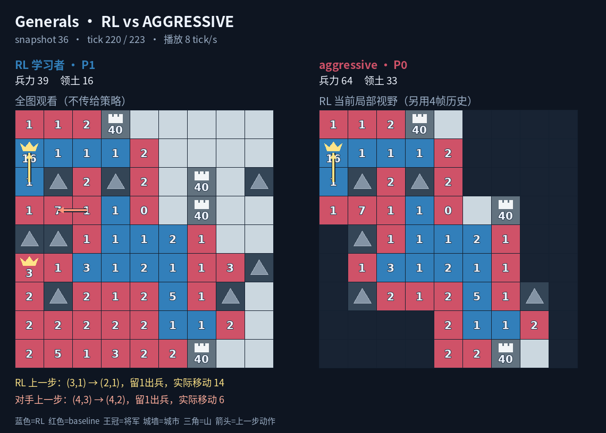

完整摘要 `outputs/moe_cts/iterations/v2/train/summary.json`；另一组种子评估 `diagnostic/best_at_1799/fresh_evaluation.json`。

## v3：student-only PPO 与回合换图

已完成，配置 `rl/configs/v3.json`。从 v2 选模最佳权重 warm start，重新初始化单 Adam 和历史池；生产源码冻结于 `dd0b30038cc9faecd187f8ad1ede5937074e1bab`，不受工作区后续 v4 改动影响。

- 原版 `rsl_rl.algorithms.PPO.update` 保持未修改；全局部 student lane、单 Adam、privileged critic，取消 teacher latent 蒸馏。学生 actor encoder 获得 PPO 任务梯度；critic 中学生 latent 仍 detach，仅去掉该分支不会用于反传的 encoder 计算图。
- 配置 16,384 环境 × 32 tick、4 epoch、64 minibatch、fixed LR=1e-4、gamma=0.995、episode=1024、TF32 high；productive mask、原 obs/reward 保持。通过独占 GPU 短测后选择 16k×32，保留较长 GAE rollout。
- 地图池 65,536；每个回合结束独立随机抽新地图，正在进行的其他对局不受影响；地图生成、采样不消耗 learner RNG。训练 seed=20261007；历史池 8、快照每 50 更新、每 100 更新同选模集评估、训练至少 1 小时/最多 2 小时，资源保留上限不变。
- 不缓存 PPO fixed schedule 未使用的旧动作分布，16k×32 理论额外省 1.268 GiB。默认 CTS 保持原缓存和两阶段行为。单优化器 runner/storage 是最小 vendor 适配；PPO 算法文件未改。
- CPU 核心 70 项（CUDA 1 项在 CPU 回归中跳过）、录像 1 项、vendor 22 项通过；原版 PPO 与适配器在四种 normalizer 开关下 loss/参数/梯度/完整 Adam/RNG 精确一致。去除 value 编码器图的 CPU 短测未显示显著提速。
- 真实 CUDA 小规模 smoke：256 lane、2 更新、回合换图、历史模型发布及 2 次四 AI 子进程周期评估全部完成，无 NaN/失败/积压。另做 4 lane 原生 CUDA 的换图/部分重置逐 tick Core 对照，其他 lane 不受影响。小规模 smoke 不作为胜率或长期速度结论。

额外运行优化：历史对手每组一次 `where`，复用行索引，保留逐组动作验证。CPU Golden 的 8 条轨迹、200 边界、1264 次策略调用及 8 项非法动作合同精确一致，核心 69 通过/1 CUDA 跳过。生产源码冻结于 `outputs/moe_cts/iterations/v3/source/`，代码 commit `dd0b300`；前置 PPO/map 功能 commit `ccb88e5`、安全停止功能 `63e4c0f`。可通过创建 run 目录中的 `STOP` 文件在完整更新后正常保存并结束。

独占 GPU 短测使用相同 warm-start 权重、8 个相同权重的历史对手组、524,288 样本/更新、4 epoch×64 minibatch；每组 20 更新，以最后 10 更新累计采样/更新时间比较，未开启评估：

| 算法/布局 | 采样+更新 transitions/s | 采样秒/更新 | 学习秒/更新 | allocated 峰值 |
| --- | ---: | ---: | ---: | ---: |
| CTS 16,384×32 | 200,025 | 0.860 | 1.761 | 16.10 GiB |
| student PPO 16,384×32 | 170,665 | 0.812 | 2.260 | 14.48 GiB |
| student PPO 32,768×16 | 177,063 | 0.696 | 2.265 | 16.91 GiB |

全局部 student 获得 PPO encoder 梯度的计算量高于 CTS 当前 student 子集蒸馏更新；PPO 速度并没有优势。32k×16 仅快 3.7%，占用更多显存并缩短 rollout，本轮采用 **16,384×32**。短测全部 loss/参数有限，不能代表长期胜率。记录在 `outputs/moe_cts/iterations/v3/bench/comparison.json`。

本轮实际以 **`requested_stop` 正常停止**：在约90分钟时，诊断集后半段已无明确提升，主动创建 `STOP`，在完整更新后保存最终 checkpoint、排空评估并退出。原配置最少1小时/最多2小时、8个评估点平台规则仍保留，但本次**不是自动触发8点平台**；决策证据见 `outputs/moe_cts/iterations/v3/train/stop_rationale.json`。1M tick/环境是调用上限，本次没有跑满。

实际 **1757 更新、每环境56,224 tick、921,174,016 transitions、421.0万 completed episodes**；耗时 **5432.35秒（90.54分钟）**。采样加更新 **170,106 transitions/s**，全流程 **169,572/s**；显存峰值 allocated **14.49 GiB**、reserved **14.80 GiB**。17次周期评估全部完成：failed/cancelled/running/queued均为0。37次模型发布，历史池8、完整checkpoint3、评估权重3+best的保留上限不变。

最佳 snapshot26/update1299（每环境41,600 tick），权重 `outputs/moe_cts/iterations/v3/train/evaluations/best.pt`；SHA256 `b1c58186291f77fd1da5cad9518cfb6ec67fc906e69b217ec3c457cda72e50be`。最佳始终按预定选模集选择，没有根据复用诊断集重新挑选799模型。

| 评估 | aggressive | expansion | defensive | random |
| --- | ---: | ---: | ---: | ---: |
| v3 最佳1299，同选模 seed=271828，100局/AI | **79%** | **84%** | **93%** | **97%** |
| v3 最佳1299，诊断 seed=1001042，200局/AI | **65%** | **81.5%** | **96.5%** | **95.5%** |
| v2 最佳1799，同诊断集 | 55% | 76.5% | 95% | 92.5% |
| v3 相对v2同诊断集 | +10pp | +5pp | +1.5pp | +3pp |

尚未达标。诊断 seed已在前面版本复用，不能作为最终未见seed测试。v3/99→499→799→1299 的 aggressive 诊断胜率为 **63.5→65.5→67→65%**：相对v2有提升，但后半段无明确提高。1299相对799在同地图、座次和controller seed配对后，25局转胜、29局丢胜，净−4/200局；selector最高79%不能直接认定跨seed已接近或达到目标。按本轮最弱对手主目标，v3较v2提升，连续无提升版本计数重置为0。

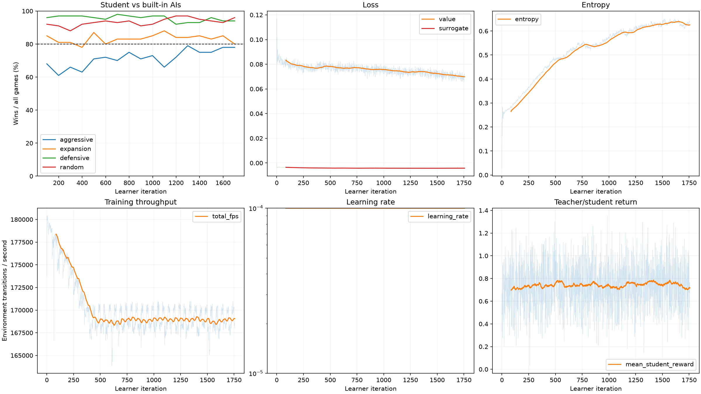

- aggressive选模曲线由68%起，1299达到79%，后面1499/1599/1699为75/78/78%；expansion约78–88%，defensive/random主要在90%以上波动。只凭选模曲线看起来仍可能提高，复用诊断集却没有同步上升，因此把余下预算转向局部战斗特征实验。
- value loss从约0.083降到末100更新均值 **0.0699**，surrogate均值 **−0.00422**；entropy从约0.26升到 **0.626**，未出现熵持续降低的塌缩迹象。student回报末100均值 **0.709**，后半段约0.7–0.8，没有明显上升；self-play episode胜率约 **52.1%**，不能替代对baseline的评估。
- 全历史池运行后的吞吐稳定在约 **169k/s**，末100更新采样 **0.838秒**、学习 **2.265秒**；较CTS的student子集蒸馏方案计算更重。训练末100更新实际零兵动作约 **0.212%**、立即反向约 **6.38%**，动作mask不可能消除同tick对手先手造成的全部执行变化。最佳1299的400局选模评估零兵动作仍为0。

最佳1299每个AI一败一胜录像：`outputs/moe_cts/iterations/v3/diagnostic/best_at_1299/analysis/`。独立CPU审计 **1828 tick全部Core逐帧重放一致**，具体分析见 `outputs/rl_iteration_audit/v3_1299_failure_analysis/analysis.md`：

- aggressive败局259 tick，45次主城出兵共151兵，仅8次回援共22兵；118 tick主城≤2兵。decision258主城18只有1兵，可见敌19有8兵贴邻，而友军27有37兵；策略选远处14→5弱攻击。Core穷举143个合法动作，仅27→18 ALL/HALF可撑过原死亡tick259，分别剩30/12兵；257提前回援也可救。251只WAIT/HALF仍失败，因为后续ALL再次抽空。该局只有9次折返、15/87次弱攻击，主因是直接可见威胁下未调度邻接援军，支持下一轮combat特征。
- defensive败局539 tick，132/167次攻击不足以占领可见目标，417 tick主城≤2兵；早期领土/兵力已落后，末段军力16对123。382用48兵攻击可见敌将101兵；484再次20攻92。382/484/534/538的单步穷举和382起两步回援都未避免原死亡；额外持续留城分支也被增长后的更强敌军击穿，说明单纯保主城不能替代经济和减少无效消耗。
- 同地图game402为回归个例：v2/1799、v3/499、v3/799分别赢59/55/47 tick，1299却输539 tick；这里只核对旧报告结果，没有重放旧模型此局行为，不能指定某个动作的因果。aggressive/expansion败局从未看过敌King；random败局最后失去敌King视野217 tick，memory只对曾见过的信息有意义。
- 原reward下，aggressive/random两局失败的初始折扣回报仍为 **+0.274/+0.450**，为后续独立reward实验提供依据。八局是中位时长定性样例，不能推断全体失败频率；弱攻可能是有益消耗。反事实固定未来双方动作，仅证明是否活过原死亡tick，不证明后续获胜。

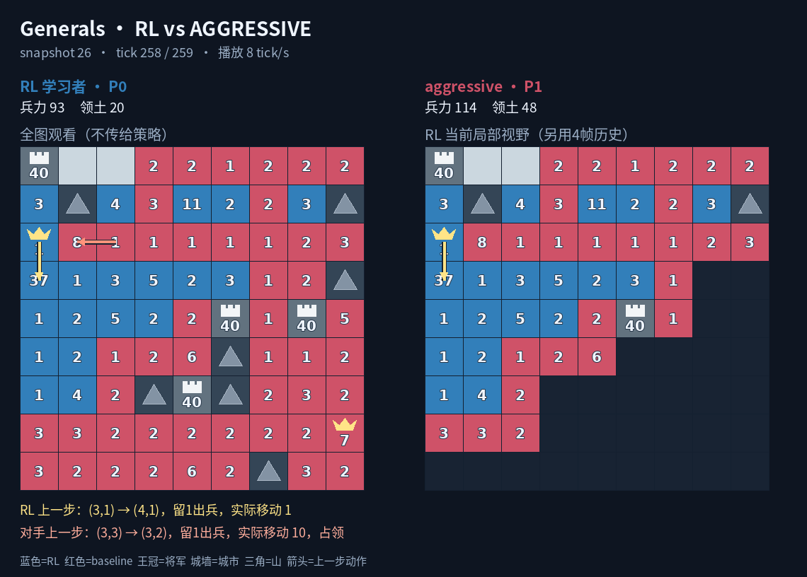

TensorBoard：`outputs/moe_cts/iterations/v3/train/`；完整预算/资源/退出结果 `train/summary.json`，最终曲线与末100指标 `train/analysis/summary.json`，最佳模型复用诊断评估 `diagnostic/best_at_1299/fresh_evaluation.json`。

收尾后独占GPU测试历史模型 `vmap` 推理：8192行/8组、30次TF32 high，串行均值2.304ms，vmap 3.184ms，反而慢38.2%；合成数据有2个near-tie贪心动作变化，最大概率差7.24e-7。未接入生产；这只测随机输入的冻结模型推理，不是完整训练速度。记录：`outputs/rl_iteration_audit/selfplay_vmap_prototype/gpu_decision.json`。

## v4：局部战斗特征

配置 `rl/configs/v4.json`；从 v3 选模最佳1299做权重迁移，重新初始化 Adam 和历史池。生产源码冻结于 `9d4100b6d99edcd6d5d66a18d0b180a6a53868d7`（combat实现提交 `bb64e0d`），随后源码修改不影响本轮。16,384环境×32 tick、4 epoch×64 minibatch、gamma=0.995、episode=1024、fixed LR=1e-4、TF32 high，训练至少1小时/最多2小时。迁移权重：`outputs/moe_cts/iterations/v4/migration_from_v3_1299/checkpoint.pt`；TensorBoard：`outputs/moe_cts/iterations/v4/train/`。此前 v2 迁移和256-lane smoke仅是可运行验证，不是本轮结果。

- `combat_features=true`：用可见敌军下一 tick 最大四邻留一攻击风险和有符号战斗余量，替换 P2 冗余身份平面。单帧仍 985、历史 4 帧；local 先屏蔽隐藏兵力，privileged critic 使用完整状态。其余 action/reward/PPO 配置保持 v3，seed=20261008。
- 风险/余量表示一次动作的潜力，不预测双方联合动作或绝对座位顺序。适用 9×9、1v1；大兵力浮点精度范围和可见性边界由实现及测试注明。
- 迁移旧身份输入列到原 self/enemy 列，将两张新特征的输入权重置零；teacher、student expert/gating、actor/critic 的所有相关历史帧都处理。输出仅权重，必须新 Adam、新历史池。录制的 1560 次旧动作在离线对照中保持，概率误差约 1e-5；不宣称任意输入下 bit-exact。
- 默认关闭，旧 MDP 不变；训练/历史对手/评估通过统一 encoder 工厂选择。历史池签名记录特征语义，防止同维度但不同含义的模型误恢复。
- root CPU 回归 **105 通过、1 CUDA 跳过、1578 subtests 通过**，包括原版 PPO/vendor 和录像工具。真实 CUDA smoke **256 lane×2 更新**、换图/模型发布及两次四 AI 子进程评估正常，无 NaN/失败/积压；短回合 clock 不同，不作胜率或速度结论。
- 空闲 GPU 的 encoder 微基准：16,384 lane，三次编码（learner-local/critic-full/opponent-local）由 **1.63ms→2.40ms**，临时峰值约 259MiB。它只测 encoder，不能据此宣称整轮训练 FPS；完整训练时另记录。

证据：`outputs/rl_iteration_audit/combat_observation_prototype/`，smoke：`outputs/moe_cts/iterations/v4/smoke_gpu/`。

本轮已完成，以 `requested_stop` 正常结束：复用诊断集后半段 aggressive 无持续上升，因此在完成最低1小时预算后转入独立reward实验。停止证据 `train/stop_rationale.json`；不是自动8点评估平台停止，也没有跑满调用上限1M tick/环境。

实际 **1501更新、每环境48,032 tick、786,956,288 transitions、334.4万 completed episodes**；耗时 **4845.61秒（80.76分钟）**。采样加更新 **164,624 transitions/s**，全流程 **162,406/s**；GPU allocated/reserved峰值 **14.49/14.80 GiB**。15次周期评估全部完成，无失败、积压或取消；发布32次、历史池8、完整checkpoint3和评估3+best的保留上限不变。比v3整轮采样加更新吞吐低约3.2%，两轮轨迹不同，不能把全部差异归于combat encoder。

最终按预定选模集选择 snapshot26/update1299，每环境41,600 tick；冻结权重 `outputs/moe_cts/iterations/v4/diagnostic/best_at_1299/snapshot.pt`，SHA256 `70c0d1e8bef7fb762701168ab1bb5bffa3e59cf7d038101758bfb0d5e9fa4c23`。

| 评估 | aggressive | expansion | defensive | random |
| --- | ---: | ---: | ---: | ---: |
| v4最佳1299，选模seed271828，100局/AI | **82%** | **87%** | **97%** | **93%** |
| v4最佳1299，诊断seed1001042，200局/AI | **65.5%** | **81%** | **96%** | **97.5%** |
| v3最佳1299，同诊断集 | 65% | 81.5% | 96.5% | 95.5% |

选模集首次全部超过80%，但未泛化，**未达标**。诊断seed已用于反复迭代，不是最终未见测试集。99/399/799/999/1099/1299的aggressive诊断胜率为 **65.5/70.5/72/72.5/71/65.5%**，中期改善未保持；没有按该诊断集重新挑选999来报告本轮最佳。最终模型aggressive相对v3仅+0.5pp，不视为有效提升，连续无提升版本计数为 **1**。

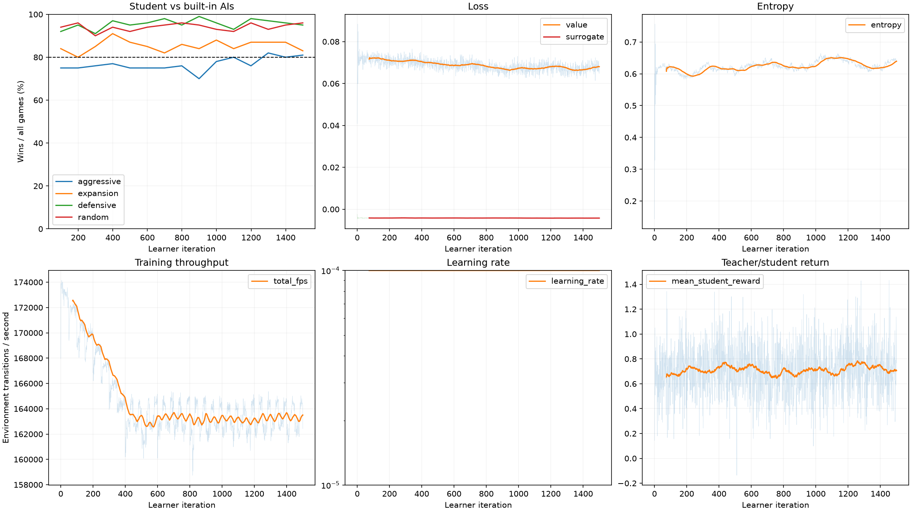

- aggressive选模从75%起，后段达到78/80/82%，末点评估1499为81%；expansion多数约80–90%，其他两个AI稳定较高。小选模集反复挑选与复测不一致，因此不能把82%当作目标完成证据。
- 末100更新value loss **0.0678**、surrogate **−0.00422**、entropy **0.634**；student回报 **0.708**，self-play胜率 **51.6%**，均未显示持续改善。吞吐约163k/s，采样/更新 **0.946/2.266秒**；实际零兵动作 **0.307%**、立即折返 **6.25%**。
- 中期299的输入消融：同一模型仅将两张combat平面置零，diag aggressive **64.5→67.5%**，expansion **81.5→85%**。这只是固定模型的输入干预，不是成对训练的因果对照，也不是最终1299表现。新特征确实被使用，但暂不能证明收益。
- 中期399的原生Core分析2036 tick完全匹配：aggressive在可见贴邻敌军下未调邻军回援，expansion提前数tick忽视可见主城威胁；两局旧reward折扣回报仍为+0.128/+0.264。单tick主城安全mask的额外800局推理对照中aggressive **70.5→70.5%**、零胜负翻转，未采用；需要更早规划和经济，不能靠最后一tick规则保证胜利。以上399案例不代替最终1299样例分析。

最终1299每AI一败一胜录像和Core审计另存 `diagnostic/best_at_1299/analysis/` 与 `outputs/rl_iteration_audit/v4_1299_failure_analysis/`。TensorBoard `outputs/moe_cts/iterations/v4/train/`；完整预算/资源 `train/summary.json`、曲线指标 `train/analysis/summary.json`，复测 `diagnostic/best_at_1299/fresh_evaluation.json`。

最终1299的8局已独立Core逐tick重放，**2519 tick全部状态精确一致**；不是前面的399样例。aggressive相对v3同赛程25局转胜、24局丢胜，净+1/200，两座次67/64%都不足目标，不能归为仅后手问题。详细分析 `outputs/rl_iteration_audit/v4_1299_failure_analysis/README.md`：

- aggressive败局227 tick，211/214将城兵送走，217邻格42有23兵、主城43仅2兵，仍外攻；随后大军绕远并折返。217回援ALL/HALF可撑过原死亡tick，城剩16/5兵；225/226单步已全部无解。最终P0先斩首、P1动作跳过，所以最后一tick的防守规则无助于本例。
- expansion败局166 tick，159已见入侵仍ALL抽空主城，161邻格38有18兵、主城37仅1兵、上方敌28有10兵，仍从主城外攻。161/162回援能撑过原死亡，但固定后续动作再次抽兵；164/165改单步已无解。原先小股攻中立城与经济落后也存在，不能把所有弱攻或WAIT一概判为错。
- 当前aggressive/expansion两败局折扣回报为−0.00039/−0.271，不能套用399两败局正回报的结论；更长的defensive926tick和random849tick败局仍为 **+0.587/+1.004**，支持独立检验reward。反事实固定未来双方选择，仅证明原死亡tick生存，不证明最终取胜；八局不是失败频率统计。

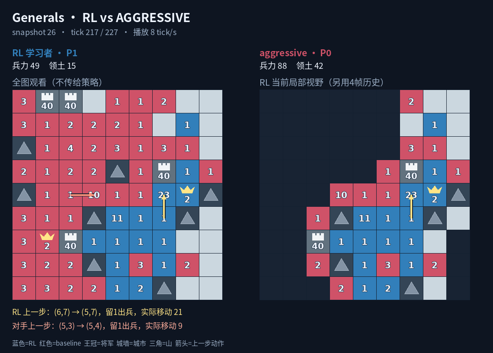

## v5：proper potential reward

配置 `rl/configs/v5.json`，先保持 v4 网络、动作、combat 特征和终局±1/tick−0.001，仅把三项 raw stats difference 改为 `gamma*Phi(next)-Phi(before)`，其中 `Phi=.05*territory+.2*cities+.001*army`、gamma=0.995。真实终止或 learner 死亡的下一状态潜能归零；超时保留实际末状态潜能，并用末状态 critic bootstrap。训练必须显式给出匹配 gamma，否则在创建输出/环境之前拒绝。

默认 `potential_gamma=None` 保留旧 reward 逐元素一致；vendor/PPO 更新和网络参数结构未改。理论对应 **terminal+tick** 基础目标的潜能塑形，不是对旧 raw difference 目标等价；旧 critic 也并非正确的潜能平移，warm-start 初期 TD/advantage 会改变。不根据理论保证胜率提升。终局±5保留为独立候选。

v5 配套开启 `task.critic_potential=true`、`policy.value_potential_offset=true`：MDP独立计算当前状态 `[N,1]` Phi，value返回 `V_head-Phi`。actor/history/原critic输入和参数维度保持不变；默认两项均关闭。任意head下，TD/GAE和clipped value residual与terminal+tick任务一致，因此这是调整优化目标，不提供额外探索奖励。old head仍需适应base目标；不宣称浮点优化轨迹bit-exact。historical pool现有签名记录新增key与policy bool，必须fresh pool；不改vendor。实现/证明/真实PPO合同：`outputs/rl_iteration_audit/potential_value_offset_prototype/README.md`。

v3/1299 的8局录像再次全 Core 回放，1828 tick精确匹配。四个失败例 aggressive/expansion/defensive/random 的旧起点折扣回报为 **+0.274/−0.004/+0.005/+0.450**，proper±1为 **−0.471/−0.514/−0.305/−0.332**；这是固定轨迹奖励审计，不是重新训练后的胜率。弱攻击多数没有直接得到正奖励，不能据此统一惩罚弱攻。详细公式/逐项账单/超时边界：`outputs/rl_iteration_audit/v3_reward_analysis/README.md`。

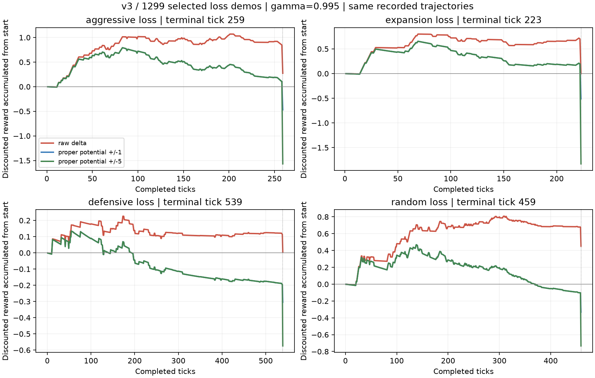

CPU 核心79项通过、1 CUDA跳过，vendor 22项通过；新增测试覆盖旧默认精确一致、自然终止/多人死亡/真实超时、telescope/TD/GAE、gamma副作用前拒绝。另用已迁移 v3 权重运行8 lane×2更新的student PPO+self-play+换图 CPU smoke，两次四 AI 子进程评估完成，loss/参数有限。episode仅8tick、评估仅12tick，不能作训练质量或吞吐结论。配置和结果：`outputs/moe_cts/iterations/v5/smoke_cpu/`。GPU长训练、实际warm-start来源和最终配置需等 v4 结果后决定。

接入value offset后root CPU核心 **82通过、1 CUDA跳过**；包含真实terminal+timeout rollout、完整原版PPO loss/模型/梯度/Adam/RNG与base任务对照，以及缺失potential key提前拒绝。再用最终候选配置做8 lane×2更新的CPU smoke和两次四AI子进程评估，无NaN/失败/积压：`outputs/moe_cts/iterations/v5/smoke_offset_cpu/`。短回合不作质量结论，真实GPU smoke待训练设备空闲后执行。

v4结束后，最终配置的真实GPU smoke已通过：256 lane×2更新、回合换图、fresh Adam/history、两次四AI子进程评估全部完成，损失有限，无失败/积压。warm-start来源为v4最终选模1299；记录 `outputs/moe_cts/iterations/v5/smoke_gpu/`。短回合8tick/评估12tick，不作质量或长期吞吐结论。

正式训练于2026-10-05 02:10 UTC启动；代码冻结于 `3ce8735a1f06dc2f41dcb1bc88605784939931b3`，reward实现 `f3aef68`、value平移 `3ce8735`。从v4/1299仅恢复权重，Adam和历史池重新初始化，网络/动作/combat保持；16,384×32、4 epoch×64 minibatch、gamma=.995、fixed LR=1e-4、episode1024、TF32 high，seed=20261009、换图池65536，训练至少1小时/最多2小时。历史池8/每50更新发布，每100更新四AI eval，完整checkpoint3/评估3+best，调用上限1M tick/环境。TensorBoard `outputs/moe_cts/iterations/v5/train/`，源码/初始化溯源 `outputs/moe_cts/iterations/v5/source_version.json`。

启动前独占GPU对比了空间CNN候选（尚未加入生产）：相同MDP、8192×32、E4/B64、pool2，各20更新，两个网络冷启动且seed相同、产生的轨迹不同，评估关闭。Dense整体/末10更新 **154,012/153,542 transitions/s**，CNN **45,363/45,354/s**；末10更新学习1.276→4.843秒，采样0.431→0.937秒。CNN参数少并未带来吞吐优势，本轮保持Dense网络。记录 `outputs/rl_iteration_audit/spatial_integration_candidate/gpu_bench_20_001/`；这不是胜率对比，也不代表16384环境/8对手的完整训练速度。

**早期99诊断，非最终结果**：选模79/86/96/95%，复用seed1001042为 **75/84.5/96/93%**（200局/AI）。相对v4最终的同赛程，aggressive38局转胜/19局丢胜，净+19/200；expansion19/12，defensive8/8，random2/11。仍未达标，也不以此宣称reward的单独因果收益。复测曲线写入TensorBoard `DiagnosticReuse/*`，明确与选模曲线和最终未见测试区分。

99的每AI一败一胜录像已Core逐tick验证，**1813 tick完全一致**；报告 `outputs/rl_iteration_audit/v5_99_failure_analysis/README.md`。aggressive败局213提前ALL拦截可撑过原死亡，回援后还需避免217再次抽兵；215后单步已无救。expansion败局军力35对181，测试的留兵/回援分支仍失败，停攻也会保留敌军原本被消耗的兵，必须用完整Core验证，不能固定敌军兵量估计救援。反事实仅证明原死亡tick生存，未声称最终赢局。

实际reward使用冻结3ce源与run_config重算：四败局proper折扣回报 **−0.520/−0.474/−0.328/−0.311**，旧rawDelta对照 **+0.137/+0.038/−0.026/+0.803**。这8个真实终止轨迹中折扣塑形项为−Phi(initial)=−0.051，恒等式误差≤2.04e−6；目标偏差修正不等于已解决提前防守和经济问题。

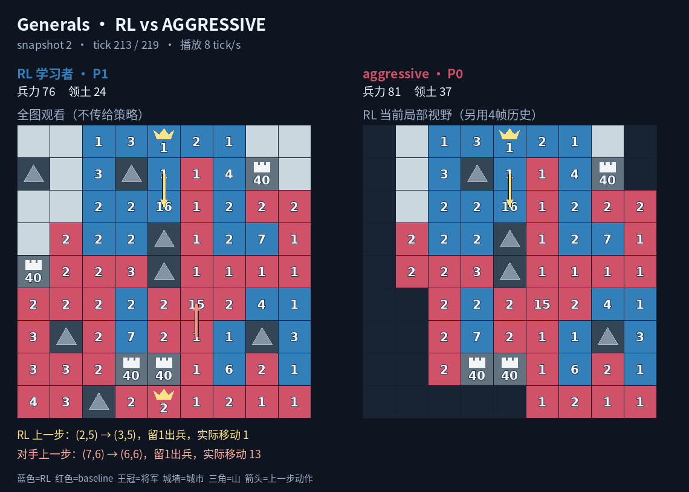

v5已完成，以 **`evaluation_plateau`自动正常停止**：最低1小时预算满足后，599之后8个选模评估点没有达到0.02提升margin，1399评估完成后在完整更新边界结束。没有跑满每环境1M tick调用上限，停止并非达标。

本轮沿用v4的Dense student PPO、combat特征和productive action，新增匹配gamma的proper potential reward与`V_base−Phi` critic平移；从v4/1299仅恢复权重，新Adam、新历史池。冻结源码 **`3ce8735a1f06dc2f41dcb1bc88605784939931b3`**，16,384环境×32 tick、4 epoch×64 minibatch、gamma0.995、fixed LR1e−4、episode1024、TF32 high、地图池65536、历史池8/每50更新发布/每100更新评估。源码和初始化依据为`outputs/moe_cts/iterations/v5/source_version.json`。

实际 **1415更新、每环境新增45,280 tick、741,867,520 transitions、2,960,156 completed episodes**（自然终止2,946,284，超时13,872）。耗时 **4543.61秒（75.73分钟）**；采样加更新 **163,847 transitions/s**，全流程 **163,277/s**；GPU allocated/reserved峰值 **14.49/14.78 GiB**。14次周期评估全部完成，failed/cancelled/running/queued均0；30次模型发布、历史池8。完整checkpoint上限3/评估3+best的保留规则继续生效，实际根训练目录仅`checkpoint.pt`与`model_0.pt`两份完整checkpoint。

最终按预定selector选择 **snapshot12/update599（每环境新增19,200 tick）**；权重`outputs/moe_cts/iterations/v5/train/evaluations/best.pt`与冻结`diagnostic/best_at_599/snapshot.pt` SHA一致：**`8cc54ea3e89429a55e735515e467a95ccf9d61ccdb0bca64ce259705297684c1`**。没有根据诊断集重新选择999或1299。

| 评估 | aggressive | expansion | defensive | random |
| --- | ---: | ---: | ---: | ---: |
| v5最终选中599，selector seed271828，100局/AI | **82%** | **87%** | **96%** | **93%** |
| v5最终选中599，复用诊断seed1001042，200局/AI | **74%** | **80%** | **97%** | **95.5%** |
| v4最终1299，同复用诊断集 | 65.5% | 81% | 96% | 97.5% |
| v5相对v4 | +8.5pp | −1pp | +1pp | −2pp |
| v5非选中999，另行诊断 | 78% | 81.5% | 94% | 96.5% |
| v5非选中1299，另行诊断 | 73% | 81.5% | 92% | 95.5% |

**尚未达标**：Aggressive74%，Expansion恰好80%，未满足“四种AI均超过80%”。Aggressive双座次均74%。诊断seed已复用多轮，不是最终未见随机种子验证；selector82%也不等同跨seed泛化。相同地图、座次和controller seed严格配对，599相对v4有33局Aggressive转胜/16局丢胜，净+17/200；本轮按所选模型的主目标视为提升，连续无提升版本计数重置为 **0**。warm start、reward/value、优化器/历史池重置和后续训练同时存在，不能把提升独立归因于proper reward。

99/499/599/999/1299的Aggressive复用诊断为 **75→72.5→74→78→73%**。999只是晚期诊断样本，未用于重新择模；1299随后回落支持结束本轮。最终selector曲线在599/699达到82%，之后约75–80%，末1399为78%；没有持续突破。

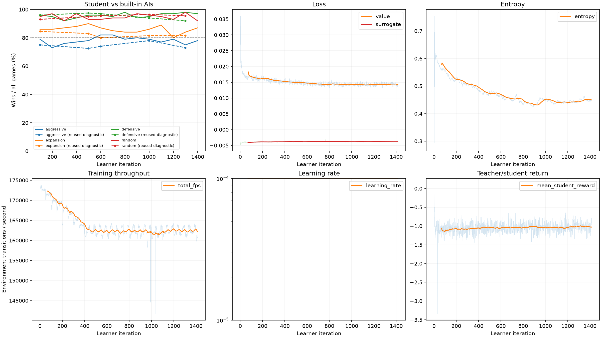

- 末100更新value loss **0.01437**、surrogate **−0.00381**、entropy **0.4498**。Value loss降低发生在新目标和value平移下，不能直接与v4数值比较来证明策略更强。
- student episode回报末100均值 **−1.021**，episode约 **252 tick**，self-play胜率 **50.83%**。该回报是新目标下的episode累计指标，不是baseline胜率，也不是录像账单的初始折扣回报，不能与v4旧reward的正回报直接比较。
- 末100更新约 **162.3k transitions/s**，采样/学习 **0.960/2.270秒**，与v4吞吐接近。WAIT **11.67%**、实际零兵 **0.449%**、立即折返 **7.22%**，后两者仍需关注；productive mask无法消除对手同tick先手导致的所有执行变化。

最终599的每AI一败一胜录像在`diagnostic/best_at_599/analysis/`，独立Core重放 **2217 tick全量状态精确一致**；审计最初写为“当前最佳、训练中”，最终summary已确认同SHA599确为本轮最终选模。详细依据：`outputs/rl_iteration_audit/v5_599_failure_analysis/README.md`。

- Aggressive败局game46/P0/261tick：54次主城出兵147兵，仅7次回援17兵，后期经济兵力也落后。259时主城26只有2、邻格16有9、可见敌34有11，仍抽城；259改16→25 ALL拦截，或259/260经17两步回援8兵，都能撑过原死亡tick，城余1。HALF拦截、单独WAIT失败；260改单步已全部无解。这里需要拦截/回援时机，不能归因为所有弱攻或折返。
- Expansion败局game315/P1/251tick：213–233连续21次反向，242把原28兵驻军ALL运出，248邻格69有30兵却继续外送；大军已在局部可见。单次242WAIT或248回援29兵仍不够，248/249/250单步穷举均无解；一个更早的六动作留兵加两路合兵分支在249达到57兵，挡住最后Core重新计算的54兵攻击，余3。分支是事后早期规划示例，不证明模型会规划或最终取胜。
- Defensive败局WAIT422/607，其中连续148tick；这张图v4与99都曾赢，599丢胜。八局为每AI中位时长定性示例，不代表全体失败频率。全部反事实固定未来双方动作选择，但重新计算增长、城市归属和兵量；只证明活过原死亡tick，不能固定原录像敌军兵量或声称最终赢局。

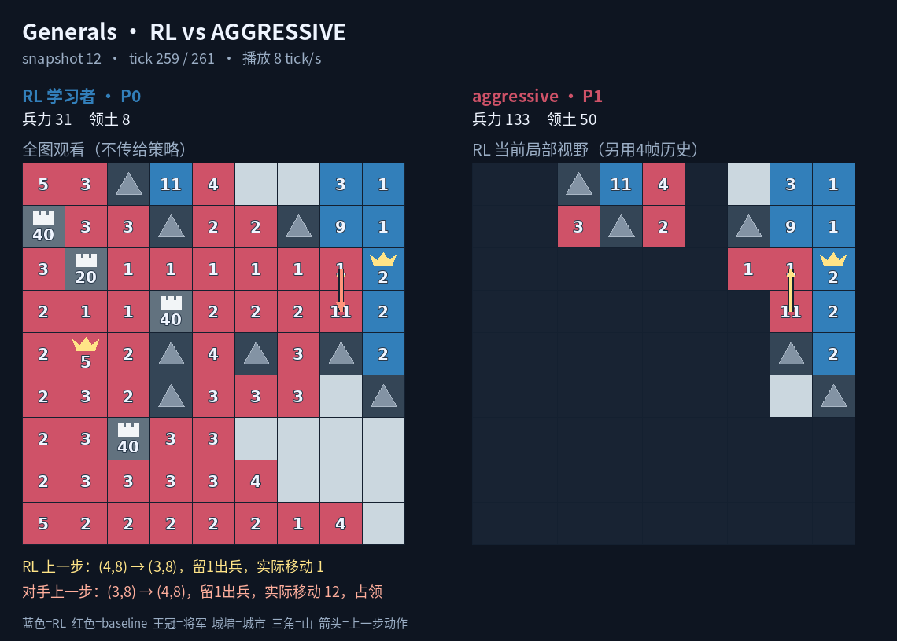

实际599 reward已加载冻结3ce源与真实run_config逐tick核对。四败局proper初始折扣回报 **−0.469/−0.480/−0.289/−0.270**，旧rawDelta同轨迹对照 **+0.048/+0.110/−0.026/+0.884**；8局自然终止的折扣塑形项都等于 **−Phi(initial)=−0.051**，最大float32误差 **2.66×10⁻⁶**。新目标账单正确，提前防守、驻军保持与经济规划仍未解决；不能用奖励数值或理论等价代替胜率证据。

TensorBoard：`outputs/moe_cts/iterations/v5/train/`，四AI复用诊断均写入`DiagnosticReuse/*`，与`Eval/*` selector区别；最终预算/资源/退出状态`train/summary.json`，曲线与末100指标`train/analysis/summary.json`，最终599复测`diagnostic/best_at_599/fresh_evaluation.json`，未选中1299另行诊断`diagnostic/late_at_1299/report.json`（SHA`62dfc047b3aded3b06de76dde25c417af45ea8919deac84527f886eedc332f6c`）。后续迭代继续以更早的战斗规划及训练对手覆盖为重点，不把本轮写成目标完成。

## v6：历史 self-play 混入少量原 aggressive（实现与启动）

配置 `rl/configs/v6.json`；代码冻结 `2d1c43071ef275efe7c4ce2ca4f1832667dbfe9f`，2026-10-05 03:41 UTC启动。单独增加训练对手覆盖：固定128/16384环境（0.78125%）使用原aggressive，另外99.21875%继续历史池self-play。默认该功能关闭，要求至少98%历史self-play；MDP、Dense student PPO、reward/value offset、gamma=.995、epoch4/minibatch64、rollout32和episode1024均保持v5。seed=20261010、self-play seed=120261010、league seed=19000043；新Adam和历史池8，每50更新发布。每100更新eval改为100maps/AI，即200局/AI，以减少小选模集的噪声；其他选模规则不变。

warm-start显式选用v5非正式选模的update999，因为复用开发诊断为78/81.5/94/96.5%；这属于开发集上的下一轮起点选择，**不修改v5正式best599或将该诊断称为最终holdout**。SHA `a5b9db4841baaf152171afe7d7a07cb68d87d5ca49e9982e430f0cc7a68921d1`。本轮开始同时发生重新训练/seed/对手池重置，因此不能把所有差异独立归因于混合对手。最低1小时/最多2小时，8点评估平台、0.02 margin，调用上限1M tick/环境；完整checkpoint3、history8、eval3+best。

- 原controller factory、局部观察、每局memory/path、NumPy随机数和绝对座次反馈均保留。双方在增长前选动作；GPU step后、reset前传回真实MoveResult。仅选中的原AI对手槽替换，保留全部历史推理以避免改动其RNG序列。`League/`记录两来源决策/episode/胜率、host耗时及native调用/fallback次数；训练内胜率不代替原AI完整赛程评估。
- 可选C++只加速原aggressive的候选枚举打分，支持当前默认9×9规则；不支持的设置回退原方法。32地图11448决策/176014 float64 score的独立CPU审计一致；原AI随机选择/path/act/反馈不搬到C++，不修改原评估AI。源码随Python wheel打包，启用时需要g++。
- 独立Core/GPUv1合同：Python/native各4lane×64tick，动态状态、terrain/tick/结束/winner、动作/结果、memory/path/RNG与reset均匹配。root86回归通过（含CUDA一致性）；256lane×2更新GPU smoke完成换图、controller重置、模型发布和两次四AI子进程eval，无NaN/失败/积压，32次native调用、0fallback。短8tick/12tick对局只验证接线。
- GPU效率主证据 `_003`：16384×32、E4/B64、八个相同冻结warm模型，各20真实更新，评估关闭，末10更新纯history **164484/s**、native128 **131410/s（−20.1%）**；采样总18.46→34.20秒、PPO更新45.33→45.45秒，额外成本来自host原AI。GPUallocated约14.48GiB且混合仅增约2MB。该固定池对照不代替真实长训练吞吐。
- `_002`另测Python128 **114283/s**、native128 **131765/s**，期间并发过小合同回归，故只作辅助性能证据；其Python/native最终模型和Adam逐tensor完全相同、81920原AI决策及10403840history决策与TensorBoard一致，支持加速不改本次完整训练轨迹。第一次`_001`漏了默认self-play配置，activation guard提前拒绝；无有效FPS，未采用该结果。
- CNN channels-last候选各8192×32×5更新，除布局外同配置，末3更新NCHW **45457/s**、channels-last **24030/s**；没有带来效率优势，未采用。两者冷启动且浮点布局可能改动作，未作胜率结论。

效率/合同/独立复审证据 `outputs/rl_iteration_audit/mixed_league_prototype/`；CNN布局 `outputs/rl_iteration_audit/spatial_layout_candidate/gpu_bench_5_001/`。TensorBoard `outputs/moe_cts/iterations/v6/train/`，GPU smoke `v6/smoke_gpu/`，冻结本轮RL/vendor及env源码、初始化SHA在`v6/source_version.json`。本轮启动时尚无胜率结论；最终结果见下文。

v6中途299候选的独立检查：selector（200局/AI）82/87.5/97.5/98%，复用诊断73/87/97.5/95.5%。在看结果之前冻结299 SHA `262748bc228ac77de8601dd3ef7f7b3e47eb2ea7d09566667822840eedf578ad`，预注册此前未用seed314159265、500maps/AI、每图双座次共4000局；全部赛程完成，胜率 **74.3/81.8/95.2/94.1%**（743/818/952/941胜，各1000局），draw分别0/41/10/9且计入分母。**未达标**，当时继续训练；最终结果见下文。该seed自此已使用，后续不能称为未见测试；本次结果不用于改选同版本候选。证据`v6/heldout/selected_299_seed314159265/{protocol.json,report.json}`，TensorBoard `Heldout/*`。299的8局Core2128tick完全一致；完整失败分析另存`outputs/rl_iteration_audit/v6_299_failure_analysis/`。

## v6：少量原版 aggressive league，正式选模没有提升（2026-10-05）

本轮保持16384并行、9×9 P2、1024tick episode、productive动作、combat观测H4、proper potential reward/critic offset、student-only PPO和8模型历史池，新增 **128条原版aggressive baseline lane（0.78125%）**，其余16256条保持历史self-play；原AI只接收原local Observation，原决策/结果反馈与绝对席位时序保留。native候选排名shim开启，本轮2320748次调用、0次fallback。冻结代码`2d1c43071ef275efe7c4ce2ca4f1832667dbfe9f`，main仍`0189d55d5ac4eb51fc53eb574ca8933e182e00ce`。初始化从开发诊断较好的**v5/999**权重开始，新optimizer和历史池；v5的canonical选模结果仍是599，不能改写为999。

PPO固定LR=1e−4、gamma=.995、lambda=.95、entropy=.01，rollout32、E4/B64：每次收集524288条样本，mini-batch8192、256次Adam更新。历史快照每50update发布，每2次发布进行100maps/AI×两席位=200games/AI的独立CPU eval；正式save_interval2000，模型/池按固定数量保留。本轮评估和训练使用的源码均冻结于上述commit，没有把后续批量观测/距离cue/lightCNN候选混入v6。

实际完成 **941次update、每环境30112tick、493355008环境转移，62.68分钟**。summary的stop_reason=`requested_stop`：root在达到约1小时、后续胜率无明确上升后主动请求停止；这是**手动平台判断**，不是自动8点plateau或预算耗尽。训练正常退出；9项scheduled eval全部completed，queued/running/failed/cancelled均0。1966313个episode完成，其中1957795自然终止、8518截断；teacher_envs=0、student_envs=16384。

预定selector以最差AI胜率→aggressive→overall选出 **canonical update299 / snapshot6**，SHA256：`262748bc228ac77de8601dd3ef7f7b3e47eb2ea7d09566667822840eedf578ad`。canonical权重及匹配配置/报告位于`outputs/moe_cts/iterations/v6/diagnostic/best_at_299/`；未按复用诊断重新选99/499/799，也未用heldout选择权重。

| AI | selector seed271828，200局/AI | 复用诊断seed1001042，200局/AI | 预注册独立seed314159265，1000局/AI | 上轮v5 canonical599复用诊断 |
|---|---:|---:|---:|---:|
| aggressive | **82%** | **73%** | **74.3%** | 74% |
| expansion | 87.5% | 87% | 81.8% | 80% |
| defensive | 97.5% | 97.5% | 95.2% | 97% |
| random | 98% | 95.5% | 94.1% | 95.5% |

独立测试在冻结canonical299后预注册，用500map/AI×双席位=1000局/AI、总4000局；**aggressive74.3%未超过80%，结论FAIL**。seed314159265现已使用，后续可以作为开发证据，不能再称未见最终测试种子。独立测试报告与预注册协议保存在`v6/heldout/selected_299_seed314159265/`；结果未用于重新择模。复用诊断本身也已经用于多轮开发，不是未见holdout。v6 canonical复用Aggressive较v5 canonical **74→73%（−1pp）**，最差AI没有提升，本轮无提升计数记 **1**；Expansion的+7pp并不意味着完成任意baseline都>80%的目标。

完整9个selector点99/199/299/399/499/599/699/799/899的Aggressive是 **75/74/82/79/79.5/79.5/77.5/78.5/80%**。复用诊断99/299/499/799为 **78/73/76.5/77.5%**；Expansion为83/87/88/87.5%、Defensive97.5/97.5/97/94%、Random95.5/95.5/97/97%。299的selector峰值没有在开发诊断或独立测试上泛化，后半段没有超过warm-start v5/999的78%开发Aggressive。晚期Defensive诊断也出现回落。正式模型始终按预定selector保留299，不用这些诊断重选。

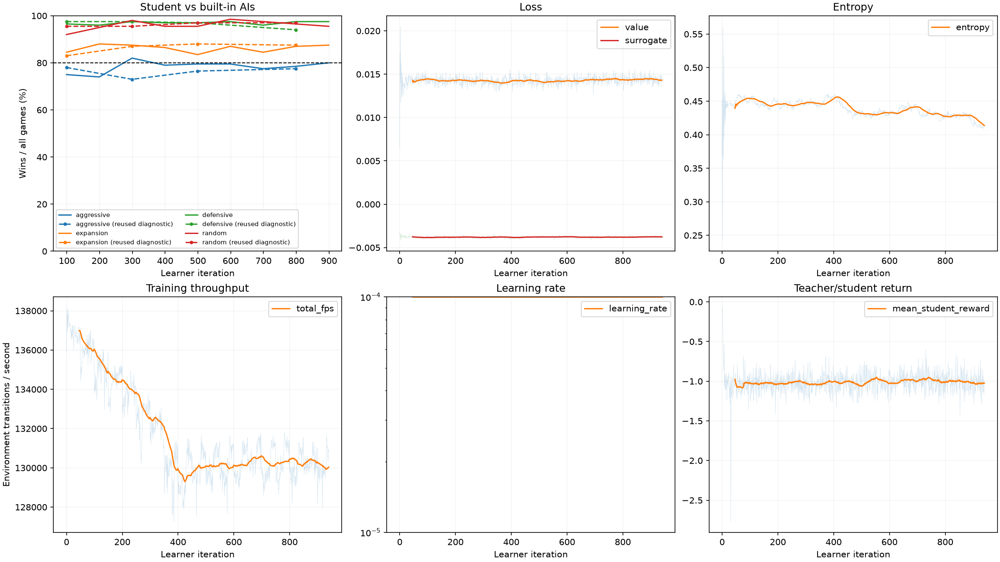

曲线重生成于`outputs/moe_cts/iterations/v6/train/analysis/curves.png`，已独立核对9项eval report、299权重SHA和99/299/499/799四个DiagnosticReuse点。首100→末100 update的value loss均值0.014285→0.014390、surrogate−0.003797→−0.003760，基本稳定；entropy0.4470→0.4216，末值0.4064，学生变得更确定，但胜率未同样改善。mean_student_reward约−0.999→−1.022，不能把proper潜势的该累计训练量当作baseline胜率。末100的league aggressive随机训练胜率均值77.42%、historical50.94%；前者是训练map/随机动作混合轨迹，后者是动态历史对手，均不能替代冻结greedy baseline eval。

速度为 **collection+update平均131671环境转移/秒，完整训练wall平均131184/秒**；末100 TensorBoard Perf/total_fps均值130207。collection1610.49秒、update2136.37秒；峰值显存 allocated **14.49GiB**、reserved **14.80GiB**。吞吐前期约137k、400update附近下降到约130k后稳定。原baseline action与result主机计时合计740.17秒，占collection46.0%、训练wall19.7%，尽管lane仅0.78125%；说明观测/原Python AI桥是后续性能优化的重要对象。计时包括本次真实训练与同机CPU评估环境，不能单独归因或外推为纯GPU基准；独立CPU批量观测候选尚未进入v6，不能把其短bridge速度算作本轮训练速度。

canonical299匹配报告生成8段中位输赢录像，CPU Core **2128tick全量重放，所有state digest一致**；实际run_config proper gamma=.995 reward账单最大float32潜势望远镜残差1.80e−6。视频：`outputs/moe_cts/iterations/v6/diagnostic/best_at_299/analysis/videos/`；完整Core/奖励/反事实证据：`outputs/rl_iteration_audit/v6_299_failure_analysis/`。这些此前冻结的299样例现在对应最终canonical权重；其他未选模型样例不混入此结论。

- **Aggressive game71/P1，259tick死**：40次出城129兵、0回援，主城≤2兵116/259tick；245–249主力约30兵在14↔15连续折返5次，251主力32兵远在15、可见敌25有21、主城仅5，又继续抽城。敌一路33→42→51→52→53→62→71，P0先运19夺城。250/251/254/257/258全部合法单动作均无法救回；251把15→24 ALL、252把24→33 ALL两步提前拦截可撑过原259tick，第一步HALF失败。保留后续录制动作并重算双方兵量，**只证明原死亡tick可避免，不证明最终获胜或策略已会规划**。
- **Expansion game396/P0，214tick死**：经济长期落后，58次出城130兵、仅9次回援24兵；196用12兵弱攻40兵中立城。末213真实局部视角中主城1、邻10有12、敌18有5，模型却搬远处1兵。Core把邻兵ALL/HALF回援即可撑过原214tick，主城余9/4；先消耗敌18也是可救动作之一。同地图v5/599和warm999均2000tick平局、v6/99输228、299输214，原本简单回援缺口没有解决。
- **Defensive game481/P1，632tick死**：145次折返、最长连续33次；终前174兵在远处1、72兵在58，主城仅7、邻70有12、敌68有11。630提前邻兵ALL/HALF回援即可撑过原632tick（余9/4），631已经来不及P0先手。敌城从未可见，last-seen记忆不能补出未知信息。Random game797也出现199次抽城、低驻军497/691tick、58/177弱攻和同地图丢胜。

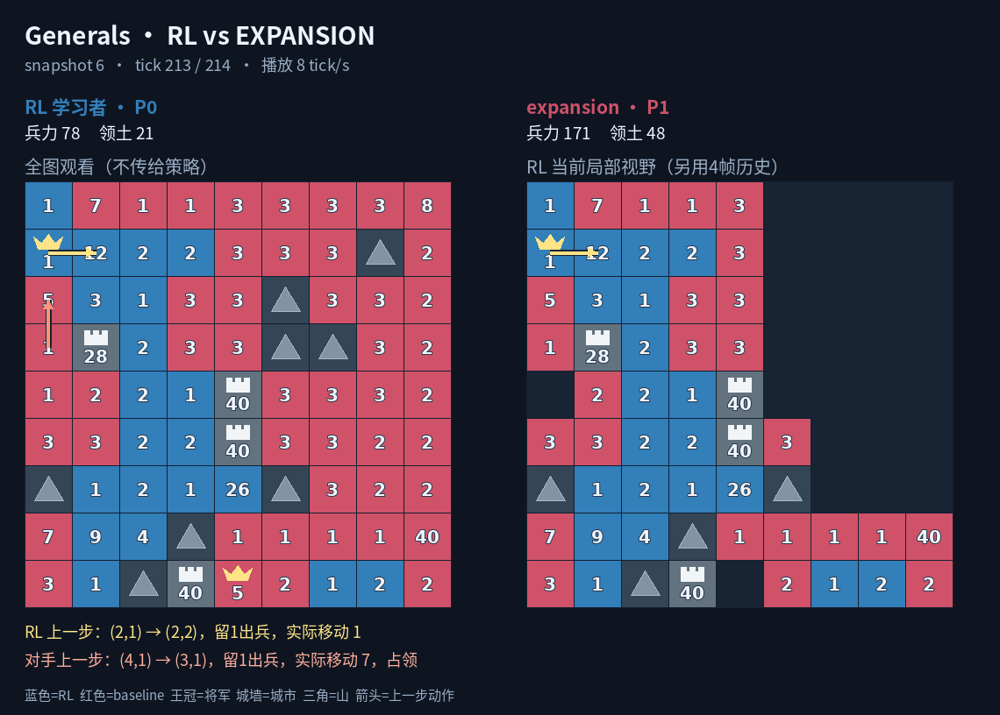

本轮确认少量原aggressive league可正常混合训练且结果反馈/Core一致，但canonical最差baseline胜率没有提升，仍需改进提前守家、驻军保留、兵力合并与局部行动规划；胜率/训练效率都需继续迭代。证据与曲线验证位于`outputs/rl_iteration_audit/v6_final_report/verification.json`。

## v7：可见敌军到己方主将的距离（实现与启动）

2026-10-05 05:08 UTC启动，配置`rl/configs/v7.json`，冻结代码`a135953ce87fdafca53bc5717bb6720f60df9cca`；main仍`0189d55d5ac4eb51fc53eb574ca8933e182e00ce`。单一MDP语义改动：用可见可移动敌军到己方主将的最近Manhattan距离/16，替换可由seat-P0恢复的冗余seat-P1标量。没有敌军或自身死亡时取1；考虑公开下一tick增长，但不考虑墙、路径或足够攻城兵量，不是强制防守规则。局部计算先屏蔽隐藏兵力，不读取敌方主将位置；单帧985/H4不变，learner/history/eval共用encoder工厂和新语义签名。reward、action、Dense网络、student PPO更新与原AI对手比例保持v6。

起点显式选择v6未正式选中的early99：复用开发诊断78/83/97.5/95.5%，属于下一轮开发起点选择，v6正式canonical仍299。原SHA`02c1c82b4acabc105283bad9583d4a60cd457ffefb7c6f86743cdb1aa0d1fd38`；五个Dense输入层的旧seat-P1权重折叠到seat-P0与bias，新距离权重初始化0；仅恢复迁移权重、新Adam/新历史池。迁移SHA`c2ea43e52c626197409d5e780a48b90ed817aab6b2e6e4159c33de557d4696ec`。2048条真实GPU观测，FP32最高精度概率/value最大差8.73e−6/1.49e−6；TF32 high最大差0.00582/0.00168，两者贪心动作翻转0、在相同源动作下环境状态精确一致。不是任意输入或TF32采样轨迹bit-exact保证。记录`outputs/rl_iteration_audit/king_threat_distance_candidate/root_gpu_migration_{highest,high}.json`。

同时加入已证明本次训练轨迹等价的性能优化`baseline_league.batched_observations=true`：批量构造原版local Observation，GPU先gather选中行，保留原类型/不可变数组/整数公共统计/原AI memory、随机数与反馈。极大army走原安全统计路径；默认关闭，不改env/vendor/评估AI。CPU独立边界/隐私/跨行审查、GPU4lane×64tick全观测/Core/结果/reset以及16k非连续选中行合同通过。16384×32、E4/B64、8个同冻结warm历史模型，各20update独占GPU、eval关闭：整体collection+update **131767→147629 transitions/s（+12.0%）**，collection34.39→25.79秒、update45.19→45.24秒，allocated/reserved峰值14.48/14.73GiB完全相同。两组最终模型/Adam、环境/history/controller及全部RNG/来源计数精确一致；该短基准不是胜率或正式长跑吞吐。证据`outputs/rl_iteration_audit/batched_observation_integration/gpu_bench_20_001/`。

Root回归93项通过（1 CUDA跳过）；生产冻结后的GPU256lane×2update smoke完成换图、原AI桥重置/32native调用0fallback、模型发布及两次四AI子进程eval，无NaN/失败/积压。短8tick episode/12tick eval只验证接线，见`v7/smoke_gpu/`；最初smoke配置plateau=0被参数守卫拒绝，改为null后正常，无生产代码改动。

正式配置16384×32、E4/B64、gamma=.995、fixed LR=1e−4、entropy=.01、lambda=.95、episode1024、TF32 high、地图池65536；128lane原aggressive，其余99.21875%历史self-play，历史池8/50update发布/100update评估100maps每AI双座次。seed20261011/self-play120261011/league19000044；至少1小时/至多2小时、8点评估平台margin=.02，调用上限每环境1M tick。完整checkpoint3/history8/eval3+best固定保留。TensorBoard `outputs/moe_cts/iterations/v7/train/`，冻结三包源码及warm SHA `v7/source_version.json`。当前尚无正式胜率结论。

下一网络候选LightCNN独立吞吐对照：三家相同配置除policy、8192×32各5update冷启动，末3update Dense/残差CNN/Light为 **154741/45486/151852 transitions/s**。Light比Dense慢约1.87%，比残差CNN快3.34倍；参数/MAC不能预测此收益，Light联合MAC反而增加约5%。各类实际checkpoint/Adam更新次数/有限值与严格CPU加载已核对，首次nvcc早退无数据已排除；无baseline胜率结论，本轮v7仍Dense。证据`outputs/rl_iteration_audit/light_spatial_candidate/{gpu_bench_5_002,gpu_review.json,performance_decision.md}`。

## v7最终结果：守城提示接线正确，仍未达标

本轮于2026-10-05 06:08 UTC以`evaluation_plateau`自动正常结束：最低一小时满足，首99评估后8个点均未达0.02提升margin。共 **982更新、每环境新增31,424tick、514,850,816 transitions、2,052,170 completed episodes**（自然终止2,043,408，超时8,762）；不是跑满每环境1M tick。9次周期评估全部完成，failed/cancelled/queued/running均0。

保持v6的Dense student PPO、productive action、proper gamma=.995 reward与critic offset、128lane原aggressive/其余历史self-play；新增KingDistance，等价批量原观测加速同时开启。16,384×32、E4/B64（每轮524288 samples、minibatch8192、256次Adam）、LR1e−4、episode1024、TF32 high、地图池65536、历史池8/50update发布/100update eval。源码`a135953ce87fdafca53bc5717bb6720f60df9cca`；从开发候选v6/99仅迁移权重，新Adam/新池，main未改。完整设置及SHA见`v7/source_version.json`与`rl/configs/v7.json`。

预定greedy selector最终选中 **snapshot4/update199**，SHA **`4f4b85a9f53f956eef04cffbecdc1c38d0f9d83b4226da6f05adb4e05c24069e`**，没有按诊断改选499。

| 赛程 | aggressive | expansion | defensive | random |
| --- | ---: | ---: | ---: | ---: |
| 最终199，selector seed271828，200局/AI | **80%** | 87% | 97% | 97.5% |
| 最终199，复用诊断seed1001042，200局/AI | **77.5%** | 82.5% | 97.5% | 98% |
| 同199，随机采样部署的复用诊断 | **73%** | 84.5% | 96% | 96.5% |
| v6正式299，同greedy复用诊断 | 73% | 87% | 97.5% | 95.5% |
| 本轮实际warm起点v6/99，同greedy复用诊断 | 78% | 83% | 97.5% | 95.5% |

**未达标**。greedy aggressive未超过80%，随机部署也无收益；本轮未开展新的未见种子测试，seed1001042已用于开发，不能称独立holdout。旧314159265已在v6使用。本轮canonical诊断Agg比先前最高canonical v5/599的74%高3.5pp，比v6正式299高4.5pp，按“正式选中模型比此前最佳canonical提升>2pp”的开发进度标准，将连续无提升计数重置为0；但比实际warm低0.5pp，不能证明KingDistance提高了策略质量。

9个selector Agg点99/199/299/399/499/599/699/799/899为 **79/80/76.5/77/79/78.5/78.5/78.5/79%**；复用诊断99/199/499/799为 **74.5/77.5/78.5/76.5%**，明显未持续突破。末100 value loss0.01441、surrogate−0.00382、entropy0.45095，稳定不等于胜率改善；WAIT11.28%、立即折返7.24%。

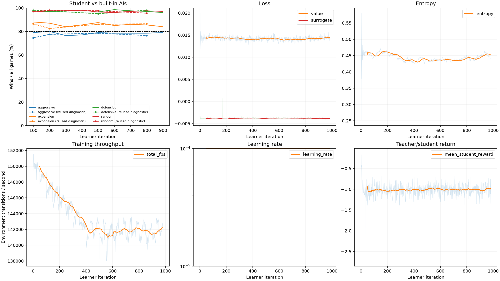

完整训练 **3603.15秒（60.05分钟）**，collection+update **143452 transitions/s**、全wall **142889/s**，末100 TB FPS均值141902。collection1358.10秒、update2230.90秒；GPU allocated/reserved峰值 **14.49/14.79GiB**。原baseline actions334.78秒、反馈26.76秒，native2430695次/0fallback。与v6整体131671/s相比快约8.9%，两轮MDP/seed/轨迹均不同，不能把这个全部归因于加速；同轨迹独占GPU基准已证明批量观测约+12%。模型按checkpoint3/history8/eval3+best固定保留，本轮仅4份开发诊断权重，未保存逐update模型。

最终199的每AI一输一赢录像位于`v7/diagnostic/best_at_199/analysis/videos/`。独立Core **2035tick全状态、proper reward、局部985/四帧KingDistance/mask/greedy动作全部一致**，潜能望远镜残差≤1.514e−6；完整证据`outputs/rl_iteration_audit/v7_199_failure_analysis/`。审计原文写“当前best、非最终”，训练summary现已确认同SHA199最终被选中。

- Agg game139/P1，死于256：236–248在主城0与邻格9间连续反向13次。253主城20兵、可见邻敌8兵，距离提示已为1/16，仍以73.06%概率ALL出城；254邻兵19可回援，但回援ALL概率仅0.0561%，继续外送。253WAIT/HALF或254回援ALL/HALF可避开原死亡。
- Expansion game290/P0，死于183：177主城19、可见敌77有23，提示被更近的2兵敌军主导，ALL抽城后主力65→66→67远离威胁；180单步回撤仍失败，但180/181连续两步回援可撑过原183tick。Defensive失败例总军604对197仍输，Random失败例486/636次邻格反向，说明守城调度和循环不能靠总兵力解决。
- 反事实固定后续双方动作选择，真实Core重新计算增长/兵量/座次与死亡；只证明活过原死亡tick，不证明最终取胜。胜局也会低驻军或ALL出城，不据此全局禁止这些动作。早期99的1939tick审计另存`v7_99_failure_analysis/`，不代替最终199。

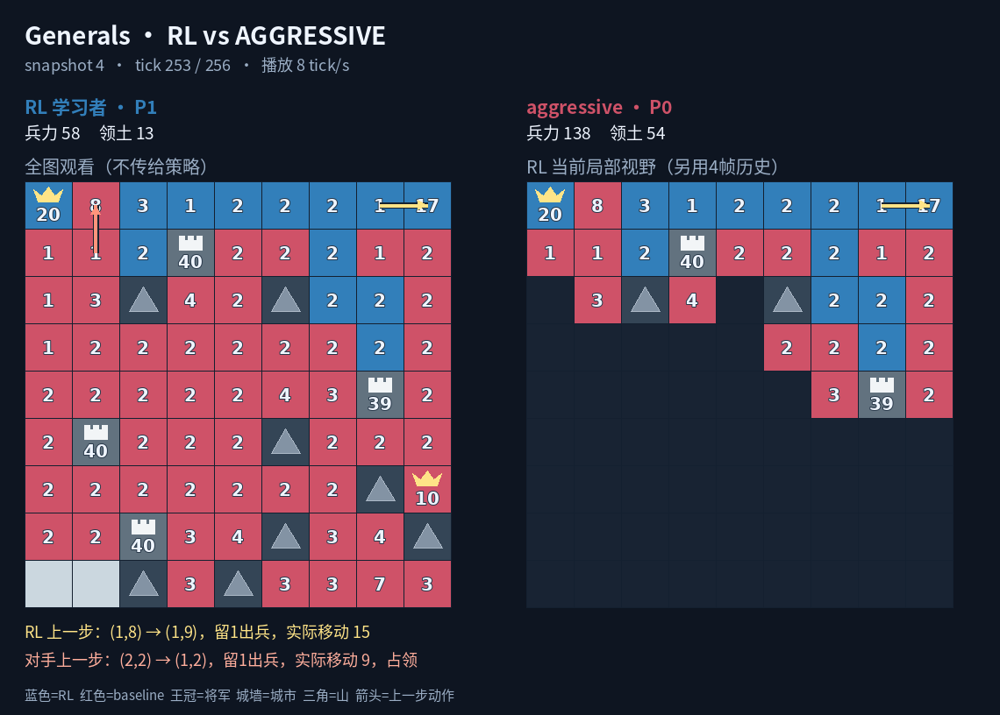

TensorBoard `outputs/moe_cts/iterations/v7/train/`；最终预算/退出`train/summary.json`、曲线及末100指标`train/analysis/summary.json`。随机部署另写`DiagnosticReuseStochastic/*`；greedy诊断为`DiagnosticReuse/*`，selector为`Eval/*`。下一项候选保持MDP/reward/对手比例，先蒸馏冻结部署student至Light CNN，再独立self-play PPO；它尚无正式胜率结论。

## v8：Light CNN student PPO（实现与启动）

2026-10-05开始，配置`rl/configs/v8.json`，冻结代码`b3a38c13474703e6d57cf22e6bd438af9214c5da`，main仍`0189d55d5ac4eb51fc53eb574ca8933e182e00ce`。保持v7的KingDistance/combat局部观测、productive649动作、proper potential gamma=.995 reward/critic offset、1024tick、128原aggressive lane和其余历史self-play。网络换为两层3×3、16通道Light CNN：actor读四帧12平面及最新13个公共标量，忽略旧公共标量与冗余single_obs；输出与原编码对应的649全局categorical logits。独立critic读当前特权观测，actor没有特权输入；15,498参数。StudentPPO继续复用未改的upstream PPO.update，vendor无新修改。

旧dense权重无法严格加载至CNN，因此先冻结v7正式canonical199 SHA`4f4b85a9f53f956eef04cffbecdc1c38d0f9d83b4226da6f05adb4e05c24069e`与历史池，进行540秒流式masked KL/value初始化：1024lane、batch512、学习率3e−4；标签来自旧部署student（is_teacher=False），对手为seed与最近3个冻结历史模型，不含baseline overlay。共27,610,112样本、53,926 Adam步；固定训练内probe actor KL1.681→1.165/value MSE.00554→.00320。KL仍高，不是精确保留函数，也不是heldout验证。蒸馏checkpoint SHA`253f7dce9af106452b00f3bbc767174796d9d873aea84eed0cdaef17cc91ad6f`，正式PPO新建Adam与CNN历史池。只保存两个CNN权重文件、不存观测数据集；蒸馏51,129 samples/s不能与PPO FPS混用。

CPU回归101项通过（1 CUDA跳过），独立SHA/原配置/权重有限值/pool seed一致性复核通过。实际16,384×32、E4/B64短训5update完成2,621,440 transitions，collection+update144,037/s，GPU峰值allocated14.40GiB、reserved14.86GiB；小轮启动/存盘令全wall仅95,347/s，不当作长跑速度。256lane×2update GPU smoke完成2048transitions、快照发布与2项CPU worker评估，failed/queued均0；短8tick episode和12tick评估仅验证接线。

正式预算每环境调用上限1M tick，最低1小时/最高2小时、8点评估平台margin=.02；16384×32、E4/B64、固定LR1e−4、gamma.995/lambda.95/entropy.01、TF32 high、地图池65536。seed20261012/self-play120261012/league19000045；history8、每50update发布，100update评估。为减少选模噪声，本轮每AI从100增至200maps、双座次共400games（seed271828）；这使selector协议与v7不同。跨版本诊断仍使用复用seed1001042、每AI200games，不称未见测试。checkpoint3/history8/eval3+best固定保留。

正式训练TensorBoard：`outputs/moe_cts/iterations/v8/train/`；蒸馏TensorBoard：`v8/distillation/tensorboard/`。源码与warm SHA见`v8/source_version.json`；实际蒸馏报告`v8/distillation/distillation_report.json`、短训`v8/ppo_gpu_gate/summary.json`、smoke`v8/smoke/summary.json`。正式胜率和曲线待本轮结束补齐，不能据架构或训练loss宣称达标。

初始化独立复用诊断（训练前CNN、seed1001042、每AI200局）**34.5/41/38.5/41.5%**，WAIT56.1%、立即折返40.1%，800局全部完成。这直接证明蒸馏未保留v7能力，不能当作等价warm start；本轮仍继续检验CNN的PPO学习趋势。TB单独记录`InitializationDiagnosticReuse/*` step0，不混入更新后selector曲线。

## v8最终结果：新随机种子四AI均超过80%，停止迭代

**目标已达到。** 在未查看本次测试结果前，冻结当时selector最佳 **update199/snapshot4**，SHA`efae62d11ffa3c726cba21b09d301675da86ae906bf1262952b29e06f9f4de7a`；预注册新seed**161803398**、9×9 P2、每AI1000随机地图、每图交换座次，共8000局。部署greedy local student、原版四种AI、最大2000tick，平局纳入胜率分母。后续出现更高selector权重，没有中途换测试模型，也没有用heldout重新选择本次候选。

| 原版baseline | 胜/2000局 | 平局 | 新种子胜率 | 名义Wilson95区间 |
| --- | ---: | ---: | ---: | ---: |
| aggressive | 1667 | 0 | **83.35%** | 81.65–84.92% |
| expansion | 1853 | 56 | **92.65%** | 91.42–93.71% |
| defensive | 1956 | 22 | **97.80%** | 97.06–98.36% |
| random | 1939 | 38 | **96.95%** | 96.10–97.62% |

全部8000赛程完成，独立复核唯一game ID、1000 map/AI×两席位、SeedSequence、胜/负/平统计与分母、权重/协议/113冻结源码SHA、严格CPU Light class载入及原版AI/main一致性。Wilson区间按局计算，双座次同地图存在相关性；预注册规则是完整赛程各AI点估计严格>80%。证据`outputs/rl_iteration_audit/v8_heldout_review/{README.md,verification.json}`、`v8/heldout/selected_199_seed161803398/{protocol.json,report.json}`。该seed现已使用，后续不能再称未见测试。

达标后root写STOP请求，训练以`requested_stop`正常退出，**574update、18,368tick/环境、300,941,312 transitions、36.14分钟**；不是耗尽1M tick/环境或自动平台停止。原计划最低1小时用于判断平台，本轮按用户“达到目标后停止”提前结束。1621754个episode完成（自然1620296/超时1458）；5项周期评估全completed，queued/running/failed/cancelled均0，GPU训练进程已退出。

本轮网络Light C16两层3×3（15,498参数），局部四帧+最新公共量actor和独立privileged critic；student-only PPO继续复用原版rsl_rl PPO.update。MDP/reward/action/league保持v7：KingDistance/combat985单帧H4、productive649动作、proper potential/critic offset/gamma.995、1024episode、128/16384原aggressive lane，其余99.21875%历史self-play。rollout32、4epoch、64minibatch（每次524288样本、mini8192、256次Adam）、LR1e−4、lambda.95、entropy.01、TF32 high、map bank65536、history8/50update发布。源码`b3a38c13474703e6d57cf22e6bd438af9214c5da`；v7 canonical199先蒸馏9分钟，正式PPO fresh Adam/新CNN池。未改本轮vendor和env/main。

正式selector最终最佳为 **update399/snapshot8**，SHA`730655a20e2acd43d130b51c8623959cca206f3503e59d1454ea9e91a82c0206`，selector **88.75/97/99.75/98.5%**；复用诊断 **88/97.5/99.5/99.5%**。它没有参加上述未见测试，**不能把199的83.35%冒记给399**。两个用途分开：

- 已验证达标模型：`outputs/moe_cts/iterations/v8/diagnostic/middle_at_199/snapshot.pt`及同目录`run_config.json`；8段开发诊断输赢录像`middle_at_199/analysis/videos/`。
- 正式selector最佳模型：`outputs/moe_cts/iterations/v8/diagnostic/best_at_399/snapshot.pt`（同SHA亦保存在`train/evaluations/best.pt`）；匹配selector录像`best_at_399/analysis/videos/`，每AI一输一赢。

初始化greedy复用Agg34.5%，说明KL没有精确保留旧策略；之后更新99/199/299/399/499的selector Agg为 **78.25/79.5/84.25/88.75/88%**，同期Expansion89.25/93.5/92.75/97/95.25%，Def94.5/97.5/97.75/99.75/99.75%，Random93.75/96.5/96.75/98.5/98.5%。复用诊断99/199/299/399的Agg **78.5/84.5/85/88%**。这是持续PPO训练中的实际上升，不能将全部提升独立归因CNN（还涉及蒸馏初始化、重新训练和seed）。末100 value loss.02674、surrogate−.000572、entropy1.08679，WAIT13.16%、立即折返7.92%；相对Dense entropy仍较高，胜率提升才是主要质量证据。

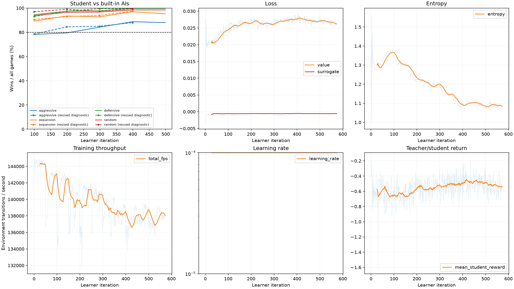

collection831.47秒/update1324.84秒，平均 **139,564 transitions/s**；完整train wall **138,782/s**，末100 TB均值137966。GPU峰值allocated **14.41GiB**、reserved **14.87GiB**。蒸馏约51,129样本/s单独计量，540秒/27,610,112标签未计入正式PPO吞吐；不能把此warm初始化耗时省略为纯从头训练。相对v7真实长跑143452/s约慢2.7%，轨迹不同，不能作单因素效率结论；换来了本轮胜率提升。128原AI lane对应2351104决策/19758局，native1384611次、0fallback；training league胜率不能替代heldout。

模型保留按既定上限：history8、完成eval权重3+best、完整checkpoint最多3；实际只1个周期checkpoint加最终checkpoint。另有**固定4份**开发诊断权重99/199/299/399，未按每update存档。蒸馏仅两个小CNN权重、不存观测数据集；本轮总体约百MB，显存/磁盘没有影响训练。新结构的CPU101回归通过（1CUDA跳过）、16k GPU5update及256lane含2评估smoke已记录在启动部分，独立源码与真实GPU/模型合同均通过。

达标199的8局 **1170 Core tick**逐state digest、local985/H4/KingDistance/mask/greedy动作、trace与真实proper reward完全复现；潜能残差≤1.953e−6。完整失败分析`outputs/rl_iteration_audit/v8_199_failure_analysis/`，早期99另有2012tick精确审计。即使总胜率达标，仍有明显失败：

- Aggressive loss101/P1：经济落后，251–327连续77WAIT，328在P0先夺城后动作被skip。晚327ALL/HALF反击均无法活过原329；没有穷举更早规划，不能声称失败必然。
- Expansion loss376/P0：148ALL抽城，149邻16有14兵、回援ALL概率39.74%，却以47.84%选择向西；随后持续外送。真实Core149ALL/HALF回援均活过原162tick，HALF也通过前沿留兵削弱敌军；不意味着最终赢局，或应统一禁止ALL出城。

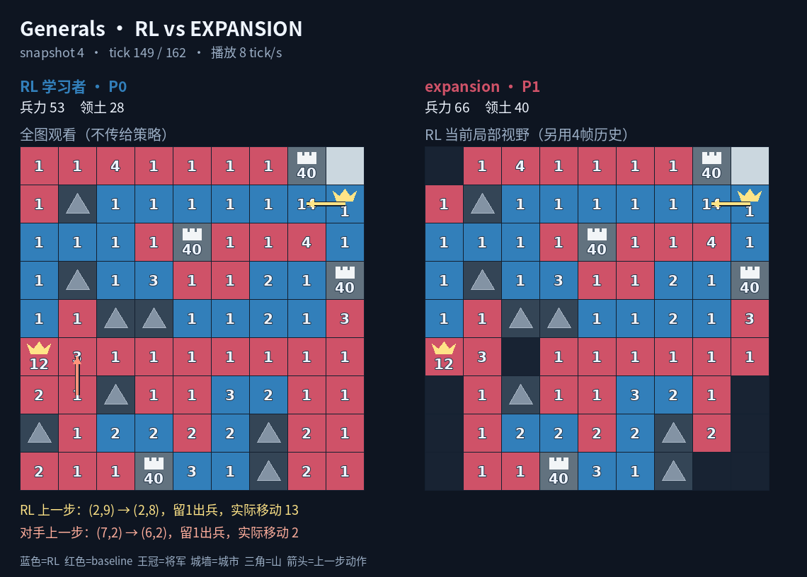

最终399最佳模型录像与失败观察单独位于`outputs/rl_iteration_audit/v8_399_failure_summary/`，8局1941 Core tick及trace/SHA/结果精确复现，不混用199的失败局或测试结论。Aggressive败局318/P0在251–327连续77WAIT，后出城再次把主力带远，335主城3兵、可见邻敌10兵仍移动远处40兵，随后被夺城。Expansion败局425/P1在326主城54、可见正上邻敌9仍ALL出53兵，327计划回援却在P0先手夺城后被skip；守城时序错误仍存在。8个中位败/胜例提供定性解释，不估计全体失败原因频率。

TensorBoard：`outputs/moe_cts/iterations/v8/train/`，`Eval/*`周期选模、`DiagnosticReuse/*`复用开发、`Heldout/*`预注册新种子；初始化和stochastic诊断有独立前缀。所有v1–v8配置、改动、结果、曲线在本文和`rl/configs/v*.json`中。迭代进度`outputs/moe_cts/iterations/iteration_state.json`，code/docs均提交至`codex_dev`，main保持`0189d55d5ac4eb51fc53eb574ca8933e182e00ce`。**当时因旧目标达到停止；随后按新的更高目标从 v9 开始随机初始化、纯历史自对弈的新阶段。**

## v9：随机初始化、纯历史自对弈参考

改动动机：此前模型使用已有权重和少量 aggressive 训练对手，无法公平衡量新方案从零学习的能力。删除 baseline league 及其专用 host/C++ 桥接（约 900 行训练与测试代码）；取消额外 critic 潜能偏移，保留标准潜能差分奖励，避免随机初始化时扩张 TD 信号被精确抵消。局部观测、productive 649 动作、C16 两层卷积与原版 PPO 更新均保留。

配置：`rl/configs/v9.json`。16,384 环境×32 tick rollout、4 epoch×64 minibatch（batch8192）、episode1024、gamma0.995、LR1e-4、entropy0.01。每轮最多3小时、至少1小时后可按12个评估点的平台停止；每100更新评估400局/AI。随机初始化 policy、全新 Adam 和历史池，全部训练对手来自当前版本的冻结历史 student。

启动前验证：CPU 97 项测试（1 项 CUDA 跳过），真实 GPU 256环境×2更新 smoke 成功，2次四AI评估完成、无失败与积压。正式规模5更新短测共2,621,440 transitions，采样加更新162,187/s，allocated14.40 GiB、reserved14.86 GiB；所有损失/参数有限。初始快照 provenance=`random_initial_policy`，没有恢复/旧池/旧权重。短测不作为训练胜率或长期吞吐结论。

正式训练代码 commit `c5a322a`，运行源码 108 文件冻结在 `outputs/moe_cts/iterations/v9/source/`；不受后续工作区改动影响。TensorBoard：`outputs/moe_cts/iterations/v9/train/`。

### v9 最终结果

1304 次更新、每环境 41,728 tick、683,671,552 transitions。采样与更新共 4422.53 秒（73.71 分钟），平均 **154,588 transitions/s**；含最后 CPU 评估等待的完整训练耗时 4760.16 秒（79.34 分钟），**143,624 transitions/s**。GPU 峰值 allocated 14.41 GiB、reserved 14.87 GiB。完成 4,530,166 个 episode，其中 25,111 为 1024 tick 截断；13 次周期评估均完成，failed/queued/running/cancelled 全为零，训练进程正常退出。

最终选模最佳 **update999/snapshot20**，模型 SHA `883f00ba5f887251f59ee90db4df3de3ae33145915783dcf2a416eedf67a9b94`；固定选模 seed271828、每 AI 400 局，胜率依次 **83.75% / 94.75% / 99.50% / 99.25%**。不满足当前更高目标，因此没有消耗新的独立测试种子。初始随机模型的复用开发胜率只有 3% / 6.5% / 6% / 7.5%，没有继承旧模型能力。

同一最佳权重在复用开发 seed1001042、每 AI 100 地图×双座次上的胜率为 **84.5% / 94% / 100% / 100%**，800 局完整完成，无平局。它与 99、499 及随机初始化使用相同赛程；不是未见测试，也不据此宣称防守与随机对手的所有地图都必胜。开发集最后两类没有输局，因此四 AI 各一输一赢的录像来自匹配同 SHA 的 **selector seed271828**，明确标注来源。

最佳权重：`outputs/moe_cts/iterations/v9/diagnostic/best_at_999/snapshot.pt`，同目录 `report.json` 为 800 局复用开发评估，`selection_report.json` 为选模评估；录像与 trace 在 `analysis/`。TB 选模使用 `Eval/*`，复用开发四个点（随机初始化、99、499、999）使用 `DiagnosticReuse/*`，两者不合并为独立测试数据。

选模 aggressive 的 13 个点为 48→73.25→78.25→77.5→80.25→81.25→78.5→76.5→76.5→83.75→75.25→72→73.75%。早期快速改善，随后没有稳定上升，999 为局部峰值。停止前 1199 点四 AI 已降至 72% / 78.25% / 95.5% / 88.75%，并出现大量超时。训练满足至少一小时后请求 STOP，以 `requested_stop` 正常结束；**不是触发连续 12 点的自动平台规则，也没有跑满每环境 1M tick**。已启动的 1299 评估完整收尾，不删除慢局或挑选部分赛程。

末 100 更新均值：value loss 0.02214、entropy 1.1127、WAIT 12.16%、立即折返 8.55%、153,553 transitions/s。1299 评估平局数依次为 0/93/11/66（每类 400 局），说明后期 expansion/random 的下降包含长时间无法结束，而不是仅输局增加；loss 下降不能替代胜率证据。

已复核 108 个冻结源码文件逐一等于 commit `c5a322a`，49 个 env runtime 文件等于 main；22 个初始模型张量与 seed20261013 的随机 constructor 精确一致，Adam state 为空，无旧模型加载。本轮独立核对在 `outputs/rl_iteration_audit/pure_scratch_phase/v9_completion_audit.{md,json}`。原版四 AI 与 env 规则没有改动。

本轮建立从零纯自对弈参考，连续无提升版本计数为 0。旧 v1–v8 的续训与 baseline league 数据只保留为历史，不计入此比较。保留池内可抽样历史权重 8 份、完整 checkpoint 上限 3、最近 3 个评估权重加 best，以及 4 份人工诊断权重；实际分别为 8/2/4/4 个文件。已从池中淘汰但仍在对局中的模型会保留引用至该局结束，退出时池与 active 合计 10 个模型，不能称显存内严格只有 8 个模型；峰值显存已包含这些引用。下一轮继续随机初始化，不加载本轮最佳模型。

中期 499 模型的 8 局 1268 tick 已精确复现 Core、局部 actor 及录制动作，分析见 `outputs/rl_iteration_audit/v9_499_failure_analysis/`。Defensive 的 363–365 tick，远处己方主力附近可见的大敌与将军无法同时进入 RF5 局部卷积，而 RF9 可同时覆盖；但 Random 220 tick 的 ALL 抽空将军在 RF5 内已有足够信息。扩大感受野只解决部分空间表达问题，不能据此保证回防或经济停滞得到解决。终局晚一步回援还可能被 P0 先斩将而跳过，需要更早规划；不加禁止出城、强制守将等规则。

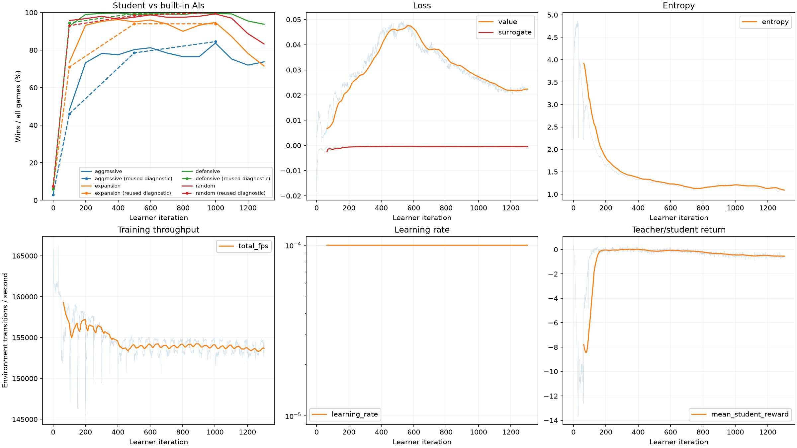

最终 999 最佳模型的 selector 输赢录像共 953 个 Core tick，状态/trace 与四帧局部 actor 动作全部精确复现，详见 `outputs/rl_iteration_audit/v9_999_failure_analysis/`。Aggressive 败局 224 在 259、271 tick 排空将军，随后继续远端扩张；Defensive 败局 1191 在 190 tick 将军 5 兵 ALL 出城，三格外已有可见敌军 21 兵；Random 败局 1225 在 68 tick 将军 7 兵 ALL 出城，三格外已有可见敌军 17 兵。后两例敌军不能直接进入将军 cell 的 RF5，但 RF9 可以。Expansion 败局 710 首 47 tick 等待，整局 112/157 次 WAIT，100 tick 领地 7 对 22；胜局也先蓄兵 28 tick，不能简单禁 WAIT。四个示例最后一 tick 的合法动作均不能救将，需要检查更早决策；这些选取案例不能估计全体失败原因比例。

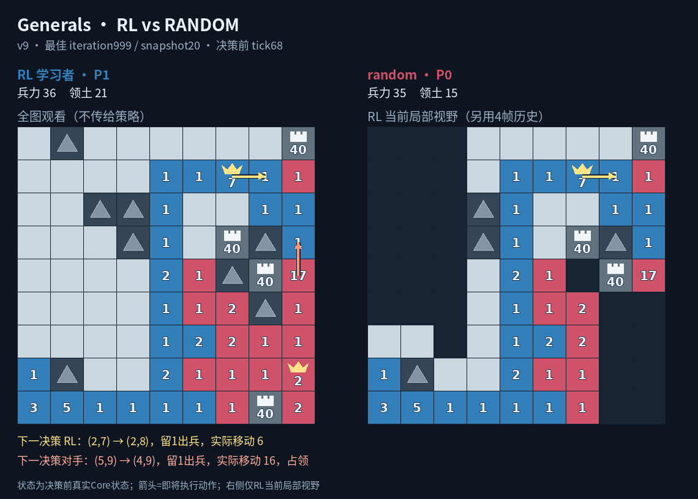

未采用的离线检查：部分 WAIT 是最大单项但概率低于 0.5，于是只对冻结 v9/999 的 CPU 实例诊断一次「WAIT≥0.5 才等待，否则选最大 MOVE」的通用部署规则。同一复用 800 局从 84.5/94/100/100% 变为 82.5/97/99.5/100%；5.63% 决策由 WAIT 改 MOVE，四类反向搬兵增加，aggressive 修复 15 局却新增 19 败。它改变部署规则而非修复分布错误，不采用、不改生产、没有新增训练版本或权重。该结果支持保留有效蓄兵，不能用统一促移动替代策略学习；证据在 `pure_scratch_phase/marginal_greedy_review.{md,json}`。另已确认 snapshot20 在后续 304 次更新始终仍可采样，只在训练结束后淘汰，不能把晚期退化归因于淘汰最佳模型。

## v10：扩大卷积感受野，保持从零纯自对弈

动机：v9 最佳模型与中期败局都出现远处主力、将军和可见敌军的位置关系无法同时进入局部卷积的问题。原 actor 已有全图 mean-pooled context 和公开总量，因此不是完全缺少全局信息；这里增加直接空间联合表达，不加 baseline 对手或守将规则，也不宣称能解决所有失误与等待停滞。

具体改动：`LightSpatialPPOPolicy` 增加 `spatial_dilation`，默认 1 与旧版权重、logits、value 逐位一致。v10 的第二层 actor/critic 3×3 卷积 dilation/padding 设为 3，第一层仍为 1；直接感受野 RF5→RF9、连续半径 2→4，无采样空洞。棋盘中心可覆盖整张 9×9，角落仍只覆盖到距离 4，并非所有位置都看全图。参数保持 15,498，动作/历史输入/特权边界和原版 PPO.update 不变；历史池配置签名区分新结构。

配置 `rl/configs/v10.json` 相对 v9 仅改 `run_id` 与 `runner.policy.spatial_dilation=3`。固定相同训练种子 20261013、历史池种子 120261013；16,384×32、4 epoch×64 minibatch、gamma.995、lambda.95、entropy.01、LR1e−4、episode1024、无 critic 潜能偏移。随机初始化 actor/critic、fresh Adam、独立新历史池，不加载 v9；上限每环境 1M tick/3 小时、至少一小时后检查平台。仍每 100 更新四 AI 各 400 局、相同 selector 与复用开发赛程。

启动前验证：98 项 CPU 回归通过（1 CUDA 跳过），新增测试测量 actor/critic 中心和角落的真实梯度覆盖；默认 dilation1 精确兼容、dilation3 的 actor 隐私、mask、概率和值有限。256 环境×2 更新 GPU smoke 完成 2048 transitions、2 次 CPU 评估与历史池发布，failed/queued/running 全为零；仅验证接线，不以 12 tick 评估胜率判断能力。正式 16384×32 的 5 更新短测完成 2,621,440 transitions，采样加更新 **161,544/s**，allocated14.40 GiB、reserved14.86 GiB；v9 同规模短测162,187/s，差约−0.4%，非长期性能结论。门禁与日志在 `outputs/rl_iteration_audit/pure_scratch_phase/v10_*`。

正式代码 commit `b591ed9`，108 文件冻结在 `outputs/moe_cts/iterations/v10/source/`。TensorBoard 保存于 `outputs/moe_cts/iterations/v10/train/`。

### v10 最终结果

1084 次更新、每环境 34,688 tick、568,328,192 transitions。采样加更新 3657.51 秒（60.96 分钟），**155,387 transitions/s**；包含最后 CPU 评估收尾的全流程 3957.62 秒（65.96 分钟），**143,604 transitions/s**。显存峰值 allocated 14.41 GiB、reserved 14.99 GiB。完成 3,035,996 个 episode，其中 29,963 个为超时截断；10 次周期评估全部完成，failed/queued/running/cancelled 为零，训练进程正常退出。

最终按预定 selector 选择 **update399/snapshot8**，SHA `2975b1df2ccb5ce87738b02f811b24293e610d22bc170df6bfb42d10217aa363`。没有依据开发集另挑模型，也没有消耗新测试种子。

| 评估 | aggressive | expansion | defensive | random |
| --- | ---: | ---: | ---: | ---: |
| v10 最佳399，selector271828，400局/AI | 81.5% | 91.75% | 99.75% | 96.5% |
| v10 最佳399，复用开发1001042，200局/AI | 77.5% | 94% | 99% | 96.5% |
| v9 最佳999，同开发赛程 | 84.5% | 94% | 100% | 100% |

aggressive 的十个选模点为 42.75→63.5→74.25→81.5→75.25→79.25→77.25→71→52.5→53.25%。峰值之后没有持续提升，最后两点四类共同下降；999 的 expansion/random 平局为 158/102（每类400局）。完成最低一小时预算后人工请求 STOP，按完整更新保存并排空评估，**不是自动触发12点平台，也没有跑满1M tick/环境**。停止依据在 `train/stop_rationale.json`。末100更新 value loss0.01652、entropy1.08725、WAIT14.78%、反向搬兵6.04%、154,893 transitions/s；训练loss下降没有对应更强的部署胜率。

同赛程开发比较未改善，连续无提升版本计数 **1/20**，参考仍为 v9。扩大感受野不保留为下一轮训练设置；下一轮回到 dilation1。v10 全轮采样加更新比 v9 约快0.5%，但轨迹和实际预算不同，不能据此宣称结构改善计算或胜率。模型保持 bounded：实际完整checkpoint2、pool8、eval3+best、人工诊断3，共17个权重文件；退出时淘汰模型仍有正在对局的引用，其资源已计入峰值。没有修改 env 规则或四个 baseline。

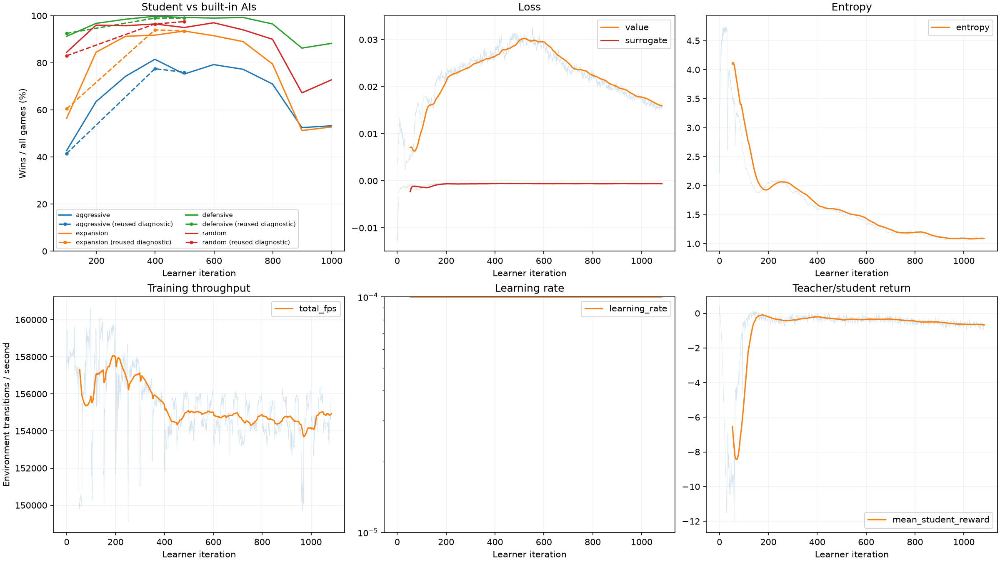

最终399的8个输赢录像均来自同一开发赛程，保存于 `outputs/moe_cts/iterations/v10/diagnostic/best_at_399/analysis/videos/`；1986个Core tick、frames、trace与四帧local actor动作精确复现，MP4经ffprobe核对。三个版本内诊断点99/399/499已分别记录到 `DiagnosticReuse/*`。完整失败证据在 `outputs/rl_iteration_audit/v10_399_failure_analysis/`：

- defensive 败局504有590/712次相邻反向（82.9%），最长连续270次；将军和邻格反复搬同一批兵，300tick仍只有5格领地，兵力134对248。RF9没有解决循环。
- expansion 败局283在300tick兵力110对102、领地38对31，仍持续ALL输出将军，302tick失守；301tick源格的RF9已同时包含将军和近敌，不能归因于卷积看不到。
- random 败局686在460tick将军11兵ALL出城，461tick继续向外搬。末tick仍有4个合法回援动作可撑过原死亡时刻，但策略未选；该单步反事实不证明最后能赢。aggressive败局125则需更早改善经济或协调，最后一步已无救将动作。

这些八局是定性样例，不能估算全体失败频率；胜局也有等待和往返，不统一禁WAIT、反向或ALL。下一轮只改善己将空间关系的表达，并以精确等价的存储瘦身降低内存；不混入baseline对手、不加载旧模型。

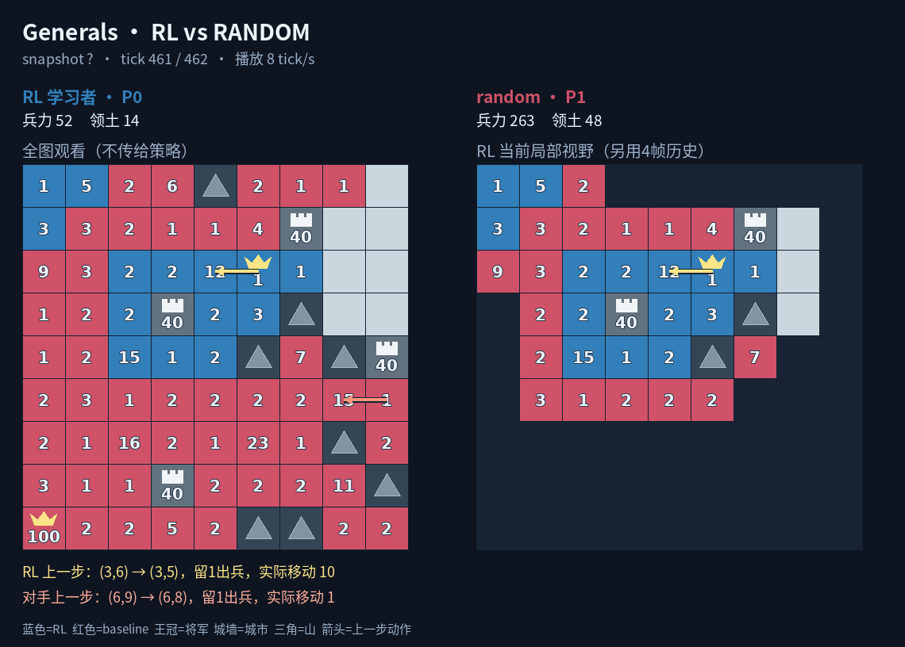

## v11：己将相对坐标与等价存储瘦身

动机：v10 的RF9没有提高最终选模能力，回防错误在可见威胁已进入卷积视野时仍发生。回到v9的RF5，仅帮助局部卷积表达「当前兵源相对己将的方向和距离」，不使用攻击对手规则或动作禁令。v10示例也有经济落后和循环，坐标并不保证解决这些问题。

具体改动：actor 首卷积前可选追加己将相对dx/dy两平面，除以8归一化，由最新局部self与general标记的交集推导；缺失或多个标记时为0，不读取critic、隐藏敌将或旧模型。默认关闭与原Light逐位兼容；开启参数15,498→15,786（增加288），critic随机初值和计算保持。MDP单帧985/四帧3940、动作649、reward不变，历史池签名记录 `own_king_geometry=true`。

计算侧：vendor runner仅增加可选 `storage_obs_keys`，策略构造和live obs保持完整；v11只保存policy、critic、bool action_mask，省掉CNN不读取的single_obs。16384×32少1.924 GiB存储、每个4-epoch更新少7.695 GiB重复单帧索引物化；原版PPO.update、GAE和采样保持。默认MoE CTS完整存储不变，最小patch记录在 `rl/vendor/rsl_rl/PATCHES.md`。真实CPU self-play含timeout的完整/None/子集三组采样、GAE、loss、权重、Adam、RNG逐位一致。

配置 `rl/configs/v11.json` 相对v9只改变run_id、actor坐标flag和storage键。保持训练seed20261013、poolseed120261013、N16384×T32、4epoch×64minibatch（8192）、gamma.995、lambda.95、LR1e−4、entropy.01、episode1024、均匀历史池8、每50更新发布/100更新四AI各400局。全部从零初始化policy、fresh Adam与新历史池；不加载v9/v10。每环境1Mtick为上限，至少1小时/最多3小时，根据曲线和真实失败再决定停止。

验证：104项CPU测试通过（1CUDA跳过）和vendor22项通过；几何覆盖latest/缺失/多标记/dtype、默认兼容、actor隐私、critic不变、新坐标权重的有效梯度以及历史池拒绝旧结构。GPU smoke256×T4两次更新2048transitions，历史池发布及2次四AI评估完成，无失败/积压。正式规模5更新短测2,621,440transitions，采样加更新 **151,737/s**，allocated **12.56 GiB**、reserved **13.42 GiB**；较v9相同5更新短测162,187/s约−6.4%，显存下降约1.84 GiB。存储瘦身并不等于整个方案提速，坐标计算与不同随机轨迹均有成本；短测不判断最终能力或长期吞吐。门禁证据在 `outputs/rl_iteration_audit/pure_scratch_phase/v11_*`。

正式代码 commit `4bf441b`，108个runtime文件冻结于 `outputs/moe_cts/iterations/v11/source/`。正式进程从配置启动，无warm/resume/distillation。TensorBoard：`outputs/moe_cts/iterations/v11/train/`；门禁和初始随机快照证明已保存，最终结果与完整曲线在本轮结束后补齐。

### v11 最终结果

正常 requested_stop 结束：完整 **1,071 次更新、每环境 34,272 tick、561,512,448 transitions**，完成 3,775,593 局（终局 3,750,803、timeout 24,790）。每环境1M为预算上限，实际约65分钟后停止；十次选模评估已全部完成，无失败、积压或取消。499之后未有持续提升，达到至少1小时后人工触发正常STOP，**没有触发配置中的12点评估自动平台条件**。最晚999点虽较899回升，但仍低于499的aggressive，不把单次回升称为持续趋势。

采样 1282.185s + 更新 2618.360s = 3900.544s，**143957 transitions/s**；包含收尾的全流程 3914.553s（65.24分钟），**143442/s**。GPU峰值allocated **12.567 GiB**、reserved **13.756 GiB**；主进程峰值RSS **2.201 GiB**。相比v9长训练154588/s，本轮采样更新速度约降低6.9%，同时省显存；不宣称坐标计算或storage瘦身提高整个方案吞吐。末100更新FPS 142391、WAIT 13.59%、相邻反向 8.24%、value loss 0.02428、entropy 1.0959；这些是随机历史自对弈指标，不能直接等同baseline确定性部署行为。

| 更新 | aggressive | expansion | defensive | random |
| ---: | ---: | ---: | ---: | ---: |
| 99 | 45.25% | 74.50% | 94.25% | 95.75% |
| 199 | 73.75% | 92.75% | 97.50% | 97.50% |
| 299 | 79.50% | 96.00% | 99.00% | 97.50% |
| 399 | 82.25% | 95.75% | 99.75% | 96.00% |
| 499 | 83.50% | 97.25% | 99.25% | 96.75% |
| 599 | 81.50% | 97.00% | 99.50% | 97.75% |
| 699 | 80.75% | 94.50% | 99.50% | 98.00% |
| 799 | 79.00% | 94.50% | 98.75% | 98.25% |
| 899 | 75.25% | 94.75% | 99.50% | 99.50% |
| 999 | 82.25% | 97.25% | 98.75% | 99.50% |

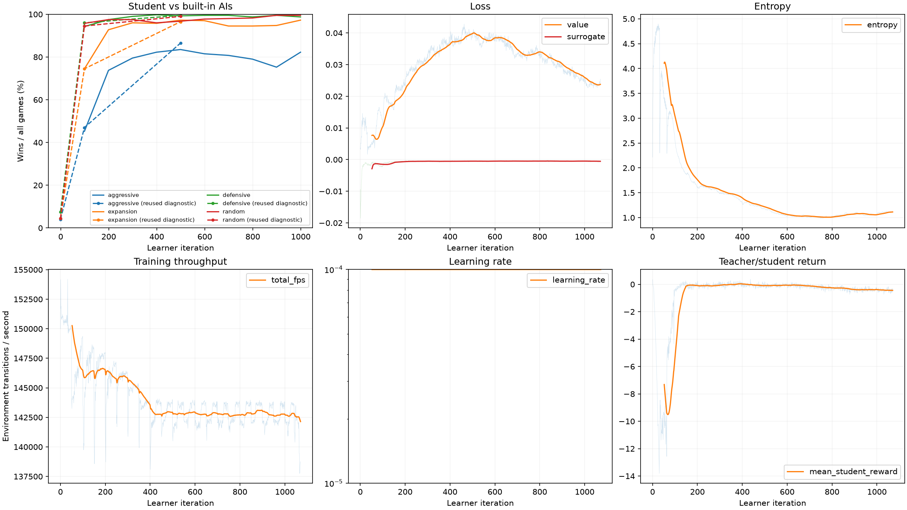

最终最佳 **snapshot10 / update499**，每环境16000tick；SHA256 `768150ef7359bd5fd2861adbe35758de8712343f8ce339e464e9cda473f5e5e7`。选模 seed271828 每AI400局：**83.50 / 97.25 / 99.25 / 96.75%**；重复开发 seed1001042 每AI200局：**86.50 / 96.50 / 99.50 / 99.00%**，各AI胜/负/平173/27/0、193/7/0、199/1/0、198/2/0。两套赛程都非新测试；没有消耗新的held-out seed。四目标未全部满足，任务继续。

相对v9最终最佳相同dev赛程84.5/94/100/100%：+2/+2.5/−0.5/−1pp；归一化最低值由0.938889升至0.961111、均值0.990475，按事前规则重置连续无提升版本数为0，并作为新冷启动参考。200局/AI下点估计有方差，不能据此证明因果或显著改善；相同更新499的v9为78.5/94/99.5/98.5%，也保留进度配对比较。v10 RF9未改善，v11回到dilation1。

最佳499的真实dev录像直接复用中期保留的同一权重和同一800局报告；没有重复评估或复制第四份模型。八局1053tick全部Core/局部actor/几何逐tick一致，22关键时刻独立复核；各AI输赢一局共8段MP4、4311帧、4.19MB，FFprobe和SHA校验通过。录像及报告：`outputs/moe_cts/iterations/v11/diagnostic/middle_at_499/analysis/`；独立分析：`outputs/rl_iteration_audit/v11_499_failure_analysis/`。原中期说明保留，另加最终best确认。

最佳失败例显示：aggressive在207回援、208WAIT后，209仍将己将9兵ALL移走，可见20/7兵威胁已经在RF5内；WAIT/HALF替换可活过原211死亡。random在43己将6兵ALL出动后50死亡，WAIT/HALF也可避开原死亡。expansion在189有先手23→14截杀来兵的两种保命动作却未选中；defensive唯一dev败局长期4地停滞、400tick中244WAIT，最后已无法用单次动作救回。分支后双方动作固定，只证明原死亡可避免，不证明最终获胜。赢局也普遍先WAIT40–47tick再迅速斩将，因此不采用统一WAIT惩罚。

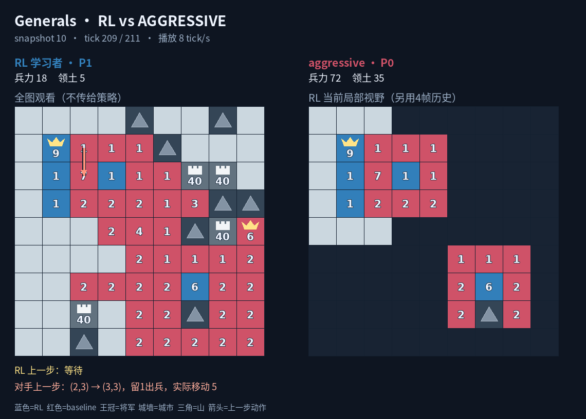

保留人工模型initial/99/499共3份、完整checkpoint至多3、eval最近3+best、可分配历史8。淘汰但对局尚未结束的历史模型继续引用至本局结束，不能将pool8误读为所有活引用永远≤8。代码冻结108文件仍为4bf441b，env49文件与main一致；初始22张量为同seed随机构造、fresh Adam，训练无baseline对手。TensorBoard：`outputs/moe_cts/iterations/v11/train/`。

## v12：增加并行样本量，保持其余训练方案

动机：v11的己将方向信息改善开发集，但可见威胁下的驻军保持和先手拦截仍未稳定学会；暂不增加奖励规则或面向baseline的动作限制。利用storage瘦身释放的显存，验证更广的并行经验、较大单次PPO样本量能否继续改善能力。

具体改动只有 `task.num_envs:16384→24576` 和 `run_id:v12`，配置 `rl/configs/v12.json`。保持32tick rollout，**786432 samples/update**、4epoch×64 minibatch、**12288 samples/minibatch**、256个Adam step/update；seed20261013、poolseed120261013、己将geometry、C16/RF5、三键storage、gamma.995、lambda.95、entropy.01、LR1e−4、episode1024、MDP和纯历史模型池均不变。每次更新样本增加50%，但每个transition获得的optimizer更新次数也改变，因此这不是只提升硬件利用率的中性改动。完全随机初始化、新Adam、新历史池，不加载v11最佳。

计算门禁：相同seed随机初始化的正式尺度5更新 **3932160 transitions**，采样7.713s+更新19.673s，**143583/s**；allocated **18.806 GiB**、reserved **20.322 GiB**。相比N16384同条件短测151737/s约−5.37%，不宣称提速；采样广度与每个更新的样本量增加，最终胜率和长期吞吐仍由完整训练检验。

压力门禁仅在outputs运行：episode32、每更新发布、10更新 **7864320 transitions**、245689个timeout，末tick24509/24576 done；最初与最后均为12288/12288座位。历史池8，原joint_actions完成后实际执行过双座各8个ID（新ID仅1/2lane，不声称均衡压力）。rewards/values/returns/advantages/logprob、loss和参数均finite。262次设备采样最低空闲 **2369MiB（2.313GiB）**；Torch峰值allocated **18.822 GiB**、reserved **20.072 GiB**。压力测不是正式训练速度或强度比较，最终assignment也不被冒充为已执行证明。normal/stress均budget正常exit0，初始22张量与v11正式随机构造逐位相同；stress仅因episode签名不同而文件SHA不同。只读observer首次误写类名而在import阶段失败，保留错误日志后修正；未发生训练或生产代码故障。

证据：`outputs/rl_iteration_audit/pure_scratch_phase/v12_n24576_*`。生产runtime与v11完全相同，因此复用已通过的104项CPU（1CUDA跳过）和22项vendor测试，不为纯配置重复整套测试；真实大批量GPU短测覆盖本轮变化。正式eval恢复默认开启，每100更新四AI各400局；每轮至少1小时、最多3小时，每环境1M为上限。保留池8、checkpoint3、eval3+best、人工诊断至多4份；曲线无持续改善时正常停止并等eval闭合，之后补最终结果、曲线和最佳失败录像。

正式v12代码 commit `e87cfba`；108 runtime文件冻结于 `outputs/moe_cts/iterations/v12/source/`，逐位等同v11 runtime。PID2314987从配置启动，初始snapshot0 SHA `a48be4a5bcedecb41600a5468792a035731e43431baba41f6e422723c3b264f2` 的22张量与独立CPU随机构造逐位相同、fresh Adam，无warm/resume。独立启动审计和N24576运行门禁均PASS。TensorBoard：`outputs/moe_cts/iterations/v12/train/`；最终结果待本轮完成补齐。

### v12 最终结果

正常 requested_stop 结束，**666更新、每环境21312tick、523763712 transitions**。完成3,815,643局（3,779,864终局、35,779timeout）；全流程 3664.601s（61.08分钟）。采样 1091.011s + 更新 2560.300s，**143445 transitions/s**；包含收尾 **142925/s**。allocated **18.811 GiB**、reserved **20.326 GiB**，峰值RSS **2.200 GiB**。长训练采样+更新速度较v11仅约−0.36%，没有吞吐提升；短测−5.37%不能替代实际长跑结论。

六次选模均完成、无失败/积压/取消。第299更新后aggressive连续80.5→78.75→77.25→75.75%，其它AI也未持续改善，超过最少1小时后人工正常STOP；**未触发12点自动平台条件**，1Mtick/env是上限。末100更新FPS 142817、sampled learner WAIT 24.02%、反向 8.02%、value loss 0.03900、entropy 0.9591，不能将这些直接当作历史对手/部署统计。

| 更新 | aggressive | expansion | defensive | random |
| ---: | ---: | ---: | ---: | ---: |
| 99 | 52.75% | 74.75% | 93.00% | 95.25% |
| 199 | 78.50% | 92.25% | 99.50% | 96.00% |
| 299 | 80.50% | 95.00% | 99.75% | 98.25% |
| 399 | 78.75% | 94.75% | 98.50% | 96.00% |
| 499 | 77.25% | 94.50% | 99.25% | 96.75% |
| 599 | 75.75% | 93.50% | 99.50% | 96.50% |

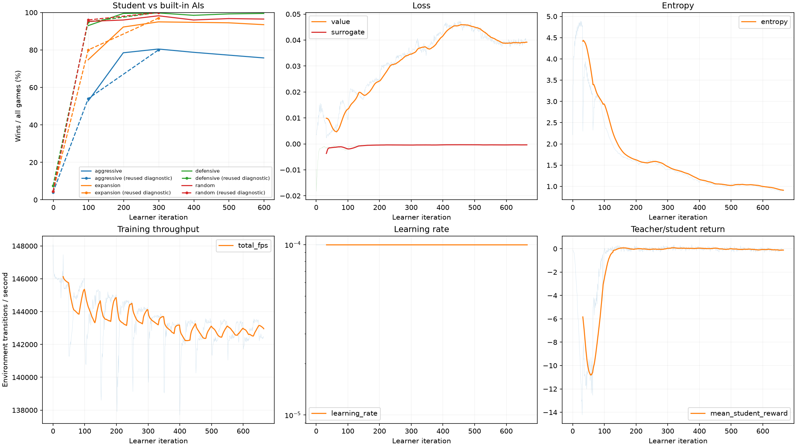

最终最佳 **snapshot6/update299**，每环境9600tick、235929600 transitions，SHA256 `2f38d15292828ad739973a35a63739b3bcf10b896bf5276751519f714cd0d0d9`。selector seed271828每AI400局：**80.5 / 95 / 99.75 / 98.25%**，全无平局；reused dev1001042每AI200局：**80 / 97 / 100 / 100%**，胜/负/平160/40/0、194/6/0、200/0/0、200/0/0。无新的held-out种子被消耗，未达当前目标。

相对v11最终best的相同dev86.5/96.5/99.5/99%：−6.5/+0.5/+0.5/+1pp；最低归一化进展0.961111→0.888889，均值0.977485，不满足事前改善规则。连续无提升版本数 **1**，参考仍v11。更大batch早期Agg更好，随后没有抬高峰值；不能由此推断所有并行扩容都无效，但本次不保留N24576为下一轮默认。原环境数参数本来可配置，版本配置保留便于复核；下一轮回到已验证的v11 N16384。

复用现有best_so_far_299人工副本，没有新权重/重评估。八MP4中6局来自dev，因dev Defensive/Random无败局，另外2局仅从**同一299模型现有selector**中挑真实败局；逐局记录seed/report/座位，**不合并这两局进800dev胜率**。985ticks/993states全部Core/local actor/geometry/privacy/mask精确，独立198关键MOVE核对；8MP4共4107帧、4.17MB，ffprobe/SHA通过。目录：`outputs/moe_cts/iterations/v12/diagnostic/best_so_far_299/analysis/`；独立报告：`outputs/rl_iteration_audit/v12_299_failure_analysis/`。保留人工99/299两份，池8、checkpoint≤3、eval3+best，活跃淘汰历史引用至局结束。

最佳299失败行为：aggressive有62次相邻反向、最长31次，经济落后且主力离将；expansion开局WAIT27、经济落后并把主力放到远端；defensive总兵近均衡但局部集中不足，先手夺将；random有143个非连续WAIT、0反向、15次对可见敌弱攻，己将东/南出口是可见中立平原，不能说地形封死。有限Core反事实里Agg183WAIT/HALF或184回补可活过194、Exp174WAIT/HALF或175回补可活过186；Def130WAIT/131回补可活139，HALF不行；Rand218WAIT/HALF/219回补仍死221。保留驻军也会减少上游防守，改变敌方实际出兵5→8，不能静态算一次兵数就推出通用守将规则。后续双方动作固定，仅证明原终局时刻的局部分支，绝非新的胜率或可保证获胜策略。

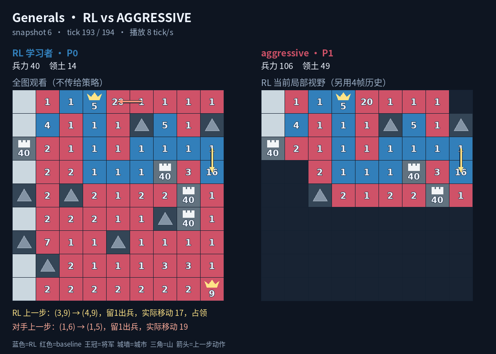

TB额外记录initial参考、99、299的DiagnosticReuse；initial引用v11已测数据，因为原始22张量、MDP/策略签名、源码和权重SHA都完全相同，**不是新v12评估**，也没有把旧权重加载到learner/pool。正式108源码为e87cfba、与v11逐位相同，env49仍main0189；独立completion audit PASS。TensorBoard：`outputs/moe_cts/iterations/v12/train/`。

## v13：历史对手使用部署 argmax，learner 保持 PPO 采样

动机：v12增大并行样本没有提高最终能力，回到v11 N16384。最佳真实败局仍有驻军/集结、折返和长期等待；这些不是仅用一个WAIT惩罚或静态兵数规则就能修复。尝试让learner面对历史模型的部署形态，接触更稳定的攻击或静止防守，而非仅面对其随机采样行为。不使用baseline对手，不改变部署规则，也不假定greedy历史一定更强。

具体改动：完整配置 `rl/configs/v13.json` 相对v11 **只有run_id和self_play.stochastic:false**。learner仍Categorical.sample、原版PPO更新和critic/GAE，历史对手调用现有Light `act_inference` 的masked649联合argmax。整局固定、uniform抽池、初始随机模型+近期7、每50更新发布、两座历史仍不变。N16384×T32=524288 samples/update、4epoch×64mini（8192）、256Adam步；MDP/reward、gamma.995/lambda.95、C16/RF5/己将坐标、三键storage、LR1e−4、entropy.01、episode1024保持。没有新runtime/vendor补丁或额外策略参数。

完全随机初始化、新Adam和新池，训练seed20261013/poolseed120261013保持；不加载v11/v12模型。历史argmax不消耗其动作抽样RNG，reset抽池仍随机，但其后同seed抽池序列会变化，因此两轮不是逐局同轨迹。learner自身采样与部署argmax的差别仍存在；1024训练timeout/2000评估上限也保持。greedy随机初始模型可能被动、降低行为多样性；是否改善由完整评估曲线及真实失败判断。

GPU smoke实际N256/T4、episode4、2epoch×4mini、pool2/pub1/eval1，**3更新3072transitions、768timeout**，3/3 eval全部完成无失败/积压。只读observer核对12个原joint_actions调用deterministic=True、对手generator调用内完全不变；第三rollout实际执行learner_update iteration0的历史ID1，两个绝对对手座位均有样本。无extra inference、动作/RNG/算法更改；reset在调用之外仍可抽池。之所以3更新而非2，是第二rollout末才分配已训练模型，不能拿最后assignment冒充执行。该observer仅outputs验证工具，不进入生产。

正式规模5更新2621440transitions：采样5.178s+更新12.246s，**150447/s**，全wall26.795s/97835s⁻¹；allocated **12.563 GiB**、reserved **13.422 GiB**。较v11相同短测151737/s约−0.85%，不宣称提速。该bench只面对初始历史，不是成熟池8或长跑强度证明。loss、模型/Adam有限，metadata从random_initial_policy开始；CPU104项（1CUDA跳过）与vendor22项及现有False接口回归均沿用，不为单个现有bool重复整套测试。门禁：`outputs/rl_iteration_audit/pure_scratch_phase/v13_greedy_*`。

正式eval默认开启、每100更新四AI各400局、最少1小时/最多3小时、每环境1M上限；历史8、checkpoint3、eval3+best、人工诊断至多4。TensorBoard将保存在 `outputs/moe_cts/iterations/v13/train/`，本轮完成后补实际结果、完整曲线及最佳失败分析。
