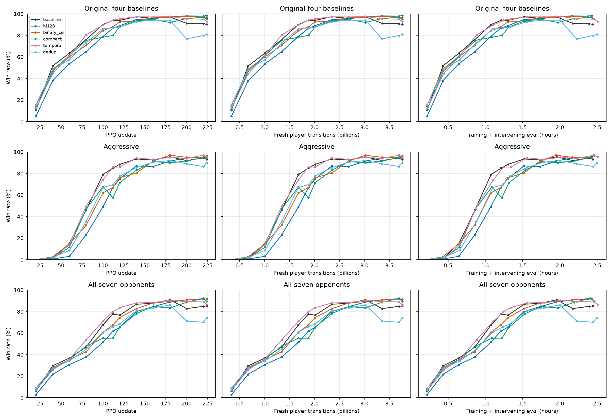
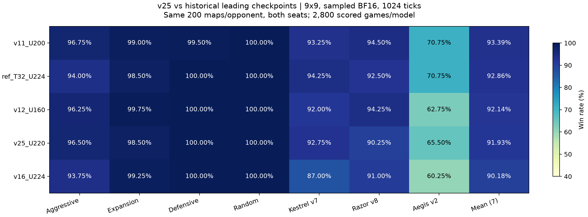

# Sparse critic / feature experiments: live results

Updated 2026-11-10T10:39:59+00:00; stage `completed`.

[Design and comparison](sparse_features_20261109.md). Every formal run is 224 updates, 3.758B fresh player transitions; same seed. Pilot data are excluded.

| Run | Updates | Latest original4 | Latest aggressive | Latest all7 | Steady player/s | Peak allocated/reserved GiB |
|---|---:|---:|---:|---:|---:|---:|
| v24_9x9_sparse_baseline | 224/224 | 90.3% | 93.0% | 85.3% | 441,906 | 21.02/22.37 |
| v25_9x9_sparse_hl128 | 224/224 | 98.5% | 95.5% | 91.6% | 447,148 | 21.02/22.28 |
| v26_9x9_sparse_binary_ce | 224/224 | 96.8% | 94.5% | 91.4% | 444,812 | 21.02/22.37 |
| v27_9x9_sparse_compact | 224/224 | 95.2% | 96.5% | 89.4% | 437,300 | 18.65/19.90 |
| v28_9x9_sparse_temporal | 224/224 | 92.9% | 95.5% | 86.5% | 425,359 | 19.35/20.69 |
| v29_9x9_sparse_dedup | 224/224 | 80.9% | 90.0% | 74.1% | 434,269 | 19.35/20.55 |

Wall time begins at the first rollout (compiler warmup included), and includes intervening evaluations; throughput excludes eval. No smoothing. These are single-seed results. All7 is the unweighted mean of seven equal-size panels, WAIT excluded.

TensorBoard: `outputs/experiments/sparse_features_20261109_actual01/runs/<run>/events.out.tfevents.*`.

## Independent-seed validation

| Checkpoint/horizon | Original4 | Aggressive | Heuristic3 | All7 |
|---|---:|---:|---:|---:|
| v24_9x9_sparse_baseline_best_t1024 | 96.12% | 95.50% | 80.75% | 89.54% |
| v24_9x9_sparse_baseline_best_t2000 | 96.69% | 95.75% | 81.00% | 89.96% |
| v24_9x9_sparse_baseline_final_t1024 | 90.12% | 93.50% | 78.00% | 84.93% |
| v24_9x9_sparse_baseline_final_t2000 | 90.56% | 93.50% | 78.58% | 85.43% |
| v25_9x9_sparse_hl128_best_t1024 | 98.75% | 96.50% | 82.83% | 91.93% |
| v25_9x9_sparse_hl128_best_t2000 | 98.75% | 96.50% | 82.92% | 91.96% |
| v25_9x9_sparse_hl128_final_t1024 | 98.69% | 96.25% | 81.75% | 91.43% |
| v25_9x9_sparse_hl128_final_t2000 | 98.69% | 96.25% | 82.33% | 91.68% |
| v26_9x9_sparse_binary_ce_best_t1024 | 97.00% | 95.50% | 83.08% | 91.04% |
| v26_9x9_sparse_binary_ce_best_t2000 | 98.06% | 95.50% | 84.33% | 92.18% |
| v26_9x9_sparse_binary_ce_final_t1024 | 96.81% | 95.00% | 84.25% | 91.43% |
| v26_9x9_sparse_binary_ce_final_t2000 | 97.69% | 95.00% | 84.92% | 92.21% |
| v27_9x9_sparse_compact_best_t1024 | 95.50% | 95.50% | 83.50% | 90.36% |
| v27_9x9_sparse_compact_best_t2000 | 96.25% | 95.75% | 84.83% | 91.36% |
| v27_9x9_sparse_compact_final_t1024 | 94.62% | 96.25% | 81.67% | 89.07% |
| v27_9x9_sparse_compact_final_t2000 | 95.44% | 96.25% | 82.92% | 90.07% |
| v28_9x9_sparse_temporal_best_t1024 | 98.44% | 96.75% | 83.17% | 91.89% |
| v28_9x9_sparse_temporal_best_t2000 | 98.56% | 96.75% | 84.17% | 92.39% |
| v28_9x9_sparse_temporal_final_t1024 | 92.38% | 94.25% | 76.58% | 85.61% |
| v28_9x9_sparse_temporal_final_t2000 | 92.94% | 94.25% | 77.58% | 86.36% |
| v29_9x9_sparse_dedup_best_t1024 | 93.88% | 92.50% | 75.33% | 85.93% |
| v29_9x9_sparse_dedup_best_t2000 | 94.13% | 92.50% | 75.50% | 86.14% |
| v29_9x9_sparse_dedup_final_t1024 | 81.38% | 90.75% | 65.42% | 74.54% |
| v29_9x9_sparse_dedup_final_t2000 | 82.31% | 91.75% | 66.33% | 75.46% |

<!-- v25_historical_top3:begin -->
## v25 与历史领先模型的统一七对手复评（2026-11-10）

旧候选互战前三为 v11_U200、ref_T32_U224、v12_U160；另纳入上一批四基线前三候选 v16_U224。v25 固定为训练七对手面板选出的 U220，模型选择均在此次比较前完成。

使用同一冻结环境和对手代码、独立 seed 94722775、每对手 200 图双座（400 局）、采样 BF16 eager、CPU 原生环境与 H200 推理。每模型每个时限 2800 场主对局，另 400 场 WAIT 诊断不计均值。v25 复用完全相同口径的既有复评，历史四模型本次补测。

| 模型 | 原四均值 | aggressive | Kestrel v7 | Razor v8 | Aegis v2 | 七对手均值 |
|---|---:|---:|---:|---:|---:|---:|
| v11_U200 | 98.81% | 96.75% | 93.25% | 94.50% | 70.75% | 93.39% |
| ref_T32_U224 | 98.12% | 94.00% | 94.25% | 92.50% | 70.75% | 92.86% |
| v12_U160 | 99.00% | 96.25% | 92.00% | 94.25% | 62.75% | 92.14% |
| v25_U220 | 98.75% | 96.50% | 92.75% | 90.25% | 65.50% | 91.93% |
| v16_U224 | 98.25% | 93.75% | 87.00% | 91.00% | 60.25% | 90.18% |

以上为 1024 tick 主比较。所有 2800 场地图初始状态逐局匹配，策略错误与决策超时为零。

| 模型 | 七对手 1024 tick | 七对手 2000 tick | v25 减该模型：1024 tick 差值及 95% 区间（百分点） |
|---|---:|---:|---:|
| v11_U200 | 93.39% | 93.46% | -1.46 [-2.43, -0.50] |
| ref_T32_U224 | 92.86% | 92.86% | -0.93 [-1.93, +0.07] |
| v12_U160 | 92.14% | 92.14% | -0.21 [-1.18, +0.79] |
| v25_U220 | 91.93% | 91.96% | — |
| v16_U224 | 90.18% | 90.21% | +1.75 [+0.71, +2.75] |

区间以同图两座为块、按对手分层进行 10000 次配对 bootstrap，仅描述固定权重的评估地图不确定性。各训练仅一个 seed；这里比较已选 checkpoint，并非同预算算法因果消融，也不是 RL 模型相互对战。v25/v11/v12/v16 完整训练预算均为 37.58 亿玩家样本，旧 T32 为 9.40 亿；实际参评 checkpoint 轮次不同。

原始协议、权重 SHA256、逐局结果、审计、CSV 与置信区间：`outputs/analysis/v25_historical_top3_20261110_actual01/`。
<!-- v25_historical_top3:end -->
