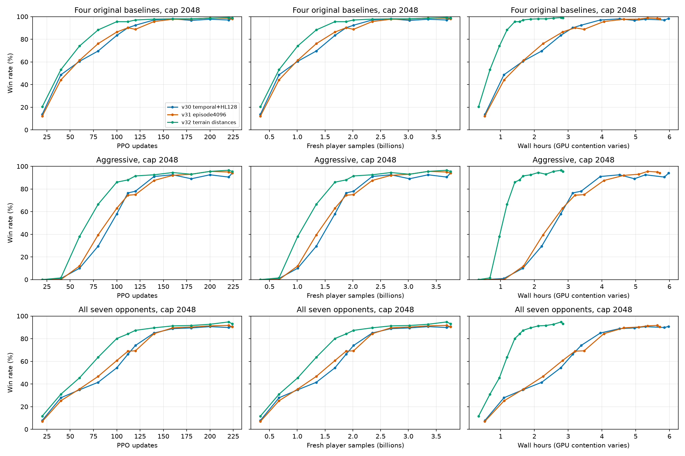
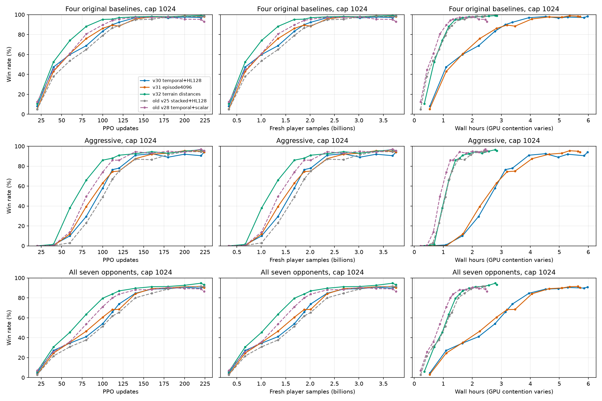

# Temporal + HL128：路径与时限消融

更新：2026-11-11T16:40:59+00:00；队列状态：`completed`。

[实验配置与路径定义](terrain_distance_20261110.md)。三组各224轮、单种子、3.758B新玩家样本。本轮部分时段与其他任务共享8×H200，资源竞争随时间变化，速度差异不能直接归因于算法。

## 最终结论

三组训练和全部独立种子评估于2026-11-11 16:40 UTC完成。每组实际收集3,758,096,384个新玩家样本，执行57,344次optimizer更新；13次训练期间评估均成功，权重与损失有限，allocator retry为0。

以下固定比较U224，使用独立评估seed94722775、每对手200张地图×双座、采样动作，共2800局／模型。七对手为原四基线＋kestrel-v7／razor-v8／aegis-v2；统一2048 tick口径，平局不计胜利。

| U224模型 | 四基线均值 | 七对手均值 | aggressive | Aegis | 七对手胜／平／负 |
|---|---:|---:|---:|---:|---|
| v30：基线，2048 tick | 98.125% | 91.500% | 94.25% | 66.50% | 2562／3／235 |
| v31：4096 tick训练 | 98.000% | 90.107% | 94.00% | 65.00% | 2523／5／272 |
| v32：两个路径通道 | 98.625% | 93.536% | 95.50% | 73.50% | 2619／2／179 |

- **路径特征有收益。** 固定U224的七对手胜率提高2.036个百分点，Aegis提高7个百分点。开发集U100时，七对手胜率为80.14%，基线为54.29%；首次超过90%是U160，基线是U200。这一轮同时观察到更快的学习和更高的最终胜率。
- **单独延长训练时限没有改善。** v31最终七对手胜率比基线低1.393个百分点；即使评估上限放宽到4096，胜率也仅由90.107%变为90.143%。当前失败以败局为主，几乎没有超时平局，不能解释为评估时限不足。
- **未确认路径组发生后期退化。** 开发集U220→U224从94.79%降至93.14%，但独立评估从93.43%变为93.54%。按开发集选择的best仍保留U220，其独立评估aggressive为96.25%、Aegis为74.25%；不根据独立评估重新选择best。
- **路径存储开销符合预期。** 每卡rollout观测buffer由3.647增至4.280 GiB，增加0.6328125 GiB；正式训练峰值allocated由19.348增至19.995 GiB。输入仍为40通道，参数量和token数不变。完整预检中路径组吞吐比基线低约0.41%，但只有两个稳态样本且共享GPU，不能精确归因。正式训练后20轮路径组约426k玩家样本/s，基线约159k；两组GPU竞争程度不同，不能将这个差距解释为路径方案加速。

后续建议以2048 tick＋temporal_paths作为这一组实验的候选基座，保留U220与U224两个模型。以上仍是单个训练种子的结果；独立评估种子扩大了地图／控制器测试覆盖，并不等同于多训练种子复现。

三组best/final导出包均已保存到本地：`outputs/experiments/terrain_distance_20261110_actual01/heldout/<run>/<best或final>/bundle/`，包含权重、模型配置和冻结策略源码；原始训练checkpoint保留在H200。本轮v32名称仅指本次路径消融，与早期v32／v32-opt不同。

## 训练期间评估与性能

下表使用开发集，吞吐取最后20轮；不是上面的独立评估结果。

| Run | PPO轮 | 原时限 | 原时限七对手 | 统一2048四基线 | 统一2048七对手 | 玩家样本/s | 峰值allocated/reserved GiB |
|---|---:|---:|---:|---:|---:|---:|---:|
| v30_9x9_temporal_hl128 | 224/224 | 2048 | 90.86% | 98.25% | 90.86% | 158,564 | 19.35/20.58 |
| v31_9x9_temporal_hl128_4096 | 224/224 | 4096 | 90.43% | 97.88% | 90.43% | 296,438 | 19.35/20.64 |
| v32_9x9_temporal_hl128_paths | 224/224 | 2048 | 93.14% | 98.75% | 93.14% | 426,078 | 20.00/21.38 |

短时限曲线从同一局的终局tick截取：超过时限的胜/负均计平局；不是再次独立采样。模型内部clock仍使用其训练配置。旧v25/v28仅在1024口径图比较；旧训练上限2000，本轮2048/4096，且旧吞吐在独占GPU下测量。

TensorBoard：`outputs/experiments/terrain_distance_20261110_actual01/runs/<run>/events.out.tfevents.*`。

## 独立种子验证

best按开发集统一2048七对手均值选择；final固定U224。各模型使用同一批新地图/控制器种子、每对手400局。v30的best与final是同一个U224模型，两行不构成独立重复实验。各时限由同一次4096 tick评估截取，模型内部clock仍遵循各自训练配置。

| 模型/时限 | U | 四基线 | aggressive | 七对手 |
|---|---:|---:|---:|---:|
| v30_9x9_temporal_hl128/best/t1024 | 224 | 98.00% | 94.25% | 91.43% |
| v30_9x9_temporal_hl128/best/t2048 | 224 | 98.12% | 94.25% | 91.50% |
| v30_9x9_temporal_hl128/best/t4096 | 224 | 98.12% | 94.25% | 91.50% |
| v30_9x9_temporal_hl128/final/t1024 | 224 | 98.00% | 94.25% | 91.43% |
| v30_9x9_temporal_hl128/final/t2048 | 224 | 98.12% | 94.25% | 91.50% |
| v30_9x9_temporal_hl128/final/t4096 | 224 | 98.12% | 94.25% | 91.50% |
| v31_9x9_temporal_hl128_4096/best/t1024 | 220 | 97.44% | 91.00% | 90.25% |
| v31_9x9_temporal_hl128_4096/best/t2048 | 220 | 97.50% | 91.00% | 90.39% |
| v31_9x9_temporal_hl128_4096/best/t4096 | 220 | 97.50% | 91.00% | 90.43% |
| v31_9x9_temporal_hl128_4096/final/t1024 | 224 | 97.94% | 94.00% | 89.93% |
| v31_9x9_temporal_hl128_4096/final/t2048 | 224 | 98.00% | 94.00% | 90.11% |
| v31_9x9_temporal_hl128_4096/final/t4096 | 224 | 98.00% | 94.00% | 90.14% |
| v32_9x9_temporal_hl128_paths/best/t1024 | 220 | 98.56% | 96.25% | 93.18% |
| v32_9x9_temporal_hl128_paths/best/t2048 | 220 | 98.69% | 96.25% | 93.43% |
| v32_9x9_temporal_hl128_paths/best/t4096 | 220 | 98.69% | 96.25% | 93.43% |
| v32_9x9_temporal_hl128_paths/final/t1024 | 224 | 98.50% | 95.50% | 93.25% |
| v32_9x9_temporal_hl128_paths/final/t2048 | 224 | 98.62% | 95.50% | 93.54% |
| v32_9x9_temporal_hl128_paths/final/t4096 | 224 | 98.62% | 95.50% | 93.54% |
